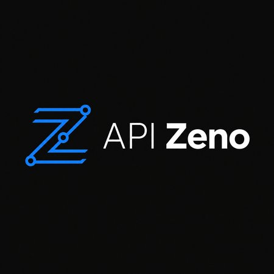
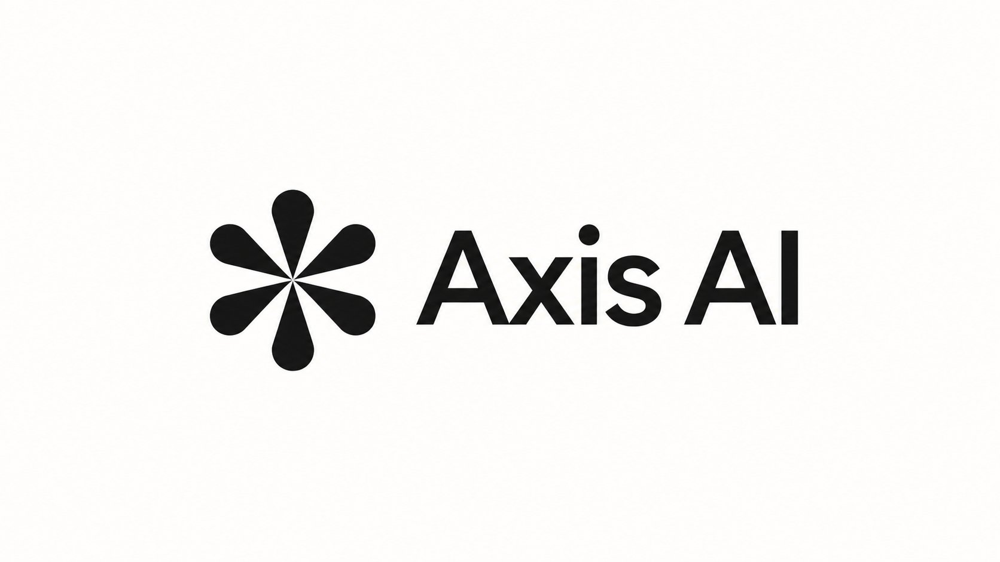
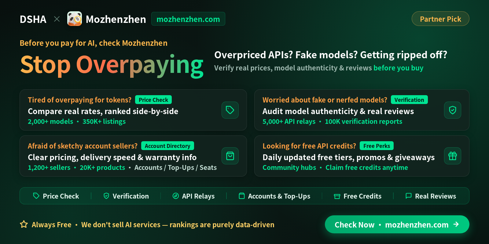

# DSHA

<p align="center">
  <b>Android için DeepSeek Harness başlatıcısı</b><br>
  Tam <a href="https://github.com/deepseek-ai/deepseek-harness">deepseek-harness</a> ortamını telefonunuzda çalıştırın — ROOT yok, Termux yok, kutudan çıktığı gibi çalışır
</p>

<p align="center">
  <a href="LICENSE"></a>
  <a href="https://github.com/DSH-APP/DSHA/releases/latest"></a>
  <a href="https://github.com/DSH-APP/DSHA/stargazers"></a>
  
  
  <a href="https://afdian.com/a/dsha_apk"></a>
</p>

<p align="center">
  <a href="README.md">English</a> · <a href="README-zh.md">简体中文</a> · <b>Türkçe</b> · <a href="https://dsha.cc">dsha.cc</a> · <a href="CHANGELOG.md">Değişiklik Günlüğü</a> · <a href="docs/security-model.md">Güvenlik modeli</a> · <a href="AGENTS.md">AGENTS.md (yapay zekâ / geliştiriciler için)</a>
</p>

> 🤖 Yeni bir yapay zekâ veya geliştiriciyseniz tüm dizin ağacını taramak yerine önce **[AGENTS.md](AGENTS.md)** dosyasını okuyun (proje yapısı, başlangıç sözleşmesi, bilinen tuzaklar).

> 🇹🇷 Bu dosya **[README.md](README.md)** (İngilizce) ve **[README-zh.md](README-zh.md)** (Basitleştirilmiş Çince) belgelerinin Türkçe sürümüdür — ürün tanıtımı, kurulum adımları, cihaz kanalları ve sık sorulan konular.

> Kararlı sürüm **[v0.2.2 · build357](https://github.com/DSH-APP/DSHA/releases/tag/v0.2.2)** (`0.2.2-20261111.0200-dsh0.2.2-rc.1`): build356 ile aynı içerik, resmî varlık düzeniyle (APK + tam kaynak kodu) yayımlandı. Tüm değişiklikler [CHANGELOG.md](CHANGELOG.md) dosyasındadır.

## ❤️ Sponsorlar

Bu projenin bakımının sürmesine destek olan sponsorlarımıza teşekkür ederiz (belirli bir sıra gözetmeksizin).

<table>
<tr>
<td width="56" align="center" valign="top"><a href="https://api-zeno.com"></a></td>
<td>
<strong><a href="https://api-zeno.com">API-Zeno</a></strong>, DSHA ile kullanılabilecek yapay zekâ modelleri sunar.
<details>
<summary>API-Zeno ayrıntıları</summary>
<p>Bu projeye sponsor olduğu için <a href="https://api-zeno.com">API-Zeno</a>'ya teşekkürler! API-Zeno; öğrenme, içerik üretimi, kodlama ve daha fazlası için Çin ve yurt dışından önde gelen yapay zekâ modellerini bir araya getirir. Gerçek dünya deneyimine odaklanan platform kullanım kılavuzları, soru-cevap ve teknik destek sunar ve DSHA'ya entegre edilebilir. Yeni kullanıcılar kayıt olduğunda ¥5 ücretsiz kredi kazanır — hemen deneyin!</p>
</details>
</td>
</tr>
<tr>
<td width="56" align="center" valign="top"><a href="https://zdxjl.com/register?aff=WDYTNDJ5LT4X"></a></td>
<td>
<strong><a href="https://zdxjl.com/register?aff=WDYTNDJ5LT4X">Lvluo Relay</a></strong> kodlama ve görsel üretimini destekler.
<details>
<summary>Lvluo Relay ayrıntıları</summary>
<p>Bu projeye sponsor olduğu için <a href="https://zdxjl.com/register?aff=WDYTNDJ5LT4X">绿萝中转站 (Lvluo Relay)</a> ekibine teşekkürler! Lvluo Relay, birçok sağlayıcıdan modelleri kapsayan bir yapay zekâ platformudur: önde gelen büyük modeller isteğe bağlı olarak kullanıma hazırdır; kodlama, görsel üretimi ve daha fazlası tek bir platformdan çağrılabilir. Çin ve yurt dışı modeller mevcuttur, yeni sürümler hızla eklenir, hizmet özenlidir ve fiyatlandırma caziptir. Bu bağlantı üzerinden kayıt olmak %105 bakiye bonusu kazandırır.</p>
</details>
</td>
</tr>
<tr>
<td width="56" align="center" valign="top"><a href="https://ai.onyxaxis.org/"></a></td>
<td>
<strong><a href="https://ai.onyxaxis.org/">Axis AI</a></strong> ücretsiz, kamu yararına çalışan bir yapay zekâ platformudur.
<details>
<summary>Axis AI ayrıntıları</summary>
<p>Bu projeye sponsor olduğu için <a href="https://ai.onyxaxis.org/">Axis AI</a>'ya teşekkürler! Axis AI, birden fazla ana akım modelin kullanıma hazır olduğu ücretsiz ve kamu yararına çalışan bir yapay zekâ platformudur. Tek bir birleşik platformdan sohbet edin, kod yazın ve görsel üretin.</p>
</details>
</td>
</tr>
<tr>
<td width="56" align="center" valign="top"><a href="https://mozhenzhen.com/go/dsha"></a></td>
<td>
<strong><a href="https://mozhenzhen.com/go/dsha">Mozhenzhen</a></strong> (İş Ortağı Önerisi): ücretsiz yapay zekâ fiyat karşılaştırması ve model özgünlük doğrulaması.
<details>
<summary>Mozhenzhen ayrıntıları</summary>
<p>🐼 <strong>Partner Pick · 合作推荐：买 AI 前先查【模真真 Mozhenzhen】/ Yapay zekâya fazla ödemeyin — fiyatları karşılaştırın ve modelleri ücretsiz doğrulayın</strong><br>
350 binden fazla listede 2.000+ modeli karşılaştırın ve 100 binden fazla doğrulama raporuyla 5.000+ aktarıcıyı denetleyin. Her zaman ücretsiz ve veri odaklı, hiçbir yapay zekâ hizmeti satmaz 👉 <a href="https://mozhenzhen.com/go/dsha">mozhenzhen.com</a></p>
<a href="https://mozhenzhen.com/go/dsha"></a>
</details>
</td>
</tr>
</table>

Bu proje işinize yaradıysa geliştiriciyi [Afdian](https://afdian.com/a/dsha_apk) üzerinden de destekleyebilirsiniz.

## Mevcut durum

| Öğe | Değer |
|---|---|
| Uygulama adı | **DSHA** (test sürümü: `DSHA Test`) |
| Sürüm | `0.2.2-20261111.0200-dsh0.2.2-rc.1` |
| versionCode | 357 |
| Paket | `dsh.android.client` (test sürümü `dsh.android.client.SunsetRNE`) |
| İmzalama | Tarihsel sürüm sertifikası, SHA-256 `e7e3a31a75946f2669194c972b3dd0c9aea3fc7c50a8b885d2dee710b22a53f5` |
| Sistem | Android 11+ (API 30) / arm64-v8a; **Android 10 ve altı artık desteklenmiyor** |
| Dahili ortam | Ubuntu 24.04 arm64 · Node.js 24 · pnpm 10.34.5 · DSH 0.2.2-rc.1 · mobil arayüz 3.3.5 |
| Çalışma zamanı | Varsayılan olarak proot, isteğe bağlı proroot (cihaza bağlı) |
| Arayüz dilleri | 10: zh / zh-Hant / en / ru / ja / ko / ar / pt / la / fr |
| Ana dal | `main` |
| Lisans | MIT (orijinalden devralınmıştır) |

## Bu nedir?

DeepSeek Harness (`@deepseek-ai/dsh`), DeepSeek'in glibc Linux için yazılmış resmî ajan çatısıdır. Doğrudan Android üzerinde çalıştırmak bir dizi engele takılır: yerel modüller derlenmez, `link(2)` SELinux tarafından engellenir, sandbox başlamaz ve ön yüz masaüstü için düzenlenmiştir.

**DSHA tüm bunları tek bir APK içinde paketler.** İlk açılışta dahili çevrimdışı ortamı çıkarıp doğrular, ardından web sunucusu arka planda başlarken ana ekranı açar; sağlayıcıları, modelleri ve API anahtarlarını yapılandırmak için Web Arayüzünü açmanız yeterlidir. Termux yok, ROOT yok, tek bir kabuk komutu bile yok. İçinde eksiksiz bir Ubuntu ortamı vardır: `apt` çalışır, etkileşimli PTY çalışır, derleme gerektiren yerel modüller kurulabilir — bir sunucuda kullanacağınız kurulumun aynısı.

Bu depo DSHA'nın ana deposudur (resmî sürüm hattı): [@qiannianhuanxiang](https://github.com/qiannianhuanxiang)'ın orijinal DSHA projesinden türemiştir ve terminal, cihaz yetenekleri ile mobil arayüz üzerindeki topluluk çalışmalarını birleştirir. Sürümler tarihsel E7E3 sertifikalı resmî `dsh.android.client` kimliğini kullanır; eski Mod paketi `io.github.sunsetrne.dsha` bir arada bulunabilen tarihsel kimlik olarak kalır. Orijinal geliştiriciye ve katkıda bulunan herkese teşekkürler.

## Kimlikler ve bir arada bulunma

| Kimlik | Paket | Notlar |
|---|---|---|
| Kararlı (varsayılan) | `dsh.android.client` | Mevcut sürüm; E7E3 sertifikası, tarihsel kararlı derlemeler için yerinde yükseltme |
| Test sürümü | `dsh.android.client.SunsetRNE` | Kararlı uygulamayla yan yana çalışır, ayrı veri ve izinlere sahiptir |
| Eski Mod | `io.github.sunsetrne.dsha` | Tarihsel Mod kimliği (A4B0 sertifikası), yalnızca eski paketler ve birlikte var olma kontrolleri için |
| Daha eski | `com.dsh.client` | Önceki paket adı; eski veriler dışa aktar/geri yükle ile taşınabilir |

Aynı telefonda birden fazla kimlik bir arada bulunabilir ancak **veriler, sistem izinleri ve erişilebilirlik anahtarları devralınmaz**. Taşıma işlemi uygulama içi "Data & backup" dışa aktarma → içe aktarma üzerinden yapılır. İki web sunucusunu aynı anda çalıştırmak yine de port çakışmasına yol açabilir.

## İndirme ve kurulum

Mevcut kararlı sürüm **[v0.2.2 · build357](https://github.com/DSH-APP/DSHA/releases/tag/v0.2.2)**, Standart derleme, Android 11+ / arm64, APK yaklaşık **302 MiB** (dahili Ubuntu ortamı nedeniyle).

[APK İndir](https://github.com/DSH-APP/DSHA/releases/latest) · SHA-256 ve tam kaynak arşivi ilgili sürüm varlıklarındadır · [indirme doğrulaması](docs/download-verification.md)

Varlıklar: `dsha-0.2.2.apk`, `dsha-0.2.2.apk.sha256`, `DSHA-0.2.2-20261111.0200-source.zip` ve `.sha256` dosyası; sürüm notları ve derleme kayıtları [v0.2.2 sürümünde](https://github.com/DSH-APP/DSHA/releases/tag/v0.2.2) yer alır.

### Başlarken

1. İmzalama kimliğinize uygun APK'yı kurun; ilk açılış çevrimdışı ortamı çıkarır ve doğrular (süre cihazın G/Ç hızına bağlıdır).
2. Ortam hazır olduğunda ana ekran açılır ve web sunucusu arka planda başlar; ana ekran ilerlemeyi ve sonuçları gösterir.
3. Web Arayüzünü açın ve web ayarlarından sağlayıcı, model ve API anahtarını yapılandırın.

### Taşıma (Migration)

- **Kararlı uygulamayı yükseltme**: Aynı paket, aynı imza — doğrudan üzerine kurun. Yükseltmeden önce DSH'yi normal şekilde durdurun; veriler korunur.
- **Eski Mod paketinden**: Eski uygulamada "Data & backup" üzerinden dışa aktarın, ardından kararlı uygulamada içe aktarın; cihaz izinleri ve erişilebilirlik yeniden etkinleştirilmelidir.
- **Daha eski `com.dsh.client` sürümünden**: Benzer şekilde dışa/içe aktarın; izinler paket adları arasında asla devralınmaz.

## Neden DSHA?

| | Ayrıntılar |
|---|---|
| 🚫 **Sıfır komut satırı** | Dahili çevrimdışı Ubuntu rootfs: APK'yı kurun ve kullanın. Termux yok, `pkg` yok, komut yok |
| 🐧 **Tam glibc ortamı** | Kırpılmış bir derleme değil: `apt` / PTY / yerel modüller / Python / git hepsi mevcut. Yukarı akış eklentileri değişiklik gerektirmeden çalışır |
| ⚙️ **İki çalışma zamanı** | Varsayılan olarak proot, isteğe bağlı proroot; gerçek dünya hızı cihaza, G/Ç'ye, önbelleğe ve eklentilere bağlıdır — geçmiş örneklerden motor sıralaması yapmıyoruz |
| 🔌 **Telefon ajanın elleridir** | Erişilebilirlik + Shizuku gerektirmeyen ADB + bağımsız sanal ekran: ekranı okuma, dokunma, uygulama kurma, otomasyon çalıştırma — hepsi yerleşik |
| 💾 **Önce dışa aktar, sonra taşı** | "Data & backup" parolasız bir `.tar.gz` dışa aktarır; depolama kılavuzu verilerin nerede yaşadığını gösterir ve yerel kopyaların kaldırma işleminden sağ çıkacağı garanti edilmez |
| 🩺 **Neyin bozulduğunu söyleyebilir** | Bileşen bazlı öz denetim, hedefli onarım, başlangıç tanılaması ve bağımsız kurtarma DSH'si; web arayüzü başlamadığında sorunlu eklentiyi adıyla belirtir |

## Temel modüller

### ① Kurulum ve ortam

| Yetenek | Ayrıntılar |
|---|---|
| Dahili çevrimdışı rootfs | APK içinde Ubuntu 24.04 (noble) arm64 bulunur; kurulum ağ olmadan tamamlanır |
| Altı adımlı kurulum hattı | Çıkarma → temel araçlar → Node.js → pnpm → dsh → yamalar; her adım önce yoklar, çalıştırır, sonra doğrular. Yalnızca başarısız adımlar yeniden denenir |
| Adım adım yeniden kurulum / güncelleme | Rootfs, araçlar, Node ve harness bağımsızdır; yeniden indirme olmadan ayrı ayrı yeniden kurulabilir |
| İki kurulum yolu | Önceden derlenmiş paket ve kaynak derleme birlikte desteklenir; kaynak yolu `node-pty` gibi yerel modülleri derler |
| Çevrimdışı araç zinciri | `packages.lock.json` ile sabitlenmiş curl / git / Python / sertifikalar; önce `apt` çalıştırmaya gerek yoktur |
| Yansılar ve ağ | `apt`, resmî ve USTC yansıları arasında yedekleme yapar; üç DNS kipi (auto / force IPv4 / native) bulunur ve reddedilen AAAA kayıtlarında yalnızca çözümleme yeniden denenir, HTTP isteği değil |
| Sürümlü temel ortam | Ubuntu tabanının kendi sürümü vardır; arayüz güncellemeleri ortamı yeniden kurmaz ve sıradan dsh güncellemeleri taban sürümünü artırmaz |
| Tekrarlanabilir girdiler | Çevrimdışı rootfs, DSH çalışma zamanı ve Ubuntu araçları `ci/sunset-inputs.lock.json` içinde SHA-256 ile sabitlenmiş herkese açık sürüm varlıkları olarak sunulur; bir klon bunları geri yükleyip derleyebilir |

### ② Çalışma zamanı

| Yetenek | Ayrıntılar |
|---|---|
| proroot / proot | Varsayılan olarak kararlı proot; "Configuration" altında proroot seçilebilir, uyumluluk cihaza göre değişir |
| Performans kanıtları | Yalnızca aynı cihaz örnekleri; cihaz, önbellek ve eklenti durumu belirleyicidir — bkz. [performans notları](docs/performance-startup-20261022.md). Genel bir motor sıralaması değildir |
| Sınırlı geri dönüş | proroot eklenti hatası olmadan kimlik doğrulamadan önce çıkarsa, konuk sürecin kapandığı doğrulandıktan sonra proot tam olarak bir kez yeniden denenir; yavaş başlangıçlar bunu asla tetiklemez |
| Node.js 24 + pnpm 10.34.5 | Yukarı akışla aynı çalışma zamanı, paketle sabitlenmiştir |
| Parçalı güncellemeler | Ubuntu ve dsh çalışma zamanı ayrı APK varlıklarıdır; sıfırdan kurulum ikisini de çıkarır, kısmi güncellemeler yalnızca dsh paketini okur |
| Yönetilen güncellemeler için deneme çalıştırması | Yeni bir ortam kesinleştirilmeden önce yalıtılmış olarak gerçekten başlatılır (portlar, kimlik doğrulama, oturum okuma/yazma, eklenti yükleme); başarısızlık durumunda geri alınır |
| Ön plan servisi + bekçi (watchdog) | Çalışma durumu bildirim alanında görünür; web süreci çökerse otomatik olarak yeniden başlatılır |
| Yavaş başlangıç koruması | Kimlik doğrulama beklemesinde sert bir sonlandırma süresi yoktur (60 sn yalnızca bir ipucudur); bekçi yavaş bir başlangıcı çökme sanmaz |

### ③ Veri ve yedekleme

| Yetenek | Ayrıntılar |
|---|---|
| Veri konumu ve taşıma | "Data & backup → storage guide" gerçek yolları gösterir; yükseltmeler verileri korur, kaldırmadan önce ihtiyacınız olan her şeyi dışa aktarın |
| v5 yedekleme ve dışa aktarma | Kullanıcı dışa aktarımları **parolasız** `.tar.gz` bütünlük arşivleridir; dahili otomatik kopyalar şifreli kalır ve eski şifreli orijinaller yine parolalarını gerektirir |
| Otomatik yedekleme zamanlaması | Varsayılan olarak açık: her gün belirli saatte / her 1–168 saatte bir / DSH durduktan sonra; çalışırken ertelenir, işi asla bölmez; son 3 doğrulanmış kopya saklanır |
| Kapsamlı yedekler | Tam / yalnızca sohbetler / yalnızca eklentiler / yalnızca ayarlar; geri yükleme yalnızca eşleşen kapsama dokunur |
| Yeni telefona geçiş | Gerçek sohbetleri, ekleri, ayarları ve kullanıcı eklentilerini dışa aktarır; geri yükleme ön kontrolünden önce özet ve kapsamı doğrular, mevcut içeriği ve çakışan orijinalleri korur |
| Kimlik bilgileri hariç | Köprü belirteç dosyası tamamen hariç tutulur; `.credentials.yaml` içindeki makine anahtarları alan alan temizlenirken kullanıcı API anahtarları korunur |
| Eski yedekler | Ön kontrolden önce tam kimlik doğrulama/özet doğrulaması; sistem eklentileri mevcut APK'dan yeniden oluşturulur, kullanıcı orijinalleri korunur |
| Bozuk oturum yalıtımı | Bozuk oturum dosyaları `corrupt-backup` klasörüne taşınır ve kurtarılabilir; tek bir bozuk dosya tüm web arayüzünü kilitlemez |
| Yükseltme sonrası temizlik | Yeniden üretilebilir önbellekler ve fazladan eski kopyalar boştayken temizlenir; en az iki sağlıklı önceki kopya tutulur ve değiştirilmiş orijinaller asla silinmez |
| Harici çalışma alanı koruması | Tam biçimlendirme kaldırılmıştır; bakım yalnızca referansı ayırır ve dosyalar ile yedeklerini korur |

### ④ Cihaz yetenekleri (ajanın telefonu gerçekten yönetmesi)

Ajan bunları yerel `127.0.0.1:3090` köprüsü üzerinden çağırır (belirteç korumalı; `/app/help` tüm uç noktaları listeler):

| Yetenek | Ayrıntılar |
|---|---|
| Ekran kontrolü | **Erişilebilirlik servisi, ADB gerekmez**: dokunulabilir sınırları içeren yapılandırılmış dökümler, metne veya koordinata dokunma, metin girişi, tuşlar, kaydırma, PNG ekran görüntüsü |
| Bağımsız sanal ekran (deneysel) | Standard / Android 11+; önce ADB, Shizuku veya Root yetkisi verin, ardından sanal ekran sayfasından ekranı oluşturun. Tek başına erişilebilirlik bunu oluşturmaz — bkz. [mimari](docs/virtual-screen-architecture.md) |
| Ayrıcalıklı fiziksel ekran (deneysel) | Faz A: yönetilen `app_process` girişi üzerinden fiziksel ana ekranı yönetin; varsayılan olarak kapalı, iptal edilebilir, yalnızca geçerli telefon görevi süresince geçerlidir. "Device permissions → privileged execution" altından etkinleştirin; bkz. [çekirdek notları](docs/privileged-screen-core.md) |
| Wi-Fi üzerinden ADB | Dahili kablosuz eşleştirme (TLS 1.3-PSK + SPAKE2) ve canlı tutma (keepalive), **Shizuku gerekmez**; yeniden başlatma sonrası tekrar bağlanır |
| Shizuku / Root | ADB ile aynı komut izin listesi altında alternatif cihaz komut kanalları |
| Root komutu üç durumlu politikası | Sıkı (varsayılan izin listesi), esnek (geri döndürülemez işlemleri engeller), tam esnek; yalnızca Root kanalı için geçerlidir — Shizuku ve ADB sıkı kalır |
| Uygulamalar arası dosyalar (SAF) | Kullanıcı klasörleri sistem belge seçicisiyle tek tek yetkilendirir; yazma ve silme onay gerektirir, yalnızca yazma ağaçları doğrudan reddedilir |
| Kullanıcı etkileşimi | Sistem bildirimleri, uygulama içi bildirimler, titreşim (uzun görevlerde kullanıcıyı uyarmak için), üç seçenekli iletişim kutuları, paylaşım / bağlantı açma |
| Dosya alışverişi | Dizinleri ve metin dosyalarını okuma, çıktıları `Download/DSHA` klasörüne aktarma; kimlik bilgisi alanları (`.dsh` / `.ssh` / `.android`) hem okuma hem yazma için reddedilir |
| Sensörler ve konum | Işık / ivmeölçer / jiroskop / manyetometre / barometre / adımsayar / konum / el feneri — varsayılan olarak kapalı, öğe bazında yetkilendirilir |
| Pano | Okuma ve yazma (sistem ön plan sınırlarına tabidir) |
| Tehlikeli komut bekçisi | Cihaz komutları her zaman izin listesi ayrıştırmasından geçer: biçimlendirme / bölümleme / SELinux / sistem özelliği yazmaları reddedilir, bilinmeyen komutlar çalıştırılmaz, engellenen çağrılar "yine de izin ver" düğmesi olmadan `[POLICY_BLOCKED]` döndürür |
| SMS okuma | Bağımsız hassas yetenek, sıkı salt-okunur sorgular, varsayılan olarak çağrı başına onay, iptal edilebilir ve yedeklerden geri yüklenmez |

### ⑤ Terminal

| Yetenek | Ayrıntılar |
|---|---|
| Gerçek PTY | Termux terminal-emulator JNI: vim / htop / tmux ve diğer tam ekran TUI uygulamaları çalışır |
| Telefon klavyesi desteği | Ek tuş satırı (Ctrl / Alt / Esc / oklar / Tab), yazı tipi boyutunu değiştirmek için parmakla yakınlaştırma |
| Çoklu sekme | Aynı anda birden fazla oturum; süreçler ve durum sayfa geçişleri, ekran döndürme ve dil değişikliklerinde korunur |
| Oturum kenar çubuğu | Üç durumlu ve yatay sıkıştırılmış yerleşimler; oturum değiştirmek çıktıyı kaybetmez |
| Çıktı paneli | Önizleme / kopyalama / paylaşma / kaydetme özellikli "More…" paneli; uzun çıktılar ekranı boğmaz |
| Basit terminal yedeği | PTY'nin sorun çıkardığı cihazlarda oturumları arka planda koruyan basit terminale geçilir |

### ⑥ Web Arayüzü ve erişim

| Yetenek | Ayrıntılar |
|---|---|
| Tek Standart hat | Sistem WebView motoru; `low` uyumluluk hattı ve GeckoView kaldırılmıştır |
| Mobil uyarlama | Telefon kısayolları ve dar ekran düzeniyle dahili [dsh-web-mobile](https://github.com/mexiaosqwq/dsh-web-mobile) **3.3.5** (MIT) |
| Resim içinde resim (PiP) | Varsayılan olarak kapalı, kullanıcı tarafından açılır; normal geri gezinme ve arka plandan dönüş aynı web örneğini korur |
| Yenileme hızı ve güç | Kullanıcının üst sınırına kadar ister ve boştayken kontrolü sisteme geri verir; gerçek kare hızı cihaza ve işletim sistemine bağlıdır |
| Tema ve diller | Koyu / açık / sistemi izle; 10 arayüz dili, varsayılan olarak sistem dilini izler |
| LAN erişimi | Telefonun dsh örneğini bilgisayar veya tablet tarayıcısından kullanın. Belirteç doğrulaması hata durumunda kapalıdır (fail-closed), ardından belirtecin bağlantılar üzerinden sızmaması için `SameSite=Strict` çerezi ayarlanır |
| Eski tarayıcı uyumluluğu | `AbortSignal.any/timeout` ve `crypto.randomUUID` polyfill'lerini enjekte eder (LAN HTTP üzerinden gereklidir) |
| Akan katman (Streaming overlay) | Yapay zekâ çıktısı şarkı sözü gibi ekranın üstüne sabitlenir, araç çağrıları sade dile çevrilir; renkler, opaklık ve satır sayısı ayarlanabilir; tehlikeli komutlar oradan onaylanabilir |
| Canlı etkinlikler | Ada üzerinde görev durumu (canlı etkinlikler / Dynamic Island) artı bildirimlerde çoklu seçim ve özel yanıtlar yerleşiktir |
| Yapılandırılabilir port | Çakışma durumunda otomatik yedekleme ve net mesajla özel web portu |

### ⑦ Eklenti ekosistemi

| Yetenek | Ayrıntılar |
|---|---|
| Eklenti yönetimi | Kur / güncelle / etkinleştir / devre dışı bırak / sil / ara / sırala — hepsi uygulama içinde; [dsha.cc](https://dsha.cc) eklenti dizini ve topluluk eklentileriyle bütünleşik |
| Çoklu kurulum kaynakları | GitHub kısaltması / tree / blob / archive / release bağlantıları, HTTPS tarball URL'leri, yerel içe aktarma (biçim içerikten algılanır), terminalde `dsha-plugin install` |
| Çoklu indirme kaynakları | Otomatik kaynak seçimi, resmî npm ve npmmirror, eşzamanlı güncelleme kontrolleri, sabitlenmiş sürümler önbelleği yeniden kullanır, sınırlı geri dönüş |
| Bağımlılıklar ve işlemler | Dahili pnpm 10.34.5; kilitsiz bağımlılık çözümlemesi, yaşam döngüsü betikleri ve pnpmfile'lar desteklenir; gerçek kilit ve dizin özetleri kaydedilir, arşiv dizin aşımı reddedilir ve geri alma için orijinaller saklanır |
| Kurulum sonrası otomatik etkinleştirme | Paket biçimi, yol, bağımlılık ve özet kontrollerinden sonra kesinleştirilir ve etkinleştirilir; kullanıcının devre dışı bırakma ve güvenli kip tercihi korunur — bkz. [eklentiler](docs/plugins.md) |
| Sabit bağımlılık yeniden yazımı | Bir eklenti tarafından sabit kodlanan servis bağımlılıkları çalışma zamanında enjekte edilir; böylece tek bir eklenti tüm eklenti ağacını sürüklemez |
| Dahili eklenti koruması | Dahili eklentiler silinemez; kullanıcı tarafından kapatılanlar yükseltme sonrası kapalı kalır; yapılandırma içe/dışa aktarılabilir |

Başlıca dahili eklentiler: `dsh-web-mobile` (mobil uyarlama), `dsh-status-overlay` (üst katman çubuğu),
`dsh-task-notifier` (tur tamamlanma bildirimleri), `dsh-device-shell-guide` (cihaz yetenek kılavuzu),
`dsh-computer-use-android` (Android Computer Use), `dsh-tool-vscreen` (sanal ekran aracı),
`dsh-launch-target` (başlatma hedefi), `dsh-fs-read-hint` / `dsh-fs-search-scope` (okuma ipuçları ve arama kapsamı),
`dsh-auto-review` (resmî deneysel otomatik inceleme girişi).

### ⑧ Güvenilirlik ve kurtarma

| Yetenek | Ayrıntılar |
|---|---|
| Kurulum ve onarım sayfası | Altı bileşenin tamamını kontrol eder ve yalnızca başarısız olanları onarır (sertifikalar / npm, DNS, oturum yazma yamaları, …) |
| Tanılama | Ortam kontrolü ve hata günlükleri dışa aktarılabilir; başlangıç tanılaması aşama, gerçek eklenti hataları ve çıkış kodlarını tutar, son beş çalıştırma sansürlenerek saklanır |
| Başlangıç kurtarma | Belirgin başlangıç / eklenti hataları kurtarma sayfasını açar; güvenli başlatma yalnızca resmî temel bileşenlerle yalıtılmış bir profil kullanır, yapılandırmayı ve eklenti anahtarlarını korur |
| Yapılandırma anlık görüntüleri | Her değişiklikten önce bir anlık görüntü alınır (üç sağlıklı + üç onarım öncesi), böylece bozuk bir yapılandırma geri alınabilir |
| Sade dille eklenti tanılaması | Web arayüzü başlamadığında Node yığın izi dökmek yerine "sorun X eklentisinde, ihtiyaç duyduğu servis eksik, düzeltmek için buraya dokunun" der |
| Bağımsız kurtarma DSH'si | Ana ortam hasar görürse ayrı bir kurtarma ortamına girin: bağımsız kök, önce salt-okunur tanılama, yazma işlemleri adım adım yerel onay gerektirir |
| Betik sıcak güncellemeleri | Temel betikler yeni bir APK beklemeden **çevrimdışı imza doğrulamasıyla** GitHub'dan artımlı olarak güncellenebilir (açık anahtar yerleşiktir; hatalı imza tüm paketi reddeder) |

### ⑨ Güvenlik (varsayılan olarak en az ayrıcalık)

| Alan | Yaklaşım |
|---|---|
| Hiç izin olmadan çalışır | En düşük yapılandırmayla (ADB yok, dosya izni yok, LAN yok) DSHA yine de dsh'yi çalıştırır; her yetenek varsayılan olarak kapalı ve iptal edilebilir |
| API anahtarları | Android Keystore + AES/GCM, anahtar Keystore'dan asla çıkmaz; bir hata eski şifreli metni sessizce silmez |
| Cihaz komutları | İzin listesi her zaman açıktır; Root / Shizuku / ADB aynı politikayı paylaşır ve Root sıkı / esnek / tam katmanlarını eklerken SMS kapısı üçünde de kalır |
| Köprü kimlik bilgisi koruması | `/app/export` ve `/app/readfile` normalleştirme ve kanonik yol kontrolleriyle kimlik bilgisi alanlarını reddeder; bilinen özyinelemeli okuma boşluğu belgelenmiştir ve tam yalıtım iddia edilmez |
| Telemetri yok | Hiçbir günlük veya kullanım verisi yüklenmez; güncellemeler, eklenti indirmeleri ve model çağrıları dışında ağ isteği yapılmaz |
| Açık bilgilendirme | Bilinen zayıflıklar (çekirdek düzeyinde sandbox olmaması, eski düz metin yedekler, imza anahtarı rotasyonu beklentisi, …) belgelerde listelenmiştir |

👉 Her iznin tam olarak neyi açtığı ve ajanın telefonun hangi bölümlerine ulaşabildiği için **[güvenlik modeline](docs/security-model.md)** bakın.

## Karşılaştırma

Android'de dsh çalıştırmanın iki yolu vardır; her birinin kendi maliyeti vardır ve bunları açıkça ortaya koymak etiket yarıştırmaktan iyidir:

| | **Kapsayıcı yaklaşımı** (DSHA) | **Termux önyükleme yaklaşımı** |
|---|---|---|
| Yöntem | proot/proroot + tam glibc rootfs | Android bionic üzerinde doğrudan çalışan Termux paketleri |
| Kurulum | Bir APK kurun ve bitti | Termux kur → komutlar çalıştır → araç zinciri kur |
| Ortam | Tam Ubuntu, `apt` ve yerel modüller doğrudan çalışır | bionic için paket bazında yamalama / yeniden derleme |
| Ek yük | Sistem çağrısı ve dosya G/Ç çeviri maliyeti; gerçek süreler cihaza ve iş yüküne bağlıdır | Kapsayıcı katmanı yok, teorik olarak en hızlı |
| Sandbox | İkisi de sınırlıdır | İkisi de sınırlıdır |

## Bilinen sınırlamalar

| Öğe | Durum | Notlar |
|---|---|---|
| Mimari | ⚠️ Yalnızca arm64-v8a | 32 bit ve x86 cihazlar desteklenmez |
| Sistem | ⚠️ Android 11+ (API 30) | Android 10 ve altı desteklenmez; ROM izin, arka plan ve güç politikaları büyük ölçüde değişir |
| Paket boyutu | ⚠️ Bu sürüm için ~302 MiB | Tam bir Ubuntu ortamını dahil etmenin bedeli; karşılığında sıfır indirme ve sıfır komut satırı |
| bash aracı | ✅ Kullanılabilir | Tam Ubuntu bash; ajan kabuk komutlarını kısıtlama olmadan çalıştırabilir |
| bash **sandbox** | ⚠️ Kullanılamaz | bubblewrap, Android sepolicy'nin engellediği ayrıcalıksız kullanıcı ad alanları gerektirir — iki yaklaşım da bunu aşamaz. dsh izin katmanlarıyla kısıtlayın: `danger-full-access` varsayılandır; yapılandırma sayfasından `workspace-write` veya `read-only` seçin. Riski kendiniz değerlendirin |
| Üst katman çubuğu | ⚠️ İzin gerektirir | `TYPE_APPLICATION_OVERLAY` ile çizilir; ROOT olmadan gerçek durum çubuğu şarkı sözü API'si yoktur |
| Veri konumu | ⚠️ Dosya izni gerektirir | "Tüm dosyalara erişim" reddedilirse veriler özel dizinde kalır ve uygulama kaldırıldığında silinir (öz denetim hangi kipte olduğunuzu belirtir) |
| Sanal ekran / ayrıcalıklı yürütme | ⚠️ İzin gerektirir | İşletim sistemi sürümüne ve yerel izin durumuna bağlıdır; iddialar gerçek cihaz kanıtlarına dayanır, tüm cihazlar için garanti verilmez |
| Masaüstü bağlantısı | ⚠️ Kaldırıldı | Uzak çalışma alanı yeteneği kaldırıldı; telefon kontrolü ve yerel / LAN erişimi devam ediyor |
| Bazı üretici yerel bağımlılıkları | ⚠️ Garanti edilmez | Bazı üretici yerel bağımlılıklarının kaynak koddan tekrarlanabilir olduğu garanti edilmez; ilk çevrimdışı ortam çıkarma biraz zaman alır |
| ZhuoYiTong / HarmonyOS anco | ❓ Doğrulanmadı | Teorik olarak çalışabilir, henüz cihaz regresyon testi yapılmadı |

## Mimari

```
┌──────────────────────── APK ────────────────────────┐
│ Yerel Android (Java 17 · Material3 · tek :app)       │
│  ├ başlangıç / kurulum & onarım / ayarlar / alan     │
│  ├ web motoru: sistem WebView (tek Standart hat)     │
│  ├ ön plan servisi + bekçi + bildirimler + PiP       │
│  ├ Uygulama köprüsü :3090 (erişilebilirlik/vscreen/UI/SAF) │
│  ├ LAN vekili :3081 · ADB / Shizuku / Root kanalları │
│  └ üst katman çubuğu (TYPE_APPLICATION_OVERLAY)      │
├──────────────────────────────────────────────────────┤
│ proot (varsayılan) / proroot (isteğe bağlı, kontrollü)│
├──────────────────────────────────────────────────────┤
│ Ubuntu 24.04 arm64 · Node.js 24 · pnpm 10.34.5       │
│  └ @deepseek-ai/dsh 0.2.2-rc.1 → Web UI :auto        │
└──────────────────────────────────────────────────────┘
```

Veriler: Gerçek konum "Data & backup → storage guide" altında gösterilir; eski `Documents/dshdata` hâlâ okunur.
API anahtarları Android Keystore ile korunur; yerel anahtarların ve otomatik kopyaların kaldırma işleminden sağ çıkacağı garanti edilmez. Portlar ve kimlik doğrulama [portlar ve ağ](docs/ports-and-networking.md) belgesinde açıklanmıştır.

## Cihaz kanalları: ADB / Shizuku / Root

Cihaz komutları için ajan **Root → Shizuku → ADB** sırasıyla tek bir kullanılabilir kanal seçer (Android 17+ ve doğrulanmış bir ADB bağlantısında ADB, Shizuku'dan önce gelir). Seçildikten sonra bir hata asla başka bir kanalda tekrarlanmaz. Üçü de aynı komut izin listesini paylaşırken Android sistem izinleri ve DSHA izinleri ayrı ayrı kontrol edilir. Tüm ayrıntılar [docs/device-channels.md](docs/device-channels.md) belgesindedir.

### ADB Wi-Fi eşleştirme (önerilen, Shizuku gerekmez)

Eşleştirildikten sonra ajan telefonu **Shizuku ve ROOT olmadan** doğrudan yönetebilir.

1. Ayarlar → "Telefon hakkında" → Geliştirici seçeneklerini açmak için "Derleme numarası"na 7 kez dokunun
2. Geliştirici seçenekleri → "Kablosuz hata ayıklama"yı etkinleştirin
3. "Kablosuz hata ayıklama" → "Cihazı eşleştirme koduyla eşleştir" menüsüne girin, **IP:port** ve **6 haneli kodu** not alın
4. DSHA'ya dönün → "Device permissions" → bilgileri girin → eşleştirin

> Eşleştirme kodu Android 11+ gerektirir. Android 17'den itibaren doğrulanmış bir ADB bağlantısı Shizuku'ya tercih edilir.

Kablosuz hata ayıklama henüz açık değilse "verify existing connection" dahili çevrimdışı bağımlılıkları hazırlayabilir; `ADB_OFFLINE_READY` yalnızca bağımlılıkların hazır olduğu anlamına gelir. Yine de kablosuz hata ayıklamayı açıp eşleştirme veya bağlantı doğrulaması yapmanız gerekir.

**Eşleştirme sonrası**: DSHA bağlantıyı kendisi sürdürür (keepalive + yeniden bağlanma) ve yeniden başlatma sonrası geri yükler; başka bir işlem gerekmez.

**Doğrulama**: Dahili terminalde `adb shell id` çalıştırın; `uid=2000(shell)` sonucu çalıştığını gösterir.

### Shizuku (veya uyumlu yönetici Stellar)

Kablosuz hata ayıklama istemiyorsanız Shizuku kanalını kullanın:

1. [Shizuku](https://shizuku.rikka.app/) veya [Stellar](https://github.com/roro2239/Stellar) gibi Shizuku protokolüyle uyumlu bir yönetici kurun, ardından servisi oradan başlatın (Stellar ile "Shizuku compatibility layer" seçeneğini de etkinleştirin).
2. DSHA'ya dönün → "Device permissions" → Shizuku izni verin, ardından yöneticinin penceresinde DSHA'ya izin verin.
3. Doğrulama: DSHA'da Shizuku bağlı görünür ve `id` komutu `uid=2000(shell)` döndürür.

Standart API 13.1.5 / uyumlu API 12.2.0. Yönetici izni yürütme servisinin hazır olduğu anlamına gelmez; yeniden bağlanmalar, zaman aşımları ve hataların kendi bütçeleri vardır ve bilinmeyen bir sonuç asla başka bir kanalda tekrarlanmaz. Shizuku SMS sorgularını çalıştırmaz ve esnek katman ham root komutlarını taşımaz.

### Root

Cihazda gerçek ve çalışan bir `su` gerektirir (Magisk / KernelSU, …). "Device permissions" altında Root anahtarını açın ve izin verin; Root ayrıca yalnızca root olarak çalışırken nelerin engelleneceğini etkileyen **strict / relaxed / fully relaxed** komut katmanlarına sahiptir. SMS kapısı üç katmanda da kalır.

### Ekran kontrolü için tek başına Erişilebilirlik yeterlidir

Ekran dökümleri, dokunmalar, yazma, kaydırma ve ekran görüntüleri tamamen erişilebilirlik servisine dayanır ve **hiçbir eşleştirme gerektirmez**; yalnızca sanal ekranlar, SMS okuma ve cihaz komutları yukarıdaki kanalları gerektirir.

## Kaynak koddan derleme

JDK 17, Node 24, Python 3.9+, Android SDK 37 ve NDK 26 gereklidir. Sabitlenmiş girdiler herkese açık ön sürüm varlıklarından geri yüklenir; araç zinciri ve imzalama ayrıntıları [BUILD.md](BUILD.md) ve [docs/fixed-build-inputs.md](docs/fixed-build-inputs.md) belgelerindedir.

```bash
python3 tools/ci-assets.py --url "$(python3 -c 'import json;print(json.load(open("ci/sunset-inputs.lock.json"))["url"])')" \
  --sha256 "$(python3 -c 'import json;print(json.load(open("ci/sunset-inputs.lock.json"))["sha256"])')"
python3 tools/run-host-tests.py --check-manifest
python3 tools/run-host-tests.py --stage fast
./gradlew :app:testStandardDebugUnitTest :app:lintStandardRelease
./gradlew :app:assembleStandardRelease
```

Windows'ta `gradlew.bat` kullanın; `bash build.sh` aynı komutları sarar. Test görevi adındaki "Debug" yalnızca test varyantını belirtir — hiçbir debug APK derlenmez veya kurulmaz. İmza anahtarları, kullanıcı verileri, cihaz ekran görüntüleri ve günlükler depoya asla girmez. Kararlılık kapısı: `python3 tools/verify-stability.py`.

## Belgeler

| Belge | İçerik |
|---|---|
| [AGENTS.md](AGENTS.md) | Proje yapısı, başlangıç sözleşmesi, teknik kısıtlar ve tuzaklar (yapay zekâ / yeni katkıda bulunanlar için giriş noktası) |
| [docs/documentation-index.md](docs/documentation-index.md) | Tam belge dizini |
| [docs/security-model.md](docs/security-model.md) | Güvenlik modeli: her iznin sınırları ve bilinen zayıflıklar |
| [docs/device-permissions-architecture.md](docs/device-permissions-architecture.md) | İzin mimarisi: kanallar, yerel izinler ve yürütme tarafı korumaları |
| [docs/plugins.md](docs/plugins.md) | Eklenti kurulum ve paketleme gereksinimleri |
| [docs/virtual-screen-architecture.md](docs/virtual-screen-architecture.md) | Sanal ekran mimarisi, ön koşullar ve girdi kısıtları |
| [docs/privileged-screen-core.md](docs/privileged-screen-core.md) | Ayrıcalıklı fiziksel ekran çekirdeği (T130 Faz A) |
| [docs/runtime-engines.md](docs/runtime-engines.md) | proot / proroot çalışma zamanları ve bilinen sınırlar |
| [docs/ports-and-networking.md](docs/ports-and-networking.md) | Portlar, kimlik doğrulama ve LAN |
| [docs/backup-and-restore.md](docs/backup-and-restore.md) | Yedekleme, geri yükleme ve veri konumları |
| [docs/fixed-build-inputs.md](docs/fixed-build-inputs.md) | Sabitlenmiş derleme girdileri için herkese açık varlıklar ve bunların nasıl geri yükleneceği/yükseltileceği |
| [docs/i18n-length-policy.md](docs/i18n-length-policy.md) | Arayüz metin uzunluğu bütçesi ve çok dilli kırpma kuralları |
| [docs/ROADMAP.md](docs/ROADMAP.md) | Yol haritası ve açık "yapılmayacaklar" listesi |
| [BUILD.md](BUILD.md) / [CONTRIBUTING.md](CONTRIBUTING.md) | Derleme, imzalama ve katkı süreci |
| [CHANGELOG.md](CHANGELOG.md) / [docs/releases/](docs/releases/) | Tam değişiklik günlüğü ve sürüm bazlı kabul kayıtları |

## Teşekkürler

- [deepseek-ai/deepseek-harness](https://github.com/deepseek-ai/deepseek-harness) — çatı yazılımının kendisi
- [proroot](https://github.com/coderredlab/proroot) / [proot](https://github.com/termux/proot) — rootsuz kapsayıcı (bkz. [THIRD_PARTY_NOTICES.md](THIRD_PARTY_NOTICES.md))
- [Termux terminal-view / terminal-emulator](https://github.com/termux/termux-app) (Apache-2.0) — PTY terminali
- [dsh-web-mobile](https://github.com/mexiaosqwq/dsh-web-mobile) — dahili mobil uyarlama
- [Shizuku](https://shizuku.rikka.app/) — alternatif cihaz komut kanalı

## Topluluk ve geri bildirim

- Sorunlar ve öneriler için [GitHub Issues](https://github.com/DSH-APP/DSHA/issues) kullanın; cihaz modelini, Android sürümünü, APK sürümünü ve yeniden oluşturma adımlarını ekleyin.
- Topluluk sohbeti: QQ grubu **975836806** (uygulama içindeki "Hakkında" bölümünden de erişilebilir).
- Kod göndermeden önce [CONTRIBUTING.md](CONTRIBUTING.md) dosyasını okuyun; harici PR'lar birleştirilmeden önce satır satır incelenir.

## Lisans

[MIT](LICENSE). Üçüncü taraf lisansları [THIRD_PARTY_NOTICES.md](THIRD_PARTY_NOTICES.md) dosyasındadır.
