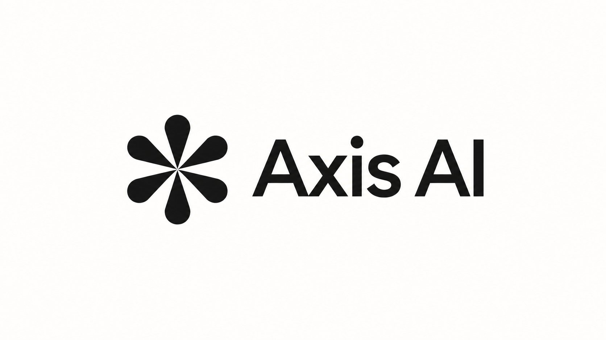
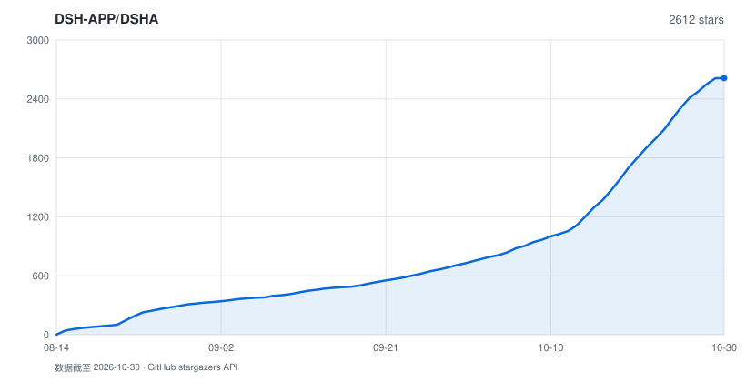

# DSHA

<p align="center">
  <b>DeepSeek Harness launcher for Android</b><br>
  Run the full <a href="https://github.com/deepseek-ai/deepseek-harness">deepseek-harness</a> on your phone — no root, no Termux, nothing to type
</p>

<p align="center">
  <a href="LICENSE"></a>
  <a href="https://github.com/DSH-APP/DSHA/releases/latest"></a>
  <a href="https://github.com/DSH-APP/DSHA/stargazers"></a>
  
  
  <a href="https://afdian.com/a/dsha_apk"></a>
  <a href="https://qm.qq.com/q/N5aZSlnmgM"></a>
</p>

<p align="center">
  <b>English</b> · <a href="README.md">Simplified Chinese</a> · <a href="https://dsha.cc">dsha.cc</a> · <a href="CHANGELOG.md">Changelog</a> · <a href="docs/en/security-model.md">Security model</a> · <a href="AGENTS.en.md">AGENTS.en.md (for AI / contributors)</a>
</p>

> 🤖 If you are an AI agent or a new contributor, read **[AGENTS.en.md](AGENTS.en.md)** first
> (structure, startup contracts, traps we already fell into). Don't scan the whole repo.

> **0.2.1-rc.2 · build190** — Standard release, package `dsh.android.client`. Installs alongside older `com.dsh.client` releases with separate app data. [Download](https://github.com/DSH-APP/DSHA/releases/tag/v0.2.1-rc.2) · [Documentation](docs/en/index.md) · [Release scope](docs/en/releases/v0.2.1-rc.2-build190-package-rename-20261021.md).

## ❤️ Sponsor

<table>
<tr>
<td width="180"><a href="https://zdxjl.com/register?aff=WDYTNDJ5LT4X"></a></td>
<td>Thanks to <a href="https://zdxjl.com/register?aff=WDYTNDJ5LT4X">Lvluo Relay</a> for sponsoring this project! Lvluo Relay is an AI platform covering models from many vendors: mainstream large models are ready to use on demand, and coding, image generation and more can all be called from one platform. Models from China and abroad are available, new releases land promptly, the service is attentive and the pricing is attractive. Registering through this link gives a 105% top-up bonus.</td>
</tr>
</table>

<table>
<tr>
<td width="180"><a href="https://ai.onyxaxis.org/"></a></td>
<td>Thanks to <a href="https://ai.onyxaxis.org/">Axis AI</a> for sponsoring this project! Axis AI is a free public-interest AI platform where multiple mainstream models are ready to use. Chat, write code, and generate images from one unified platform.</td>
</tr>
</table>

---

## What this is

DeepSeek Harness (`@deepseek-ai/dsh`) is DeepSeek's official agent harness — think Claude Code.
It is written for glibc Linux, and running it on Android directly hits a wall of problems:
native modules that won't compile, `link(2)` blocked by SELinux, sandboxes that won't start,
and a front end laid out for desktop screens.

**DSHA wraps all of that into a single APK.** After offline extraction, Main appears while Web
starts in the background. Open the Web UI to configure models and API keys. No Termux, root or
command line is needed. Inside is a complete Ubuntu environment: `apt` works,
interactive PTYs work, native modules that need compiling install fine — the same stack you'd
use on a server.

Maintained and released by contributor [@ym2025szz](https://github.com/ym2025szz), with thanks to
original author [@qiannianhuanxiang](https://github.com/qiannianhuanxiang) and all other contributors.

---

## Download

**0.2.1-rc.2 / build190**, published as a regular GitHub release. The APK version remains `0.2.1-rc.2-20261021.2107-dsh0.2.1-rc.2`; E7E3 signing, bundled DSH 0.2.1-rc.2 and Ubuntu base10 are unchanged. Maintained and published by contributor [@ym2025szz](https://github.com/ym2025szz), with thanks to the original author and contributors.

| Download | Contents |
|---|---|
| [Standard APK](https://github.com/DSH-APP/DSHA/releases/download/v0.2.1-rc.2/dsha-0.2.1-rc.2.apk) | Android 11+ / arm64, system WebView, non-debuggable |
| [Complete source ZIP](https://github.com/DSH-APP/DSHA/releases/download/v0.2.1-rc.2/DSHA-0.2.1-rc.2-build190-source.zip) | Source, documentation, locks and fixed offline build inputs at their project paths |

The package is **`dsh.android.client`**. It installs alongside older `com.dsh.client` versions; app data and Android permissions are separate. Export and restore a backup to migrate data. This release contains no new Low APK; older releases remain available in [Releases](https://github.com/DSH-APP/DSHA/releases).

### What's new since the previous release

- **Virtual screen**: experimental independent display, observation and input in Standard; see [architecture and prerequisites](docs/en/virtual-screen-architecture.md).
- **Global authorization**: manual confirmation, per-app rules or allow-all. This controls DSHA prompts; Android, ADB, Root and Shizuku capabilities still require authorization.
- **Runtime and mobile UI**: DSH 0.2.1-rc.2, mobile UI 3.2.1, proot by default with proroot selectable. Model configuration is handled in Web UI.
- **Maintenance and backup**: one-click password-free backup, external-workspace protection, and fixes for plugin installation, directory picking, LAN authentication and background Web recovery. Picture-in-picture remains opt-in.

| Historical versions | Preserved record |
|---|---|
| [v1.1.10 and earlier](https://github.com/DSH-APP/DSHA/releases/tag/v1.1.10) | Two APK editions, managed Ubuntu/DSH updates and host-side backup/restore replace the old architecture. The complete direct-upgrade matrix has not been revalidated; original documentation remains in historical tags. |

The current APK changes only package identity and its associated references relative to the latest build190 maintenance APK. [Verification and limits](docs/en/releases/v0.2.1-rc.2-build190-package-rename-20261021.md); no new device or endurance acceptance in this publication.

### Getting started

1. Install the release APK. First launch extracts and verifies the bundled offline environment.
2. Main appears immediately after extraction while Web starts in the background. Main shows progress and the result; there is no native first-run model wizard.
3. Once Web is ready, open its settings to configure providers, models and API keys. These editors are absent from first launch and native API configuration.

Extraction and Web readiness are separate stages. Timing depends on the device and environment; this round has no new phone benchmark. If startup fails, read Main's status or diagnostics; navigation alone does not prove readiness.

If a legacy native API key is temporarily unreadable, its record is retained with a warning. Web remains available for configuration; an unreadable record is not cleared or silently replaced.

---

## Why DSHA

|  | What you get |
|---|---|
| 🚫 **Zero command-line barrier** | Offline Ubuntu rootfs bundled in the APK. No Termux, no pkg, nothing to type |
| 🐧 **Full glibc environment** | `apt` / PTY / native modules / Python / git are included. Plugins must still match Linux arm64/glibc dependencies and the device's actual capabilities |
| ⚡ **proroot, zero ptrace overhead** | Classic proot pays two context switches per syscall; proroot does in-process path translation via LD_PRELOAD + binary patching. Measured **+58% in a historical vivo/Android14 build; not current-default proot or F10 phone evidence** on key benchmarks on a real device |
| 🔌 **The phone is the agent's hands** | Accessibility + ADB without Shizuku + an independent virtual display: read screens, tap, install apps, run automations — all built in |
| 💾 **Export for migration** | Data & backups exports password-free `.tar.gz` archives. Storage guidance shows the actual location; local copies are not guaranteed to survive uninstall |
| 🩺 **Failures that explain themselves** | Component checks, targeted repair, startup diagnostics and an independent recovery DSH distinguish core and plugin failures |

---

## Core modules

### ① Setup & environment

| Capability | Details |
|---|---|
| Bundled offline rootfs | Ubuntu 24.04 (noble) arm64 inside the APK — deployment works with no network |
| Six-step component checks | Linux environment → base tools → Node.js → pnpm → dsh → runtime patches. Repairable failures are repaired and rechecked; replacing an existing environment, Node or dsh uses data-preserving maintenance. See [installation and maintenance](docs/en/install-and-maintenance.md) |
| Per-step reinstall / update | rootfs, tools, Node and the harness are independent — reinstall any of them without re-downloading the rest |
| Two install paths | Prebuilt bundle or source build; the source path handles node-pty and other native module compilation automatically |
| Offline toolchain | curl / git / Python / CA certificates pinned via `packages.lock.json` — no dependency on the user running `apt` first |
| Mirrors & networking | apt falls back between official and USTC mirrors automatically; three DNS modes (auto / ipv4 / native, with scope explained in the dedicated page), and a failed AAAA lookup retries resolution only — never replays the HTTP request |
| Versioned base environment | The Ubuntu base carries its own version number; app updates never rebuild the environment, and ordinary dsh updates never bump the base version |

DNS settings: `auto` and `ipv4` both apply a narrow retry to specific Node lookup failures; `ipv4` additionally writes managed glibc `no-aaaa`. This does not disable IPv6 or control every resolver. `native` opts out of that Node compatibility path. See [DNS configuration](docs/en/dns-configuration.md). The default engine was restored to proot when build190 returned to the build170 base; explicit proroot remains selectable. [Migration and compatibility details](docs/en/runtime-engines.md).

### ② Runtime

| Capability | Details |
|---|---|
| proroot / proot dual runtime | Stable proot is the default; proroot can be selected in Configure, subject to device compatibility |
| Historical benchmarks | Specific older vivo/Android14 builds recorded workload speedups; these do not establish current-engine or F10 phone performance. See [engines](docs/en/runtime-engines.md) |
| Bounded compatibility fallback | Retry proot once only after proroot exits before authentication without a plugin failure and guest exit is confirmed; slow startup never triggers fallback |
| Node.js 24 + pnpm 10 | Same runtime as upstream, versions pinned with the APK |
| Split-package updates | Ubuntu and the dsh runtime ship as separate packages inside the APK; cold installs extract both, partial updates read only the dsh package |
| Managed update trials | A new environment boots for real in an isolated area first — ports, auth, session read/write and plugin loading are verified before it is committed; failures roll back automatically |
| Foreground service and run intent | Notifications expose state; supervision follows current run intent and preserves barriers when exit is unknown |
| Slow-start protection | Waiting for auth has no kill timeout (a hint appears at 60 s); the watchdog never mistakes a slow start for a fault |

### ③ Data & backups

| Capability | Details |
|---|---|
| Storage and migration | Data & backups → Storage guidance shows the actual location. Updates preserve current data; export needed content before uninstalling |
| v5 backups and exports | New exports are password-free `.tar.gz` integrity archives. Internal automatic copies remain encrypted; older encrypted originals still require their original password |
| Automatic backup schedules | On by default: daily at a chosen time, every 1–168 hours, or after stopping DSH; running backups wait instead of interrupting your work; keeps the latest 3 verified copies |
| Scoped backups | Full / conversations only / plugins only / settings only; restoring a partial backup touches only its own scope |
| Restore on another device | Export actual conversations, attachments, settings and user plugins; check digests and scope before restore preview, retaining current content and conflicting originals |
| Machine credentials and user configuration | The bridge token is excluded whole; `.credentials.yaml` is stripped field-by-field — machine keys removed, user API keys kept |
| Older backup compatibility | Full authentication/digest verification precedes restore preview; unknown or incomplete dependencies are reported. The current APK rebuilds system plugins, retaining user originals |
| Corrupt session quarantine | Broken session files move to `corrupt-backup` where you can retrieve them — one bad file can't take down the whole web UI |
| Post-upgrade cleanup | Regenerable caches and surplus old copies are cleaned in idle time after upgrades; at least two healthy predecessors are kept, and modified originals are never touched |
| Data-preserving maintenance | Full formatting is retired from production; maintenance preserves personal data and unknown originals |

### ④ Device capabilities (the agent's hands on this phone)

The agent calls these through the local `127.0.0.1:3090` bridge (token-gated; `/app/help` lists every endpoint):

| Capability | Details |
|---|---|
| Screen control | **Via the accessibility service — no ADB needed**: structured screen dumps with tappable regions, tap by text or coordinates, text input, key events, swipes, PNG screenshots |
| Virtual display (experimental) | Standard / Android 11+: authorize ADB, Shizuku or Root, then create a display on its page. Accessibility alone does not create one; see the [setup guide](docs/en/virtual-screen-guide.md) |
| Wireless ADB | Pairing and connection management independent of Shizuku; system debugging and authorization must remain valid. Reboot can require re-enabling debugging; see [permissions](docs/en/device-permissions-architecture.md) |
| Shizuku / Root channels | Backup device-command channels, bound by the same command allowlist |
| Talking to the user | System notifications, in-app toasts, vibration (wake the user after long jobs), a three-option blocking prompt, share / open URLs |
| File exchange | Read directories and text files, export artifacts to `Download/DSHA`; credential areas (`.dsh` / `.ssh` / `.android`) are blocked from both reads and writes |
| Sensors & location | Light / accelerometer / gyroscope / magnetometer / barometer / step counter / location / flashlight — all off by default, granted per capability |
| Clipboard | Read and write (subject to Android foreground restrictions) |
| Dangerous-command gatekeeper | Device commands always pass through an allowlist parser: partitioning / formatting / SELinux / system property writes are rejected outright, unknown commands never pass; blocks return `[POLICY_BLOCKED]` instead of a "allow anyway" dialog |
| SMS reading | A separate sensitive capability: strictly read-only queries, confirmed per query by default, revocable, never restored from backups |

### ⑤ Terminal

| Capability | Details |
|---|---|
| Real PTY terminal | Termux terminal-emulator JNI: vim / htop / tmux and other full-screen TUIs just work |
| Phone keyboard compensation | Extra key row (Ctrl / Alt / Esc / arrows / Tab); pinch to change font size |
| Multiple tabs | Sessions persist across tab switches, rotation and language changes |
| Simple-terminal fallback | If PTY misbehaves on some device, switch to the simple terminal with the session kept alive in the background |

### ⑥ Web UI & access

| Capability | Details |
|---|---|
| Dual engines | Standard uses the system WebView; Low bundles GeckoView 143, immune to whatever WebView the system ships |
| Mobile adaptation | Bundles [dsh-web-mobile](https://github.com/mexiaosqwq/dsh-web-mobile) **3.2.1** (MIT), retaining phone shortcuts and narrow-screen layout while fixing focus, dialogs and plugin cards |
| Picture-in-Picture | Off by default; users explicitly enable it. Normal return and background restoration retain the same-generation page |
| High refresh & power | Requests the user-selected refresh limit and returns control when idle; a successful request does not establish measured frame rate |
| Themes & languages | Dark / light / follow system; Simplified Chinese / English, following the system language by default |
| LAN access | Use dsh from a laptop or tablet browser over Wi-Fi. Token auth is fail-closed; on first hit it sets a `SameSite=Strict` cookie and removes the token from the navigation URL; plain HTTP still requires a trusted network |
| Legacy browser compat | Injects `AbortSignal.any/timeout` and `crypto.randomUUID` polyfills (the latter is required over plain-HTTP LAN) |
| Streaming overlay | Agent output sticks to the top of the screen like lyrics; tool calls are translated into plain language; colors / opacity / line count adjustable; dangerous commands can be approved right on the overlay |
| Web port | Automatic by default, with explicit manual override. Selection is checked before launch; the authenticated startup reports the actual port. The remembered spare stays on this installation and is not transferred. Post-selection bind races are not promised automatic retries; see [ports](docs/en/ports-and-networking.md) |

### ⑦ Plugin ecosystem

| Capability | Details |
|---|---|
| Plugin management | Install / update / enable / disable / delete / search / sort, entirely in-app; works with the [dsha.cc](https://dsha.cc) catalog and community plugins |
| Many install paths | GitHub shorthand / tree / blob / archive / Release links, direct HTTPS archive URLs, local import (format detected by content, not extension), or `dsha-plugin install` in the terminal |
| Multiple download sources | Automatic source selection with npm official and npmmirror; concurrent update checks, locked-version cache reuse, bounded fallback on failure |
| Dependencies and transactions | Bundled pnpm 10.34.5 permits unlocked resolution, lifecycle scripts and pnpmfile; actual locks/digests are recorded, archive traversal is rejected and rollback originals are retained |
| Enable after installation | Package format, paths, dependencies and digests are checked before automatic commit/enable; explicit disable and safe-mode choices remain. See [plugin details](docs/en/plugins.md) |
| Hard-dependency rewrite | Plugins that hardcode service dependencies get rewritten to runtime injection — one plugin can't drag down the whole plugin tree |
| Built-in plugin protection | Built-in plugins can't be deleted; disabled ones stay disabled across upgrades; configs import/export cleanly |

Main built-in plugins include: `dsh-web-mobile` (mobile adaptation), `dsh-status-overlay` (floating
bar), `dsh-task-notifier` (turn-complete notifications), `dsh-device-shell-guide` (device capability
guide), `dsh-computer-use-android` (Android Computer Use), `dsh-tool-vscreen` (virtual display
tools) and `dsh-auto-review` (official experimental Auto review entry).

### ⑧ Reliability & recovery

| Capability | Details |
|---|---|
| Install & repair page | Checks components and repairs eligible failures, including tool and runtime patches. It does not blindly replace an existing environment, Node or dsh |
| Diagnostic reports | Environment checks and failure logs are exportable; startup diagnostics persist stage, actual plugin errors and exit codes — the last five runs, sanitized |
| Startup recovery | Definite startup / plugin faults enter the recovery page automatically; Safe Start uses an isolated profile with official components only, keeping original configs and plugin switches |
| Config snapshots | Automatic snapshots before configuration changes (three healthy + three pre-repair), so there's always something to roll back to |
| Plain-language plugin diagnosis | When the web UI won't start, it says "it's plugin X, it wants a service that doesn't exist, tap here to fix" — not a screen of Node stack traces |
| Independent recovery DSH | If the main environment breaks, an independent recovery environment takes over: its own runtime root, read-only diagnostics first, write repairs confirmed step by step natively |
| Script hot updates | Key scripts update incrementally from GitHub with **offline signature verification** (public key bundled; a bad signature rejects the whole batch) — no need to wait for a new APK |

### ⑨ Security (least privilege by default)

| Aspect | Approach |
|---|---|
| Usable with zero permissions granted | The minimal setup (no ADB, no file access, no LAN) still runs dsh fine; every capability is off by default and revocable at any time |
| Models and API keys | Configure only in the Web UI; native pages have no editors, and retiring those editors does not automatically erase existing credentials |
| Device commands | The allowlist is always on; Root / Shizuku / ADB share one policy; app termination verifies ownership per target to prevent PID-reuse mistakes |
| Bridge credential guard | `/app/export` and `/app/readfile` reject credential-area paths, with normalization + canonical-path double checks against symlink tricks |
| No automatic telemetry | Diagnostic export is explicit. Updates, dependency/plugin downloads, configured model services and user-authorized tools can still use the network; see the security model |
| Honest disclosure | Known weaknesses (no kernel-level sandbox, legacy plaintext backups, signing key rotation pending…) are listed directly in the docs |

👉 For what each permission actually exposes and which parts of your phone the agent can reach, see the **[security model](docs/en/security-model.md)**.

---

## How this compares

Running dsh on Android has two paths, each with real costs — describing them beats name-calling:

| | **Container path** (DSHA's choice) | **Termux bootstrap path** |
|---|---|---|
| How | proot/proroot + full glibc rootfs | Termux packages running bare on Android's bionic |
| Setup | Install one APK | Install Termux → type commands → build a toolchain |
| Environment | Full Ubuntu — `apt` and native modules work | Needs per-package patches / rebuilds for bionic |
| Overhead | proroot has no ptrace overhead | No container layer; theoretically fastest |
| Sandboxing | Limited either way | Limited either way |

---

## Known limits

Listed honestly, so you don't discover them after installing:

| Item | Status | Notes |
|---|---|---|
| Architecture | ⚠️ arm64-v8a only | 32-bit and x86 devices are not supported |
| OS version | ✅ Standard 11+ / Low 6+ | Older systems lose some capabilities (wireless pairing needs 11+, see [android-low](docs/android-low.md)) |
| Size | Artifact-specific | The 273.10 / 345.27 MiB figures above belong to historical build170. Use the final delivery receipt for current APK bytes |
| bash tool | ✅ Works | Full Ubuntu bash; the agent runs shell commands without restriction |
| bash **sandbox isolation** | ⚠️ Unavailable | bubblewrap needs unprivileged user namespaces, and Android sepolicy refuses — neither the container path nor Termux can work around it. Constraints rely on dsh's permission modes: `danger-full-access` by default, switchable to `workspace-write` or `read-only` in Configure. Judge the risk yourself |
| Sundigital / HarmonyOS anco | ❓ Unverified | Plausible in theory; no real-device regression yet |
| Overlay | ⚠️ Needs permission | Self-drawn via `TYPE_APPLICATION_OVERLAY`; rootless devices can't get the real "status-bar lyrics" API |
| Data location | ⚠️ Needs file access | If "All files access" is denied, data stays in the private directory and is lost on uninstall (the self-check tells you which state you're in) |

---

## Architecture

```
┌──────────────────────── APK ────────────────────────┐
│ Native Android (Java 17 · Material3 · single :app)  │
│  ├ Launch / install-repair / configure / workspace  │
│  │   plugins / terminal                             │
│  ├ Web engine: system WebView (Std) / Gecko (Low)   │
│  ├ Foreground service + watchdog + notifications+PiP│
│  ├ App bridge :3090 (accessibility / vscreen /      │
│  │   interaction / files)                           │
│  ├ LAN proxy :3081 · ADB / Shizuku / Root channels  │
│  └ Overlay (TYPE_APPLICATION_OVERLAY)               │
├─────────────────────────────────────────────────────┤
│ proot (default) / proroot (optional, device-specific)│
├─────────────────────────────────────────────────────┤
│ Ubuntu 24.04 arm64 · Node.js 24 · pnpm 10           │
│  └ @deepseek-ai/dsh  →  Web UI :<dynamic>                │
└─────────────────────────────────────────────────────┘
```

Data: see Data & backups → Storage guidance for the actual location; legacy `Documents/dshdata` remains readable.
The Web UI manages model credentials; local data, keys and automatic copies are not guaranteed to survive uninstall.

---

## Wireless ADB pairing (device shell)

Once paired, the agent can operate this phone directly — **no Shizuku needed**.

**First-time pairing**

1. System settings → "About phone" → tap "Build number" 7 times to enable developer options
2. Developer options → enable "Wireless debugging"
3. Open "Wireless debugging" → "Pair device with pairing code"; note the **IP:port** and the **6-digit code**
4. Back in DSHA → "Device capability grants" → enter them → Pair

> The pairing code requires Android 11+; on older systems use the Shizuku / Root channels —
> or skip pairing entirely, since the accessibility capabilities (screen reading, taps, input) need none.

With wireless debugging off, Verify existing connection can prepare the bundled offline dependencies first. `ADB_OFFLINE_READY` means dependencies are ready; enable wireless debugging and complete pairing or connection verification afterward.

**After pairing**: DSHA can maintain/reconnect while the system debugging service and authorization remain valid. A reboot may require re-enabling wireless debugging and verifying its current endpoint; stored pairing material alone does not prove a live connection.

**Verify**: run `adb shell id` in the built-in terminal — `uid=2000(shell)` means success.

**Let the agent use it**: copy the skill packs into the agent's skill directory:

```bash
cp -r agent-skills/device-shell ~/.agents/skills/
cp -r agent-skills/screen-ocr-operator ~/.agents/skills/
```

`device-shell` covers command usage across the ADB / Shizuku / Root channels;
`screen-ocr-operator` adds screenshot + OCR + batched screen actions (for WebView / game canvases
where accessibility dumps come up empty).

---

## Building from source

Use the final tag/full commit in the new private repository or its matching source attachment. Do not build the old local173 checkout. Requirements: JDK17, Node24, Python3.9+, Android SDK37 and NDK26. Prepare pinned inputs using [CONTRIBUTING.en.md](CONTRIBUTING.en.md); see [BUILD.en.md](BUILD.en.md) for toolchains and signing.

```bash
python3 tools/run-host-tests.py --check-manifest
python3 tools/run-host-tests.py --stage fast
./gradlew :app:testStandardDebugUnitTest :app:testLowDebugUnitTest \
  :app:lintStandardRelease :app:lintLowRelease
./gradlew :app:assembleStandardRelease
```

On Windows, use `gradlew.bat`. Debug in a unit-test task name identifies a test variant; it does not require generating or installing a debug APK. Release packaging requires the existing E7E3 signing credentials and checks of actual APK identity, assets, licenses and hashes. Git excludes large generated archives; full packaging uses the hash-verified original inputs in the Release source ZIP and the existing recipes, without a separate bundle. The APK cannot reconstruct all original inputs. Required small prebuilt dependencies remain, but not all vendor native code is reproducible from source. Deliveries exclude private keys, user data, device images and logs.

See the [English release introduction](docs/en/release-introduction.md), [build/release guide](docs/en/build-and-release.md) and [BUILD](BUILD.en.md) for phase-specific commands and final identity. Fixed inputs expand directly at project paths without a nested packet. The final receipt must bind source, selected tests, APK and ZIP hashes; earlier F9/F10/F11 selections, failures and candidate counts remain historical.

---

## Documentation index

See the complete [documentation index](docs/en/index.md) and [31-topic gap matrix](docs/en/documentation-gap-matrix.md). Added guides cover backup/restore, maintenance, updates, bridge/files, emergency recovery, diagnostics, plugin permissions, terminals, PiP, language and notifications. Current guides, historical notes and undistributed local evidence are distinguished.

| Doc | Contents |
|---|---|
| [AGENTS.en.md](AGENTS.en.md) | Project structure, startup contracts, technical constraints, known traps (entry point for AI / new contributors) |
| [docs/en/security-model.md](docs/en/security-model.md) | Security model: boundaries of every permission and known weaknesses ([English](docs/en/security-model.md)) |
| [docs/en/plugins.md](docs/en/plugins.md) | Plugin installation and packaging requirements |
| [CHANGELOG.md](CHANGELOG.md) | Full changelog |
| [Historical roadmap](docs/ROADMAP.md) | Original-language historical roadmap and decisions |
| [Browser engines and flavors](docs/en/browser-engines.md) | Current Standard/Low behavior; [old Standard](docs/android-standard.md) / [Low](docs/android-low.md) notes remain historical |
| [Release introduction](docs/en/release-introduction.md) / [historical records](docs/releases/) | Current evidence ownership and original-language per-version records |

## Credits

- [deepseek-ai/deepseek-harness](https://github.com/deepseek-ai/deepseek-harness) — the harness itself
- [proot](https://github.com/termux/proot) / [proroot](https://github.com/coderredlab/proroot) — rootless containers (see [Third-party notices](docs/en/third-party-notices.md))
- [Termux terminal-view / terminal-emulator](https://github.com/termux/termux-app) (Apache-2.0) — PTY terminal
- [dsh-web-mobile](https://github.com/mexiaosqwq/dsh-web-mobile) — bundled mobile adaptation
- [Shizuku](https://shizuku.rikka.app/) — backup device-command channel

## Community

QQ group **975836806** — pre-release builds, feedback, plugin talk.

| Topic | Contact |
|---|---|
| Original author (partnership / licensing) | QQ 2921185884 |
| Current maintainer (proposals / feedback, or just open an issue) | QQ 1876843459 |
| Email | 1437ht@gmail.com |

## License

[MIT](LICENSE). Third-party component licenses: [Third-party notices](docs/en/third-party-notices.md).

## Star History

The original repository's snapshot is 1885 stars on 2026-10-21; this is not the private repository's star count.

<a href="https://github.com/DSH-APP/DSHA/stargazers">
  <picture>
    <source media="(prefers-color-scheme: dark)" srcset="docs/star-history-dark.svg" />
    <source media="(prefers-color-scheme: light)" srcset="docs/star-history.svg" />
    
  </picture>
</a>

<sub>This source includes the public upstream repository snapshot checked on 2026-10-21 and its [date/count aggregates](docs/star-history.json). Regenerate manually with [`tools/gen-star-history.py`](tools/gen-star-history.py) and `STAR_REPO=DSH-APP/DSHA`; the existing workflow handles future updates; actual runs are reported by Actions.</sub>
