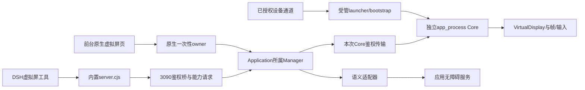

# ADR 0003：独立虚拟屏的生命周期、观察与输入身份

状态：**Accepted**。记录日期：2026-10-21。适用范围：build190当前实现。

本记录解释现有源码的架构选择与维护约束，没有新增运行权限或改变APK。本文所列测试是回归入口，不表示本次重新执行；源码、宿主夹具与历史软件结果均不等于当前手机验收。调用细节见[虚拟屏架构主文](../virtual-screen-architecture.md)，使用条件见[虚拟屏指南](../virtual-screen-guide.md)。同UID与工具审批的限制沿用[ADR 0001](0001-build154-boundaries.md)和[ADR 0002](0002-current-threat-model.md)。

## 背景与问题

DSH既需要观察独立Android显示，也需要在明确目标上执行一次输入。显示持续产生新帧，应用/窗口、无障碍连接、DSH运行代次和授权均可能在排队期间变化。调用超时还不能证明设备没有执行动作。把截图、确认、输入和关闭当成无状态命令，会使旧坐标、旧节点或迟到回调作用于另一个实例。

独立显示也不是普通Activity内的一块画布。当前实现需要设备侧创建VirtualDisplay及注入输入的实际系统能力；应用自己的确认不能替代这些能力。设计同时要处理宿主重建、Core断连、创建结果未知以及退出证明无法取得的情况。

## 决定一：设备侧独立Core，应用侧单一受管owner

应用以当前已安装APK为classpath，通过已授权的Root、Shizuku或ADB通道启动`VirtualScreenCore --launch`；实际UID取决于通道，不能统一假定为root或shell。launcher再用`setsid`启动独立`app_process --server`，保留直接子进程及bootstrap管道关系，不使用`setsid -d`隐藏该关系。Core创建随机端口和secret，secret经bootstrap结果返回，不进入设备命令argv；父launcher核对存活与ping后才报告started。[启动命令](../../app/src/main/java/com/deepseekharness/app/vscreen/VirtualScreenLauncher.java)、[Core的launch/server](../../app/src/main/java/com/deepseekharness/app/vscreen/VirtualScreenCore.java)

Core承担VirtualDisplay、ImageReader帧、受限输入和本次控制连接。应用侧`VirtualScreenManager`按Application归属持有Core握手、通道、生命周期epoch、队列、观察/语义缓存与清理记录；不是每个Activity各建一个owner。端口或token相同也不构成Core身份相同。旧listener、旧HostControl的关闭只能退休自己的绑定，不能清掉后来的绑定。[Manager](../../app/src/main/java/com/deepseekharness/app/vscreen/VirtualScreenManager.java)、[Core绑定竞争测试](../../app/src/test/java/com/deepseekharness/app/vscreen/VirtualScreenCoreControlTest.java)

DSH工具先进入内置`dsh-tool-vscreen`，再经固定`127.0.0.1:3090/app/vscreen/*`与X-Token进入HttpShellService。JS校验私有token文件、路径和有界响应，不能将本地HTTP可达性当成授权。HttpShellService构建能力/目标请求，Manager才向本次Core发送控制请求；语义节点动作另经应用无障碍服务完成。[工具适配器](../../app/src/main/assets/builtin-plugins/dsh-tool-vscreen/lib/server.cjs)、[桥入口](../../app/src/main/java/com/deepseekharness/app/HttpShellService.java)

## 决定二：捕获与输入分离，保留三种不同的输入证据

| 路径 | 观察与准入 | 不可互换的边界 |
|---|---|---|
| 原始坐标/按键/文本路径 | Core核对screen generation、实际最新frameSeq、确曾观察该帧及观察时效；输入消费观察状态 | 单纯知道frameSeq不等于已观察；预览调度优化不能放宽Core帧门 |
| tree → node / editor | 无障碍树节点绑定display/window/package与连接代次，执行前refresh、语义复核及有效期检查 | 语义节点不是坐标；不能为节点动作额外强制“像素帧必须没变化”，也不能节点失败后偷偷tap |
| see → anchor → anchored_click | 从保留的原图观察选唯一可操作节点；绑定原观察、节点/窗口/几何与区域证明，执行前复核并一次消费 | anchor不执行点击、不续观察TTL；丢响应或UNKNOWN不重新签发/重放 |

原生预览使用独立缩图路径，当前宽度上限720。Agent的`see`则保存全分辨率不可变raw副本并输出对应尺寸的JPEG，坐标以该原图为准；当前保留上限为30秒、2份、24MiB。原生预览帧不进入Agent观察owner。保留旧原图可供锚定核对，不会把旧raw帧重新变成最新许可。[预览像素](../../app/src/main/java/com/deepseekharness/app/vscreen/VirtualScreenPixels.java)、[Agent观察](../../app/src/main/java/com/deepseekharness/app/vscreen/VirtualScreenObservedPixels.java)

原生`VirtualScreenPreviewInputGate`只协调本地抓图/解码采用与手势准入，避免二者并发扰动；Core仍执行真实帧检查。语义节点路径依据树不超过30秒、当前窗口和节点语义，不依赖持续画面静止。锚定路径还核对窗口几何、节点bounds/路径和原区域证明。[帧策略](../../app/src/main/java/com/deepseekharness/app/util/VirtualScreenPolicy.java)、[语义适配器](../../app/src/main/java/com/deepseekharness/app/vscreen/VirtualScreenSemanticAdapter.java)、[锚点证明](../../app/src/main/java/com/deepseekharness/app/vscreen/VirtualScreenAnchorProof.java)、[观察控制](../../app/src/main/java/com/deepseekharness/app/vscreen/VirtualScreenObservedControl.java)

## 决定三：身份是分层证据，不合并成一个“已授权”布尔值

| 身份层 | 绑定内容与作用 |
|---|---|
| 助手请求 | 当前DSH/桥运行身份、策略revision、能力请求及实际目标证据；旧排队请求不可借新授权继续 |
| Manager | Application owner、生命周期epoch、state revision、本次端口/token；撤销先使旧快照失效 |
| Core进程 | coreInstance及出生身份；退出探针绑定原实例，不能按裸PID、端口或名称认定退出 |
| screen | displayId和generation、实际宽高/方向；displayId可复用，不能单独当身份 |
| 像素 | frameSeq、已观察状态、时效；Agent另有observationId和不可变原图 |
| 语义/几何 | nodeId或anchorId、display/window/package、无障碍连接epoch、refresh后的语义和bounds/窗口几何；旧缓存不能跨owner或连接复用 |

执行前和异步返回时都要核对原快照，成功观察保留自己的身份，不能用后来实例B的字段重新标注实例A的响应。节点/anchor先消费再调用平台，防止双击、排队与迟到结果重复使用。[请求scope](../../app/src/main/java/com/deepseekharness/app/vscreen/VirtualScreenRequestScope.java)、[Manager快照与响应](../../app/src/main/java/com/deepseekharness/app/vscreen/VirtualScreenManager.java)、[目标证据](../../app/src/main/java/com/deepseekharness/app/vscreen/VscreenTargetEvidence.java)

## 决定四：助手授权与本机直接操作分别准入

助手路径经CapabilityBroker和screen请求。全局确认只把ASK转为ALLOW，不越过显式DENY、暂停、系统权限、真实应用目标、运行代次或观察身份；本机策略和授权不从用户备份恢复。应用自有确认也不授予Root/Shizuku/ADB或无障碍权限。[全局确认策略](../../app/src/main/java/com/deepseekharness/app/util/NativeConsentPolicy.java)、[屏幕会话许可](../../app/src/main/java/com/deepseekharness/app/util/ScreenSessionGrant.java)、[确认策略](../../app/src/main/java/com/deepseekharness/app/util/ScreenConfirmationPolicy.java)

本机“节点操作”只能由真实RESUMED的AppCompatActivity取得不可替换的Native owner与`NativeScreenControlLease`；pause/stop/destroy永久撤销，resume不复活旧owner。这是本机用户明确操作的独立入口，不是给助手传null broker绕过授权的公开接口。文本仅投给系统声明可编辑且非密码的节点；截断摘要不能预填成完整原值后无输入提交。[原生owner](../../app/src/main/java/com/deepseekharness/app/vscreen/VirtualScreenNativeControls.java)、[原生许可](../../app/src/main/java/com/deepseekharness/app/screen/NativeScreenControlLease.java)、[节点动作](../../app/src/main/java/com/deepseekharness/app/vscreen/VirtualScreenAccessibility.java)

这些控制约束受管入口，不构成同UID恶意插件的强沙箱，也不能保证所有厂商窗口都能导出语义节点。系统拒绝或目标缺失时返回拒绝，不能改投物理display0。

## 决定五：未知结果不重放，退出是独立的证据提交

传输已派发后发生断连、取消或缺失响应，动作可能已经执行，结果保持UNKNOWN。不能切设备通道、自动补图重选anchor、改用tap或重复close来“修复”未知。NOT_SENT只允许由本机typed前发送事实建立；过期/已提交/已取消票据、普通错误文本均不足以证明未发送。平台接受输入也不等于应用业务效果已验证，后续需要新观察。[传输](../../app/src/main/java/com/deepseekharness/app/vscreen/VirtualScreenTransport.java)、[启动结果](../../app/src/main/java/com/deepseekharness/app/vscreen/VirtualScreenManager.java)

生命周期为STOPPED、STARTING、READY，以及保留屏障的START_UNKNOWN、DISCONNECTED、CLOSING、CLOSE_UNKNOWN。清理未知时不能再派发新启动。撤销先使epoch、票据和观察失效，再异步清理；撤销UI许可不等于远程进程已退出。[状态定义](../../app/src/main/java/com/deepseekharness/app/util/VirtualScreenLifecycleState.java)

Core的close回复只代表显示释放的应答。Manager用原通道对原出生身份做只读退出探针，只有EXITED且清理journal提交成功才清除pending；ALIVE、UNKNOWN、旧epoch、通道不可用或journal写失败均保留屏障。迟到的旧退出证明不能结束新实例，不按状态文本伪造成功。[closeDetached及probeClosed](../../app/src/main/java/com/deepseekharness/app/vscreen/VirtualScreenManager.java)、[出生身份](../../app/src/main/java/com/deepseekharness/app/util/VirtualScreenCoreIdentity.java)

这里的Core退出与Ubuntu内DSH guest退出是两套证明。正常停止Web仍由WebStopCoordinator分别确认guest及owned launcher退出；WebLifecycleController只在同代次finishStop后、无新启动且有本次成功证明时退休HarnessService。Core close成功不替代这两项，失败也不能借旧成功证明释放服务；用户独立DeviceBridge不是该服务退休的对象。[Web退出协调](../../app/src/main/java/com/deepseekharness/app/core/WebStopCoordinator.java)、[Web停止与退休](../../app/src/main/java/com/deepseekharness/app/core/WebLifecycleController.java)

## 恢复、升级及平台边界

Manager在rootfs外的应用私有journal保存生命周期、boot、原通道及握手。相同boot恢复未完成handle时进入DISCONNECTED并保留原身份供清理；缺handle/损坏记录进入START_UNKNOWN。不会据journal自动恢复可写许可或假装重连READY。明确boot_id变化可收敛旧boot尝试；不可读取boot不是“已变化”。新安装APK启动命令使用当前安装路径，不能拿旧Core/旧屏幕ID冒充升级后的当前会话。[恢复逻辑](../../app/src/main/java/com/deepseekharness/app/vscreen/VirtualScreenManager.java)、[持久journal](../../app/src/main/java/com/deepseekharness/app/vscreen/VirtualScreenSessionJournal.java)

Standard且API30+才支持虚拟屏；Low即使运行在现代系统也明确拒绝，API23路径不打开虚拟屏journal。具备这些版本条件仍不保证Root/ADB/Shizuku、显示创建、目标应用、无障碍或厂商输入机制实际可用。普通物理读屏与Low网页能力不能当成虚拟屏已支持。[能力边界](../../app/src/main/java/com/deepseekharness/app/vscreen/VirtualScreenManager.java)、[通道](../../app/src/main/java/com/deepseekharness/app/vscreen/VirtualScreenChannels.java)

## 替代方案与后果

下面是依据当前代码和约束的**设计推断**，不是对历史会议或作者动机的追述。

| 替代方案 | 当前选择的理由与代价 |
|---|---|
| 直接复用物理屏或普通Activity画布 | 无法等价提供独立目标显示与设备侧输入；独立Core增加通道、进程、恢复和厂商兼容成本 |
| 每次操作从设备shell执行任意命令 | 难以绑定持续显示、帧和一次性语义身份；本机受管协议更可核验，但增加认证、限流和状态机维护 |
| 全部只做坐标输入 | 动态界面容易过帧；保留独立语义路径增加可用性，但系统无节点时仍只能明确失败或重新观察 |
| 全部只做无障碍节点输入 | Canvas/缺节点页面不能覆盖；保留像素通道与锚定证明，代价是几何与观察缓存复杂度 |
| 未知就重试、降级通道或按PID强杀 | 可能重复输入/误杀复用PID；保留UNKNOWN和清理屏障会降低自动恢复便利性，需要明确诊断与后续只读核验 |
| 助手与原生UI共享一个已授权开关 | 无法表达用户前台owner、助手请求代次与DENY；分离准入增加接口和测试，保留各自授权来源 |

## 受影响文件与维护不变量

入口与协议涉及`dsh-tool-vscreen/lib/server.cjs`、HttpShellService；编排与持久化涉及VirtualScreenManager/Launcher/Transport/SessionJournal；设备侧涉及VirtualScreenCore/DisplaySession/Input/Pixels/ObservedPixels；语义与UI涉及SemanticAdapter/Accessibility/AnchorProof/ObservedControl/NativeControls、VirtualScreenActivity、NativeScreenControlLease。以上链接指向当前职责，不表示本ADR修改这些文件。

维护时必须保留以下不变量：

1. 控制端口/token与Core出生身份、screen generation分开核验；旧listener/回调不能关闭新绑定。
2. 捕获不自动输入，输入不隐式重观察；raw帧门、语义节点门和锚定几何证明不可互相替代。
3. Native前台owner不能成为助手授权；全局ALLOW不取消DENY、暂停和系统能力检查。
4. id在派发前一次消费；UNKNOWN不重放，旧失败响应不能被新实例重新标注。
5. close释放应答、Core EXITED、journal提交、guest退出与launcher退出分别取证；任一未知不能借另一项成功清障。
6. 升级/进程重建只恢复清理事实，不导入备份授权、不恢复旧观察或重放未确认动作；Low保持显式不支持。

## 回归用例

本次只读核查这些测试的存在与意图，没有运行测试或设备。后续变更应按实际受影响层选择执行并报告平台/跳过限制：

| 不变量 | 当前回归入口 |
|---|---|
| 旧listener迟到关闭、新Core重绑、构造异常清理 | [CoreControlTest](../../app/src/test/java/com/deepseekharness/app/vscreen/VirtualScreenCoreControlTest.java)、[NativeControlsTest](../../app/src/test/java/com/deepseekharness/app/vscreen/VirtualScreenNativeControlsTest.java) |
| Application归属、撤销先围栏、迟到owner不能清新会话 | [ManagerOwnershipTest](../../app/src/test/java/com/deepseekharness/app/vscreen/VirtualScreenManagerOwnershipTest.java)、[ManagerRevocationTest](../../app/src/test/java/com/deepseekharness/app/vscreen/VirtualScreenManagerRevocationTest.java) |
| immutable see/预算、锚点链、像素变化时语义节点仍校验 | [ObservedPixelsTest](../../app/src/test/java/com/deepseekharness/app/vscreen/VirtualScreenObservedPixelsTest.java)、[AnchoredChainTest](../../app/src/test/java/com/deepseekharness/app/vscreen/VirtualScreenAnchoredChainTest.java)、[NativeInputFrameBoundaryTest](../../app/src/test/java/com/deepseekharness/app/vscreen/VirtualScreenNativeInputFrameBoundaryTest.java) |
| 预览与手势互斥、旧手势不能释放新手势 | [PreviewInputGateTest](../../app/src/test/java/com/deepseekharness/app/vscreen/VirtualScreenPreviewInputGateTest.java) |
| pause/换窗口/连接epoch、截断文本与一次提交 | [NativeControlsTest](../../app/src/test/java/com/deepseekharness/app/vscreen/VirtualScreenNativeControlsTest.java)、[ActivityNodeControlsTest](../../app/src/test/java/com/deepseekharness/app/vscreen/VirtualScreenActivityNodeControlsTest.java) |
| 原通道不可用、迟到EXITED、journal失败仍保留pending | [CloseReconcileTest](../../app/src/test/java/com/deepseekharness/app/vscreen/VirtualScreenCloseReconcileTest.java)、[PersistentCleanupTest](../../app/src/test/java/com/deepseekharness/app/vscreen/VirtualScreenPersistentCleanupTest.java) |
| Low/API23不解析API30执行能力或打开journal | [LowBoundaryTest](../../app/src/test/java/com/deepseekharness/app/vscreen/VirtualScreenLowBoundaryTest.java) |

设备显示/输入、OEM兼容、真实背景/恢复和长时场景仍需各自明确授权与对应正式包证据；本文不以宿主回归数量宣称这些范围完成。
