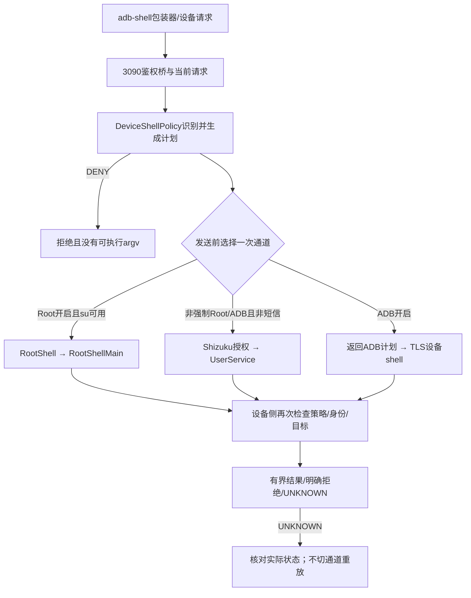
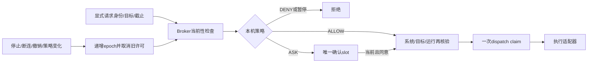

# 设备权限与执行通道架构

本文面向维护者，说明设备权限的分层、入口、存储、撤销和故障定位。初版以F10/F11为参考，历史软件与APK范围见[F11记录](releases/v0.2.1-rc.2-build190-fix11-20261021.md)；Root部分于2026-10-22按维护源码 `140c7ba277fc2a91a9b8fd8cb5a24bc35a5c41c5` 补核。
它不是Root教程或ROM兼容保证。该次Root核查包含源码、固定上游文件和隔离宿主策略检查，未操作真实su管理器或读取手机短信；后续性能验收须使用绑定实际APK的新记录，不能沿用本页当作真机通过。

全项目入口见[项目架构手册](project-architecture-handbook.md)，运行环境和数据事务见[运行时、数据与插件架构](runtime-data-plugin-architecture.md)。
独立显示详见[虚拟屏架构](virtual-screen-architecture.md)及[ADR 0003](adr/0003-virtual-screen-lifecycle-and-input.md)。
同UID与审批的安全边界见[安全模型](security-model.md)、[ADR 0001](adr/0001-build154-boundaries.md)、[ADR 0002](adr/0002-current-threat-model.md)。
资料出处与项目证据分类见[参考资料与来源](references-and-provenance.md)。

## 1. 先区分七种不同的“允许”

| 层 | 授权者/事实来源 | DSHA中的作用 | 不能替代 |
|---|---|---|---|
| Android应用权限 | 系统权限控制器、特殊访问设置 | 麦克风、定位、通知、存储等应用能力 | Root、ADB、Shizuku、助手批准 |
| Root | 设备已有su及其管理器；执行时实际UID | 特权设备命令通道 | DSHA命令策略、屏幕目标核验 |
| Shizuku | 外部服务Binder、管理器授权、UserService绑定 | 在其实际身份下执行受管设备命令 | ADB配对、应用私有授权记录 |
| ADB | 系统adbd、配对密钥、当前鉴权连接 | 本机无线设备shell通道 | Root、无障碍已连接、当前操作已批准 |
| 无障碍 | 用户的系统设置及系统实际绑定 | 节点、手势、部分截图/屏幕操作 | 任意shell、独立显示创建权限 |
| DSHA本机确认策略 | DeviceGrants、CapabilityBroker、当前运行 | 判断助手请求应询问、允许或拒绝 | 系统权限或设备连接 |
| DSH会话权限模式 | Web/运行选项与工具策略 | read-only、workspace-write等工具约束 | Android UID隔离或强系统沙箱 |

Android官方把普通权限、运行时权限和特殊权限分别处理；Manifest中的声明本身不是所有能力已获准的证明。[Android权限概览](https://developer.android.com/guide/topics/permissions/overview)
上表后三层的具体判据是DSHA源码策略，不是Android或Shizuku为DSHA提供的安全背书。

### 1.1 UID和“容器root”

Ubuntu中的`/root`是guest文件视图和工作身份；不能据此认定Android进程已经是UID 0。
普通应用、Web后端、插件与终端的文件访问仍受实际宿主身份和已获Android权限约束。
Root入口要求真正的UID 0；受管虚拟屏特权执行入口只接受UID 0或2000。
Shizuku UserService可能是root或shell身份，取决于其服务启动方式，不能因“已连接”就统一写成root。
Shizuku官方同时说明UID、Linux capabilities和SELinux都会影响可用操作。[Shizuku API开发文档](https://github.com/RikkaApps/Shizuku-API#guide)

### 1.2 查看和修改的起点

- 设置页入口：[DeviceGrantsFragment](../app/src/main/java/com/deepseekharness/app/ui/DeviceGrantsFragment.java)。
- 全局确认卡：[FullPermissionControls](../app/src/main/java/com/deepseekharness/app/ui/FullPermissionControls.java)。
- ADB配对界面：[AdbPairActivity](../app/src/main/java/com/deepseekharness/app/ui/AdbPairActivity.java)。
- Manifest能力声明：[AndroidManifest.xml](../app/src/main/AndroidManifest.xml)。
- 应用级装配与broker：[DshaApp](../app/src/main/java/com/deepseekharness/app/DshaApp.java)。

## 2. Android系统权限：按功能请求，按使用点再检查

当前Manifest声明了录音、定位、网络、通知、前台服务、安装包、悬浮窗和文件访问等能力。
`WRITE_SECURE_SETTINGS`是受保护权限；声明不表示普通安装已获授予。
`BIND_ACCESSIBILITY_SERVICE`约束无障碍服务绑定方，不是普通运行时弹窗。
维护新功能时，应同时检查Manifest、发起权限请求的UI和真正执行能力的适配器。

| 功能 | 当前实现入口 | 维护边界 |
|---|---|---|
| Web麦克风 | [BrowserMicrophone](../app/src/main/java/com/deepseekharness/app/ui/BrowserMicrophone.java) | 按网页请求申请；核对当前来源/页面/运行身份，不能启动时预授权 |
| 定位、传感器等 | [DeviceSense](../app/src/main/java/com/deepseekharness/app/DeviceSense.java)及设备授权页 | 本机开关与系统可用性独立；关闭时撤销本域请求 |
| ADB/LAN局域网 | [LocalNetworkAccess.granted/applyConfiguredFeatures](../app/src/main/java/com/deepseekharness/app/bridge/LocalNetworkAccess.java) | API37+明确检查ACCESS_LOCAL_NETWORK；更早版本此门返回允许，其他门仍存在 |
| 文件访问 | 系统特殊访问/SAF及各文件适配器 | Root开关和全局确认不扩大文件根、NOFOLLOW或目标范围 |
| 安装APK | 系统安装能力及安装事务 | 进入系统安装流程不等于安装成功或运行进程已退出 |

这里的API37门来自当前源码；不能推导所有Android版本、系统设置页或ROM都有同样表现。
权限可能被用户撤销，也可能已允许但实际服务未连接；应在使用点重新取事实。
涉及系统对话框的选择仍由用户完成，不能用全局确认自动回答。

## 3. Root：发现su、用户允许和真实执行是三步

### 3.1 不在探测时索取Root

[RootShell.enabled/present/status](../app/src/main/java/com/deepseekharness/app/RootShell.java)分别表示本机开关、可验证su候选和最近执行状态。
`present()`只检查[RootShellCandidates](../app/src/main/java/com/deepseekharness/app/util/RootShellCandidates.java)中的已知位置。
候选按 `Os.stat` 返回值核对root所有、普通文件类型、无group/other写权限，并检查可执行性；发现阶段不执行su，不信任应用可控PATH。
`Os.stat`会跟随链接，返回值也可能来自内核su兼容钩子；这些是metadata检查，不是su二进制来源、管理器身份或完整父目录NOFOLLOW证明。
九个固定候选是DSHA自己的发现策略，不是Magisk、KernelSU或APatch承诺的完整安装路径表；没有覆盖任意自定义su路径。
所以“找到su”不是“管理器已授权”，“开关开启”也不是“命令一定能执行”。

### 3.2 执行入口

`RootShell.exec(ctx, command, authorizedSmsUser)`先执行DeviceShellPolicy检查。
随后`runPrivileged()`通过`su -c`启动当前安装APK中的固定RootShellMain入口。
业务命令经标准输入JSON发送，不直接拼入su的shell参数。
[RootShellMain.main](../app/src/main/java/com/deepseekharness/app/RootShellMain.java)先检查实际UID为0，再解析有界输入。
需要应用身份的操作通过PrivilegedPackageContext核对包名、UID与安装来源，不能猜测固定`/data/app`路径。
结果经专用标记和Base64回传；调用方要求完整结果，而非看到任意输出就判成功。

### 3.3 有界执行与失败

`runPrivileged()`先同步 `ProcessBuilder.start()` 并向stdin写JSON，之后才进入 `BoundedProcessRunner.collect()`。65秒/400000字节是该结果收集器的当前限制，不覆盖前序进程创建和同步stdin写入，不能据此承诺整个Root请求最多65秒。ShellService内部命令另有自己的期限和输出上限。
没有完整结果、超时、中断或通道异常时，RootShell保留`EXECUTION_UNKNOWN`，不会换Shizuku/ADB重发。
销毁本次本地helper不证明远端动作没有发生，也不证明其所有后代都已退出。
Root状态是最近通道结果，不应被缓存为永久能力许可。
关闭Root开关会阻止后续选择，并撤销相应虚拟屏请求；不能据此承诺已派发动作回滚。

### 3.4 上游su语义与兼容性证据

DSHA是现有su的客户端，没有在APK内实现Magisk、KernelSU或APatch的提权内核。固定核查的提交与文件见[来源依据](references-and-provenance.md)第5.1节；这些上游负责调用者授权及实际执行身份，DSHA的命令、短信、媒体目录和虚拟屏守卫由本仓库负责。

KernelSU的su兼容实现可按已允许UID重定向stat/access/exec；APatch依赖的KernelPatch也支持按授权与配置路径提供su兼容入口。因此，探测不到文件不一定等于设备未root，授权或兼容钩子配置会影响可见性；不能要求为通过探测而禁用守卫或信任任意PATH。
管理器允许后仍须核对实际UID；KernelSU/APatch的profile可改变目标UID，capabilities、SELinux及mount namespace还会影响命令能力和APK路径可见性。当前RootShellMain要求UID 0，DSHA不会把非0身份解释为Root成功，也不主动覆盖管理器的这些设置。

本页未提供三管理器、各版本、隐藏/兼容模式、自定义su路径或ROM的真机兼容矩阵。RootShellCandidatesTest注入的是候选判定，不执行真实su；已有干运行计划与隔离ADB回归也不能补足该矩阵。

## 4. Shizuku：Binder存在、应用授权、执行服务连接分别显示

### 4.1 状态机入口

[ShizukuShell](../app/src/main/java/com/deepseekharness/app/ShizukuShell.java)的几个方法有不同含义：

- `isInstalled()`：管理器可发现或已有服务Binder。
- `isAvailable()`：`Shizuku.pingBinder()`成功。
- `hasPermission()`：Binder可用且Shizuku自有权限检查通过。
- `isReady()`：权限有效，并已绑定可ping的IShellService。
- `status()/userStatus()`：显示这些独立事实与最近错误。

`init()`登记Binder到达和死亡监听，不依赖ADB开关，也不要求Ubuntu准备完成。
`requestPermission()`在主线程使用独立请求码，收到匹配回调才处理；当前60秒未完成会结束等待。
`ensureBound()`绑定ShellService，使用`dsha-device-shell`tag、`shizuku`进程后缀、非daemon和当前版本码。
绑定当前有15秒超时；死亡/断连清理旧连接，迟到回调先核对是否仍为本次连接。

### 4.2 管理器兼容层

[ShizukuManagerCompat.reconnect](../app/src/main/java/com/deepseekharness/app/ShizukuManagerCompat.java)只在用户点击时重新索取Binder。
它从API_V23权限声明者识别管理器，核对显式handler、导出状态与管理器UID。
回调只接受该UID一次，核对Binder描述符，再交给本应用受保护Provider进行标准握手。
管理器附带的APK路径不被执行或加载；重新取Binder也不替代管理器授权。

### 4.3 发送边界

`awaitReady()`可在发送前等绑定；主线程不阻塞等待。
`exec()`一旦调用远端Binder，异常就返回UNKNOWN，不自动重新绑定后重发同一命令。
虚拟屏另有`execVirtualScreenTyped()`；未就绪且没有Binder调用可产生NOT_SENT，调用后异常保持UNKNOWN。
UserService不是普通应用进程，其Context能力有限；这也是不能直接读取应用SharedPreferences作为授权的原因之一。
官方API文档说明UserService通过Binder在独立进程执行，并提示其Context不等同普通应用Context。[Shizuku UserService](https://github.com/RikkaApps/Shizuku-API#userservice)

## 5. ADB：配对不是连接，连接不是操作批准

Android官方无线调试配对流程面向Android11/API30+手机，配对码页面提供配对地址与端口。
DSHA的本机Python客户端是对该设备协议的项目实现，不能把官方桌面流程直接当作本机或全部ROM实测。[Android ADB无线调试](https://developer.android.com/tools/adb#connect-to-a-device-over-wi-fi)

### 5.1 准备与配对入口

[AdbPairActivity.PairModel](../app/src/main/java/com/deepseekharness/app/ui/AdbPairActivity.java)持有配对页工作状态，防止Activity旋转重复启动事务。
配对码、配对端口和连接端口分开处理；保存地址不等于配对或连接成功。
配对信息可由用户输入，也可从被用户开启的无障碍观察中取得；监听有watchEpoch，旧结果不能覆盖新操作。
连接端口缺失时可发现`_adb-tls-connect._tcp.`；配对服务和连接服务不可互换。
[AdbPairingInfo](../app/src/main/java/com/deepseekharness/app/util/AdbPairingInfo.java)和AdbResult负责解析/分类，不能仅凭界面出现“成功”就开启通道。

### 5.2 依赖和本机会话

[AdbBridge.ensureReady](../app/src/main/java/com/deepseekharness/app/bridge/AdbBridge.java)准备受管脚本、设置、Python及锁定wheel依赖。
环境准备和连接操作使用[AdbEnvironmentTask](../app/src/main/java/com/deepseekharness/app/util/AdbEnvironmentTask.java)协调维护占用；ENVIRONMENT_BUSY不是配对失败。
实际协议由[adb-pair.py](../app/src/main/assets/adb-pair.py)和[adb-shell.py](../app/src/main/assets/adb-shell.py)执行。
后者使用TLS客户端、已有密钥、保存端口及本机服务发现；在连接阶段可尝试候选端点，远程命令发送后不重放。
密钥和连接提示位于guest私有`/root/.dsh/adbkeys`；端口历史只用于发现，不能当连接或进程身份。
关闭ADB保留配对密钥；系统撤销配对、网络变化或adbd重启仍可能使后续连接失效。

### 5.3 成功状态必须细分

`DeviceBridgeService.recordPairResult()`区分CONNECTED、PAIRED与需人工处理。
仅配对成功但shell未鉴权时显示重连状态，不宣称设备命令已可用。
TCP端口可达只表示有监听者，不能替代`AdbResult.shellReady()`认证结果。
设备系统页面中的撤销授权与DSHA开关关闭是不同操作；不要为修复断连自动删除用户密钥。

### 5.4 独立保活服务和ANR边界

[DeviceBridgeService.apply](../app/src/main/java/com/deepseekharness/app/DeviceBridgeService.java)先检查ADB开关及LocalNetworkAccess，再申请启动服务。
API26+使用前台服务入口；API34+前台类型为connectedDevice。
系统拒绝后台启动时保留诊断，等待用户回到应用；START_STICKY不保证系统永远保活。
服务有独立随机serviceInstanceId，持有自己的HttpShellService lease，网络/亮屏回调和Alarm用于触发有界探测。
探测在worker运行；开关/生命周期只发起或取消工作，不应把等待Python/网络/进程退出搬到主线程。
`adbIntentChanging()`先递增ADB意图epoch并取消修复，再发布开关，防止off→on后旧worker误认自己仍有效。
`probeCurrent()`同时检查服务对象、running、开关、epoch、配对状态与中断。
`onDestroy()`撤销本实例修复、释放本服务lease、打断探测并移除回调/Alarm。
正常停止DSH的HarnessService退休不关闭用户独立启用的DeviceBridgeService。

## 6. 设备shell：先计划，再选择一次通道，再执行

[HttpShellService.devicePlan/deviceExecute](../app/src/main/java/com/deepseekharness/app/HttpShellService.java)是编排入口。
默认发送前优先Root，其次Shizuku，最后返回ADB计划；显式选项和短信限制会改变可选项。
已经通过Root/Shizuku执行的结果即使失败也作为completed结果返回，不能再解释成“请ADB继续执行”。
指定`--su`仍要求本机Root允许；它不解除策略。显式端点会走ADB路径，但仍先请求原生计划。

### 6.1 三处都要保留的守卫

1. [DeviceShellPolicy](../app/src/main/java/com/deepseekharness/app/util/DeviceShellPolicy.java)识别单条命令、argv与路径；未知命令、脚本、管道等不能靠批准绕过。
2. [DeviceShellExecutor](../app/src/main/java/com/deepseekharness/app/DeviceShellExecutor.java)在实际设备身份下重新核对文件、应用清单和停止目标。
3. [device-shell-policy.py](../app/src/main/assets/device-shell-policy.py)消费原生计划，并在ADB执行边界核对所需事实。

文件操作使用明确路径与专用文件实现，不把Root当成任意递归修改授权。
停止应用前要求完整用户/系统应用清单；PID目标也先核对UID，再按确定的包名停止，避免PID复用误伤。
通用shell拒绝任意app_process；虚拟屏启动走独立受管命令契约，绑定当前安装APK和包身份。
[ShellService](../app/src/main/java/com/deepseekharness/app/ShellService.java)登记本实例Process，有界收集；destroy只清本实例持有的进程。
其默认命令期限30秒、输出256KiB；截断或超时不能写成业务效果已核验。

### 6.2 短信是独立敏感读取域

`DeviceGrants.smsReadAllowed()`默认关闭；全局确认不代替该开关。
原生计划只允许当前Android用户的受限`content://sms`查询，不授权发送、修改或删除。
Shizuku UserService不持有应用授权记录，因此通用敏感读取拒绝；当前短信路径使用原生授权后的Root或ADB。
Root读文件路径在[DeviceShellExecutor.validateRootReadPaths](../app/src/main/java/com/deepseekharness/app/DeviceShellExecutor.java)重新检查命令行路径及canonical路径；ADB侧的[validate_root_reads](../app/src/main/assets/device-shell-policy.py)执行对应检查，已识别的短信provider路径和递归祖先会被拒绝。

**已知实现缺口（2026-10-22核查基准 `140c7ba`，尚未修复）**：递归READ派发后遇到的子链接目标没有逐项核验。上游Toybox的`grep -R`会跟随软链接，顶层路径通过检查不能证明其整个遍历范围安全。隔离检查确认生产Java策略接受该类READ，Python执行侧只核顶层路径后派发；未在手机上读取真实短信，也未证明某ROM可被实际利用。受管FILE适配器的NOFOLLOW实现不能替代这个READ缺口的修复。
不能把“主调用链可对应源码”概括为“所有保护完整、问题均属文档层面”。修复需要限制相应读取选项或使用可验证的读取器，并增加执行侧反例回归；更新文档本身不算完成修复。
即使计划获准，Android/provider仍可能拒绝；短信正文和验证码不能进入公开诊断材料。

## 7. 无障碍：系统绑定与DSHA屏幕许可是两道门

Android的AccessibilityService由系统管理绑定，通常通过用户在系统设置开启；普通startService不能代替这一流程。[AccessibilityService生命周期](https://developer.android.com/reference/android/accessibilityservice/AccessibilityService#service-lifecycle)
[DshaAccessibilityService.enabledState/connected/availability](../app/src/main/java/com/deepseekharness/app/DshaAccessibilityService.java)分别反映设置、实际连接与诊断。
已开启但断连不能报告为已可操作；旧静态`rebindIfEnabled()`没有新认证探测，不能启动自动修复。
物理读屏和手势主要走本应用无障碍，不要求ADB/Shizuku已连接。
虚拟屏创建及raw输入的特权通道，与虚拟屏语义节点经无障碍执行仍是两条链。

### 7.1 窄自动修复不是静默初次授权

[AccessibilityRepairOwner.afterAuthenticatedProbe](../app/src/main/java/com/deepseekharness/app/screen/AccessibilityRepairOwner.java)只接受本次新鲜的已鉴权ADB探测。
还要求当前服务/意图未变、已获WRITE_SECURE_SETTINGS、未连接，以及实际设置仍包含本应用组件等状态机条件。
它只针对已有开启意图尝试重绑定，保留其他无障碍组件；不能把未开启状态改成用户同意。
当前修复窗口5秒，每步再次核对，超时/撤销/策略变化/服务停止均取消。
[AccessibilityRepairState](../app/src/main/java/com/deepseekharness/app/util/AccessibilityRepairState.java)负责attempt身份和结果，不以TCP可达或历史成功启动写设置。
ROM可拒绝受保护设置写入；记录失败并保留人工入口，不降级为无限重试。

## 8. DSHA自有审批、全局确认和screen lease

### 8.1 全局确认是本机策略，不是系统授权总开关

[DeviceGrants](../app/src/main/java/com/deepseekharness/app/core/DeviceGrants.java)使用独立`dsha_device_grants` SharedPreferences。
全局键为`native_global_consent_v1`，屏幕键为`screen_confirmation_v1`；键名保留不意味着编码仍为v1。
[NativeConsentPolicy](../app/src/main/java/com/deepseekharness/app/util/NativeConsentPolicy.java)仅将自有ASK转为ALLOW，显式DENY不被覆盖。
屏幕MANUAL/CUSTOM/ALLOW_ALL见[ScreenConfirmationPolicy](../app/src/main/java/com/deepseekharness/app/util/ScreenConfirmationPolicy.java)；全局ON不擦除原规则，OFF后原规则继续生效。
系统权限、Root/ADB开关、短信、定位等独立门仍检查；暂停和撤销也有效。
选择参数、保存位置、恢复范围及系统权限弹窗不属于可跳过的安全批准。

### 8.2 revision、持久化和损坏恢复

revision是使旧请求失效的单调围栏，不是开启次数或运行代次。
健康的重复同值保存幂等；普通启动/停止和UI刷新不重写全局记录或递增该revision。
FullPermissionControls在渲染setChecked时设置rendering，监听器不能把展示误写成用户选择。
普通界面以开启/关闭为主，revision只在诊断详情显示。
保存先围栏旧授权，再commit并读回；同进程读回不是新进程磁盘证明。
缺失的新记录为未配置/OFF；损坏、回退或读取异常保持fail-closed，不自动恢复历史ON。
用户可显式原生确认重建：保留异常原件，失效旧请求，只重建为OFF；需要开启时再自行选择。
编码兼容与XML换行细节必须由真实SharedPreferences磁盘测试约束，不能随意trim损坏值。
这些本机授权不从用户备份导入；恢复数据不能恢复旧lease、票据、桥token或排队确认。
Android自动备份也仅包含专用portable设置白名单，不包含整个授权prefs；见[backup_rules.xml](../app/src/main/res/xml/backup_rules.xml)。

### 8.3 CapabilityBroker的职责

3090桥凭据通过私有文件和X-Token请求头使用，不把token放入URL；本机端口可达不是鉴权成功。
HttpShellService的BridgeRun独立持有socket/线程池及随机runId，lease分别代表Web与设备服务的需求。
请求接收时捕获当前run、全局revision等scope；停止、换run或策略改变后，旧结果不能满足新请求。
桥凭据也不是网页来源许可；网页到原生的专用接口仍须核对当前页面/来源和运行身份。

[CapabilityRequest](../app/src/main/java/com/deepseekharness/app/capabilities/CapabilityRequest.java)显式携带请求ID、能力/action、安装身份、bridgeRunId、运行epoch、目标、policyRevision、authorityEpoch和单调时钟截止时间。
[CapabilityBroker](../app/src/main/java/com/deepseekharness/app/capabilities/CapabilityBroker.java)为Application所属；只有一个原生确认slot，不是无界弹窗队列。
`current()`检查本域epoch、取消、安装/运行归属与截止；适配器还必须重新检查真实运行、系统能力和目标。
`authorize()/resolve()`与`claimDispatch()`分开，dispatch permit一次消费；撤销后迟到allow不能重新授权。
broker锁内不执行平台调用、UI回调或I/O，避免确认和停止彼此阻塞。

### 8.4 屏幕与本机直接操作

[ScreenSessionGrant](../app/src/main/java/com/deepseekharness/app/util/ScreenSessionGrant.java)把记住许可绑定完整runtime、bridgeRunId、policyRevision与authorityEpoch。
停止/断连/撤销使本轮许可失效；暂停阻止手动或自动新批准，必须显式恢复。
`HttpShellService.screenPolicyChanged/globalConsentChanged/setScreenPaused`先围栏、取消旧确认、丢弃观察或撤销manager。
全局策略revision、broker epoch、screen grant revision和Web generation是不同字段，不能合并或归零。
原生虚拟屏节点面板另有[NativeScreenControlLease](../app/src/main/java/com/deepseekharness/app/screen/NativeScreenControlLease.java)，绑定真实RESUMED Activity；pause/stop/destroy撤销。
该本机用户入口不能通过null broker变成助手绕过，也不能把旧帧/节点换标签作用于新屏。

## 9. 审批不等于回答，工具策略不等于生命周期证明

[BridgeAskDialog](../app/src/main/java/com/deepseekharness/app/BridgeAskDialog.java)处理业务提问，不标记为可自动跳过的安全确认。
它要求本次Activity仍RESUMED；后台、取消、窗口消失或超时取消本次问题，不能伪造用户选择。
`DshaDialogBuilder`只有明确安全批准入口才可采用全局策略；输入/选项选择仍需真实用户数据。
官方Web ask_user_question与`/app/ask`不是同一套UI：前者由Web会话处理，后者依赖原生前台窗口。
[PermissionMode](../app/src/main/java/com/deepseekharness/app/util/PermissionMode.java)是DSH运行选项，和Agent预设、Auto审核、Android权限分别管理。
插件/终端与应用同UID的边界仍存在；不能用受管设备shell守卫宣称全部插件执行都被强沙箱隔离。

Web正常停止由[WebStopCoordinator](../app/src/main/java/com/deepseekharness/app/core/WebStopCoordinator.java)分别确认guest与owned launcher退出。
[WebLifecycleController](../app/src/main/java/com/deepseekharness/app/core/WebLifecycleController.java)只在本次成功证明、同代次且没有新启动时退休HarnessService资源。
失败/UNKNOWN保留屏障，旧STOPPED证明不能作为新失败停止的成功依据。
ADB保活、Shizuku绑定、虚拟屏Core、Web guest和launcher各有owner；不能停其中一个就假定全部退出。

## 10. UNKNOWN、NOT_SENT和一次性启动票据

网络连接可以在发送前尝试恢复；副作用已发送后失去响应必须保持UNKNOWN。
NOT_SENT要求本机可证明尚未发送，不能靠错误文案、超时或“没有看到成功”推断。
虚拟屏ADB启动额外使用[OneShotLaunchAuthority](../app/src/main/java/com/deepseekharness/app/util/OneShotLaunchAuthority.java)，绑定命令、manager epoch和有效期。
原生发计划，bundled客户端在唯一远程shell发送前调用commit；票据仅供本机helper与桥使用，不是可迁移或长期复用的授权。
当前helper从私有stdin管道读取票据，向本机桥发送参数；错误诊断不能回显可能含参数的完整URL。
[AdbVirtualScreenStart](../app/src/main/java/com/deepseekharness/app/bridge/AdbVirtualScreenStart.java)仅在helper已本地退出、输出完整且原有效未提交票据被原子撤回时证明未发送。
已提交、已取消、已过期、找不到的票据及未完整收集的helper仍不能借此降级UNKNOWN。
[DeviceTransportResult](../app/src/main/java/com/deepseekharness/app/device/DeviceTransportResult.java)保留typed状态；消费方不能重新按字符串猜测。
close回复只证明受管释放应答；Core出生身份EXITED与journal提交另验，细节见虚拟屏ADR。

## 11. 故障诊断顺序

| 表现 | 先核对 | 不应采取的“修复” |
|---|---|---|
| Root开着却不可用 | su候选、管理器授权、最近完整结果/实际UID | 把开关当授权成功，失败后换通道重放 |
| Shizuku已安装但不工作 | binder、permission、bound三项及连接超时 | 反复ADB配对或加载管理器给出的外部APK |
| ADB已配对但连不上 | pairing/connection端口、当前鉴权shell、局域网门、维护busy | 删除密钥、固定5555、把TCP可达写成CONNECTED |
| 无障碍显示已开启但不可操作 | 设置状态、实际connected、目标窗口与repair诊断 | 静默首次开启，恢复旧screen许可 |
| 全局开启仍询问/拒绝 | 是否系统授权/业务输入、显式DENY/暂停/目标变更 | 为消除提示扩大系统能力或清revision |
| 全局卡异常 | ReadState/SaveState；显式保留原件重建为OFF入口 | trim损坏内容、自动重置ON、导入备份授权 |
| 后台提问消失 | 原生前台owner、问题截止与取消原因 | 代答默认选项或把取消变成同意 |
| 停止后服务仍在 | 服务owner、独立ADB意图、退出证明和当前代次 | 裸PID强杀、把独立DeviceBridge当Harness泄漏 |
| EXECUTION_UNKNOWN | 实际设备状态、新观察及原事务/实例 | 自动重试、换通道、换目标或伪造NOT_SENT |

诊断可记录状态枚举、能力域、代次和已脱敏原因；不要公开token、配对密钥/码、短信、屏幕内容或原始用户路径。

## 12. 修改入口与回归地图

以下是当前测试入口和应保护的行为，不表示本次重新执行或设备已通过。

| 修改内容 | 源码/测试入口 |
|---|---|
| 命令语法、路径、Root候选 | [DeviceShellPolicyTest](../app/src/test/java/com/deepseekharness/app/util/DeviceShellPolicyTest.java)、[DeviceAppPolicyTest](../app/src/test/java/com/deepseekharness/app/util/DeviceAppPolicyTest.java)、[RootShellCandidatesTest](../app/src/test/java/com/deepseekharness/app/util/RootShellCandidatesTest.java) |
| ADB解析、配对状态、环境占用 | [AdbPairingInfoTest](../app/src/test/java/com/deepseekharness/app/util/AdbPairingInfoTest.java)、[AdbResultTest](../app/src/test/java/com/deepseekharness/app/util/AdbResultTest.java)、[AdbEnvironmentTaskTest](../app/src/test/java/com/deepseekharness/app/util/AdbEnvironmentTaskTest.java) |
| Python准备/wheel | [AdbDependencyPreparationTest](../app/src/test/java/com/deepseekharness/app/util/AdbDependencyPreparationTest.java)、[AdbWheelCacheTest](../app/src/test/java/com/deepseekharness/app/util/AdbWheelCacheTest.java) |
| 设备侧双层守卫 | [test-native-device-policy.py](../tools/test-native-device-policy.py)、[test-device-shell-policy.py](../tools/test-device-shell-policy.py)、[test-adb-flow.py](../tools/test-adb-flow.py) |
| 桥鉴权与迟到结果 | [BridgeCredentialAuthTest](../app/src/test/java/com/deepseekharness/app/util/BridgeCredentialAuthTest.java)、[BridgeLifecycleTest](../app/src/test/java/com/deepseekharness/app/util/BridgeLifecycleTest.java)、[test-bridge-token-transport.py](../tools/test-bridge-token-transport.py) |
| 全局策略幂等/损坏/真实偏好磁盘 | [DeviceGrantsTest](../app/src/test/java/com/deepseekharness/app/core/DeviceGrantsTest.java)、[DeviceGrantsPreferenceRecoveryTest](../app/src/test/java/com/deepseekharness/app/core/DeviceGrantsPreferenceRecoveryTest.java)、[FullPermissionControlsTest](../app/src/test/java/com/deepseekharness/app/ui/FullPermissionControlsTest.java) |
| 策略编码与payload | [NativeConsentPolicyTest](../app/src/test/java/com/deepseekharness/app/util/NativeConsentPolicyTest.java)、[NativeConsentProjectionTest](../app/src/test/java/com/deepseekharness/app/core/NativeConsentProjectionTest.java)、[ScreenConfirmationPolicyTest](../app/src/test/java/com/deepseekharness/app/util/ScreenConfirmationPolicyTest.java) |
| 一次dispatch、撤销、暂停 | [CapabilityBrokerTest](../app/src/test/java/com/deepseekharness/app/capabilities/CapabilityBrokerTest.java)、[ScreenSessionGrantTest](../app/src/test/java/com/deepseekharness/app/util/ScreenSessionGrantTest.java) |
| 修复仅限既有意图且保其他组件 | [AccessibilityRepairStateTest](../app/src/test/java/com/deepseekharness/app/util/AccessibilityRepairStateTest.java)、[AccessibilityEnableListTest](../app/src/test/java/com/deepseekharness/app/util/AccessibilityEnableListTest.java) |
| ADB票据/未发送证据 | [OneShotLaunchAuthorityTest](../app/src/test/java/com/deepseekharness/app/util/OneShotLaunchAuthorityTest.java)、[AdbVirtualScreenStartTest](../app/src/test/java/com/deepseekharness/app/bridge/AdbVirtualScreenStartTest.java) |
| 提问和安全确认分离 | [BridgeQuestionsTest](../app/src/test/java/com/deepseekharness/app/util/BridgeQuestionsTest.java)、[BridgeConfirmationsTest](../app/src/test/java/com/deepseekharness/app/util/BridgeConfirmationsTest.java) |

新增能力应先明确授权域、目标证据、截止时间与撤销点，再选设备适配器；不要直接从UI发通用shell绕过编排。
异步工作携带显式请求/owner，不借ThreadLocal或全局“已允许”覆盖下一次请求。
修改开关时保留先失效后发布顺序；修改结果模型时保留可能已执行与明确未发送的区别。
修改测试只验证所处层；系统弹窗、su管理器、Binder服务、ROM后台策略与实际设备输入仍须独立设备证据。

## 13. 官方资料与项目实现的边界

- [Android权限概览](https://developer.android.com/guide/topics/permissions/overview)：系统权限分类和申请原则；DSHA开关不是系统权限。
- [Android ADB文档](https://developer.android.com/tools/adb)：ADB协议角色、配对和无线调试；不证明DSHA本机客户端全ROM兼容。
- [AccessibilityService API](https://developer.android.com/reference/android/accessibilityservice/AccessibilityService)：系统生命周期与能力契约；不保证目标应用提供完整节点。
- [Shizuku-API官方仓库](https://github.com/RikkaApps/Shizuku-API)：Binder、UserService和身份说明；实际DSHA行为以本地适配器和锁定依赖为准。

这些主资料于本文编写时只读核对；资料可能更新，历史软件测试或API存在不能转记为当前设备验收。
DSHA自有命令白名单、全局确认、票据、暂停、同代次围栏和停止证明均应追溯上述本仓库源码及测试。
