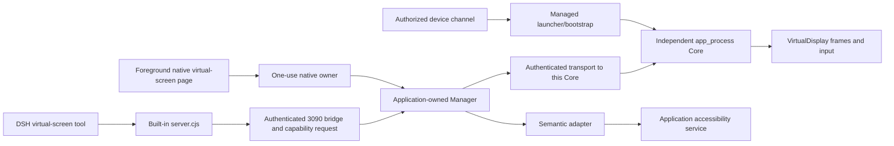

# ADR 0003: Independent virtual-screen lifecycle, observation, and input identity

Status: **Accepted**. Recorded: 2026-10-21. Scope: the current build190 implementation inspected for this record.

This ADR explains existing architectural choices and maintenance constraints. It adds no runtime permission and changes no APK. Listed tests are regression entry points, not a claim that translation reran them. Source, host fixtures, and historical software results do not establish acceptance on the current phone. See the [virtual-screen architecture](../virtual-screen-architecture.md) for calls and the [virtual-screen guide](../virtual-screen-guide.md) for prerequisites. Same-UID and tool-approval limits follow [ADR 0001](0001-build154-boundaries.md) and [ADR 0002](0002-current-threat-model.md).

## Context and problem

DSH needs both to observe an independent Android display and to execute a single input against a precise target. New frames arrive continuously; the application/window, accessibility connection, DSH generation, and permission can change while a request waits. A timeout does not prove that no action occurred. Treating capture, confirmation, input, and closure as stateless commands risks applying old coordinates, old nodes, or late callbacks to another instance.

An independent display is not a canvas in an ordinary Activity. Creating a VirtualDisplay and injecting input require actual device-side system capabilities; application confirmation cannot replace them. The design must also handle host reconstruction, Core disconnection, unknown creation results, and unavailable exit proof.

## Decision 1: Independent device Core, one application-owned manager

The application launches `VirtualScreenCore --launch` with the currently installed APK as classpath through an authorized Root, Shizuku, or ADB channel. The effective UID depends on the channel; it is not uniformly root or shell. The launcher starts an independent `app_process --server` using `setsid`, retaining the direct-child/bootstrap-pipe relationship rather than hiding it with `setsid -d`. Core chooses a random port and secret; the secret returns through bootstrap, not device-command argv. The parent launcher verifies liveness and ping before reporting started. See [launch commands](../../../app/src/main/java/com/deepseekharness/app/vscreen/VirtualScreenLauncher.java) and [Core launch/server](../../../app/src/main/java/com/deepseekharness/app/vscreen/VirtualScreenCore.java).

Core owns VirtualDisplay, ImageReader frames, restricted input, and this control connection. Application-owned `VirtualScreenManager` holds the handshake, channel, lifecycle epoch, queue, observation/semantic caches, and cleanup records. Activities do not each create an independent owner. Equal ports or tokens do not establish equal Core identity. Closing an old listener/HostControl retires only its own binding, never a later binding. See [Manager](../../../app/src/main/java/com/deepseekharness/app/vscreen/VirtualScreenManager.java) and [binding-race tests](../../../app/src/test/java/com/deepseekharness/app/vscreen/VirtualScreenCoreControlTest.java).

DSH enters built-in `dsh-tool-vscreen`, then uses `127.0.0.1:3090/app/vscreen/*` with X-Token to reach HttpShellService. JS validates the private token file, path, and bounded response: local HTTP reachability is not authorization. HttpShellService creates a capability/target request; Manager then sends control to this Core. Semantic node actions separately use the application's accessibility service. See the [tool adapter](../../../app/src/main/assets/builtin-plugins/dsh-tool-vscreen/lib/server.cjs) and [bridge entry](../../../app/src/main/java/com/deepseekharness/app/HttpShellService.java).

## Decision 2: Separate capture and input; retain three kinds of input evidence

| Path | Observation and admission | Non-interchangeable boundary |
|---|---|---|
| Raw coordinates / keys / text | Core checks screen generation, actual latest frameSeq, that the frame was observed, and freshness; input consumes observation state | Knowing a frameSeq is not observing it. Preview scheduling optimizations cannot relax Core's frame gate. |
| tree → node / editor | Accessibility nodes bind display/window/package and connection epoch; refresh, semantic recheck, and expiry apply before execution | A semantic node is not a coordinate. Do not additionally require unchanged pixels for a node action, or secretly tap after a node failure. |
| see → anchor → anchored_click | Select a unique actionable node from a retained original observation; bind original observation, node/window/geometry, and region proof; recheck and consume once | Creating an anchor does not click or extend observation TTL. Lost responses and UNKNOWN do not permit reissuing or replaying it. |

Native preview uses a separate thumbnail path, currently capped at width 720. Agent `see` retains an immutable full-resolution raw copy and returns a JPEG with matching dimensions; coordinates refer to that original. Current retention is 30 seconds, two copies, and 24 MiB. Native preview frames do not enter the Agent observation owner. A retained old original supports anchor verification without becoming a fresh latest-frame permit. See [preview pixels](../../../app/src/main/java/com/deepseekharness/app/vscreen/VirtualScreenPixels.java) and [Agent observations](../../../app/src/main/java/com/deepseekharness/app/vscreen/VirtualScreenObservedPixels.java).

`VirtualScreenPreviewInputGate` only coordinates local capture/decode adoption and gesture admission to avoid interference; Core still checks the actual frame. Semantic-node admission uses a tree no older than 30 seconds, current window, and node semantics rather than continuously unchanged pixels. Anchoring additionally checks window geometry, node bounds/path, and original-region proof. See [frame policy](../../../app/src/main/java/com/deepseekharness/app/util/VirtualScreenPolicy.java), [semantic adapter](../../../app/src/main/java/com/deepseekharness/app/vscreen/VirtualScreenSemanticAdapter.java), [anchor proof](../../../app/src/main/java/com/deepseekharness/app/vscreen/VirtualScreenAnchorProof.java), and [observed control](../../../app/src/main/java/com/deepseekharness/app/vscreen/VirtualScreenObservedControl.java).

## Decision 3: Layered identity evidence, not one authorized boolean

| Identity layer | Bound evidence and purpose |
|---|---|
| Assistant request | Current DSH/bridge identity, policy revision, capability request, and actual-target evidence; an old queued request cannot borrow a new grant |
| Manager | Application owner, lifecycle epoch, state revision, this port/token; revocation invalidates old snapshots first |
| Core process | coreInstance and birth identity; exit probes bind the original instance, never a bare PID, port, or name |
| Screen | displayId, generation, actual dimensions/orientation; displayId can be reused and is insufficient alone |
| Pixels | frameSeq, observed state, freshness; Agent additionally has observationId and immutable original pixels |
| Semantics / geometry | nodeId or anchorId, display/window/package, accessibility connection epoch, refreshed semantics and bounds/window geometry; caches cannot cross owners/connections |

Check the original snapshot before execution and again on asynchronous return. Successful observations retain their own identity: do not relabel instance A's response using instance B's later fields. Consume node/anchor IDs before calling the platform to prevent double submission, queue reuse, or late-result reuse. See [request scope](../../../app/src/main/java/com/deepseekharness/app/vscreen/VirtualScreenRequestScope.java), [Manager snapshots/responses](../../../app/src/main/java/com/deepseekharness/app/vscreen/VirtualScreenManager.java), and [target evidence](../../../app/src/main/java/com/deepseekharness/app/vscreen/VscreenTargetEvidence.java).

## Decision 4: Separate assistant permission and direct local operation

Assistant calls pass CapabilityBroker and a screen request. Global confirmation changes ASK to ALLOW only; it does not bypass explicit DENY, pause, OS permission, actual application targets, generation, or observation identity. Local policy/grants are not restored from user backups. Application confirmation does not grant Root/Shizuku/ADB or accessibility permission. See [global consent](../../../app/src/main/java/com/deepseekharness/app/util/NativeConsentPolicy.java), [screen-session grants](../../../app/src/main/java/com/deepseekharness/app/util/ScreenSessionGrant.java), and [screen confirmation](../../../app/src/main/java/com/deepseekharness/app/util/ScreenConfirmationPolicy.java).

Local “Node actions” requires an actually RESUMED AppCompatActivity to obtain a non-substitutable native owner and `NativeScreenControlLease`. Pause/stop/destroy permanently revoke it; resume does not revive the owner. This is a separate entry for explicit foreground user action, not a public interface that lets the assistant bypass approval with a null broker. Text goes only to nodes declared editable and non-password by the system. A truncated summary cannot be prefilled as if it were the complete original value and submitted without input. See [native owners](../../../app/src/main/java/com/deepseekharness/app/vscreen/VirtualScreenNativeControls.java), [native leases](../../../app/src/main/java/com/deepseekharness/app/screen/NativeScreenControlLease.java), and [node actions](../../../app/src/main/java/com/deepseekharness/app/vscreen/VirtualScreenAccessibility.java).

These checks constrain managed entries, not malicious same-UID plugins in a strong sandbox. They cannot guarantee that every OEM window exposes semantic nodes. A denied or missing target fails explicitly; it is not redirected to physical display 0.

## Decision 5: Never replay unknown results; commit exit evidence separately

After dispatch, a disconnect, cancellation, or missing response may follow an action that already executed. Preserve UNKNOWN. Do not switch device channels, obtain another image/anchor automatically, fall back to tap, or repeat close to repair an unknown outcome. NOT_SENT requires typed local pre-send facts; expired/committed/cancelled tickets and ordinary error text are insufficient. Platform acceptance of input does not prove its business effect; a new observation is needed. See [transport](../../../app/src/main/java/com/deepseekharness/app/vscreen/VirtualScreenTransport.java) and [launch results](../../../app/src/main/java/com/deepseekharness/app/vscreen/VirtualScreenManager.java).

Lifecycle states are STOPPED, STARTING, READY, and the barrier-retaining START_UNKNOWN, DISCONNECTED, CLOSING, CLOSE_UNKNOWN. Unknown cleanup blocks another launch. Revocation invalidates epochs, tickets, and observations before asynchronous cleanup; revoking a UI grant does not prove the remote process exited. See [lifecycle states](../../../app/src/main/java/com/deepseekharness/app/util/VirtualScreenLifecycleState.java).

Core's close response acknowledges display release only. Manager uses the original channel to probe the original birth identity read-only. Pending clears only after EXITED and a successful cleanup-journal commit. ALIVE, UNKNOWN, an old epoch, unavailable channel, or failed journal write retains the barrier. A late old exit proof cannot end a new instance, and status text cannot manufacture success. See [closeDetached/probeClosed](../../../app/src/main/java/com/deepseekharness/app/vscreen/VirtualScreenManager.java) and [birth identity](../../../app/src/main/java/com/deepseekharness/app/util/VirtualScreenCoreIdentity.java).

Core exit and Ubuntu DSH guest exit are separate proofs. Normal Web stop still uses WebStopCoordinator to confirm both guest and owned-launcher exit. WebLifecycleController retires HarnessService only after same-generation finishStop, no newer start, and this stop's successful proof. Core closure replaces neither proof; an older success cannot release the service after a later failure. The user's independent DeviceBridge is outside that service retirement. See [Web exit coordination](../../../app/src/main/java/com/deepseekharness/app/core/WebStopCoordinator.java) and [Web stop/retirement](../../../app/src/main/java/com/deepseekharness/app/core/WebLifecycleController.java).

## Recovery, updates, and platform boundaries

Manager's private journal outside rootfs stores lifecycle, boot, original channel, and handshake. Recovery of an unfinished handle in the same boot enters DISCONNECTED, preserving identity for cleanup. A missing handle or damaged record enters START_UNKNOWN. The journal neither restores write permission nor pretends reconnection is READY. A proven boot_id change can close an old-boot attempt; unreadable boot identity does not prove a change. Launch commands use the currently installed APK path after update; old Core/screen IDs cannot impersonate a current session. See [recovery logic](../../../app/src/main/java/com/deepseekharness/app/vscreen/VirtualScreenManager.java) and [persistent journal](../../../app/src/main/java/com/deepseekharness/app/vscreen/VirtualScreenSessionJournal.java).

Virtual screens require Standard on API 30+. Low rejects them even on modern Android; API 23 does not open the virtual-screen journal. These version prerequisites still do not guarantee Root/ADB/Shizuku availability, display creation, target-app behavior, accessibility, or OEM input support. Ordinary physical-screen access and Low Web functionality are not virtual-screen support. See [capability boundary](../../../app/src/main/java/com/deepseekharness/app/vscreen/VirtualScreenManager.java) and [channels](../../../app/src/main/java/com/deepseekharness/app/vscreen/VirtualScreenChannels.java).

## Alternatives and consequences

The following are **design inferences** from current code and constraints, not claims about historical meetings or authors' motives.

| Alternative | Reason for current choice and its cost |
|---|---|
| Reuse the physical screen or an Activity canvas | Neither is equivalent to an independent target display and device input. Core adds channel/process/recovery/OEM compatibility costs. |
| Execute arbitrary device-shell commands per action | Persistent display, frame, and single-use semantic identity are harder to bind. A managed local protocol is more verifiable but adds authentication, limits, and state-machine maintenance. |
| Coordinates for every action | Dynamic pages invalidate frames. Separate semantic input improves availability, but missing system nodes still require explicit failure or a new observation. |
| Accessibility nodes for every action | Canvas/missing-node pages remain uncovered. Pixel and anchor paths add geometry and observation-cache complexity. |
| Retry unknown work, switch channels, or kill by PID | These risk duplicate input and killing a reused PID. UNKNOWN and cleanup barriers reduce automatic recovery convenience and require diagnostics/read-only verification. |
| One permission switch for assistant and native UI | This cannot represent foreground user ownership, assistant request generations, and DENY. Separate admission adds interfaces/tests while retaining the source of each permission. |

## Affected files and maintenance invariants

Entry/protocol: `dsh-tool-vscreen/lib/server.cjs`, HttpShellService. Orchestration/persistence: VirtualScreenManager, Launcher, Transport, SessionJournal. Device side: VirtualScreenCore, DisplaySession, Input, Pixels, ObservedPixels. Semantics/UI: SemanticAdapter, Accessibility, AnchorProof, ObservedControl, NativeControls, VirtualScreenActivity, NativeScreenControlLease. These responsibilities do not imply this ADR modifies the files.

Preserve these invariants:

1. Verify port/token, Core birth identity, and screen generation separately; old listeners/callbacks cannot close a new binding.
2. Capture does not automatically input; input does not implicitly re-observe. Raw-frame, semantic-node, and anchored-geometry evidence do not replace each other.
3. A native foreground owner is not assistant permission. Global ALLOW preserves DENY, pause, and OS capability checks.
4. Consume IDs once before dispatch. UNKNOWN is not replayed, and a new instance cannot relabel an old failure response.
5. Collect display-release acknowledgment, Core EXITED, journal commit, guest exit, and launcher exit separately. Success in one cannot clear another unknown barrier.
6. Updates/process reconstruction restore cleanup facts only: no backup grants, old observations, or replay of unconfirmed actions. Low remains explicitly unsupported.

## Regression cases

Translation checked the existence and intended role of these tests without running them or operating a device. Select actual affected layers for future changes and disclose platforms/skips:

| Invariant | Regression entry |
|---|---|
| Late old-listener close, new Core binding, construction cleanup | [CoreControlTest](../../../app/src/test/java/com/deepseekharness/app/vscreen/VirtualScreenCoreControlTest.java), [NativeControlsTest](../../../app/src/test/java/com/deepseekharness/app/vscreen/VirtualScreenNativeControlsTest.java) |
| Application ownership, revocation fencing, late owner cannot clear new session | [ManagerOwnershipTest](../../../app/src/test/java/com/deepseekharness/app/vscreen/VirtualScreenManagerOwnershipTest.java), [ManagerRevocationTest](../../../app/src/test/java/com/deepseekharness/app/vscreen/VirtualScreenManagerRevocationTest.java) |
| Immutable see/budgets, anchor chain, semantic checks despite pixel changes | [ObservedPixelsTest](../../../app/src/test/java/com/deepseekharness/app/vscreen/VirtualScreenObservedPixelsTest.java), [AnchoredChainTest](../../../app/src/test/java/com/deepseekharness/app/vscreen/VirtualScreenAnchoredChainTest.java), [NativeInputFrameBoundaryTest](../../../app/src/test/java/com/deepseekharness/app/vscreen/VirtualScreenNativeInputFrameBoundaryTest.java) |
| Preview/gesture exclusion; old gesture cannot release a new one | [PreviewInputGateTest](../../../app/src/test/java/com/deepseekharness/app/vscreen/VirtualScreenPreviewInputGateTest.java) |
| Pause/window/connection epoch, truncated text, one submission | [NativeControlsTest](../../../app/src/test/java/com/deepseekharness/app/vscreen/VirtualScreenNativeControlsTest.java), [ActivityNodeControlsTest](../../../app/src/test/java/com/deepseekharness/app/vscreen/VirtualScreenActivityNodeControlsTest.java) |
| Original channel unavailable, late EXITED, journal failure retains pending | [CloseReconcileTest](../../../app/src/test/java/com/deepseekharness/app/vscreen/VirtualScreenCloseReconcileTest.java), [PersistentCleanupTest](../../../app/src/test/java/com/deepseekharness/app/vscreen/VirtualScreenPersistentCleanupTest.java) |
| Low/API 23 does not resolve API 30 execution capability or open journal | [LowBoundaryTest](../../../app/src/test/java/com/deepseekharness/app/vscreen/VirtualScreenLowBoundaryTest.java) |

Device display/input, OEM compatibility, real background/recovery, and long-duration scenarios require their own authorization and matching release-APK evidence. Host regression counts do not establish those results.
