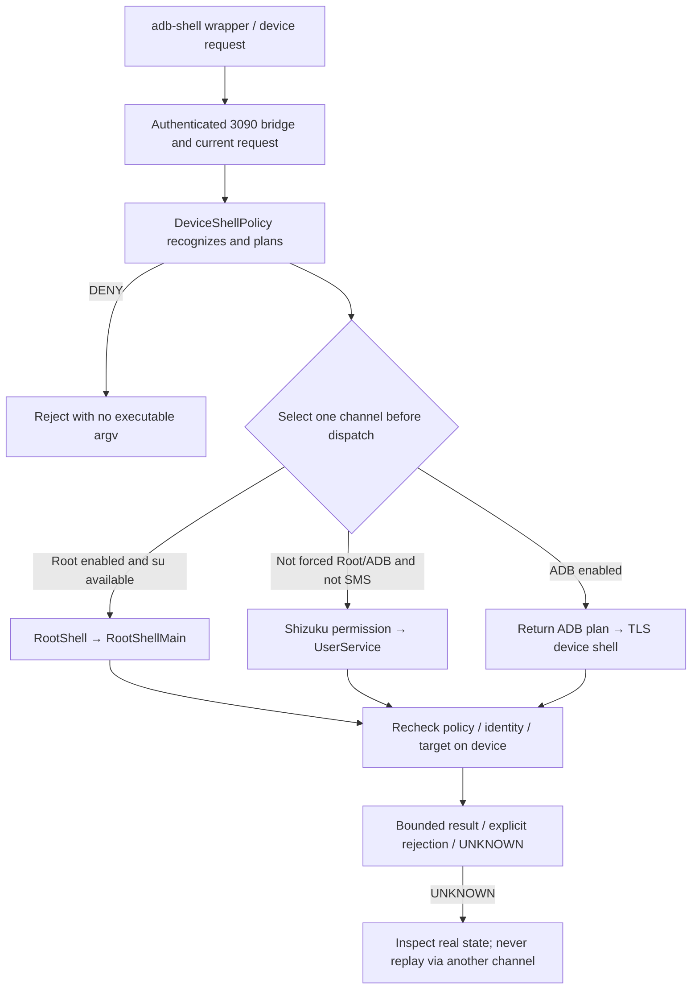
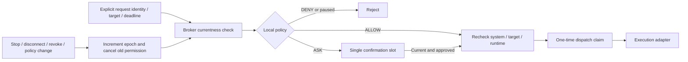

# Device permissions and execution-channel architecture

This maintainer guide uses F10 as a reference and follows the build190/F11 working tree as of 2026-10-21. It explains permission layers, entry points, storage, revocation and troubleshooting. Consult the [F11 record (original-language evidence)](../releases/v0.2.1-rc.2-build190-fix11-20261021.md) for its recorded software/APK scope and results. This is not a Root tutorial or a guarantee of any ROM capability. The documentation work reviewed source, tests and official references without building, running tests or operating a device.

For the project entry point, see the [architecture handbook](project-architecture-handbook.md); for runtime and data transactions, see [runtime, data and plugin architecture](runtime-data-plugin-architecture.md). Separate displays are covered in [virtual-screen architecture](virtual-screen-architecture.md) and [ADR 0003](adr/0003-virtual-screen-lifecycle-and-input.md). Same-UID and approval boundaries are covered in the [security model](security-model.md), [ADR 0001](adr/0001-build154-boundaries.md) and [ADR 0002](adr/0002-current-threat-model.md). See [references and provenance](references-and-provenance.md) for sources and project-evidence categories.

## 1. Distinguish seven meanings of “allowed”

| Layer | Authorizer/source of facts | Role in DSHA | Cannot replace |
|---|---|---|---|
| Android application permissions | System permission controller and special-access settings | Application capabilities such as microphone, location, notifications and storage | Root, ADB, Shizuku or assistant approval |
| Root | Existing device su and its manager; actual execution UID | Privileged device-command channel | DSHA command policy or screen-target validation |
| Shizuku | External service Binder, manager permission and UserService binding | Executes managed device commands under its actual identity | ADB pairing or application-private authorization records |
| ADB | System adbd, pairing keys and current authenticated connection | Local wireless device-shell channel | Root, a connected accessibility service or approval of this action |
| Accessibility | User's system settings and actual system binding | Nodes, gestures and some screenshot/screen operations | Arbitrary shell execution or permission to create a separate display |
| DSHA local confirmation policy | DeviceGrants, CapabilityBroker and the current runtime | Decides whether an assistant request asks, allows or rejects | System permission or a device connection |
| DSH session permission mode | Web/runtime options and tool policy | Tool constraints such as read-only and workspace-write | Android UID isolation or a strong system sandbox |

Android treats normal permissions, runtime permissions and special permissions separately. A Manifest declaration alone does not establish that every capability has been granted. [Android permissions overview](https://developer.android.com/guide/topics/permissions/overview). The checks in the last three rows are DSHA source policies, not security endorsements supplied by Android or Shizuku.

### 1.1 UID and “container root”

Ubuntu's `/root` is a guest filesystem view and working identity. It does not establish that the Android process has UID 0. File access by the ordinary application, Web backend, plugins and terminal remains subject to the actual host identity and granted Android permissions. The Root entry requires real UID 0; the managed privileged virtual-screen execution entry accepts only UID 0 or 2000. A Shizuku UserService may run as root or shell depending on how its service was started. “Connected” does not always mean root. Shizuku also documents that UID, Linux capabilities and SELinux affect available operations. [Shizuku API guide](https://github.com/RikkaApps/Shizuku-API#guide).

### 1.2 Where to inspect and modify behavior

- Settings entry: [DeviceGrantsFragment](../../app/src/main/java/com/deepseekharness/app/ui/DeviceGrantsFragment.java).
- Global confirmation card: [FullPermissionControls](../../app/src/main/java/com/deepseekharness/app/ui/FullPermissionControls.java).
- ADB pairing UI: [AdbPairActivity](../../app/src/main/java/com/deepseekharness/app/ui/AdbPairActivity.java).
- Manifest capability declarations: [AndroidManifest.xml](../../app/src/main/AndroidManifest.xml).
- Application-level composition and broker: [DshaApp](../../app/src/main/java/com/deepseekharness/app/DshaApp.java).

## 2. Android permissions: request by feature, recheck at use

The current Manifest declares capabilities including recording, location, networking, notifications, foreground services, package installation, overlays and file access. `WRITE_SECURE_SETTINGS` is protected; declaring it does not mean an ordinary installation receives it. `BIND_ACCESSIBILITY_SERVICE` restricts the party binding the accessibility service, rather than producing an ordinary runtime permission dialog. When maintaining a feature, inspect the Manifest, the UI requesting permission and the adapter that actually executes it.

| Feature | Current implementation entry | Maintenance boundary |
|---|---|---|
| Web microphone | [BrowserMicrophone](../../app/src/main/java/com/deepseekharness/app/ui/BrowserMicrophone.java) | Requested by the page; validate current origin/page/runtime identity; do not preauthorize at startup |
| Location, sensors and similar capabilities | [DeviceSense](../../app/src/main/java/com/deepseekharness/app/DeviceSense.java) and device-authorization settings | Local switches and system availability are independent; turning one off revokes its domain's requests |
| ADB/LAN local networking | [LocalNetworkAccess.granted/applyConfiguredFeatures](../../app/src/main/java/com/deepseekharness/app/bridge/LocalNetworkAccess.java) | API37+ explicitly checks ACCESS_LOCAL_NETWORK; this gate allows earlier versions, while other gates remain |
| File access | System special access/SAF and file adapters | Root and global confirmation do not expand file roots, NOFOLLOW rules or target scope |
| APK installation | System installation capability and installation transaction | Entering the system installation flow does not prove installation succeeded or runtime processes exited |

The API37 gate comes from current source. It does not imply identical behavior across Android versions, settings pages or ROMs. A user may revoke permission; permission may also be allowed while the actual service is disconnected. Obtain fresh facts at the use point. Choices in system dialogs still belong to the user; global confirmation cannot answer them automatically.

## 3. Root: finding su, user approval and execution are three steps

### 3.1 Discovery does not request Root

[RootShell.enabled/present/status](../../app/src/main/java/com/deepseekharness/app/RootShell.java) represent the local switch, verifiable su candidates and the latest execution status respectively. `present()` only checks known locations from [RootShellCandidates](../../app/src/main/java/com/deepseekharness/app/util/RootShellCandidates.java). A candidate must be a root-owned regular executable and must not be writable by group/other. Discovery does not execute su or trust an application-controlled PATH. Finding su therefore does not mean the manager has granted permission, and enabling the switch does not guarantee that a command can execute.

### 3.2 Execution entry

`RootShell.exec(ctx, command, authorizedSmsUser)` checks DeviceShellPolicy first. `runPrivileged()` then uses `su -c` to start the fixed RootShellMain entry in the currently installed APK. The business command is sent as JSON through standard input, rather than interpolated directly into su's shell arguments. [RootShellMain.main](../../app/src/main/java/com/deepseekharness/app/RootShellMain.java) verifies actual UID 0 before parsing bounded input. Operations requiring the application identity use PrivilegedPackageContext to check package name, UID and installation source; they must not guess a fixed `/data/app` path. Results return through a dedicated marker and Base64 encoding. The caller requires a complete result, not just any output.

### 3.3 Bounded execution and failure

The outer Root collector currently limits work to 65 seconds/400000 bytes; commands inside ShellService have their own deadline and output bound. An incomplete result, timeout, interruption or channel error remains `EXECUTION_UNKNOWN`; RootShell does not resend through Shizuku/ADB. Destroying this local helper proves neither that the remote action never happened nor that all its descendants exited. Root status records the latest channel outcome, not permanent capability permission. Turning Root off prevents subsequent selection and revokes corresponding virtual-screen requests; it does not promise rollback of an already dispatched action.

## 4. Shizuku: Binder, permission and execution-service connection are separate

### 4.1 State-machine entry

The methods in [ShizukuShell](../../app/src/main/java/com/deepseekharness/app/ShizukuShell.java) mean different things:

- `isInstalled()`: the manager can be discovered, or a service Binder already exists.
- `isAvailable()`: `Shizuku.pingBinder()` succeeds.
- `hasPermission()`: Binder is available and Shizuku's own permission check succeeds.
- `isReady()`: permission is valid and a pingable IShellService is bound.
- `status()/userStatus()`: display those independent facts and the latest error.

`init()` registers Binder-arrival and death listeners without depending on the ADB switch or a prepared Ubuntu environment. `requestPermission()` uses a separate request code on the main thread and handles only a matching callback. The current wait ends after 60 seconds if unfinished. `ensureBound()` binds ShellService with the `dsha-device-shell` tag, `shizuku` process suffix, non-daemon mode and current version code. Binding currently has a 15-second timeout. Death/disconnection clears the old connection, and a late callback first checks whether it still belongs to this connection attempt.

### 4.2 Manager compatibility layer

[ShizukuManagerCompat.reconnect](../../app/src/main/java/com/deepseekharness/app/ShizukuManagerCompat.java) requests Binder again only after a user click. It identifies the manager from the API_V23 permission declarer, checking the explicit handler, exported state and manager UID. Its callback accepts that UID only once, checks the Binder descriptor, then passes it to this application's protected Provider for the standard handshake. An APK path supplied by the manager is neither executed nor loaded. Requesting Binder again does not replace manager authorization.

### 4.3 Dispatch boundary

`awaitReady()` may wait for binding before dispatch; it does not block the main thread. Once `exec()` calls the remote Binder, an exception returns UNKNOWN. It does not automatically rebind and resend the command. Virtual screens have a separate `execVirtualScreenTyped()` path: an unready service with no Binder call may produce NOT_SENT, while an exception after the call remains UNKNOWN. UserService is not an ordinary application process, and its Context capabilities are limited. This is one reason it cannot directly read application SharedPreferences as authorization. The official API documents Binder execution in a separate UserService process and warns that its Context differs from a normal application Context. [Shizuku UserService](https://github.com/RikkaApps/Shizuku-API#userservice).

## 5. ADB: pairing is not connection, and connection is not action approval

Android's official wireless-debugging pairing flow targets Android11/API30+ phones. The pairing-code page provides a pairing address and port. DSHA's local Python client implements that device protocol; the official desktop flow does not establish local-client or all-ROM testing. [Android wireless ADB](https://developer.android.com/tools/adb#connect-to-a-device-over-wi-fi).

### 5.1 Preparation and pairing entry

[AdbPairActivity.PairModel](../../app/src/main/java/com/deepseekharness/app/ui/AdbPairActivity.java) owns pairing-page work so Activity rotation does not launch duplicate transactions. Pairing code, pairing port and connection port are handled separately. A saved address is not proof of pairing or connection. Pairing details may be entered by the user or obtained through accessibility observation enabled by the user. A watchEpoch prevents old observations from overwriting a new operation. When a connection port is absent, `_adb-tls-connect._tcp.` can be discovered. Pairing and connection services are not interchangeable. [AdbPairingInfo](../../app/src/main/java/com/deepseekharness/app/util/AdbPairingInfo.java) and AdbResult handle parsing/classification; a success label alone cannot enable the channel.

### 5.2 Dependencies and the local session

[AdbBridge.ensureReady](../../app/src/main/java/com/deepseekharness/app/bridge/AdbBridge.java) prepares managed scripts, settings, Python and locked wheel dependencies. Environment preparation and connection work use [AdbEnvironmentTask](../../app/src/main/java/com/deepseekharness/app/util/AdbEnvironmentTask.java) to coordinate maintenance occupancy. ENVIRONMENT_BUSY is not a pairing failure. [adb-pair.py](../../app/src/main/assets/adb-pair.py) and [adb-shell.py](../../app/src/main/assets/adb-shell.py) implement the protocol. The latter uses a TLS client, existing keys, saved ports and local service discovery. Candidate endpoints may be tried while connecting; after a remote command is sent it is not replayed. Keys and connection hints live in the guest-private `/root/.dsh/adbkeys`. Port history assists discovery, not connection or process identity. Disabling ADB preserves pairing keys. System revocation, network changes or adbd restarts may still invalidate later connections.

### 5.3 Success states must remain distinct

`DeviceBridgeService.recordPairResult()` distinguishes CONNECTED, PAIRED and states requiring user action. When pairing succeeded but shell authentication did not, it shows reconnection status rather than claiming device commands are available. TCP reachability establishes only that something is listening; it does not replace the authenticated result from `AdbResult.shellReady()`. Revoking authorization in Android and disabling DSHA's switch are different operations. Do not automatically delete the user's keys to repair a disconnect.

### 5.4 Independent keepalive service and the ANR boundary

[DeviceBridgeService.apply](../../app/src/main/java/com/deepseekharness/app/DeviceBridgeService.java) checks the ADB switch and LocalNetworkAccess before requesting service startup. API26+ uses a foreground-service entry; API34+ uses the connectedDevice foreground type. A denied background start retains diagnostics and waits for the user to return. START_STICKY does not guarantee indefinite survival. The service has a separate random serviceInstanceId and its own HttpShellService lease; network/screen-on callbacks and an Alarm trigger bounded probes. Probes run on a worker. Switch/lifecycle paths start or cancel work without moving waits for Python, networking or process exit onto the main thread. `adbIntentChanging()` increments the ADB intent epoch and cancels repair before publishing the switch, so an old worker cannot mistake an off→on cycle for unchanged intent. `probeCurrent()` checks the service object, running state, switch, epoch, pairing state and interruption. `onDestroy()` revokes this instance's repair, releases its lease, interrupts probing and removes callbacks/Alarm. Retiring HarnessService after normal DSH stop does not close a separately enabled DeviceBridgeService.

## 6. Device shell: plan, select one channel, then execute

[HttpShellService.devicePlan/deviceExecute](../../app/src/main/java/com/deepseekharness/app/HttpShellService.java) orchestrates this path. Before dispatch, the default priority is Root, then Shizuku, then an ADB plan. Explicit options and SMS restrictions change the eligible channels. A result already executed through Root/Shizuku is returned as completed even when it failed; it cannot be reinterpreted as a request for ADB to execute it next. `--su` still requires local Root permission and does not remove policy. An explicit endpoint uses the ADB path but still requests a native plan first.

### 6.1 Guards required at all three points

1. [DeviceShellPolicy](../../app/src/main/java/com/deepseekharness/app/util/DeviceShellPolicy.java) recognizes a single command, argv and paths. Approval cannot bypass rejection of unknown commands, scripts or pipes.
2. [DeviceShellExecutor](../../app/src/main/java/com/deepseekharness/app/DeviceShellExecutor.java) rechecks files, the application inventory and stop targets under the actual device identity.
3. [device-shell-policy.py](../../app/src/main/assets/device-shell-policy.py) consumes the native plan and checks required facts at the ADB execution boundary.

File operations use explicit paths and dedicated implementations; Root is not permission for arbitrary recursive modification. Stopping an application requires a complete user/system application inventory. PID targets are checked for UID first, then stopped by a determined package name to avoid PID-reuse damage. General shell execution rejects arbitrary app_process. Virtual-screen startup uses a separate managed-command contract bound to the installed APK and package identity. [ShellService](../../app/src/main/java/com/deepseekharness/app/ShellService.java) registers processes owned by this instance and collects bounded output; destroy only cleans up processes that instance owns. Its default command deadline is 30 seconds and output limit is 256 KiB. Truncation or timeout does not verify a business effect.

### 6.2 SMS is a separate sensitive-read domain

`DeviceGrants.smsReadAllowed()` is off by default; global confirmation does not replace it. Native plans permit only restricted `content://sms` queries for the current Android user, not sending, modification or deletion. Shizuku UserService does not possess application authorization records, so general sensitive reads are rejected; the current SMS path uses Root or ADB after native authorization. Root file-reading paths also recheck SMS-provider and canonical paths, preventing database-file access from bypassing this domain. Android/the provider may refuse even an allowed plan. SMS text and verification codes must not enter public diagnostics.

## 7. Accessibility: system binding and DSHA screen permission are separate gates

Android manages AccessibilityService binding, normally after the user enables it in system settings. An ordinary startService cannot substitute for that flow. [AccessibilityService lifecycle](https://developer.android.com/reference/android/accessibilityservice/AccessibilityService#service-lifecycle). [DshaAccessibilityService.enabledState/connected/availability](../../app/src/main/java/com/deepseekharness/app/DshaAccessibilityService.java) expose settings, actual connection and diagnostics separately. Enabled-but-disconnected must not be reported as operational. The old static `rebindIfEnabled()` lacks a fresh authenticated probe and cannot start automatic repair. Physical screen reading and gestures primarily use this application's accessibility service without requiring connected ADB/Shizuku. The privileged channel for creating a virtual screen/raw input remains separate from accessibility execution of its semantic nodes.

### 7.1 Narrow automatic repair is not silent initial authorization

[AccessibilityRepairOwner.afterAuthenticatedProbe](../../app/src/main/java/com/deepseekharness/app/screen/AccessibilityRepairOwner.java) accepts only a fresh authenticated ADB probe from this attempt. It also requires unchanged service/intent, granted WRITE_SECURE_SETTINGS, no current connection, and actual settings still containing this application's component, among its state-machine conditions. Repair only attempts to rebind an existing enabled intent, preserving other accessibility components. It cannot turn a disabled setting into user consent. The current repair window is five seconds with checks at every step; timeout, revocation, policy changes or service stop cancel it. [AccessibilityRepairState](../../app/src/main/java/com/deepseekharness/app/util/AccessibilityRepairState.java) owns attempt identity/results; TCP reachability or historical success cannot initiate a settings write. A ROM may reject protected-setting writes. Record the failure and retain manual entry points rather than retrying indefinitely.

## 8. DSHA approval, global confirmation and screen leases

### 8.1 Global confirmation is local policy, not a master system-permission switch

[DeviceGrants](../../app/src/main/java/com/deepseekharness/app/core/DeviceGrants.java) uses separate `dsha_device_grants` SharedPreferences. The global key is `native_global_consent_v1` and the screen key is `screen_confirmation_v1`; retained key names do not imply the encoding is still v1. [NativeConsentPolicy](../../app/src/main/java/com/deepseekharness/app/util/NativeConsentPolicy.java) converts only its own ASK to ALLOW, leaving explicit DENY unchanged. See [ScreenConfirmationPolicy](../../app/src/main/java/com/deepseekharness/app/util/ScreenConfirmationPolicy.java) for MANUAL/CUSTOM/ALLOW_ALL. Global ON does not erase existing rules, which apply again after OFF. System permissions, Root/ADB switches, SMS, location and other independent gates remain checked, as do pause and revocation. Choosing parameters, save destinations, restore scope or system-dialog responses is not skippable security approval.

### 8.2 Revision, persistence and corruption recovery

The revision is a monotonic fence that invalidates old requests, not a count of enabling actions or a runtime generation. Repeated healthy saves of the same value are idempotent. Ordinary start/stop and UI refresh do not rewrite the global record or increment that revision. FullPermissionControls sets rendering while calling setChecked so its listener cannot turn display rendering into a user choice. The normal UI mainly shows on/off; revision appears in diagnostic details. Saving fences old authorization, commits and reads back. A same-process read-back is not cross-process disk proof. A missing new record is unconfigured/OFF. Corruption, rollback or read failure remains fail-closed without automatically restoring historical ON. A user may explicitly confirm native rebuilding: retain the abnormal original, invalidate old requests and rebuild only OFF; enabling it requires another user choice. Real SharedPreferences disk tests must constrain encoding compatibility and XML newline handling; do not arbitrarily trim corrupt values. Local authorizations are not imported from user backups. Restoring data cannot restore leases, tickets, bridge tokens or queued confirmations. Android automatic backup also includes only an explicit portable-settings allowlist, not the entire authorization preferences. See [backup_rules.xml](../../app/src/main/res/xml/backup_rules.xml).

### 8.3 CapabilityBroker responsibilities

3090 bridge credentials use private files and the X-Token header, never a URL token. A reachable local port is not successful authentication. HttpShellService's BridgeRun owns its socket/thread pool and random runId independently; leases represent demand from Web and device services. Request admission captures the current run, global revision and other scope. After stop, a run change or policy change, an old result cannot satisfy a new request. Bridge credentials are not Web-origin permission; dedicated page-to-native interfaces still check the current page/origin and runtime identity.

[CapabilityRequest](../../app/src/main/java/com/deepseekharness/app/capabilities/CapabilityRequest.java) explicitly carries request ID, capability/action, installation identity, bridgeRunId, runtime epoch, target, policyRevision, authorityEpoch and a monotonic-clock deadline. [CapabilityBroker](../../app/src/main/java/com/deepseekharness/app/capabilities/CapabilityBroker.java) belongs to the Application and has one native confirmation slot, not an unbounded dialog queue. `current()` checks domain epoch, cancellation, installation/runtime ownership and deadline. Adapters must still recheck the real runtime, system capability and target. `authorize()/resolve()` are separate from `claimDispatch()`; a dispatch permit is consumed once. A late allow after revocation cannot authorize again. Platform calls, UI callbacks and I/O do not run under the broker lock, avoiding mutual blocking between confirmation and stop.

### 8.4 Screen permission and direct local operation

[ScreenSessionGrant](../../app/src/main/java/com/deepseekharness/app/util/ScreenSessionGrant.java) binds remembered permission to the complete runtime, bridgeRunId, policyRevision and authorityEpoch. Stop/disconnect/revocation invalidate this run's permission. Pause blocks new manual or automatic approval until explicitly resumed. `HttpShellService.screenPolicyChanged/globalConsentChanged/setScreenPaused` first fence, cancel old confirmations, discard observations or revoke the manager. Global-policy revision, broker epoch, screen-grant revision and Web generation are distinct fields; they cannot be merged or reset to zero. The native virtual-screen node panel has a separate [NativeScreenControlLease](../../app/src/main/java/com/deepseekharness/app/screen/NativeScreenControlLease.java), bound to a real RESUMED Activity and revoked on pause/stop/destroy. This local user entry cannot become an assistant bypass through a null broker, or relabel an old frame/node for a new screen.

## 9. Approval is not an answer; tool policy is not lifecycle proof

[BridgeAskDialog](../../app/src/main/java/com/deepseekharness/app/BridgeAskDialog.java) handles business questions. It is not marked as automatically skippable security confirmation. Its Activity must still be RESUMED for this attempt. Backgrounding, cancellation, a disappeared window or timeout cancels the question without fabricating a choice. Only explicit security-approval entries in `DshaDialogBuilder` may use global policy; input/option selection still requires actual user data. Official Web ask_user_question and `/app/ask` do not share one UI: the former belongs to the Web session, while the latter needs a native foreground window. [PermissionMode](../../app/src/main/java/com/deepseekharness/app/util/PermissionMode.java) is a DSH runtime option managed separately from Agent presets, Auto review and Android permissions. Plugins/terminals still share the application UID; managed device-shell guards cannot establish strong sandbox isolation for all plugin execution.

Normal Web stop uses [WebStopCoordinator](../../app/src/main/java/com/deepseekharness/app/core/WebStopCoordinator.java) to prove guest and owned-launcher exit separately. [WebLifecycleController](../../app/src/main/java/com/deepseekharness/app/core/WebLifecycleController.java) retires HarnessService resources only after successful proof for this attempt, in the same generation, with no new start. Failure/UNKNOWN retains the barrier. Old STOPPED proof cannot establish success for a later failed stop. ADB keepalive, Shizuku binding, virtual-screen Core, Web guest and launcher each have their own owner; stopping one does not mean everything exited.

## 10. UNKNOWN, NOT_SENT and one-time launch tickets

A connection may attempt recovery before dispatch. Once side effects have been sent, losing the response must remain UNKNOWN. NOT_SENT requires local proof that nothing was sent; an error message, timeout or absence of observed success cannot establish it. Virtual-screen ADB startup also uses [OneShotLaunchAuthority](../../app/src/main/java/com/deepseekharness/app/util/OneShotLaunchAuthority.java), binding the command, manager epoch and validity period. Native code issues the plan, and the bundled client commits immediately before the single remote-shell dispatch. The ticket is for the local helper and bridge, not transferable or reusable long-term permission. The current helper reads its ticket through a private stdin pipe and sends parameters to the local bridge. Error diagnostics must not echo a complete URL that may contain them. [AdbVirtualScreenStart](../../app/src/main/java/com/deepseekharness/app/bridge/AdbVirtualScreenStart.java) proves not-sent only when the local helper exited, output was completely collected, and the original valid uncommitted ticket was atomically withdrawn. A committed, cancelled, expired or missing ticket, or an incompletely collected helper, cannot downgrade UNKNOWN. [DeviceTransportResult](../../app/src/main/java/com/deepseekharness/app/device/DeviceTransportResult.java) preserves typed states; consumers must not guess again from strings. A close response proves managed-release acknowledgement only. Core birth-identity EXITED and journal commit require separate checks; see the virtual-screen ADR.

## 11. Troubleshooting order

| Symptom | Check first | Do not use this “repair” |
|---|---|---|
| Root is on but unavailable | su candidates, manager authorization, latest complete result/actual UID | Treat the switch as successful authorization or replay through another channel |
| Shizuku is installed but does not work | binder, permission, bound state and connection timeout | Repeated ADB pairing or loading an external APK supplied by the manager |
| ADB paired but cannot connect | Pairing/connection ports, current authenticated shell, LAN gate, maintenance busy state | Delete keys, assume 5555, or report TCP reachability as CONNECTED |
| Accessibility is enabled but unusable | Settings, actual connected state, target window and repair diagnostics | Silently enable it initially or restore old screen permission |
| Global ON still asks/rejects | System authorization/business input, explicit DENY/pause/changed target | Expand system capability or clear revision to remove the prompt |
| Global card shows an abnormal state | ReadState/SaveState and explicit rebuild-to-OFF that retains the original | Trim corruption, reset automatically to ON or import backup authorization |
| Background question disappears | Native foreground owner, question deadline and cancellation reason | Supply a default answer or turn cancellation into approval |
| A service remains after stop | Service owner, independent ADB intent, exit proof and current generation | Force-kill a bare PID or call an independent DeviceBridge a Harness leak |
| EXECUTION_UNKNOWN | Actual device state, new observation and original transaction/instance | Retry automatically, change channel/target or fabricate NOT_SENT |

Diagnostics may record state enums, capability domain, generation and redacted reasons. Do not publish tokens, pairing keys/codes, SMS, screen content or raw user paths.

## 12. Modification entry points and regression map

These are current test entry points and protected behaviors, not a claim that they were rerun or passed on devices during this documentation work.

| Change | Source/test entry points |
|---|---|
| Command grammar, paths and Root candidates | [DeviceShellPolicyTest](../../app/src/test/java/com/deepseekharness/app/util/DeviceShellPolicyTest.java), [DeviceAppPolicyTest](../../app/src/test/java/com/deepseekharness/app/util/DeviceAppPolicyTest.java), [RootShellCandidatesTest](../../app/src/test/java/com/deepseekharness/app/util/RootShellCandidatesTest.java) |
| ADB parsing, pairing state and environment occupancy | [AdbPairingInfoTest](../../app/src/test/java/com/deepseekharness/app/util/AdbPairingInfoTest.java), [AdbResultTest](../../app/src/test/java/com/deepseekharness/app/util/AdbResultTest.java), [AdbEnvironmentTaskTest](../../app/src/test/java/com/deepseekharness/app/util/AdbEnvironmentTaskTest.java) |
| Python preparation/wheels | [AdbDependencyPreparationTest](../../app/src/test/java/com/deepseekharness/app/util/AdbDependencyPreparationTest.java), [AdbWheelCacheTest](../../app/src/test/java/com/deepseekharness/app/util/AdbWheelCacheTest.java) |
| Two device-side guard layers | [test-native-device-policy.py](../../tools/test-native-device-policy.py), [test-device-shell-policy.py](../../tools/test-device-shell-policy.py), [test-adb-flow.py](../../tools/test-adb-flow.py) |
| Bridge authentication and late results | [BridgeCredentialAuthTest](../../app/src/test/java/com/deepseekharness/app/util/BridgeCredentialAuthTest.java), [BridgeLifecycleTest](../../app/src/test/java/com/deepseekharness/app/util/BridgeLifecycleTest.java), [test-bridge-token-transport.py](../../tools/test-bridge-token-transport.py) |
| Global-policy idempotence/corruption/real preferences disk | [DeviceGrantsTest](../../app/src/test/java/com/deepseekharness/app/core/DeviceGrantsTest.java), [DeviceGrantsPreferenceRecoveryTest](../../app/src/test/java/com/deepseekharness/app/core/DeviceGrantsPreferenceRecoveryTest.java), [FullPermissionControlsTest](../../app/src/test/java/com/deepseekharness/app/ui/FullPermissionControlsTest.java) |
| Policy encoding and payload | [NativeConsentPolicyTest](../../app/src/test/java/com/deepseekharness/app/util/NativeConsentPolicyTest.java), [NativeConsentProjectionTest](../../app/src/test/java/com/deepseekharness/app/core/NativeConsentProjectionTest.java), [ScreenConfirmationPolicyTest](../../app/src/test/java/com/deepseekharness/app/util/ScreenConfirmationPolicyTest.java) |
| One dispatch, revocation and pause | [CapabilityBrokerTest](../../app/src/test/java/com/deepseekharness/app/capabilities/CapabilityBrokerTest.java), [ScreenSessionGrantTest](../../app/src/test/java/com/deepseekharness/app/util/ScreenSessionGrantTest.java) |
| Repair only for existing intent; preserve other components | [AccessibilityRepairStateTest](../../app/src/test/java/com/deepseekharness/app/util/AccessibilityRepairStateTest.java), [AccessibilityEnableListTest](../../app/src/test/java/com/deepseekharness/app/util/AccessibilityEnableListTest.java) |
| ADB tickets/not-sent proof | [OneShotLaunchAuthorityTest](../../app/src/test/java/com/deepseekharness/app/util/OneShotLaunchAuthorityTest.java), [AdbVirtualScreenStartTest](../../app/src/test/java/com/deepseekharness/app/bridge/AdbVirtualScreenStartTest.java) |
| Questions separate from security confirmation | [BridgeQuestionsTest](../../app/src/test/java/com/deepseekharness/app/util/BridgeQuestionsTest.java), [BridgeConfirmationsTest](../../app/src/test/java/com/deepseekharness/app/util/BridgeConfirmationsTest.java) |

Before adding a capability, define its authorization domain, target evidence, deadline and revocation points, then choose the device adapter. Do not bypass orchestration with general shell execution directly from the UI. Asynchronous work carries an explicit request/owner, not ThreadLocal state or a global “allowed” flag that spills into the next request. Preserve invalidation-before-publication when changing switches. Preserve the distinction between possibly executed and definitively not sent when changing result models. A test verifies only its layer. System dialogs, su managers, Binder services, ROM background policy and actual device input still need independent device evidence.

## 13. Boundaries between official references and project implementation

- [Android permissions overview](https://developer.android.com/guide/topics/permissions/overview): system permission categories and request principles; a DSHA switch is not system permission.
- [Android ADB documentation](https://developer.android.com/tools/adb): ADB roles, pairing and wireless debugging; not proof that DSHA's local client works on every ROM.
- [AccessibilityService API](https://developer.android.com/reference/android/accessibilityservice/AccessibilityService): system lifecycle and capability contracts; no guarantee that target applications expose complete nodes.
- [Official Shizuku-API repository](https://github.com/RikkaApps/Shizuku-API): Binder, UserService and identity guidance; actual DSHA behavior follows local adapters and locked dependencies.

These primary references were reviewed read-only when the source page was written. They may change. Historical software tests or an API's existence cannot be reassigned as current device acceptance. Trace DSHA's command allowlist, global confirmation, tickets, pause, same-generation fences and stop proofs to the repository sources and tests above.
