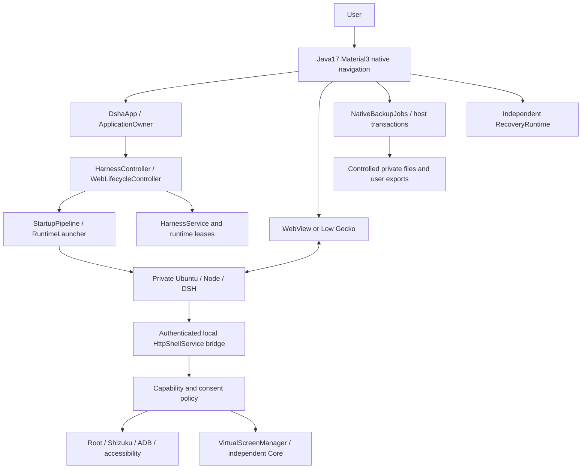
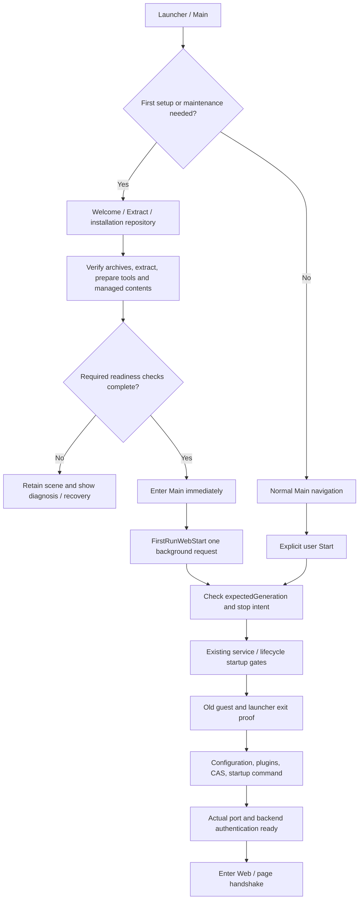
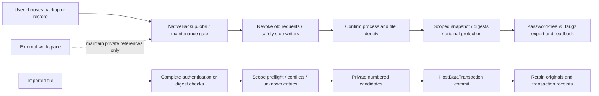

# DSHA project architecture and feature-maintenance handbook

> Translation verified: 2026-10-21. Source baseline: released F10 `087724c` and the current Chinese build190/F12 maintenance handbook and production call chain. F11 is an unpublished local checkpoint, not another released version. This complete feature/code map is not a new acceptance report and changes no runtime privileges, data format, or APK. Final identity and software/APK/asset scope are in the [English README](../../README.en.md), [release introduction](release-introduction.md), [app/build.gradle](../../app/build.gradle), and [F12 record](releases/v0.2.1-rc.2-build190-fix12-20261021.md); no final version or test total is prefilled here. Device, ADB, real-account/model-conversation, and long-duration work retain the delivery record's paused boundaries; host tests are not phone-performance measurements. The [F11 receipt](../releases/v0.2.1-rc.2-build190-fix11-20261021.md) remains a historical local record.

## 1. Reading order, project provenance, and current boundaries

Read the [README](../../README.en.md) first, then choose references for the area you will change.

| Reference | Questions it answers |
|---|---|
| [This handbook](project-architecture-handbook.md) | User features, component relationships, modification entry points, and regression selection |
| [Device permissions and channels](device-permissions-architecture.md) | ADB, Root, Shizuku, consent, and physical-device actions |
| [Runtime, data, and plugin architecture](runtime-data-plugin-architecture.md) | Installation, startup, managed updates, data transactions, and plugin installation |
| [Runtime engines](runtime-engines.md) | proot/proroot selection, migration, loaders, and exit constraints |
| [Ports and networking](ports-and-networking.md) / [DNS configuration](dns-configuration.md) | Automatic ports, network entry points, and resolver policy |
| [Virtual-screen architecture](virtual-screen-architecture.md) | Core, preview, observations, input identity, and exit proof |
| [ADR 0003](adr/0003-virtual-screen-lifecycle-and-input.md) | Design rationale for virtual-screen lifecycle and input boundaries |
| [References and provenance](references-and-provenance.md) | Official references, dependencies, current locks, and evidence levels |
| [BUILD](../../BUILD.en.md) | Toolchain, fixed inputs, software checks, and production signing |
| [Engineering standard](engineering-standard.md) | Layers, code constraints, formatting, and contributions |
| [Module map](module-map.md) | State ownership and collaborators across layers |
| [Security model](security-model.md) | Actual same-UID, plugin, bridge, and authorization boundaries |

DSHA is an Android host and adaptation project. It embeds upstream DSH and adds installation, lifecycle, device bridges, and data protection. [DeepSeek's deepseek-harness](https://github.com/deepseek-ai/deepseek-harness) is upstream; this maintenance branch, its private prerelease repository, and its Android changes do not represent an official DeepSeek release or certification. The DSHA project originates from [DSH-APP/DSHA](https://github.com/DSH-APP/DSHA), with current maintenance/distribution in [DSHA-prerelase](https://github.com/ym2025szz/DSHA-prerelase). Private pages require access rights.

Read the [npm manifest](../../tools/dsh-runtime/package.json) and [complete lock](../../tools/dsh-runtime/package-lock.json) to establish the embedded DSH version; do not infer it from the upstream default branch. The mobile UI is the third-party [dsh-web-mobile](https://github.com/mexiaosqwq/dsh-web-mobile) plugin. Its 3.2.1 source is pinned to an actual main commit, rather than an unmodified tag of the same name; see the [upstream lock](../../tools/mobile-plugin-upstream.lock.json). Local patches, fixed archives, licenses, and reproducibility scope have separate records. “Open source” does not imply every vendor binary can be rebuilt.

| Production choice in the source | Maintenance implication |
|---|---|
| Java 17, Material3, single `:app` module | Native UI/platform bridges use Java; no new Kotlin bypass |
| `dsh.android.client`, historical E7E3 certificate, non-debuggable release | Actual package/certificate checks establish upgrade compatibility; changing signatures is not an upgrade |
| Standard: minSdk 30, system WebView, arm64 | APK delivery described by the source record; system WebView still depends on the device |
| Low: minSdk 23, Gecko compatibility path, arm64 | Source/software checks retained; the source record did not deliver a new Low APK or device result |
| Ubuntu base10, DSH 0.2.1-rc.2 | Base environment, DSH, APK, and data format have separate identities |
| proot default, proroot explicit option | No production bxroot execution; old branch constraints do not override this choice |
| PiP off by default | System picture-in-picture is permitted only after explicit user enablement |
| Models and API keys configured in Web | Native model wizard, configuration-page model editing, and production routes are removed |

Do not present retired QuickChat or full-format/complete-reinstall erasure as current features. Compatibility readers for old credentials, backups, and retained originals still serve a purpose; UI retirement is not permission to delete personal data.

## 2. Locate features from the user interface

Main's bottom navigation has Launch, Terminal, Plugins, and Settings. A separate background-task entry observes app-level jobs. Settings links to installation, interface/runtime configuration, data/backups, device capability grants, and auxiliary pages. [MainActivity](../../app/src/main/java/com/deepseekharness/app/ui/MainActivity.java) and [SettingsFragment](../../app/src/main/java/com/deepseekharness/app/ui/SettingsFragment.java) define these entries.

| User goal | Current entry / main implementation | Important boundary |
|---|---|---|
| First installation, extraction, verification | Welcome, Extract, InstallFragment | Environment preparation complete is not Web readiness |
| Start, stop, restart, open workbench | LaunchFragment | Service/lifecycle orchestration serializes work; pages must not force-kill processes |
| Engine, port, DNS, display | ConfigFragment | Model/API-key editing is elsewhere |
| Configure providers, models, and credentials | DSH Web UI settings | Authentication and model capabilities belong to the external service |
| Interactive Linux command line | TerminalFragment / PtyTerminalFragment | Same execution domain as plugins, not a strong sandbox |
| Plugin catalog, install, toggle, update | PluginFragment / PluginInstallActivity | Check package format, dependencies, and actual loading separately |
| Root, Shizuku, ADB, and grants | DeviceGrantsFragment / AdbPairActivity | A channel toggle, actual grant, and connected state are different |
| Observe/control the physical screen | Accessibility, device bridge, built-in tools | Current target, screen policy, and system capability must all hold |
| Independent virtual screen and node actions | VirtualScreenActivity | Experimental Standard capability, not proof of Low support |
| Save a one-click backup | Data and backups → One-click backup | Safely stops before export; user restarts afterward |
| More export, restore, verification | NativeDataActivity | Read fully, validate, and preflight before transaction commit |
| Browse, save, share files | WorkspaceFilesActivity | SAF/Provider controlled streams; no arbitrary local path from Web |
| Automatic backups | AutomaticBackupActivity | Scheduling is system-constrained; uninstall survival is not guaranteed |
| Workspace/storage maintenance | StorageActivity / StorageHelpActivity | External workspace contents are not automatically scanned/cleaned |
| User skills | SkillsActivity | Imports documents into official skill directories; does not execute imported text |
| Startup diagnosis/recovery | DiagnosticActivity / StartupRecoveryActivity | Recovery and ordinary plugin queries use different state criteria |
| Independent emergency DSH | RecoveryActivity / RecoveryWebActivity | Independent runtime root; repair writes require native confirmation |
| App updates | UpdateActivity / UpdateDownloadService | APK updates differ from managed-environment updates |
| Agent tasks, notifications, overlay | AgentTasksActivity / OverlayFragment | Stop acts only on its bound task instance |
| LAN access | Enable LAN in configuration; Launch shows address | Current-run authentication remains required; no anonymous service |

### Common configuration and defaults

[ConfigStore](../../app/src/main/java/com/deepseekharness/app/core/ConfigStore.java) defines defaults. Saved toggles, completed system grants, and actual effect in the current run must be evaluated separately.

| Setting | Without explicit selection | Change/restore boundary |
|---|---|---|
| Shell confirmation | On | Distinguish app confirmation, DSH approval, and native terminal execution |
| DSH tool permission mode | `danger-full-access` | workspace-write/read-only are options, not Android UID isolation |
| Root Shell | Off | Enabling neither creates su nor proves actual UID0 |
| App update check | On | Controls checking intent, not completed download/installation |
| Desktop Web mode | Off | Browser presentation choice, not an engine change |
| PiP | Off | Requires an explicit local choice; historical archived true cannot re-enable it |
| Runtime eco mode | Off | Settings-page behavior; changed runtime behavior is not exit proof |
| LAN | Off | Still requires current-run proxy/authentication setup |
| DNS / plugin download source | `auto` | Download-source policy and DNS mode are distinct; see their guides |
| Native language / theme | Follow system | Explicit choices persist; Web language does not replace host choice |

## 3. Overall framework and state ownership

App-level state must neither disappear with a Fragment nor be copied into each page. `ApplicationOwner`, `HarnessSessionState`, and `RuntimeHostPorts` combine platform capabilities and unique runtime state. `HarnessController` keeps a compatibility facade; `WebLifecycleController` owns generations, queues, start/stop, and stop intent. `StartupPipeline` orders actions; `StartupEnvironmentActions` adapts host files, plugins, and configuration preparation. `WebOutputSession` parses this attempt's output; `WebProcessSession` holds the actual process and lease relationship. `MaintenanceCoordinator`, `RuntimeTasks`, and backup jobs enforce exclusion and maintenance commit.

Pages observe snapshots and submit requests. Button labels or cached state cannot independently decide that a process exited. The [module map](module-map.md) describes ownership and [ADR 0001](adr/0001-build154-boundaries.md) the historical decomposition. [ADR 0002](adr/0002-current-threat-model.md) defines security principals and threat assumptions. A package directory does not imply one lifecycle; a process does not imply every task shares one grant.

## 4. First installation, startup, and stopping

Main after initial extraction does not wait for the model catalog or a Web HTTP response to display. `FirstRunWebStart` consumes one installation-start ticket and persists submitted state; rotation/re-entry must not restart it twice. Its request includes `expectedGeneration`. Installation's own maintenance stop permits that explicit ticket, but a later user Stop changing generation must reject the old ticket rather than relaunch Web. Ordinary Start/Restart also prepares on a worker; UI destruction or a later Stop revokes queued work.

[FirstRunWebStart](../../app/src/main/java/com/deepseekharness/app/ui/FirstRunWebStart.java) and [LaunchFragment](../../app/src/main/java/com/deepseekharness/app/ui/LaunchFragment.java) are UI connections. Atomic generation rechecking and submission belong in [WebLifecycleController](../../app/src/main/java/com/deepseekharness/app/core/WebLifecycleController.java), not a single `isStarting()` check before a click.

Normal startup first checks managed identity, unfinished maintenance, and stop barriers, then prepares actual inputs. Old plugin CAS links are materialized after existing exit proof and before Web spawn, not while business work modifies originals. Automatic port uses `--port 0`, later reusing only locally recorded actual ports that remain available. Manual ports remain configurable; legacy default 3080 migrates to automatic, while old custom ports retain manual intent. Port memory is local-only, not imported from backups. See [ports and networking](ports-and-networking.md) for connections/LAN. Binding conflict, authentication, browser-engine handshake, and model HTTP are separate stages, not one “startup succeeded” result.

Stop first revokes runtime intent and old requests, then performs exact stopping and collects guest/launcher exit proof. `WebStopCoordinator`, `WebProcessManager`, and `TerminalSessionOwner` do not force-kill by bare PID, port, or name. Unverifiable birth identity, unknown results, or remaining descendants retain the barrier; timeout does not mean exit. Retire that generation's Harness foreground-service lease only after confirmed shutdown. A user's separate `DeviceBridgeService` keepalive may continue and must not be reported as Web still running.

## 5. Runtime, managed updates, maintenance, and emergency recovery

`ConfigStore`, `ContainerRuntime`, `ProotBootstrap`, and `RuntimeLauncher` connect engine selection to execution. Stable proot is default; proroot is explicit. Guest Ubuntu root is not Android root. proroot compatibility entries/native libraries have exact file, ABI, and managed-identity requirements and cannot be replaced with ad hoc UI environment assembly.

One fallback to proot may be allowed only after an explicit pre-authentication exit, no plugin failure, and confirmed exit of this attempt's processes. Record actual proot and its failure source rather than calling the fallback a proroot success. Slow startup, timeout, unknown outcomes, and already-submitted business actions must not be replayed. See [runtime engines](runtime-engines.md) for historical defaults, `kill-on-exit`, static loaders, and shims.

`InstallRepository` owns installation state; recreating a page does not reset background installation or its cancel signal. `ManagedRuntimeTransaction` and host-data transactions prepare candidates, trial them, then switch. `RuntimeTrial` checks contents, actual port/authentication, write/reopen data, sessions, and exit, not merely file existence. Ordinary DSH/UI updates with the same Ubuntu base must not rebuild current Ubuntu or roll user sessions back. Retaining predecessors does not permit arbitrary rollback; current-data read/write compatibility evidence is still required.

Discuss maintenance, repair, rebuilding, and APK upgrade separately:

| Operation | Main purpose | Original-data protection |
|---|---|---|
| Repair a component | Complete/verify managed contents | Do not treat unknown personal data as cache |
| Managed update | Update DSH, tools, or managed patches | Isolated candidate trial and transactional switch |
| Back up and rebuild environment | Protect data, then rebuild a controlled runtime root | No switch if protection fails; attempt rollback on failure |
| Storage cleanup | Remove proven regenerable/retired contents | Retain unknown, modified, and extra-member originals |
| APK upgrade installation | Update host and packaged managed inputs | Preserve signature/app data; does not establish environment upgrade |

`StartupRecoveryActivity` displays current diagnosis and rereads after busy work ends; stale “busy” must not hide results. A safe UI/profile is restricted loading within this regular environment, not an independent emergency root. `RecoveryController`, `RecoveryRuntime`, and `RecoveryService` use separate HOME, workspace, and fixed inputs. Emergency tools are limited to five; `RecoveryRepairBroker` HTTP requests cannot approve writes. Native confirmation binds candidates, digests, and generations and still passes stopping/host-transaction gates. See [runtime, data, and plugins](runtime-data-plugin-architecture.md).

## 6. Native navigation, both browsers, PiP, and keyboard

Main provides native navigation; WebPreviewActivity/Low GeckoPreviewActivity hold the page instance. Within a runtime generation, full screen, background, and PiP reuse the same page rather than “restoring” drafts by recreating it. `BrowserTasks` and task policy record explicit navigation origins, distinguishing system Home/background from deliberate return to Main. After Home from Web, the desktop icon should restore same-generation Web; deliberate Back/home-page navigation returns to Main. A new generation cannot claim an old Web task. Retiring an empty old host must match current identity. A successful `moveTaskToBack()` alone does not prove Main actually became visible.

PiP is off in the app by default; system PiP permission is not user enablement inside the app. Home, autoEnter, fullscreen return, and old-task re-entry all pass the same explicit-intent gate. Disabling PiP returns to normal home navigation while retaining the active page, sessions, and data. Native system bars stay visible. Safe regions cover stable status bars, cutouts, captions, and bottom system areas. PiP body insets are zero; fullscreen return uses current system state and idempotently clears only app-owned offsets/scales.

The keyboard integration introduced in the F10 source follows these production paths:

- [WebFullscreenUi](../../app/src/main/java/com/deepseekharness/app/ui/WebFullscreenUi.java) obtains actual insets and animation frames.
- [WebPageScripts](../../app/src/main/java/com/deepseekharness/app/ui/WebPageScripts.java) assembles controlled page bindings.
- [ime.js](../../app/src/main/assets/web-integration/ime.js) moves only the focused composer seat through composition.
- [page.js](../../app/src/main/assets/web-integration/page.js) shares identity/acknowledgment protocol with the Gecko content bridge.

During animation, the native browser keeps stable dimensions; it does not call `setPadding` every frame or translate/scale the whole WebView. Frames carry actual safe visible dimensions; DOM code maps them through the current CSS viewport into an absolute target, moving the input area while keeping the header stable. Independent CSSOM rules avoid per-frame style/class mutations triggering the mobile plugin's MutationObserver. One in-flight message and the latest pending frame are coalesced with complete nonce/generation/instance binding; an old acknowledgment cannot release a new request.

The terminal frame commits native dimensions. Resize and terminal packets converge on the same absolute target regardless of arrival order. Blur, navigation, detach, PiP, and cancellation revoke temporary offsets without clearing user-owned transforms. Missing bridge/composer/CSS support, zoom, or user transforms fall back safely to boundary adjustment. This mechanism does not establish identical frame rates across phones, input methods, or WebView versions.

Android documents `onPrepare` before relayout, while terminal insets can arrive before `onStart`. Ordinary onApply is therefore not every animation frame, and the first frame must not jump to the endpoint. See [Android keyboard animation guidance](https://developer.android.com/develop/ui/views/layout/sw-keyboard). This project's consumption and old-API compatibility still depend on current AndroidX and actual regression evidence. See [browser engines](browser-engines.md) for current operation. The original-language [Standard](../android-standard.md) and [Low](../android-low.md) notes are historical platform records, not current instructions or fresh device evidence.

## 7. Models, plugins, catalog, and skills

Provider, model name, API key, and related chat options are edited in DSH Web settings. Do not restore the retired native ModelSetup page, configuration editing buttons, or hidden Intent routes. An old native key is compatibility fallback only when explicitly readable and no persistent Web credential exists; existing Web settings take precedence. Temporarily unreadable, attention required, not configured, and available are different states, never collapsed to an empty string over old ciphertext. `ConfigStore`, `KeyVault`, and compatible credential reads still serve migration, backup, and recovery.

Plugin entries include native management, the Web plugin page, link activation, and local file import. Production has catalog/installation capabilities, without DSHA endorsing third-party source or model behavior. Sources can be npm, GitHub repositories/assets, HTTPS archives, or local packages and must satisfy the actual plugin format. An ordinary npm library does not become a plugin because “dsh” appears in its name. Validate paths, entries, name/version, and managed patches. GitHub source preparation, npm distributions, and built author Release assets are distinct paths whose test results are not interchangeable. Network, upstream prepare scripts, and Android-container compatibility can each cause failure.

[PluginRepository](../../app/src/main/java/com/deepseekharness/app/core/PluginRepository.java) connects native UI to guest tools. [plugin-manager.py](../../app/src/main/assets/plugin-manager.py) resolves sources, discovers, and installs; [plugin-transactions.py](../../app/src/main/assets/plugin-transactions.py) manages candidates, originals, and commit journals. The [tools lock](../../tools/runtime-tools.lock.json) defines bundled pnpm, not a temporary global version on the phone. Production dependencies permit unlocked resolution, lifecycle scripts, and pnpmfile; retain actual resolved locks and dependency-directory records. Download-stage script suppression must not be described as a guarantee that the whole installation never executes third-party code.

Checked candidates commit/enable automatically, while deliberate user disablement and safe-mode intent remain authoritative. Installation-directory existence, profile registration/enablement, and actual loading in current Web are three layers; list text does not replace load results. Uncommitted transactions block ordinary startup from overwriting scenes; committed old journals cannot roll back later user changes. Removal acts on exact object identity; old dependency links follow their actual version contract without recursive external deletion. Signed APK managed proof rebuilds system plugins; user source, actual dependencies, and wrappers are archived separately. Before mobile UI updates, check whether upstream absorbed or withdrew differences; do not reapply a whole historical patch set. User skills enter through [SkillsActivity](../../app/src/main/java/com/deepseekharness/app/ui/SkillsActivity.java). See [plugin operations](plugins.md); a historical title does not override the current lock.

Discovery filters small manifests and actual patch bundles first, authenticates proof once per command/request, and deduplicates canonical directories. It does not replace full FILE/mode/LINK, directory membership, and race proof with cross-request stat caches. Actual Node Host bundle/full-content proof uses asynchronous work with at most two global content scans, reads of at most 64 KiB, and event-loop yields. Removal preflights outside writer/HMR locks, then fully rechecks the actual target inside commit. Read-only list does not occupy the profile writer lock; these optimizations neither skip content proof nor relax deletion targets.

Native enable/disable strictly checks actual readback of package name, Boolean state, and `intentVerified: true`. It presents intent first, then independently coalesces refresh. Successful toggling is not component readiness or live-loader replacement; restart Web for it to apply. Cancelable list/refresh returns explicit errors on concurrent configuration rewrites or writer locks and retains cached entries. The 30-second query/short-intent limit is a cooperative total budget including queueing, preparation boundaries, and execution. Individual system I/O, monitor/Binder waits are not preemptible; unknown exit retains the original barrier rather than promising strict wall-clock termination.

Existing desktop actual-Host evidence records two list calls at about 0.65 seconds and an independent Worker HTTP ping at about 14 ms while scans remained pending. This is fixture responsiveness evidence, not a phone measurement, final-APK performance result, or guarantee for all plugin sizes. See [plugin runtime and permissions](plugin-runtime-and-permissions.md) for full implementation/failure boundaries. This handbook reruns no tests and adds no final totals.

## 8. Native capabilities, ADB / Root / Shizuku, and authorization

DSH Android tools enter the authenticated local bridge through built-in adapters; the native terminal is a separate execution entry. [BridgeRoutes](../../app/src/main/java/com/deepseekharness/app/util/BridgeRoutes.java) matches paths only; [HttpShellService](../../app/src/main/java/com/deepseekharness/app/HttpShellService.java) handles requests and capability orchestration. Routes provide device/app information, app launch, clipboard, share/open, vibration, location, sensors, flashlight, and other functions. Success still requires system capability, user grants, parameter budgets, and target state; route existence is not success proof.

Each privileged channel requires actual availability:

| Channel | Prerequisites | Maintenance concern |
|---|---|---|
| Root | Existing device su, enabled app toggle, and actual UID0 verification | Guest root does not establish Android Root |
| Shizuku | Available service Binder, user authorization, and valid UserService binding | Independent of the ADB toggle; Binder presence is not completed authorization |
| ADB | Actual pairing/connection, port/key identity, current connection generation | Pairing and connection ports differ; never hard-code them |

Ordinary `devicePlan/deviceExecute` selects Root → Shizuku → ADB; force/SMS paths have dedicated rules. Unknown results after sending cannot cause replay on another channel. Only an explicit NOT_SENT permits revoking an uncommitted ticket under its controlled contract. Wireless pairing UI mainly targets Android11+; older paths depend on actual ADB TCP, Root, or Shizuku conditions. The app neither creates Root nor completes every protected system-setting grant for the user.

Global toggles, DSH tool approval, screen confirmation, and Android permissions are separate layers. Global consent may reduce app ASK prompts, but cannot override DENY, system capability, actual target, pause, or runtime-generation gates. Screen policy supports all manual, per-app rules, and allow all. Skipping confirmation does not skip current-target/observation identity checks. Invalid persistent records fail closed. After native confirmation, preserve the original and rebuild OFF, then let the user enable it. Backups do not automatically activate grants; Stop, revocation, and disconnect invalidate this run's permission or queued requests.

See [device permissions and channels](device-permissions-architecture.md) for fuller channel, grant, and disk-state details. Android's app sandbox is based on app UID; same-UID plugins/terminals do not have independent Android app isolation. See [AOSP app sandbox](https://source.android.com/docs/security/app-sandbox) and this project's [security model](security-model.md).

## 9. Physical screen and independent virtual screen

Accessibility and device execution observe/control the real physical display; actions are not automatically redirected to a virtual screen. Accessibility connection, foreground app, screen rules, latest screenshot/nodes, and execution identity may change independently. Old screenshot coordinates, old tree nodes, or a previous approval are not permanent action permission.

An independent `app_process` Core creates the virtual `VirtualDisplay`, with the app Manager retaining its managed owner. Native Activity, overlay preview, and DSH observation consume different evidence from that one object rather than each starting a Core. Preview is not input authorization, and displayId is not full identity. Images, frame sequence, raw-coordinate mapping, nodes/editors, and observation anchors each have their own contracts. Long-editor writes require complete-content evidence; truncated display text cannot overwrite the real field.

DSH `tree/node/editor`, `see/anchor/anchored_click`, and native node actions have different input sources. An explicit native click cannot grant a background model an extended lease. Leaving the page or owner changes revoke current action eligibility. Closing requires exact Core exit and confirmed display release, not just a disconnected socket. UNKNOWN retains journals/barriers. Missing identity must not lead to bare-PID cleanup or automatic replay of creation/clicks.

Read [virtual-screen architecture](virtual-screen-architecture.md) and [ADR 0003](adr/0003-virtual-screen-lifecycle-and-input.md) before changes. See the [virtual-screen guide](virtual-screen-guide.md) for prerequisites, and preserve the explicit unsupported boundary for Low.

## 10. Terminal, attachments, files, sharing, and microphone

The terminal is a real PTY, not command output placed in a TextView. `PtySession`, `TerminalFragment`, `PtyTerminalFragment`, and `TerminalSessionOwner` manage sessions and exit. Terminal/plugins may execute user code; tool confirmation is not a strong sandbox for arbitrary same-UID code. Maintenance cannot assume writers stopped merely because terminal UI closed; actual session identity and exit criteria still apply.

Attachments use system SAF. `WebUploads`, `WebUploadChooser`, and `DocumentStreams` handle Provider streams. Reads preserve AssetFileDescriptor offset/length rather than treating a slice as the entire underlying file. Cancellation must not wait for a remote Provider on the main thread. Real browser callbacks deliver multi-select, MIME, and cancel results. Web File/Blob sharing/saving requires current origin, top-level page, and runtime identity; arbitrary local paths are not accepted. Downloads check actual filename, transfer completion, and user cancellation. An opened chooser is not a completed save/share. FileProvider temporary read-only grants and DocumentsProvider system grants are not anonymous public directories. See [Web file sharing](web-file-sharing.md).

Microphone permission is requested when Web asks, not preauthorized at ordinary startup. WebView/Gecko permits only pure-audio requests from the current local page, checking actual host, port, page, and generation. `RECORD_AUDIO` and ordinary `MODIFY_AUDIO_SETTINGS` serve separate purposes; manifest declarations do not replace runtime permission. Approving audio does not also open camera/screen audio, and an old canceled callback cannot approve a new page.

## 11. LAN, DNS, notifications, and task observation

The actual local Web port differs from the LAN proxy entry; current proxy constants are in `LanProxyService`. Enabling LAN still binds authentication to this run. Launch normally shows the service address; users can inspect current connection information. Recheck currency after generation, port, or network changes; an old URL is not a permanent access credential. `LanAuthBridge`, `LanAuth`, HTTP parsing, and proxy-stream boundaries jointly prevent stale sessions and invalid tunnel connections. Only a real successful WebSocket handshake enters tunnel mode; bodies, chunk/trailers, and hop-by-hop headers must remain consistent. See [ports and networking](ports-and-networking.md).

Configuration offers Automatic (recommended), IPv4, and Native resolver policies, not three public DNS server presets. auto does not set `ipv4first`. auto/ipv4 retry family4 once only on specified Node lookup errors when family is unspecified or 0. ipv4 additionally adds app-owned `no-aaaa` for guest glibc; native skips the Node replacement and removes app-owned `no-aaaa`. This does not force all processes or DoH to IPv4 or remove user resolver options. Read [DNS configuration](dns-configuration.md) before changing policy and check this process's actual environment and restart requirements.

`HarnessService` protects user-started Web/terminal work; `DeviceBridgeService` can protect device connections independently. Data maintenance and emergency recovery own separate services/leases, so one global “service still exists” cannot replace all exit checks. Agent tasks use ordinary progress notifications, without requiring promoted capsules. `AgentTaskNotifications` records current task facts, notification clicks route to the bound session, and stop binds to an exact task queue. `BackgroundTasksActivity` observes installation, plugin, data, and other tasks read-only; cancel returns to each workflow's safety boundary. The overlay shows progress, thoughts, or commands and offers confirmation entries according to actual overlay permission and user settings.

## 12. Data, backup, restore, and external workspaces

One-click backup reuses `OneClickBackup`, `NativeBackupJobs`, and the existing v5 engine rather than creating another lightweight format. Standard publishes directly to `Download/DSHA`; Low old-system flow reuses a persistent grant after first directory selection. Backup safely stops DSH and running tasks, generates/verifies contents, then delivers the file. It does not restart business work automatically. It includes application data recorded in the actual manifest and the current in-app workspace; users must back up external workspace contents separately.

More options support scope selection, import preflight, historical readers, verification, restore, and re-export of verified copies. New user exports are password-free `DSHA-data-v5-<UUID>.tar.gz`, not renamed encrypted files. Internal automatic copies remain encrypted. Old encrypted originals require their original password to read, and failure does not overwrite them. Password-free exports provide integrity, not confidentiality; chats, projects, and `.env` may still contain secrets. One-click excludes the native API key by default. Other entries follow the actual request/user choice, not an old preference generalized across every path. Excluding that key is not automatic redaction of all exported contents. See [host v5 archive](backup-format-v5.md).

Automatic backup defaults on with daily, interval, and after-stop plans; Android constrains actual scheduling. Background automatic jobs must not forcibly stop active Web/terminal work to meet a schedule. Automatic rotation handles only confirmed normal copies; manual, unknown, and partial records are not automatically expired as cache. Local keys/copies are not guaranteed to survive uninstall, so save readable exports outside the app. `VerifiedBackupCopy` re-export does not recollect sources or promote PARTIAL/BEST_EFFORT into complete.

Restore fully validates input/actual scope before private numbered staging and final transactional commit. System plugins restore intent and are rebuilt by the current APK; user plugins, actual dependencies, and quarantine records are restored according to their graph. Unknown/executable configuration and plugins needing attention must not become active without review. APK/DSH version does not determine data format; old-data read/write compatibility needs real evidence.

External workspace maintenance disconnects private references only; it does not traverse, clean, rename, overwrite, or replay old journaled writes/deletes against external contents. `RetainedDataActivity` provides read-only inspection, export, and preflight restore without a new auto-delete feature. Retired-environment cleanup needs stable identity, digests, and explicit retirement proof; modified/extra-member originals remain. Current configuration reset is a controlled settings/.env transaction preserving plugin composition, sessions, and credentials, not full formatting.

Old-port draft restore separately uses `BrowserOriginRestoreActivity` and a controlled local recovery page. It retains sources/candidates and verifies that target semantics are blank before restoring, without overwriting actual new drafts, references, commands, or view requests. Structured empty drafts and old string drafts have separate compatibility handling. Credentials, leases, and purely presentational width are not session-restore objects. Android private-directory framework aliases must explicitly bind canonical authority without weakening the NOFOLLOW file layer.

## 13. Modules, resources, and cross-language contracts

| Path / class group | Modification entry | Related constraints |
|---|---|---|
| `ui/` | Main, Launch, Config, Workspace, browsers, diagnosis | Navigation origin, lifecycle, no blocking main thread |
| `core/` | HarnessController, WebLifecycle, Startup, maintenance, configuration | Unique runtime state, generation fences, maintenance exclusion |
| `runtime/` | Installation, launchers, managed assets, trials, process stopping | Actual bytes, argv/env, birth identity |
| `backup/` | File layer, v5, transactions, automatic/one-click backup | NOFOLLOW, scopes, originals, cancellation boundaries |
| `recovery/` | Independent root, processes, repair broker | Do not substitute regular environment for emergency dependencies |
| `screen/`, `vscreen/` | Physical/virtual observation and input | Display, frames, nodes, owner, exit proof |
| `bridge/` and root-package services | ADB, HTTP, Shizuku, Root, LAN, PTY | Channel identity, authentication, revocation, result classification |
| `data/`, `util/` | Keystore, pure format/policy/protocol logic | Compatible records; do not reduce failure to empty values |
| `assets/builtin-plugins/` | DSH system plugins and Android tool adapters | Signed-asset proof and real DSH plugin contracts |
| `assets/web-integration/` | Controlled scripts for both browsers | Same origin, main frame, nonce/generation/instance |
| `tools/` and locks | Generation, patches, host checks, release checks | Update source and deployed bytes together |
| `res/`, `i18n/` | Material resources, UiText, bilingual indexes | No credential disclosure in text or dead-page remnants |

Production Java is in [app source](../../app/src/main/java/com/deepseekharness/app/), Low adaptations in the [low source set](../../app/src/low/), and tests in [host JUnit](../../app/src/test/java/com/deepseekharness/app/). Historical directory counts are not live architecture. Build/fixture-only scripts must not be presented as user features.

## 14. Verification, builds, and the modification workflow

[BUILD](../../BUILD.en.md) defines the full toolchain/signing process; this is only a maintenance-selection map. Git source and full source ZIP differ in fixed offline-input coverage; missing large archives do not constitute a complete slim APK. APK contents cannot reconstruct every original Ubuntu, DSH, emergency, or tool build input by inference. [ci-assets.py](../../tools/ci-assets.py) and locks constrain sources/digests; production builds still inspect actual members. [prepare-runtime-descriptor.py](../../tools/prepare-runtime-descriptor.py) generates managed-asset/launcher/bridge/data-contract identity. The descriptor, patch registry, Java DSH constant, and npm lock must agree; changing only displayed versions is insufficient.

| Change area | Meaningful regression entry points |
|---|---|
| First-run/main-thread responsiveness | `FirstRunWebStartTest`, `WebLifecycleResponsivenessTest`, `StartupPipelineTest` |
| Navigation and PiP | `BrowserTasksTest`, `PictureInPictureOptInTest`, browser task/presentation policy tests |
| IME and both bridges | Both `WebFullscreenUiIme*Test` classes, `tools/test-native-ime.mjs`, `test-native-presentation.mjs` |
| Device consent/channels | DeviceGrants/NativeConsent/ScreenConfirmation tests, `test-adb-flow.py` |
| Physical screen | ScreenOwnership tests, `tools/test-physical-screen-flow.py` |
| Virtual screen | `VirtualScreen*Test`, `tools/test-adb-vscreen-bridge.py`, ADR 0003 regression index |
| Backup and one-click publication | `OneClickBackup*Test`, `BackupDownloadsPublicationTest`, archive/transaction/file-layer tests |
| Plugins and recovery | `tools/test-native-plugin-manager.mjs`, `verify-plugin-upgrade-gate.py`, transaction/recovery tests |
| DSH and system plugins | `test-dsh-builtins.mjs`, `test-dsh-sessions.mjs`, actual raw/managed runtime fixtures |
| Mobile UI | `test-mobile-*.mjs`, pinned upstream pure-function and actual-browser-module fixtures |
| LAN and protocols | `LanAuthTest`, LanAuthBridge/HTTP/proxy-boundary tests |

Run change-related checks first. One owner then runs required affected JUnit suites for both flavors, Release Lint, and actual-APK gates. Record selected JUnit classes, executions, skips, platform-dependency failures, and reruns separately instead of showing only final green totals. [host-tests.manifest.json](../../tools/host-tests.manifest.json) centralizes host test entries/dependencies. Register real environment needs for new tests. If an old-API case lacks an SDK jar, supply the dependency instead of silently skipping it. [Engineering standard](engineering-standard.md) and [source provenance](source-provenance.md) constrain formatting, origin, and historical isolation.

To make a change concrete and reviewable:

1. Locate its UI entry from this handbook, then identify the Application/core/Manager that actually owns state.
2. Write down old behavior, target behavior, and identity/data/authorization boundaries that must remain intact.
3. Modify a narrow platform port or collaborator; do not create a second runtime state in a Fragment or an ad hoc cross-language protocol.
4. Preserve a real before-failure and add a regression that exercises the production path, not a mirror of implementation constants.
5. Synchronize required resources, i18n, format lists, deployment inventories, and test manifests; remove dead routes.
6. Let one owner generate assets/descriptors and check actual package signing, identity, DEX, assets, and licenses.
7. Update this handbook or a focused guide, state unverified boundaries, and bind device/software/release receipts separately to actual SHAs.

## 15. Results that must remain distinct during diagnosis

- Environment READY, backend authentication READY, an interactive page, and a model response are different stages.
- Root toggle, existing su, and actual UID0 differ; Shizuku Binder, authorization, and binding differ; ADB pairing differs from connection.
- Queued task, bytes sent, action executed, and peer acknowledgment are different successes.
- A virtual-screen image, injected input, and actual target-app response do not prove one another.
- Stop UI, guest exit, launcher exit, Core display release, and service retirement each require evidence.
- Backup generation, Provider publication, complete readback verification, and complete data coverage cannot be collapsed into one claim.
- Unreadable credentials are not unconfigured; unknown data is not garbage; historical receipts are not current scenes.
- Same-origin bridge checks, tool approval, and proot do not strongly sandbox arbitrary third-party code.
- Both flavors passing software checks does not mean a Low APK was delivered this round; passing browser fixtures does not cover every ROM/input method on phones.
- Adding manuals or uploading source changes neither a signed APK nor the scope of device/long-duration validation.

Continue with [device permissions](device-permissions-architecture.md), [runtime and data](runtime-data-plugin-architecture.md), [engines](runtime-engines.md), [networking](ports-and-networking.md), [DNS](dns-configuration.md), [virtual screens](virtual-screen-architecture.md), [provenance](references-and-provenance.md), and [BUILD](../../BUILD.en.md).
