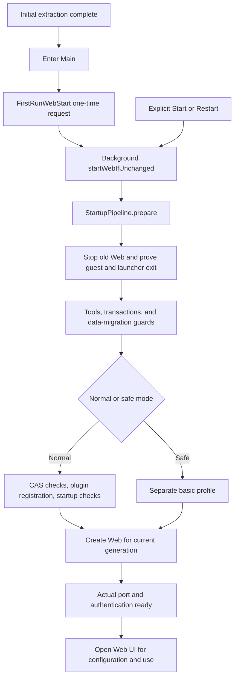
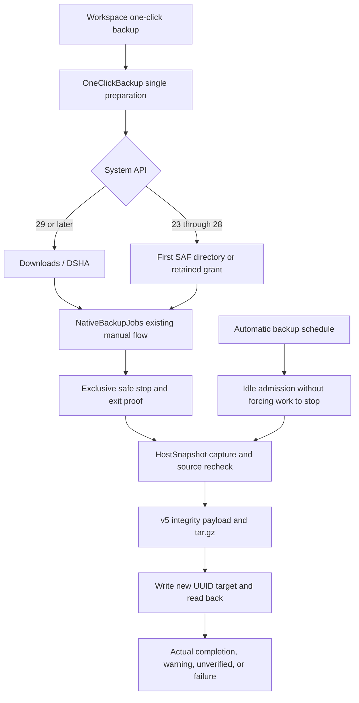

# Runtime environment, data, and plugin mechanisms

> Translation verified: 2026-10-21. Source baseline: released F10 `087724c` and the current Chinese build190/F13 maintenance guide and production call chain. F11 is an unpublished local checkpoint, not another released version. This is source navigation, not a new build, device acceptance, real-account test, or proof for every historical dataset. The delivery owner records final identity and executed scope through the [English README](../../README.en.md) and [release introduction](release-introduction.md). The [F12 record](releases/v0.2.1-rc.2-build190-fix12-20261021.md) retains its published historical identity. The [F11 record](../releases/v0.2.1-rc.2-build190-fix11-20261021.md) retains its historical local-checkpoint scope. The [F13 record](releases/v0.2.1-rc.2-build190-fix13-20261021.md) is the delivery owner's final software/artifact entry; this page does not prefill the final version or formal totals.

This guide is for developers preparing to modify DSHA. It explains where the environment comes from, who owns data, and how plugins enter the actual startup flow. The source configuration is Ubuntu base10, official DSH `0.2.1-rc.2`, Node 24, and bundled pnpm `10.34.5`. The default engine is `proot`; users may explicitly choose `proroot`. The production design does not use bxroot. These flows and constraints belong to DSHA and do not imply an Android guarantee from Ubuntu, Node, pnpm, or upstream DSH.

## Reading order and evidence layers

- Project entry: [README](../../README.en.md), [AGENTS](../../AGENTS.en.md), and [BUILD](../../BUILD.en.md).
- General navigation: [project architecture handbook](project-architecture-handbook.md) and [module map](module-map.md).
- Device capabilities: [permissions architecture](device-permissions-architecture.md) and [virtual-screen architecture](virtual-screen-architecture.md).
- Security boundaries: [security model](security-model.md) and [ADR 0002](adr/0002-current-threat-model.md).
- Input and lifecycle: [ADR 0003](adr/0003-virtual-screen-lifecycle-and-input.md).
- Historical decomposition rationale: [ADR 0001](adr/0001-build154-boundaries.md).
- Source and ownership: [source provenance](source-provenance.md) and [references and provenance](references-and-provenance.md).
- Runtime details: [engine selection](runtime-engines.md), [ports and networking](ports-and-networking.md), and [DNS configuration](dns-configuration.md).

To understand a behavior, check the current entry point, actual asset lock, test boundaries, and acceptance record for the corresponding version, in that order. Read old DSH versions, engine choices, and test counts in their historical context; current behavior is established by current code and locks. A host simulation proves its specified contract, not successful coverage of every Android version, remote plugin source, or device matrix.

## 1. APK, runtime environment, and user data are three layers

The APK supplies the Java host, native launchers, fixed offline archives, and managed scripts. The Ubuntu rootfs supplies Linux user space, in which Node/DSH runs. Data-layout and migration contracts govern user conversations, configuration, plugin intent, and work files; APK updates cannot overwrite them arbitrarily. Guest `/root` is not Android UID0. A tool-approval mode does not change the app UID or establish an independent malicious-code sandbox.

| Layer | Main entry points | Check first when changing it |
|---|---|---|
| Android orchestration | `core/HarnessController`, `WebLifecycleController` | Generation, stop intent, maintenance, and foreground service |
| Guest execution | `runtime/ProotBootstrap`, `RuntimeLauncher`, `ContainerRuntime` | Actual argv, environment, birth identity, and exit proof |
| Managed contents | `ManagedRuntimeAssets`, `RuntimeTools` | Manifests, content digests, candidate preparation, and atomic switching |
| User data | `backup/UserDataLayout`, `GuestDataResolver` | Actual layout, link boundaries, and historical originals |
| Plugin state | `PluginRepository`, guest plugin scripts | Distinguish installation, selection, disablement, and actual loading |
| Backup/restore | `NativeBackupJobs`, `HostSnapshot`, `HostDataTransaction` | Source scope, preflight, quiescence, and destination readback |

Find classes in those directories under the [main Java package](../../app/src/main/java/com/deepseekharness/app/). Core orchestration, host archives, and guest scripts execute in different domains. One Java method returning does not establish completion in every domain.

### 1.1 Fixed assets and descriptors

Key inputs follow; actual packaging locations also depend on Gradle-generated configuration.

| Input | Purpose | Authoritative location |
|---|---|---|
| `offline-rootfs.bin` | Base Ubuntu environment | APK asset and its packaged manifest |
| `dsh-runtime.bin` | Fixed DSH/Node-module overlay | [Runtime package lock](../../tools/dsh-runtime/package-lock.json) and package-building tools |
| `pnpm-runtime.bin` | Fixed pnpm distribution | `RootfsInstaller.pnpm`, managed descriptor |
| `python-support.bin` | Bundled Python support | `RootfsInstaller.python` |
| `ubuntu-tools.bin` | Ubuntu tools package | Packaged layout, manifests, and install scripts |
| `managed-runtime-inputs.json` | Installation targets and managed-input contract | [Actual contract](../../app/src/main/assets/managed-runtime-inputs.json) |
| `runtime-descriptor.json` | Identity of content, launcher, bridge, and data contracts | [Current descriptor](../../app/src/main/assets/runtime-descriptor.json) |

`runtimeId` comes from managed contracts and content fingerprints; it is not the APK versionCode. `baseVersion=10` is the Ubuntu base-environment version and should not be arbitrarily incremented for ordinary DSH or UI changes. `launcherInputs` includes only startup inputs declared by the descriptor, not a digest of the entire Java source tree. UI files outside it still require corresponding source/build validation; the descriptor does not cover every source file.

The generator is [prepare-runtime-descriptor.py](../../tools/prepare-runtime-descriptor.py). Managed package preparation also uses `prepare-dsh-runtime.py`, `build-dsh-runtime.py`, `generate-builtin-plugins.py`, and `prepare-backup-assets.py`. See [app/build.gradle](../../app/build.gradle) and [BUILD](../../BUILD.en.md) for inputs, outputs, and checks. One owner should generate and verify changed assets together; concurrent tasks must not rewrite archives or descriptors.

### 1.2 The current APK launcher and older runtime trees

[RuntimeLauncher](../../app/src/main/java/com/deepseekharness/app/runtime/RuntimeLauncher.java) constructs the current execution entry point. `RuntimeLauncherAssets.prepare` publishes bridge scripts from the current APK into a separate managed directory, mounted in the guest at `/run/dsha-launcher`. This avoids overwriting a retained old runtime tree just to use a new launcher. Runtime rollback must still check read/write compatibility among the current launcher and data; the continued existence of an old directory is insufficient.

Native process recognition, guest identity, and launcher exit all participate in the stop barrier. Android-host, guest-bash, and actual-Node PIDs are not interchangeable identities. The proroot vendor is `v1.2.8`, constrained by the [local ABI lock](../../tools/proroot-compat/abi.lock.json), independently of historical DSHA app version numbers. Vendor binaries, compatibility adapters, and source-buildable components have separate provenance; do not promise that every vendor component can be rebuilt from source.

## 2. First-run and ordinary startup

After initial extraction, the app goes directly to Main and starts Web in the background. Models and API keys are configured in Web. A native model form or native model-catalog warmup no longer blocks Main. Extraction complete, process creation, backend authentication, and a usable page are different stages.

### 2.1 One first-run request and the user's Stop

[FirstRunWebStart](../../app/src/main/java/com/deepseekharness/app/ui/FirstRunWebStart.java) stores first-run pending/submitted state. `mainIntent`, `schedule`, and `enqueue` together limit the initial-setup request; an arbitrary external Intent is not automatic-start authorization. `enqueue` requests startup in the background; rotation or re-entry must not submit twice.

`startWebIfUnchanged(expectedGeneration, true, status)` accepts an explicit setup request for the same generation. Here `manual=true` permits the stopped state left by installation maintenance; a later user Stop changes generation and still rejects the old queued request. Replacing this with unchecked background `startWeb()` could start again after the user stopped it. The UI thread updates status and visible foreground-service protection only; it must not perform slow disk preflight, wait for the guest, or do Provider I/O.

### 2.2 Orchestration and actual startup

[HarnessController](../../app/src/main/java/com/deepseekharness/app/core/HarnessController.java) is the shared entry for UI and services. [WebLifecycleController](../../app/src/main/java/com/deepseekharness/app/core/WebLifecycleController.java) owns generations, request admission, stopping, and recovery. `requestStart` handles existing stop/maintenance conditions and rechecks generation after slow preflight. `StartupPipeline.prepare` orders preparation and returns the actual profile only after success. `StartupEnvironmentActions.releasePrior` calls `stopOwnedLaunchers` and `confirmStopped`; unknown old-process exit is a failure, not a check to skip in order to open a page.

Normal startup preparation includes:

1. Read compatibility state for old native credentials; stop old LAN and Web.
2. Verify old guest/launcher exit; check bundled tools and required extraction.
3. Recover eligible data transactions and check historical-cleanup and rc1-migration guards.
4. Check old pnpm CAS file links in the normal profile, then register built-ins.
5. Remove only eligible historical automatic-review markers and run this attempt's real pre-loading checks.
6. Check generation, startup permission, and actual profile; create Web and observe authentication output.

`WebLaunchCommand.build` uses dynamic port `0` or an explicitly selected port. Only complete official output can establish authentication. A reachable port or page contents alone do not prove readiness of this Web generation. Slow startup, authentication timeout, and UNKNOWN cannot trigger automatic replay of user work. Engine fallback is restricted to the narrow, explicitly allowed startup failure before business actions and with proven exit; it is not a general retry policy.

### 2.3 Stopping and ADB-related responsiveness

`stopWeb` publishes the current stop fence before a worker performs potentially blocking cleanup. `WebStopCoordinator` and process sessions check exit of guest, launcher, and other tasks. Until exit is established, retain the stopped state, task records, and maintenance barrier; do not send force-kill signals to a bare PID. An ADB toggle, virtual-screen disappearance, or lost Activity does not prove guest exit.

The main thread must not hold the lifecycle monitor while waiting for slow preflight, thread joins, or remote I/O. Related host responsiveness regressions prove their specified blocking boundaries, not a unique root cause of ANR on a particular device.

### 2.4 Saved run records and background page recovery

A normal new start enters periodic identity checks after saving its run record; this is not exclusively a host-process reconstruction path. F13 negative controls using the compiled F12 classes reproduced a single failure permanently retaining `restoreUnknown`. Current [WebSessionRecheck](../../app/src/main/java/com/deepseekharness/app/core/WebSessionRecheck.java) distinguishes live, unknown, and exited observations and discards late results from another record/generation/instance/URL/actual port.

UNKNOWN retains the original DOM or Gecko session and background protection, revokes screen epoch, old task tickets, and LAN, and does not turn display identity into current ready authority. Standard and Low show a native waiting state. The same identity must pass kernel → actual HTTP authentication → second kernel checks before a new registration object lets the original page continue. Old objects/queued tickets do not revive, and conversations, starts, or stop operations are not resent. A confirmed guest exit is displayed with records retained; launcher stopping still requires independent proof. Retaining a page is not a strong browser/backend-RPC sandbox and does not pause all JS/Node work. Targeted JVM/Robolectric checks and fixed-F12-class negative controls are complete. Standard Activity/same-DOM/Blob/Service protection was checked only in those host fixtures; Low has compilation and source review, without a complete Gecko Activity regression. These do not replace final dual-flavor Gradle/APK checks or establish acceptance on the reported phone, ROM background behavior, or real models. See [startup and diagnostics](startup-and-diagnostics.md) for states and entry points.

## 3. Safe startup, emergency DSH, and maintenance recovery

These entries solve different problems and cannot replace one another.

| Path | Entry point | Environment | Main boundary |
|---|---|---|---|
| Normal startup | Main / Launch → controller | Regular rootfs and normal Web profile | Loads the actual configured plugins |
| Safe startup | `recoverWebIfUnchanged` and related calls | Separate basic profile in the regular environment | Leaves original plugin toggles intact; normal restart can return |
| Startup recovery page | `StartupRecoveryActivity/Model` | Host state, snapshots, and repair entries | Shows failure and bounded maintenance without pretending readiness |
| Independent emergency DSH | `RecoveryController/Runtime` | Independent runtime root, HOME, and workspace | Does not depend on the damaged regular environment |
| Environment maintenance recovery | `BackupTask.recoverMaintenance` | Recorded transactions and fixed targets | Recovers by identity/digest, not unrestricted replay of writes/deletes |

### 3.1 Startup recovery UI

`StartupRecoveryModel` reads recovery state, snapshots, and manageable plugins. The UI itself does not own background maintenance. A transient `RECOVERY_BUSY` should trigger another read after the task ends; a successful read clears stale error. A busy read-only plugin query is not “modifying the environment.” Main retains failure hints for explicit plugin/settings navigation but should not steal foreground from repair UI. Real pending transactions, Start/Stop, and maintenance remain barriers; a usable UI does not bypass plugin-load checks.

### 3.2 Independent emergency environment

[RecoveryRuntime](../../app/src/main/java/com/deepseekharness/app/recovery/RecoveryRuntime.java) prepares its environment from an independent lock at [tools/recovery-runtime/lock.json](../../tools/recovery-runtime/lock.json). If a regular archive exactly matches the emergency lock digest, the APK may share physical bytes through a location map. Shared package bytes do not mean a shared extracted runtime root; otherwise the pinned independent copy must remain.

`prepareProfile` creates an emergency-agent package with valid name/version and limits it to the emergency repair tool set. Without a usable model credential, diagnosis can be inspected first; conversation requires an appropriate credential. Diagnosis success is not model-request success.

[RecoveryRepairBroker](../../app/src/main/java/com/deepseekharness/app/recovery/RecoveryRepairBroker.java) can propose repair plans. HTTP cannot replace native write confirmation, which binds candidate, source digest, and data generation. Writes still use host transactions and the stop barrier. Stopping emergency chat cannot release an active repair lease early. `READY_READ_ONLY` describes diagnosis for this emergency attempt and grants no exemption from the regular environment's stop barrier.

### 3.3 Managed updates and isolated trials

`BackupTask.updateEnvironment` delegates maintenance orchestration; actual switching uses `ManagedRuntimeTransaction`. `RuntimeTools.prepareManagedOverlay` shares required package-manager, built-in dependency, and settings-patch preparation with ordinary tool setup. Fully prepare candidates before computing managed digests; do not defer missing pieces until the user's first Web startup.

`RuntimeTrial` uses an isolated profile to check static contents, native modules, the actual port/authentication, and storage/session writes followed by reopening. Both guest and launcher exit must be confirmed before a trial can support commit. Records state the actual runtimeMode and the source of an allowed fallback; a proot pass is not a proroot pass. Runtime rollback does not automatically restore user conversations to an old snapshot.

Retention follows real health proof and directory contents. Changed, unreadable, or extra-member old trees stay in place. Retain the required healthy predecessors; directory counts and cached receipts are insufficient for deletion. `RuntimeTrialRecords` rotates closed records within bounds and retains unclosed/abnormal scenes. Transaction cancellation, power loss, and failure must follow their own recovery records, not another install command used to guess completion.

## 4. Command environments for Node, pnpm, and plugins

### 4.1 Command discovery and preparation

[WebLaunchCommand](../../app/src/main/java/com/deepseekharness/app/util/WebLaunchCommand.java) explicitly puts fixed directories including `/root/dsh-bin` at the front of PATH while retaining the inherited tail. It does not assume non-login `bash -c` reads `/etc/profile.d`. `RuntimeTools.preparePackageCommands` prepares npm/npx/pnpm together and checks entries, distributions, version markers, and wrappers. `RootfsInstaller.pnpm` publishes actual pnpm from signed assets; a stale nonempty wrapper or missing executable bit also requires repair.

The managed publisher rejects link targets rather than treating any user link as an overwriteable managed regular file. Verify the native plugin CLI environment and the Web subprocess entry independently; one working entry does not prove the other's PATH is correct.

### 4.2 Copy default and old CAS repair

proroot `--link2symlink` changes some file-link semantics, and Node may resolve package-entry realpaths into the pnpm store. The managed pnpm wrapper therefore defaults to `package-import-method=copy`, preserving explicit user environment and command-line precedence. This affects new imports only, not already reused old shared dependencies. Do not hide old-tree problems by globally changing Node realpath, broadening path permissions, or blindly using `--force`.

After confirming old Web exit, normal startup calls `plugin-manager.py materialize-cas-links`. It handles only provable pnpm CAS file links under current `profiles/web/node_modules`. It checks each target's SHA-512 against its CAS filename, copies original bytes into a regular file, retains the original link, and leaves store, lock, and manifest unchanged. Explicit algorithm `DSHA_PNPM_CAS_COPY_V1` uses an independent transaction plan and commits in batches beyond a single-batch limit.

No repairable links is a successful no-op. Unknown algorithms, changed targets, and pending state are not success. Partial commit/interruption retains the scene; the next normal startup cannot replay it automatically and requires explicit transaction recovery. This does not run install scripts or reinstall user packages.

## 5. Plugin source, selection, and runtime state

### 5.1 System and user layers

[builtin-plugins.json](../../app/src/main/assets/builtin-plugins.json) declares bundled plugins and their guest locations. Official core bundles, APK-supplied wrappers, and third-party user packages are identified separately, not collapsed into one layer by same-name directories. The bundled mobile plugin is `3.2.1`; package inputs manage its locked source and local differences. System bytes are rebuilt from the current APK's managed proof. User backups retain their toggles rather than copying system entities as user source. User plugin archives include actual source, dependencies, wrappers, and provenance bindings; resolving dependencies again during restore does not preserve originals.

The package-proof changes described in the Chinese source as F11 further check APK-managed proof and complete FILE/mode/LINK contents. They do not exclude user packages by npm scope, a `dsh-` prefix, location, or writable `installation.dependencies`. Native backup reads APK proof, scans real runtime bundles without aliases, and rechecks changes before backup. An unproved package inside the installation tree is user/unverified: inspect, toggle, and export are allowed, but native management does not automatically update/remove it there. Normal profile user plugins follow the existing management flow. See [plugin runtime and permissions](plugin-runtime-and-permissions.md).

Discovery filters small manifests and real patch bundles before authenticating the proof table once per command/request and deduplicating canonical directories. Complete content, mode, LINK, directory-member, and race checks remain; a cross-request stat cache is not proof of current content. The actual Node Host uses asynchronous filesystem APIs for bundle/full-content proof, with at most two global content scans and 64 KiB read blocks, yielding the event loop. Node removal preflights outside writer/HMR locks and fully rechecks the actual target inside commit. Native Python removal retains its independent NOFOLLOW object transaction; a recent list view is not deletion proof.

Optional built-ins include the device-shell guide, task notifier, status overlay, mobile UI, Android computer-use, Auto review, and virtual-screen tools. Internal integrations such as `dsh-app-integration` also appear in the inventory but are not ordinary third-party removal targets. See [permissions architecture](device-permissions-architecture.md) for capabilities and authorization.

### 5.2 Registration and enable/disable intent

[register-builtin-plugins.py](../../app/src/main/assets/register-builtin-plugins.py) owns discovery, managed links, profile-manifest merge, and toggles. `register()` must not restore a signed wrapper that the user explicitly disabled on the next start. Web toggles and native registration share a profile-manifest write lock; native entries acquire data then package locks. Web clears only disable markers it owns, not native empty/unknown markers or safe-mode intent.

`dsh-auto-review` and the official experimental Auto package name are merged into one logical choice to avoid duplicate cards/activation. Do not generalize that alias to arbitrary same-name third-party packages or change a session's permissionMode through a toggle.

Observe these states separately:

1. Installed: source and dependencies exist and pass the current package checks.
2. Selected: profile bundles/dependency declarations select the plugin.
3. Disabled: native/Web markers or safety intent prevent loading.
4. Loaded: this DSH attempt actually loaded it and `apply` succeeded, not merely a visible card.
5. Restart required: installation/toggle committed but a hot-update result for current Web is not established.

`PluginRepository` drives native UI; `PluginActivationHooks` and startup observers diagnose actual loading. A failure retains plugin name and redacted cause. Installed must not be promoted to functioning.

Native `enable-state` / `disable-state` commit and read back intent only. The caller strictly checks package name, Boolean state, and `intentVerified: true`, presents that receipt first, then independently coalesces refresh. A successful toggle is not component readiness, live-loader loading/disposal, or hot update; normal Web restart applies it. Read-only list/refresh does not occupy the profile writer lock and is cancelable. Concurrent configuration changes or an existing writer lock return explicit errors; retained cached entries are not newly verified results.

Queries and short intent commands share a 30-second cooperative total budget for queueing, preparation boundaries, and execution; the actual runner receives remaining time. `GuestScriptBudget` checks between steps and around stream reads. A single system I/O, monitor wait, or Binder call is not preempted by this mechanism, so it cannot guarantee every platform call terminates within exactly 30 seconds. Cancellation/timeout does not turn unknown exit into confirmed exit. Original task and maintenance barriers remain and writes are not automatically replayed.

An existing desktop actual-Host fixture recorded two list calls at about 0.65 seconds and an independent Worker HTTP ping at about 14 ms while scanning remained pending. That establishes responsiveness only for those Node/desktop inputs, not a phone, final APK, arbitrary plugin scale, or end-to-end performance guarantee. This documentation synchronization reruns no fixture and adds no final test total.

### 5.3 npm, GitHub, and local import

Native methods such as `PluginRepository.install/importArchive` enter the guest manager. Main scripts include [plugin-manager.py](../../app/src/main/assets/plugin-manager.py), dependency/network/lifecycle helpers, and transaction scripts. Web plugin management uses the actual DSH PluginManager and enters installation through managed pnpm and policy patches. Their download, prepare, and load ordering may differ; locate failures using actual logs rather than claiming one path validates the other.

Candidates require valid package name/version, bundle-patch declaration and actual patch files, paths, and dependencies. `main/cordis.entry` requires a corresponding file only when declared. Ordinary npm libraries or Git source packages missing distribution output do not become loadable plugins because “DSH” appears in the name. Dependency policy allows unlocked resolution, lifecycle scripts, and pnpmfile, recording the actual lock and directory digest. Download-stage `--ignore-scripts` does not disable every later dependency/Git-prepare script.

A subprocess for an explicit HTTPS GitHub request may preserve HTTPS transport without writing global Git configuration or changing an explicit user configuration. Limited retries of read-only fetches differ from replaying an entire side-effecting installation; the latter cannot happen automatically.

### 5.4 Transactions, removal, and recovery

[plugin-transactions.py](../../app/src/main/assets/plugin-transactions.py) records fixed targets, candidates, before/after digests, and historical originals. Java `PluginInstallJournals` adds pending state to host maintenance/startup checks. A committed old journal cannot roll back later user data; unknown journals cannot be overwritten by ordinary startup. Ordinary temporary preparation directories may be cleaned after success or known failure. Unknown package-manager exit retains the candidate and dedicated marker; temporary cleanup cannot erase that scene.

Normal installation/execution retains strict dependency checks; broken-plugin removal uses a dedicated NOFOLLOW object digest. `DSHA_DELETE_OBJECT_NOFOLLOW_V1` proves only the selected tree object and link text, without following old store links when moving it into retention. It does not delete the shared store, other plugins, or external import sources. Old format3 journals without an algorithm field still use their old strict branch. New algorithms require explicit branches and rejection of unknown values; backward compatibility must not weaken every transaction check.

### 5.5 Known compatibility and authorization boundaries

Git-source prepare under proroot may invoke a native Go tool that sees different kernel executable and guest paths. A TypeScript native tool finding the wrong `lib.d.ts` is a prepare/toolchain failure, not automatically a network failure or ineffective pnpm copy policy. A built npm/Release package working does not prove the same version's Git source builds under that phone engine. A separate sample after switching to proot must be reported separately, not as native proroot success, and unknown business operations must not be replayed automatically.

The plugin Auto reviewer and Android global device consent are separate mechanisms. The former participates in DSH tool approval; the latter is governed by host capabilities, target identity, generation, and grant policy. “Allow all” does not relax system capability, current-target, or fresh-frame/node checks; see the [security model](security-model.md). Plugins and shell operate within the app UID's accessible scope. Package and transaction checks are not a strong malicious-code sandbox.

Official module dispose must not be assumed to be memory-only cleanup. For example, evaluate Auto's session-preset changes against the real implementation and persistent effects. Without comparing persistent sessions item by item, do not guarantee that every existing session mode remained unchanged.

### 5.6 Workspace directory services and parent-plugin dependencies

`@deepseek-ai/dsh-api-workspace-controller` exports both `WorkspaceController` and `DirectoryPickerController`. Originally the default workspace controller registered the directory controller only at the end of its constructor. Its static `workspaceRegistry` dependency may wait for actual storage-domain, historical session-header, and canonical-cwd initialization. F13 reproduced a disabled-registry case in the actual Host: the browsing backend/UI were active and the parent controller pending, while `directoryPicker/list` returned `gateway/service-unavailable` / `active Service directoryPickerController unavailable`. Healthy raw/managed empty profiles already worked. The phone's specific registry-readiness cause remains unidentified; this does not establish corrupt history or missing core services generally.

The [independent directory service patch](../../app/src/main/assets/directory-picker-service-patch.json) makes the default export a composition mounting the actual directory controller independently from the original workspace controller. The former still injects the real `directoryPicker`; the latter still injects `remoteAccess/typert/workspaceRegistry`. Original Config/name and direct named-class behavior remain, with a private Symbol preventing another nested registration through the composition. It does not fabricate a service or loosen Gateway authentication, parameter, or path checks. Missing actual backend remains a rejection. Directory-specific positive controls cover real list/create/readback, path/authentication/missing-backend rejection, healthy workspace saving, two normal same-profile shutdown/reopen cycles, and named-class compatibility. Corrupt records and HMR are not counted as passed directory coverage.

The repair changes service composition, without deleting/rebuilding workspaces, sessions, or attachments, clearing global configuration automatically, replaying unknown actions, or extending erasure to external directories. Diagnose browsing/selection failure separately from the data-storage contract. [Plugin operations](plugins.md) explains the visible error and retention, and [startup diagnostics](startup-and-diagnostics.md) covers recovery and UNKNOWN barriers. The actual-Host entry is [test-directory-picker-service-host.mjs](../../tools/test-directory-picker-service-host.mjs), not evidence of phone, model, or Android-filesystem coverage.

### 5.7 Attachment resolver registration ownership and disposal

Original raw/F12 `FileUploads.registerAgentResolver` stored a function directly in a Service property. Cordis tracing wrapped function reads in a new Proxy, causing the disposer's function `===` check to fail and leave the slot occupied. Actual Cordis with original raw/managed modules reproduced duplicate registration after registry/`SessionController` stop/restart. This is a demonstrated path independent of directory composition. Healthy startup and directory-specific results do not cover it, nor does it establish all plugin failures or the screenshot's only cause.

The [narrow lifetime patch](../../app/src/main/assets/file-upload-resolver-lifecycle-patch.json) uses a stable `{ resolve }` object for that registration only in the pinned file-upload module. Disposal compares object ownership, and invocation extracts the function. Live duplicate rejection, the old-disposer fence, real upload intake, and session receipt checks remain. It neither replays uploads nor deletes old attachments or workspace contents. Targeted checks now include the original CLI duplicate-error negative control without the directory patch and two applied workspace stop/start rounds with only the upload patch, actual raw/typed upload bytes written/read back, and cold-process same-Session upload/list retention. Authentication, foreignOrigin, 415/400, and unknown-Session rejection remain. Actual Cordis/Commands/LocalAttachmentStore checks cover live duplicates, old disposers, owner disposal, and same-Session receipts; see [test-file-upload-resolver-lifecycle.mjs](../../tools/test-file-upload-resolver-lifecycle.mjs). This does not establish combined directory/upload or final shared-runtime/APK success. Software coverage does not extend to every attachment path, accounts/models, or a phone matrix; the delivery owner reruns combined final gates.

## 6. Configuration and credentials

[ConfigStore](../../app/src/main/java/com/deepseekharness/app/core/ConfigStore.java) stores host settings; `CredentialRead` represents native credential reads in four states: `AVAILABLE`, `NOT_CONFIGURED`, `TEMPORARILY_UNAVAILABLE`, and `NEEDS_ATTENTION`. Ordinary Web startup injects an old native API key as a compatibility environment fallback only in AVAILABLE state. Not configured injects nothing. Temporary unavailability or attention required preserves warnings and original ciphertext while allowing Web configuration.

Warnings must not contain plaintext keys. Unreadable must not masquerade as missing, and a replacement decryption key must not overwrite the old record. The DSH local credential service reads persistent Web credentials before inherited environment; normal startup does not write native ciphertext back. Thus unsetting Web credentials can reveal the compatibility environment value again; this is not native code overwriting Web configuration.

Emergency credentials, backup export, and explicit reset retain their own strict contracts; ordinary-startup tolerance must not spread to them. Saving a new native value still encrypts and reads it back first. Saving unrelated options must not clear unreadable credentials.

## 7. Host v5 backups and one-click export

[backup-format-v5](backup-format-v5.md) defines a DSHA format, not an upstream DSH standard. Integrity digests detect content damage; they do not prove plugin authorship, backup provenance, or execution safety. Password-free exports provide no confidentiality, and conversations, projects, settings, and `.env` can contain sensitive contents.

### 7.1 One-click scope and destinations

Main flow is `WorkspaceFragment` → `OneClickBackup.start` → `NativeBackupJobs.exportToDownloads/exportToDirectory`. Scope is fixed to `application`, with the native API key excluded by default and no prerequisite password/scope selection. It includes conversations, settings, user plugins, and the current in-app workspace after location checks. It is not a rootfs image or automatic traversal of all private projects/external workspaces. Back up actual external files separately; a private reference does not mean those files are included.

Manual one-click export reuses `MaintenanceCoordinator.exclusive`'s normal safe-stop flow and stops DSH and running tasks. The user restarts afterward; no chat task, script, or unknown action is restored automatically. Repeated taps and UI recreation do not duplicate submission. Canceling directory selection creates no backup, and reopening does not replay it.

On API29+, `data/DownloadsExport` creates a new `Download/DSHA` entry through MediaStore without all-files access. `DSHA-data-v5-<UUID>.tar.gz` does not overwrite existing exports. `IS_PENDING` is cleared only after writing, closing, and full digest readback. Failure finally cleans only the exact row created by this task. Process termination does not trigger a scan to remove old pending entries or delete user files by name.

Low API23–28 asks for a SAF directory once and retains read/write permission for reuse. A lost grant requires reselection. Provider work is background work; the main thread must not wait on cancellation or a remote response. `BackupDirectoryTarget` claims only the newly created leaf after name/empty-object checks. Without ownership proof it preserves the target and reports failure, rather than risking deletion of another Provider object. Other older download helpers may have direct-file paths; that does not let this one-click entry bypass SAF or fall back to private cache.

### 7.2 Payloads, levels, and streams

v5 records logical roots, scope, paths, kinds, sizes, and per-file digests, and validates manifest/payload agreement in both directions. Missing, unreadable, excluded, linked, and ordinary files remain distinct; missing contents cannot be labeled complete success. User exports wrap a password-free DSHADATA integrity payload and readme in standard tar/gzip. Automatic copies use a local random password; old encrypted archives must authenticate before preflight.

`DocumentStreams` unifies SAF queries, cancellation, FD streams, and input offset/length handling. Auto-closing streams explicitly transfer FD ownership; closing a Java wrapper alone must not leak a Provider descriptor.

| Result | Establishes | Does not establish |
|---|---|---|
| `QUIESCENT` | Application writers stopped and sources rechecked | Frozen external programs |
| `EXTERNAL_CHECKED` | External sources repeatedly checked by contract | An operating-system external write lock |
| `BEST_EFFORT` | Best-effort rescue export | Application consistency |
| `PARTIAL` | Explicit missing/changed records | A complete copy |
| Written without verified readback | Target written without established full readback | A verified backup or updated last-success record |

Dependency warnings remain separate even if archive digests are correct. Private verified files support checking/re-export, not public backups guaranteed readable after uninstall.

### 7.3 Automatic backups

`AutomaticBackups` defaults on and supports daily, 1–168-hour intervals, and after-stop triggers. Automatic jobs are admitted only under eligible idle conditions; they do not use manual exclusive stopping to interrupt work. `AutomaticBackupPruner` rotates only eligible normal automatic copies, normally keeping three. Manual, unknown, partial, and user-public exports are not automatically deleted.

Local passwords and private copies are not guaranteed to survive uninstall; guide users to a password-free public export. `VerifiedBackupCopy` checks a retained source with its original password where applicable and preserves its original result level. Public re-export authenticates/decrypts as necessary into a new password-free output; it does not increase integrity or modify the encrypted source. See [v5 format](backup-format-v5.md) for the complete current re-export contract.

## 8. Restore, retained copies, and external data

Restore performs complete authentication/digest checks before private numbered staging and preflight. Archive paths do not directly become active targets. Local whitelists determine mapping; archives cannot import running PIDs, bridge credentials, device grants, or old transaction ownership. `HostDataTransaction` commits the checked plan within the stop barrier, rather than treating current data as an arbitrary overwrite target.

Current APK bytes rebuild system plugins; system-entity bytes from old v4 graphs must not load again as user plugins. Unknown scripts, executable configuration, and user plugins first enter quarantine under the restore contract, then use explicit review/activation entries.

`RetainedCatalogue` and `RetainedDataActivity` provide read-only historical inventories, item inspection, export, and restore preflight. An old tree uses only its selected rootfs mapping, not old links into current data falsely reported as a complete old copy. Same-name conflicts preserve the current version. Quarantined originals are not dependency-resolved again; inspect a candidate before choosing restore. Unknown/damaged records are reported separately, and one damaged record must not block other readable copies.

External workspace maintenance may disconnect private references only. It cannot traverse/delete/overwrite/rename external contents or replay old journaled external writes/deletes. Full-format/complete-reinstall production erasure is retired.

## 9. Failure localization and modification routes

| Failure layer | Check first | Shortcut to avoid |
|---|---|---|
| Tool entry | RuntimeTools, PATH, wrapper, actual version | Treating an existing string as success |
| Download/network | Actual URL, protocol, individual fetch output | Switching source and replaying a whole install after scripts ran |
| Prepare/build | Inner compiler, native dependencies, execution paths | Classifying every exit2 as network failure |
| Package contents | Bundle patch, entries, distribution outputs | Replacing a release package with a source tar missing outputs |
| Loading/configuration | Actual profile, plugin, startup-observer output | Equating installation with successful loading |
| Lifecycle | Generation, birth identity, guest/launcher exit | Bare-PID force kill or ignored UNKNOWN |
| Backup destination | Provider, stream closure, readback digest, result level | Claiming private cache is a successful public backup |
| Restore/maintenance | Pending type, target, originals, digests | Deleting journals to bypass maintenance |

Choose related checks along these minimal routes. Test names are entry points, not claims of execution for this translation.

| Change area | Production entry | Related regression |
|---|---|---|
| First-run/asynchronous requests | FirstRunWebStart, WebLifecycleController | `FirstRunWebStartTest`, `WebLifecycleResponsivenessTest` |
| Startup ordering/CAS outcome | StartupPipeline, StartupEnvironmentActions | `StartupPipelineTest`, `WebStopCoordinatorTest` |
| Native-credential fallback | StartupPipeline, ConfigStore | `LegacyNativeCredentialFallbackTest`, `CredentialReadTest` |
| Command preparation | RuntimeTools, RootfsInstaller, WebLaunchCommand | `RuntimePackageCommandsAndroidTest`, `WebLaunchCommandTest` |
| Managed switching/trial | ManagedRuntimeTransaction, RuntimeTrial | `ManagedRuntimeTransactionTest`, `RuntimeTrialRecordsTest` |
| Plugin toggles/alias | Registration script, runtime patches | `test-signed-builtin-web-intent.mjs`, `test-auto-review-alias.mjs` |
| Installation/removal/CAS | plugin-manager, plugin-transactions | `test-plugin-transactions.py`, `test-plugin-delete-nofollow.py`, `test-plugin-cas-materialize.py` |
| One-click/destinations | OneClickBackup, BackupDirectoryTarget | `OneClickBackupTest`, `OneClickBackupLifecycleTest`, `BackupDirectoryTargetTest` |
| v5/Downloads | HostSnapshot, NativeBackupJobs, DownloadsExport | `HostSnapshotTest`, `BackupArchiveTest`, `BackupDownloadsPublicationTest` |
| Restore/old data | HostDataTransaction, RetainedCatalogue | `HostDataTransactionTest`, `RetainedCatalogueTest`, `SystemPluginStateTest` |
| Maintenance/plugin pending | MaintenanceGate, PluginInstallJournals | `MaintenanceGateTest`, `PluginInstallJournalsTest` |

Java regressions are in the [host test directory](../../app/src/test/java/com/deepseekharness/app/); script regressions are in [tools](../../tools/). Cross-flavor SDK fixtures must respect actual merged manifests: Standard runs on supported SDKs; Low retains real API23 coverage. Managed-asset changes also require descriptor-provenance and actual-APK contents checks, both flavors' affected unit tests, and Release Lint.

Bind source, tests, tools, fixed build inputs, and delivery evidence separately. A device result for one old APK cannot be promoted to a new APK. New functionality should reuse transactions and stop gates instead of introducing another “temporary success” state or journal-clearing bypass.

## 10. Invariants to preserve

1. A user's Stop takes precedence over queued starts from an old generation; slow preflight must not lock the UI lifecycle.
2. Without confirmed guest and launcher exit, do not switch data trees, commit managed candidates, or assume replay is safe.
3. System-plugin bytes belong to the APK; save user plugins and toggle intent separately.
4. Acquire package/data locks in the established order; read-then-delete must not evade concurrent writes.
5. Preserve actual UNKNOWN, timeout, cancellation, and partial-commit states; do not present them as an operation that never executed.
6. Preserve all four native credential states. Ordinary Web fallback tolerance does not apply to strict reset, backup, and emergency entries.
7. Manual one-click backup may safely stop work; automatic backup may not force it to stop. Both use the same v5 content contract.
8. Public export must actually write its destination and report readback. An external-file reference does not count as a backup of its contents.
9. Restore verifies before mapping. Unknown grants, scripts, and old scenes cannot gain current execution rights from an archive.
10. Record software tests, actual-APK checks, and device measurements separately, retaining original failures and uncovered scope.
