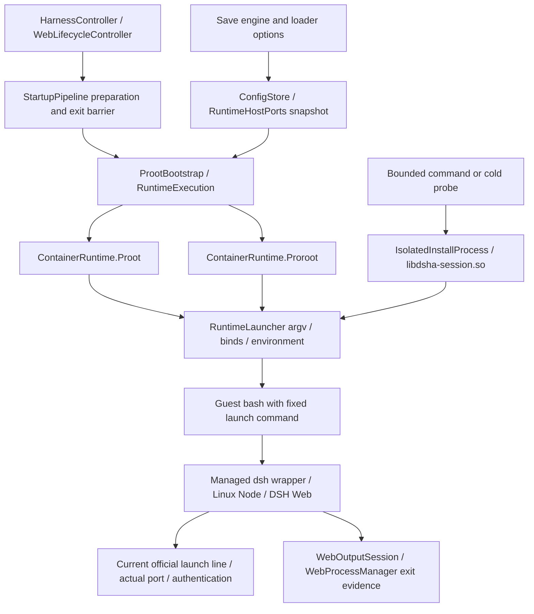

# Ubuntu, proot and proroot on Android

English documentation review: 2026-10-21. This page translates the current maintenance guide, whose source inspection used the F10/build190 worktree at `C:\Users\18768\.codex\worktrees\build190-from170\DSHA_RESTART`. Bundled DSH is `0.2.1-rc.2` and the Ubuntu base identity is `10`. The old build173/bxroot checkout at `F:\DSHA_RESTART` is not the current build source. Final revision identity and verification results belong to the [release introduction](release-introduction.md) and [English README](../../README.en.md).

See the [architecture handbook](project-architecture-handbook.md), [runtime, data and plugins](runtime-data-plugin-architecture.md), and [sources and provenance](references-and-provenance.md) for the surrounding contracts. This is a mechanism guide, not a new device acceptance report. The original [F10 record](../releases/v0.2.1-rc.2-build190-prerelease-20261020.md) is historical evidence for its own artifact.

## 1. Current default and historical differences

The current design uses **proot by default, with explicit proroot selection; bxroot was not migrated**. The build190 decision started from released build170, selectively migrated later features, retained existing data/backup/migration readers, and restored proot plus proroot. This does not prove that proroot is unusable everywhere. Device, loader mode, syscall and process-information permissions have separate compatibility limits.

[ConfigStore](../../app/src/main/java/com/deepseekharness/app/core/ConfigStore.java) owns the settings:

| Entry / key | Behavior |
|---|---|
| `isProroot()` / `container_runtime` | Only the exact value `proroot` selects it; the default is `proot`. Existing explicit selection remains readable rather than being reset on every upgrade. |
| `preferFastColdModeFrom()` | Returns `false`: a new installation does not automatically prefer proroot before the user selects it. |
| `isProrootStaticLoader()` / `proroot_static_loader` | Defaults to `true`; only affects proroot's loader path. |
| `isProotSeccompDisabled()` / `proot_disable_seccomp` | Defaults to `false`; disabling proot's seccomp acceleration is a compatibility option for demonstrated platform failures. |

Advanced options in [ConfigFragment](../../app/src/main/java/com/deepseekharness/app/ui/ConfigFragment.java) select the engine, static loader and seccomp setting; `config_save` persists them. They determine argv/environment for subsequent processes. They do not replace the engine of a live Web or terminal process: stop normally, then start and verify the actual mode. `RuntimeHostPorts` supplies one invocation's settings scope so a command cannot observe a different configuration halfway through execution.

[RuntimeExecution.runtime()](../../app/src/main/java/com/deepseekharness/app/runtime/RuntimeExecution.java) additionally requires API26+, no invocation-local `forceProot`, and successful preparation of proroot's five vendor files and two compatibility files. Otherwise it records `RUNTIME_SELECTION_FALLBACK` and selects proot. This is availability selection **before execution**, not permission to rerun a command after a guest has executed it. Low's minSdk23 does not imply proroot on API23–25.

The [historical changelog](../../CHANGELOG.md) statement that proroot became the default in v1.1.6 refers to **DSHA v1.1.6**, not the vendor binary version. Its old vivo/Android14 benchmarks and fallback rules remain historical. “5–6 times faster,” `+58%`, and switching after three failures are not build190 performance or retry guarantees.

## 2. Where Ubuntu lives and what guest root means

The APK's complete offline Ubuntu and DSH archives are extracted into the app's private environment; [ProotBootstrap](../../app/src/main/java/com/deepseekharness/app/runtime/ProotBootstrap.java) owns the production root. The base is Ubuntu **24.04 arm64**. Identity `10` is DSHA's base-environment generation, not an Ubuntu release number. Linux/glibc Node uses the **24.x** runtime. DSH's exact package and dependency content are pinned by [package.json](../../tools/dsh-runtime/package.json) and its [lock](../../tools/dsh-runtime/package-lock.json). Host Node24 is not evidence of the phone's Node patch version.

Linux Node, Bash, glibc and native npm modules need Linux paths and ABI behavior. Android itself uses bionic; these glibc programs are not Android Java libraries. proot/proroot provide a chroot-like path and simulated identity view within app permissions, mapping `/bin/bash`, `/usr/local/bin/node` and `/root` to objects in the selected root.

`-0` presents root to the guest, but **the Android kernel still enforces the app's real UID, SELinux and system permissions**. It grants no Android root, real mount privilege, access to other apps' private files, or background exemption. Guests and descendants remain subject to process reclamation and foreground-service rules. Tool approval and path checks do not sandbox arbitrary local code; terminals, plugins and lifecycle scripts retain their permitted execution abilities. [AOSP's app sandbox documentation](https://source.android.com/docs/security/app-sandbox) explains the UID boundary shared by Java and native code.

Both engines use `ContainerRuntime.binds()` for explicit `/dev`, `/proc`, `/sys`, `/system`, `/apex`, fd/random-device and already-accessible shared-storage mappings. Missing or inaccessible sources produce `BIND_SKIPPED`. `/linkerconfig` is not bound: an inaccessible system directory must not be assumed available. Binding `/sdcard` does not grant storage permission; SAF remains a separate native capability. `UserDataBindings` adds production personal-data mappings. The independent recovery root uses a separate data domain rather than guessing user-data ownership from the production root's parent directory.

## 3. Layers in one launch



The supervisor represents the session boundary around its command. **Ordinary Web, PTY and bounded commands do not all use the same Process wrapper.**

| File / method | Responsibility |
|---|---|
| [ContainerRuntime](../../app/src/main/java/com/deepseekharness/app/runtime/ContainerRuntime.java) | Engine availability, native files, roots, binds and engine-specific environment. |
| [RuntimeLauncher.builder/environment/start](../../app/src/main/java/com/deepseekharness/app/runtime/RuntimeLauncher.java) | Noninteractive argv/environment, `/bin/bash -c`, signed preload directory, ordinary or isolated-session process. |
| [TerminalRuntime.launch/interactive](../../app/src/main/java/com/deepseekharness/app/runtime/TerminalRuntime.java) | Shared engine/environment preparation; PTY passes argv/environment to JNI, while the simple terminal holds its own lifecycle task lock. |
| [StartupPipeline](../../app/src/main/java/com/deepseekharness/app/core/StartupPipeline.java), [StartupEnvironmentActions.releasePrior](../../app/src/main/java/com/deepseekharness/app/core/StartupEnvironmentActions.java) | Preparation, recovery and managed checks; close the owned launcher and confirm the old guest exited before another launch. |
| [WebLifecycleController](../../app/src/main/java/com/deepseekharness/app/core/WebLifecycleController.java) | Generation, authentication, stopping, slow-start notice, compatibility retry and user Stop intent. |

`RuntimeLauncher.environment()` sets guest `HOME=/root`, command `PATH`, `TMPDIR=/tmp` and noninteractive installation variables. `RuntimeTools.applyEnvironment()` adds CA, DNS preload, npm prefix and runtime flags. `RuntimeLauncherAssets` binds fixed bridge preloads into the selected root. The full environment and plugin layers are in the [runtime/data guide](runtime-data-plugin-architecture.md). Preparation never authorizes replaying a business command.

## 4. Actual proot invocation and native provenance

The current proot uses Termux's ptrace path translation. `baseArgv()` passes `-L --kill-on-exit -0 --rootfs=<private-root> --cwd=/root` and binds. `--link2symlink` is added only when the actual hard-link probe finds links unsupported, with `.l2s` and `PROOT_L2S_DIR`. Enabling it unconditionally for “compatibility” can break atomic publication semantics.

`applyEnv()` sets `PROOT_LOADER`, optional `PROOT_LOADER_32`, `PROOT_TMP_DIR` and library search paths. `PROOT_NO_SECCOMP=1` reflects an explicit acceleration opt-out; it does not remove Android's app boundary. [RuntimeNativeFiles.prepare()](../../app/src/main/java/com/deepseekharness/app/runtime/RuntimeNativeFiles.java) prepares `libtalloc.so.2` and `libandroid-shmem.so` aliases from bundled native libraries. Missing dependencies are not readiness.

| Files / source | Known boundary |
|---|---|
| Standard `libproot.so`, `libprootloader.so`, `libprootloader32.so` | Termux proot / GPL-2.0. [Third-party notices](third-party-notices.md) retain the unresolved exact source revision of these original binaries; Standard is not claimed reproducible using the Low script. |
| Low `libproot_legacy.so`, `libprootloader_legacy.so` | [build-low-proot.py](../../tools/build-low-proot.py) pins Termux `v5.1.107.92`, archive SHA `29385d1ddb619a9c4449ab512bfd55032034b22f724ddf98fc95ff300ea32135`; API23 build identity `5.1.107.92-dsha-android23`. |
| Low local differences | Removes an assertion unsuitable for Android named fds; resolves `getifaddrs/freeifaddrs` via `dlsym` on old APIs and reports ENOSYS when absent; maps shmem to the bundled implementation. This is not general kernel emulation. |
| NDK / owned session launcher | [Toolchain lock](../../ci/toolchain.lock.json): NDK `26.3.11579264`. [native-session/build.py](../../tools/native-session/build.py) builds the API23 ARM64 launcher with 4KiB common and 16KiB LOAD alignment. Alignment is not all-device 16KiB testing. |

The source inspection recorded these Standard originals, identifying bytes without inventing provenance:

```text
libproot.so         cbde86eb01b58413f9e4673e182caca5440e8fc4af8482a0e23d0faa0846f721
libprootloader.so   a2cbccfc776e23225b75e6700dd1990fcd505d2e973f5bfa19c76642d4e41c7d
libprootloader32.so 4c649eb2dce258c9111231940fdbf0474bcf1cd6dd447ad9bdf2898b35a85554
```

[Termux proot](https://github.com/termux/proot) documents the upstream mechanism. A source tag and an actually distributed ELF are separate evidence; provenance gaps remain explicit.

## 5. proroot, static_loader and compatibility shims

### 5.1 Vendor components and loader selection

The bundled vendor is **coderredlab/proroot v1.2.8**, using upstream's in-process translation, LD_PRELOAD and binary patching instead of proot's ptrace route. It is proprietary binary software; DSHA does not claim its complete source or reproducibility of the upstream loader. See the [upstream repository](https://github.com/coderredlab/proroot), [notices](third-party-notices.md) and local [ABI lock](../../tools/proroot-compat/abi.lock.json), not whatever upstream currently calls latest.

`ContainerRuntime.Proroot.LIBS` requires five originals in one directory:

```text
libproroot.so                 launcher
libproroot-runtime.so         guest path-hook runtime
libproroot-linker.so          upstream loader
libproroot-stub-loader.so     upstream static stub loader
libproroot-bridge.so          upstream bridge
```

The recorded inspection matched all five vendor files and both owned compatibility ELFs to `abi.lock.json`. Complete vendor hashes are in `originalVendorSha256`; the runtime, for example, is `8c47a0a7db32d84c179ebb5bf3640f655a3181860ece5886ae44d92858730c34`. Local compatibility work did not edit or rename the originals. Execution uses Android `nativeLibraryDir`; arbitrary copying to `filesDir` does not make a library executable. [Android10 behavior rules](https://developer.android.com/about/versions/10/behavior-changes-10#execute-permission) restrict execution from writable app directories for apps targeting API29+.

`static_loader` selects **loader mode**. True adds `--static-loader` and points `PROROOT_STUB_LOADER` at the original stub; false adds `--no-static-loader` and removes that variable. Both set `PROROOT_LIB_PATH` to the original runtime, `PROROOT_LINKER_PATH` to DSHA's separate entry adapter, and `PROROOT_TMP_DIR`. The setting does not statically link Node, disable glibc/path hooks/all shims, or grant real root. Proprietary internals cannot be inferred from the setting's name.

proroot also receives `-r <root> -0 -w /root`, common binds, a private-cache `/dev/shm` mapping and `--link2symlink`. Unlike proot's capability-dependent choice, this last flag is currently unconditional for proroot; compatibility layers and publishers must test that actual behavior.

### 5.2 The two owned native compatibility files

The [implementation README](../../tools/proroot-compat/README.md), [stack-sysconf.c](../../tools/proroot-compat/stack-sysconf.c) and [linker-entry.c](../../tools/proroot-compat/linker-entry.c) define this scope:

| Component | Fix and limit |
|---|---|
| `libdsha-proroot-compat.so` | GNU AArch64 `sysconf/__sysconf` proxy for GNU enumerations75/249/250: thread minimum stack, minimum signal stack and signal stack. Reads real `/proc/self/auxv`; a complete vector without `AT_MINSIGSTKSZ=51` uses the AArch64 glibc default5120. Other queries forward via `RTLD_NEXT`, preserving pre-lookup errno. |
| `libdsha-proroot-linker.so` | Dependency-free entry adapter adding direct `--preload <shim>` for the original bridge/loader while retaining direct preload of the vendor runtime. Making that runtime merely another library's indirect dependency previously disabled path hooks and is not an equivalent connection. |

The original Android13 failure involved glibc signal/thread-stack assertions. Incomplete loader initialization of the relevant glibc internal state is an **inference** supporting the fix, not a conclusion from auditing proprietary source. The proxy neither writes private glibc fields nor uses private offsets or a constructor. Unreadable, truncated, duplicate, zero, overflowing or unterminated auxv fails with a fixed diagnostic and exit126.

The entry locates the framework directory through the unique executable mapping containing its current instruction, checks the actual NOFOLLOW-opened inode, owner and non-app-writable permissions, and rejects leaf symlinks, writable companions, arbitrary paths or environment overrides. An upstream optional second preload for `libgcc_s.so.1` allows only exact `PROROOT_ROOTFS` plus a fixed suffix; arbitrary third preloads are rejected. That rootfs variable does not locate owned shims or vendor native programs. Failure emits only `DSHA_PROROOT_PRELOAD_ENTRY_UNAVAILABLE`, stage and errno, not business argv.

The ABI lock pins source/output and all five vendor hashes. Constants and formulas come from its referenced official GNU glibc **2.39** source. The compatibility library has no `DT_NEEDED`, interpreter or RPATH; the entry is a dependency/relocation-free static PIE. **Building the adapter statically** is separate from the user-facing `static_loader` choice.

### 5.3 Other compatibility layers

- [RuntimeTools](../../app/src/main/java/com/deepseekharness/app/runtime/RuntimeTools.java) and [dns-compat.cjs](../../app/src/main/assets/dns-compat.cjs): managed DNS and Node lookup compatibility, never HTTP/model replay.
- `NARB_DISABLE_NATIVE_CACHE=1`: avoids dangling extension-cache links caused by link/unlink under link2symlink; it does not justify deleting native dependencies.
- [runtime-patches.json](../../app/src/main/assets/runtime-patches.json): the exact-version patch registry prepared by `RuntimeTools.applyPatchChain()`. Old `DT_UNKNOWN`/JSON reopen patches cannot be reapplied independently of the current registry.
- [bridge-token-compat.cjs](../../app/src/main/assets/bridge-token-compat.cjs): fixed managed launch preload, separate from GNU loader shims, granting no extra native-bridge permission.
- Low API23 proot, PTY birth handshake and browser ES/PDF compatibility have independent implementations and evidence. Browser compatibility does not prove guest native loading.

## 6. Stopping without --kill-on-exit

proot receives `--kill-on-exit`. proroot integration has no such option or equivalent guarantee; do not pass proot-specific flags to it. `Process.destroy()` affects the owned launcher and does not prove Node or guest descendants exited. Comments about stopping by PID must be read with identity verification, not as permission for arbitrary PID kills.

For **Web**, [WebProcessSession](../../app/src/main/java/com/deepseekharness/app/core/WebProcessSession.java) retains the launcher/bridge lease. [WebProcessManager](../../app/src/main/java/com/deepseekharness/app/runtime/WebProcessManager.java) reads the stop sentinel, PID and birth identity, uses [WebProcSel](../../app/src/main/java/com/deepseekharness/app/util/WebProcSel.java) to verify managed Node/Bash/arguments, and checks current UID/process identity before signaling. `stopResult()` distinguishes STOPPED, CANCELLED and UNCONFIRMED. `confirmStopped(trackedProcessAlive)` also requires launcher exit and absence of app-owned Web. PID reuse, unreadable `/proc`, damaged records or permission errors are not exit evidence.

For **bounded proroot commands/install sessions**, `RuntimeExecution.bounded()` requires `libdsha-session.so`. [BoundedGuestSessions](../../app/src/main/java/com/deepseekharness/app/runtime/BoundedGuestSessions.java) registers the operation before [IsolatedInstallProcess](../../app/src/main/java/com/deepseekharness/app/runtime/IsolatedInstallProcess.java) wraps it. [session-launcher.c](../../tools/native-session/session-launcher.c) creates a setsid session, installs a parent-death signal, reports birth identity and waits for host re-verification plus `DSHA_START` before dispatch. The leader remains after foreground status publication; closure verifies the session, members and supervisor. One foreground exit code is not proof of an empty group.

[BoundedGuestLifetime.finish()](../../app/src/main/java/com/deepseekharness/app/runtime/BoundedGuestLifetime.java) closes the owned guest session before interpreting results. Failure records uncertainty and retains the task lock. PTY/simple terminals use their owner and [TerminalProcessCloser](../../app/src/main/java/com/deepseekharness/app/runtime/TerminalProcessCloser.java) for that session's identity and cleanup. One isolated-launcher success cannot establish all Web, terminal and background-device behavior.

## 7. Timeouts, UNKNOWN, fallback and cold probes

| Situation | Rule / implementation |
|---|---|
| Waiting for Web authentication beyond60s | `reportSlowStart()` reports continued waiting and retains starting; elapsed time is not a forced-kill deadline. |
| Explicit proroot exit before authentication | [WebRuntimeFallback](../../app/src/main/java/com/deepseekharness/app/util/WebRuntimeFallback.java) requires the current generation, no previous retry/authentication/named plugin or startup failure, and a real exit code. `retryWithProot()` obtains an environment lease; the new launch still passes StartupPipeline/releasePrior and launcher/guest exit barriers. At most once per run, without changing the saved engine preference. |
| After authentication, plugin failure, Stop or stale generation | No compatibility retry. Fallback cannot replay a business submission. |
| Bounded timeout or incomplete output | Stop requested is not completion. Use [GuestCommandOutcome](../../app/src/main/java/com/deepseekharness/app/util/GuestCommandOutcome.java), actual exit evidence and retained state. Unknown execution cannot be replayed as if nothing happened. |
| Managed-update isolated trial | [RuntimeTrial.verify()](../../app/src/main/java/com/deepseekharness/app/runtime/RuntimeTrial.java) accepts only a closed `TrialExit`; proot is tried only with no other tasks, recording `fallbackFrom/fallbackExitCode`. Compatibility success is not native proroot success. |
| Cold-install capability selection | [ColdToolsInstaller.modes()](../../app/src/main/java/com/deepseekharness/app/runtime/ColdToolsInstaller.java) and [ColdInstallPlan](../../app/src/main/java/com/deepseekharness/app/util/ColdInstallPlan.java) probe controlled private candidates first. Automatic fast preference is off: usually proot then compatible proot without seccomp. Explicit proroot may enter the candidate list if available and isolated sessions are supported. |
| Probe versus actual package writes | At most three probe modes; after selection, the real package installation runs once. Failed post-install checks or unconfirmed exit do not reinstall using another engine. Persist a successful selection before publishing readiness; signed preconfigured `runConfigured()` checks without another dpkg pass. |

`PROROOT_DYNAMIC` and a narrow retry for a particular static signal-stack assertion remain in code. `allowDynamicLoaderRetry()` requires the first candidate, automatic selection, no forceProot and static mode. With `preferFastColdModeFrom()` currently false, this does not mean every proroot failure automatically disables static_loader. Saved preferences, successful read-only probes and validated production packages are separate states.

## 8. Regression map

These are existing entry points, not tests rerun by this translation. Historical passes remain tied to their source/assets/APK bytes.

| Entry | Scope and limitation |
|---|---|
| [ConfigStoreRuntimeSettingsTest](../../app/src/test/java/com/deepseekharness/app/core/ConfigStoreRuntimeSettingsTest.java), [RuntimeHostPortsTest](../../app/src/test/java/com/deepseekharness/app/runtime/RuntimeHostPortsTest.java) | Defaults/snapshots, cold selection persistence and changed-input refusal; not guest execution. |
| [ContainerRuntimeEnvironmentTest](../../app/src/test/java/com/deepseekharness/app/runtime/ContainerRuntimeEnvironmentTest.java), [RuntimeLauncherTest](../../app/src/test/java/com/deepseekharness/app/runtime/RuntimeLauncherTest.java), [TerminalRuntimeTest](../../app/src/test/java/com/deepseekharness/app/runtime/TerminalRuntimeTest.java) | Arguments, environment and terminal wiring; static argv is not Android execution. |
| [WebRuntimeFallbackTest](../../app/src/test/java/com/deepseekharness/app/util/WebRuntimeFallbackTest.java), [WebProcessSessionTest](../../app/src/test/java/com/deepseekharness/app/core/WebProcessSessionTest.java) | No incorrect timeout/auth/plugin/generation retry; launcher/bridge lifetime. |
| [IsolatedInstallProcessTest](../../app/src/test/java/com/deepseekharness/app/runtime/IsolatedInstallProcessTest.java), [BoundedGuestLifetimeTest](../../app/src/test/java/com/deepseekharness/app/runtime/BoundedGuestLifetimeTest.java), [BoundedGuestSessionsTest](../../app/src/test/java/com/deepseekharness/app/runtime/BoundedGuestSessionsTest.java) | Foreground status versus whole-session exit, uncertainty and task locks. |
| [ColdInstallPlanTest](../../app/src/test/java/com/deepseekharness/app/util/ColdInstallPlanTest.java) | Probe order, one package write, unknown-exit refusal and narrow dynamic-loader conditions. |
| [test-proroot-compat.py](../../tools/test-proroot-compat.py) | Pinned source/output ELF dependencies and original vendor bytes; no Android guest. |
| [test-host.py](../../tools/proroot-compat/test-host.py) | Actual GNU/Linux sysconf forwarding, auxv refusal and direct preload; not ARM64 proprietary-loader/phone execution. |
| [test-arm64.py](../../tools/proroot-compat/test-arm64.py) | Original ARM64 bridge/loader and owned entry rejection under QEMU/WSL; binfmt/second-exec limitations remain, and it is not the app domain. |
| [native-session/build.py --check](../../tools/native-session/build.py), [handshake test](../../tools/test-native-session-handshake.py), [proot library test](../../tools/test-proot-runtime-libs.py) | Owned-supervisor reproducible bytes, host-kernel birth handshake, argument/dependency contracts; not every ROM's process-information permissions. |

Real engine acceptance for an exact release APK must record signature/hash, requested and actual modes, Node/path hooks, backend authentication, page readiness, and guest plus launcher exit after normal Stop. Standard/Low, Android13/16, host/app-domain tests are separate evidence. Successful proot fallback cannot sign off proroot. Without data comparison, long-run or device-matrix evidence, this architecture guide does not claim those completed.
