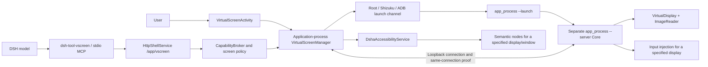

# Virtual-screen architecture and maintenance guide

This guide explains the build190/F10 source implementation for maintainers diagnosing or modifying virtual screens. It describes code contracts, not compatibility acceptance for a phone, ROM, application or input method. Design decisions and tradeoffs are recorded in [ADR 0003](adr/0003-virtual-screen-lifecycle-and-input.md). Build/project entry points are [BUILD](../../BUILD.en.md), [AGENTS](../../AGENTS.en.md) and the [security model](security-model.md). For user-facing entry points and operation, see the [virtual-screen guide](virtual-screen-guide.md).

## 1. Distinguish four objects

| Object | Owner and purpose | Does not replace |
|---|---|---|
| Physical screen | Android display 0, operated through the physical computer-use path | An active virtual screen |
| Virtual display | A `VirtualDisplay` created by the privileged Core, with its own displayId and canvas dimensions | A native preview widget |
| Native preview | Bitmaps consumed by the Activity, foreground presentation and floating preview | Long-lived input permission |
| DSH observation | Image, node or editor evidence given to the model | Current system state or the identity of an arbitrary new Core |

A virtual screen combines a separate display with a constrained control protocol. It is not an emulator, a complete desktop VM or a strong sandbox. Applications running there remain subject to Android display, window, permission, input-injection and ROM policies. Creating it, seeing an image, injecting an event and an application actually responding are four separate outcomes. Failure of a physical-screen tool must not automatically reroute it to the virtual screen; the reverse conversion is also prohibited.

## 2. Code map and process boundaries



| File | What to read |
|---|---|
| [VirtualScreenActivity][activity] | Native creation, application launch, preview, input results and explicit node panel |
| [VirtualScreenManager][manager] | Single application-level orchestrator, identity snapshots, serialized operations and exit convergence |
| [VirtualScreenCore][core] | Privileged-process startup, loopback server, display and input routing |
| [VirtualScreenLauncher][launcher] / [VirtualScreenChannels][channels] | Fixed-command construction and available-channel selection |
| [VirtualScreenTransport][transport] / [VirtualScreenPeerProof][peer] | One connection and request proof, without transparent retries |
| [HttpShellService][http] | Bridge authentication, current DSH runtime and screen-authorization checks |
| [VirtualScreenAccessibility][accessibility] / [SemanticAdapter][semantic] | Node trees, editors and native semantic-operation adapters |
| [dsh-tool-vscreen index][plugin-index] / [server][plugin-server] | DSH tool discovery, parameter restrictions, image results and error semantics |

`DshaApp.virtualScreenManager()` holds the Manager through an application-level owner. Activity recreation or removal of a preview subscription does not transfer Core ownership to a View. Core does not run inside Ubuntu's DSH Node process; the Ubuntu-side plugin requests capabilities through the host bridge. The privileged channel establishes a managed Core and birth-identity probes. Ordinary input does not reconstruct arbitrary shell launch commands.

## 3. Creation and the managed handshake

Native `start()` and `/app/vscreen/create` both reach the Manager's `startOrdered()`. It checks flavor, API, existing lifecycle and cleanup evidence first. An unresolved instance cannot be bypassed by creating another. The same Manager owns the current Core; callers should inspect `status` first and reuse an existing target. `VirtualScreenPolicy.phoneSize()` normalizes creation orientation. Do not infer virtual dimensions from the native screen size.

```mermaid
sequenceDiagram
  participant M as Manager
  participant T as Managed channel
  participant L as app_process --launch
  participant C as app_process --server
  M->>M: Record launch epoch and local evidence
  M->>T: Fixed launch command; ADB also needs a one-time ticket
  T->>L: Classpath of the currently installed APK
  L->>C: Launch direct child with setsid
  C->>C: Dynamic loopback port, random secret, birth identity
  C-->>L: Bootstrap through managed result channel only
  L->>C: Identity-bound ping / same-connection proof
  L-->>M: Managed STARTED handshake
  M->>C: Create / verify result ownership
  M->>M: Save current handle and enter READY
```

`VirtualScreenLauncher.launchCommand()` points only to the installed package and fixed Core class. Core `main()` checks the package name, installed-APK classpath, API and dynamic-port requirement. The `--launch` parent starts `--server` with `setsid`, reads bootstrap, confirms reachability and explicitly exits. Parent exit is not resident-Core exit; they have different roles. Core generates its secret and rejects putting it in a `--token` argument. The handshake carries port, secret and birth identity. A success word alone cannot establish startup.

[VirtualScreenChannels][channels] normally checks Root, Shizuku and ADB availability in that order. On API 37 with ADB connected, code places ADB before Shizuku; Root remains first. Availability still requires the corresponding local authorization. The application cannot thereby grant itself Root or pairing permission. For ADB, see [AdbBridge][adb] and [AdbVirtualScreenStart][adb-start]. The Manager issues a one-time ticket bound to the command, epoch and deadline, through plan authorization and commit. It travels through a dedicated path and must not appear in logs, command lines or ordinary terminal commands. Unknown startup results retain their evidence. Starting again through another channel can also duplicate creation; timeout cannot establish that nothing ran.

## 4. Identity is more than a displayId

| Layer | Evidence used by current code | Problem prevented |
|---|---|---|
| Core birth | `pid / started / uid / boot / instance` | PID/port reuse and impersonation by an old Core |
| Connection | Handshake, dynamic port, secret, connection nonce and HMAC | Connecting to the wrong loopback service or reusing an old proof |
| Manager | Lifecycle epoch, active epoch, port, token, generation, revision | Late callbacks after close/recreation |
| DSH runtime | Runtime identity, Web generation, bridge run, authorization epoch and revision | Requests from an old session runtime taking effect across starts |
| Display and window | Core UUID, generation, displayId, windowId, package | Substituting another window for the observed target |
| Observation | frameSeq, observationId or one-time node/editor/anchor ID, TTL | Old images/nodes authorizing new actions |

[VirtualScreenCoreIdentity][identity] defines birth identity, and Manager snapshots use [RequestFence][fence]. Core `instance` is exposed as `coreInstance`; `generation` belongs to the virtual-display session. Neither is the DSH Web generation. A current UUID returned by `status` cannot be attached to an old screenshot, tree or anchor. The Manager's `decorate()` does not relabel a successful old observation as a successful observation of the current Core.

[VirtualScreenPeerProof][peer] exchanges nonces on the same socket and binds proof to the application, port and complete birth identity. Request proof additionally binds the method, target and body digest. The raw secret is not sent as a Core HTTP header. `X-Token` on the host's 3090 bridge is another authentication layer and cannot replace Core connection proof.

## 5. Capture, resizing and what was actually presented

Core creates a `VirtualDisplay` with its Surface attached to an RGBA `ImageReader`. [VirtualScreenDisplaySession][display-session] owns release of the display, reader, frames, input and observation caches. The capture thread in [VirtualScreenPixels][pixels] calls `acquireLatestImage()` and handles row/pixel strides. It increments `sequence` only when pixels really change. Identical pixels update capture time without manufacturing a new frame number. Temporary absence of frames neither recreates the display nor fabricates an input-authorizing image.

There are two image paths, which must be tested separately when changed:

| Path | Image and retention | Input meaning |
|---|---|---|
| Native preview | JPEG no wider than 720, retaining actual display width/height metadata | Registers a frame after successful presentation; latest-frame checks still apply |
| Agent `see` | [ObservedPixels][observed-pixels] retains the original bitmap and returns a full-resolution JPEG | May retain the same original observation for an explicit anchor; does not renew old evidence |

`ObservedPixels` currently allows 30 seconds, at most two retained images and 24 MiB of raw bitmaps. Its budget is not JPEG length; a large original resolution can be rejected outright. Native thumbnails and Agent originals cannot share an undifferentiated coordinate system. `status` only reads state; **it does not issue proof that an image was observed**.

[VirtualScreenPreviews][previews] coalesces requests from multiple native presentation owners, each with its decoded bitmap and main-thread callback. A subscription `Lease` delivers only frames from the current epoch and records the generation/sequence actually adopted. A failure gap revokes input identity. Recovery must redeliver even the same sequence, rather than losing it to deduplication. [PreviewView][preview-view] may retain the previous image on same-generation `STALE_FRAME` / `FRAME_NOT_READY` to reduce flicker. **Retaining an image does not retain input authority**: the old image may remain visible, but touch stays disabled until a valid frame is adopted again.

## 6. Raw coordinates and injection

`PreviewView.point()` reverses scaling, translation and letterboxing, then maps bitmap coordinates to display width/height. Points outside the image are rejected. Activity-screenshot coordinates cannot be sent directly to the virtual display. Model coordinates follow `see` metadata. When `previewWidth/previewHeight` differ from display dimensions, conversion is required. The current Agent original-image path makes those dimensions equal, but the protocol still describes differing dimensions explicitly. Recheck presentation geometry after orientation changes, zoom, Insets or keyboard appearance.

Raw tap/swipe/type/key requires an observed request frame that is still the latest and no more than 30 seconds old. [VirtualScreenPolicy.inputRejection()][policy] centralizes the check. Core resets observation after consuming it; one `frameSeq` is not permission for unlimited repeated clicks. Streaming touch checks the frame at DOWN, and later phases also require the correct stroke identity and order. Do not remove the latest-frame check before DOWN merely because a press ripple changes the pixels.

[PreviewInputGate][preview-gate] coordinates local preview fetching and gesture admission. It reduces only the local race where a newer frame has been fetched but not drawn. It neither freezes the Android page nor relaxes the remote frame gate. A blinking cursor, animation or video can still expire a coordinate action before dispatch; this is a real usability limit. After rejection, let the user inspect the image or explicitly open node controls. Do not refresh and resend automatically.

[VirtualScreenInput][input] has two actual backends:

- The reflection backend locates `InputManager` / `InputManagerGlobal` and explicitly calls `setDisplayId` on events.
- The command backend explicitly uses `input -d <displayId>`; it cannot omit the display argument and rely on focus.
- Reflection injects each phase. The command backend aggregates a command at UP, so MOVE does not mean the system received every intermediate event.
- Input results distinguish acceptance, rejection and unknown. A command timeout does not establish that the business action never ran.
- Unicode uses the accessibility input path. Shell `input text` is not guaranteed to support every character or editing behavior.

## 7. Three explicit semantic-operation paths

### 7.1 DSH tree / node / editor

`android_vscreen_tree` reaches the accessibility window tree through Manager and SemanticAdapter. `VirtualScreenAccessibility` retains bounded nodes and actual targets and issues a one-time nodeId. Node actions recheck display, window, package and tree lifetime, then refresh the target node; taking an entry removes it from the map. Semantic nodes do not require equality with pixel `frameSeq`, so a blinking cursor alone need not invalidate them. This does not waive target identity, current authorization, service availability or node-capability checks. The editor path has separate editor identity and get/edit/submit parameters; nodeId cannot stand in for editorId. Canvas, hidden content or incomplete WebView semantics may expose no usable node. Do not guess a center coordinate and click automatically.

### 7.2 DSH see / anchor / anchored_click

[ObservedControl][observed-control] binds the original observation to authorization, runtime, Core, Manager, window and package. [AnchorProof][anchor-proof] checks the semantic tree, geometry, occlusion and candidate uniqueness, comparing pixel evidence in the original region. `anchor` selects only: it neither clicks nor renews lifetime. `anchored_click` is a separate explicit action. Calls must retain the original coreInstance/generation/frameSeq/observationId and the returned anchorId. A new status frame cannot repair an old anchor. Nor may a failed raw tap silently switch to an anchor. Losing the anchor-selection reply marks selectionUnknown/noReplay. Selecting again may consume evidence twice and cannot happen automatically. A click consumes the anchor once. Returned `validatedCurrentSeq` does not rewrite the original `sourceFrameSeq` into a new observation.

### 7.3 Native node controls

The Activity's `showNodes()` calls `Manager.openNativeControls(Activity)` only when the user explicitly opens the panel. [VirtualScreenNativeControls][native-controls] accepts only a real Activity owner in RESUMED state. It uses a separate [NativeScreenControlLease][native-lease]; absence of a model broker is not authorization. `ON_PAUSE / ON_STOP / ON_DESTROY`, panel cancellation and leaving the page permanently revoke that owner. Returning requires the user to reopen the panel; late callbacks cannot revive its old node list.

The panel shows backend-verified packageName and displayId, rather than inferring the actual target from a draft launch package. It lists only enabled clickable or editable nodes. Native minimum actions are click and set_text. set_text additionally requires editable, non-password content, declared ACTION_SET_TEXT and at most 16000 characters. Tree text displayed beyond 1000 characters is marked `textTruncated`; a truncated value is not prefilled into the editor. The user explicitly enters and submits a complete replacement, preventing an apparently unchanged submission from silently losing a field's tail. An action clears the old list. Further work requires manual refresh; the panel never automatically refreshes and executes again. UNKNOWN revokes the owner and asks the user to inspect the actual screen. Wording must not encourage immediate replay of the same action.

## 8. DSH discovery, routing and result protocol

The plugin's [index.js][plugin-index] registers a stdio server through the official MCP client and waits for subplugin initialization. Configuration disables automatic reconnect and uses a 60-second tool-call deadline. Failed initialization cannot be presented as ready tools. `initialize.instructions` and tool descriptions in [server.cjs][plugin-server] tell the model to use dedicated virtual-screen tools. Operations on an existing Core explicitly supply the original `coreInstance`; create/status are discovery entries. close also requires precise identity when a live/pending Core exists. It cannot close a different Core that happens to be current.

`requestFor()` constructs constrained JSON POST requests for node/type/edit/submit/anchor and related operations; the rest use fixed routes. [VscreenBridgeRequest][bridge-request] reparses fields, method, size and parameter combinations on the host rather than trusting only the JS schema. `HttpShellService.handleVscreen()` checks screen authorization and current runtime before reaching Manager `bridge()` / `dispatch()`. The plugin returns the `see` JPEG as real image content with corresponding metadata in text. Failures return `isError:true`; JSON containing an error must not be wrapped as a normal successful tool result. Specific not-sent and unknown information must survive all four layers: JS, HTTP, Manager and Core.

The physical tool [dsh-computer-use-android][physical-plugin] uses a separate physical-screen protocol. Prompt maintenance must preserve the two tool families' boundary. “Active virtual” cannot automatically change a physical request's meaning. Agent presets, session permissions and global host capabilities are separate configuration layers; one setting does not establish authorization at another layer.

## 9. Authorization, system capability and races

[CapabilityBroker][broker] supplies current runtime/installation identity, deadlines, authorization epoch and a one-time dispatch claim. It has one native confirmation slot and runs no platform operation, callback or I/O under its lock. [ScreenConfirmationPolicy][screen-policy] supports fully manual, per-application rules and allow all. Allow all reduces only DSHA confirmation steps. It cannot add Android permissions, create nodes or waive target checks. Persistent local rules are separate from this run's [ScreenSessionGrant][screen-grant]; backup imports cannot make authorization effective.

`HttpShellService.screenPolicyChanged()` revokes requests and observations. Global-consent changes revoke capability domains. Stop, accessibility disconnect, manual revocation and pause invalidate old requests; some paths also revoke and close Core. Queued requests still recheck Web generation, runtime state, revision and actual window/package. Revocation after a claim does not prove the system call never occurred; retain post-execution-change or unknown results.

Display creation also depends on privileged UID, ROM and hidden APIs. `requestTrustedDisplay()` requests TRUSTED only for actual Root UID or when ADD_TRUSTED_DISPLAY is really held. UNKNOWN probing is treated as not held. The host package name cannot establish that a shell process has a signature permission. Focus, IME, system decorations and application support may differ on an untrusted display. An application confirmation switch cannot supply those capabilities.

## 10. Concurrency, timeouts and UNKNOWN

Manager serializes operations through `ACTIONS` and protects identity/state snapshots with `LOCK`. The state lock and lifecycle epoch jointly prevent late callbacks from updating a new instance; disabling a UI button is insufficient. Core `route()` is synchronized. Captured listener/socket identity and owner checks run under the same monitor. Socket handshakes and HTTP header/body I/O occur outside the routing lock so a slow client cannot occupy the state lock. A late IOException from a closed listener may retire only that listener, not shut down a newer binding. The host fixture supports rebinding within one JVM, making this instance isolation especially important to test. This is not a claim of phone reproduction.

[Transport][transport] uses one socket and one write per request, avoiding pools that may transparently retry GET. Core requests have bounded headers, bodies and read deadlines; responses are limited to 4 MiB, so an incomplete reply cannot be read indefinitely. The plugin has a separate response budget and cancellation signal. Outer cancellation does not establish that an inner action was cancelled. `executionUnknown`, `INPUT_RESULT_UNKNOWN`, and a target/runtime change after execution all prohibit automatic replay. Observing the actual state again is allowed; it must not turn into a business retry that clicks again after failure.

## 11. Close, exit proof and recovery after replacement

```mermaid
sequenceDiagram
  participant U as Native close or DSH close for the exact Core
  participant M as Manager
  participant C as Original Core
  participant J as Local journal
  U->>M: Close request
  M->>M: detachLocked: increment epoch, revoke observations/tickets first
  M->>J: Save pending cleanup identity
  M->>C: One /vscreen/close
  C->>C: Release display, frames and input
  C-->>M: Release acknowledgement
  M->>C: Read-only birth probe through original channel
  alt EXITED and journal commit succeeds
    M->>J: STOPPED, clear pending
  else ALIVE / UNKNOWN / journal unavailable
    M->>J: Retain CLOSE_UNKNOWN / pending
    M->>M: Bounded read-only probes; no input or launch replay
  end
```

Manager `closeExpected()` verifies Core UUID, and `detachLocked()` invalidates old requests first. `closeDetached()` records display-release acknowledgement separately from `coreExitProof`. [ExitProofPolicy][exit-policy] classifies EXITED/ALIVE/UNKNOWN from boot, birth stat, UID and definitive ESRCH. A closed port, connection failure, permission-denied reads, timeout or a guess based on a bare PID's disappearance cannot replace complete birth proof. Even confirmed EXITED requires a successful journal commit by `persistCleanupExited()` before pending can be cleared. For normal completion, inspect `displayReleaseAcknowledged`, `coreExitProof`, `lifecycleState` and `cleanupPending` together. Background cleanup probing converges read-only without resending close or input. It must not become an endless start/close loop.

[SessionJournal][journal] stores application-private `vscreen-session-v1.json`, including the local secret and cleanup handle. It binds installation/application and uses NOFOLLOW, size limits, private permissions and atomic replacement. It must not enter user backups, public diagnostics or Git. Its fields cannot be copied into general screen authorization. `restoreJournal()` never restores old UI input permission. Unresolved same-boot evidence enters DISCONNECTED or START_UNKNOWN. A new boot may change exit-proof conditions; users must not be required to reboot to hide a same-boot unknown state. Stop normally before replacing the APK. External replacement can terminate the host, so reconnecting to a port cannot promise complete recovery. Virtual-Core exit and DSH guest/launcher exit are separate proof domains, each with its own normal-stop barrier. [WebStopCoordinator](../../app/src/main/java/com/deepseekharness/app/core/WebStopCoordinator.java) and related runtime orchestration verify the latter; Core ACK cannot replace it.

## 12. States and diagnostic order

| State/error | Check first | Do not take this shortcut |
|---|---|---|
| START_UNKNOWN / DISCONNECTED | status pending, cleanup identity and read-only probing through the original channel | create again or replay launch through another channel |
| CLOSE_UNKNOWN | Release ACK, birth proof, journal commit and cleanup reason | Declare STOPPED just because the picture disappeared |
| FRAME_NOT_READY / STALE_FRAME | Generation, latest frame, recent recovery from no-frame state and adoption callback | Retain an image while leaving touch enabled |
| FRAME_NOT_OBSERVED / FRAME_EXPIRED | requested/current/observed frame fields and TTL | Replace the old image's frame number with a new status frame |
| STALE_TREE / STALE_NODE | Actual window/package, service state and tree lifetime | Refresh automatically and resend the old business action |
| NATIVE_CONTROL_REVOKED | Paused page, cancelled panel or changed Core | Reactivate the old owner |
| INPUT_RESULT_UNKNOWN | Actual application image/state; retain the original action receipt | Repeat the same action with other coordinates/nodes/channels |
| inputUnavailable / no nodes | Missing backend members, system permissions and target-app semantics | Claim every button must be controllable |

Collect redacted technical fields first: error code, phase, orientation/dimensions, state, frame relationships, backend type and proof classification. Do not publish real tokens, handshakes, cleanup handles, user input, tree contents or personal data in screenshots. Native `lastStartOutcome()` / `safeStartOutcome()` supply a startup technical summary without secrets/images. Before reading logs, identify their source, APK, flavor and runtime phase. A PASS from another package cannot be reassigned.

## 13. Modification guide and regression entry points

| Change | Implementations to inspect together | Preferred tests/scripts |
|---|---|---|
| Lifecycle, close and journal | Manager, Core, CoreIdentity, ExitProofPolicy | VirtualScreenLifecycleTest, CloseReconcileTest, PersistentCleanupTest, SessionJournalTest |
| Core listener/protocol | Core, Transport, PeerProof, Handshake | VirtualScreenCoreControlTest, TransportTest, BridgeIdentityTest, VirtualScreenHandshakeTest |
| Launch channels and ADB tickets | Channels, Launcher, AdbBridge, AdbVirtualScreenStart | VirtualScreenChannelsTest, StartOutcomeTest, AdbVirtualScreenStartTest; test-adb-vscreen-bridge.py |
| Capture, preview and gestures | Pixels, Previews, PreviewView, PreviewInputGate | PixelsTest, PreviewContinuityTest, PreviewAdoptionTest, PreviewInputGateTest, NativeInputFrameBoundaryTest |
| Nodes and native panel | Accessibility, NativeControls, Activity, NativeScreenControlLease | VirtualScreenNativeControlsTest, ActivityNodeControlsTest, ActivityLayoutTest |
| Original-image anchors | ObservedPixels, ObservedControl, AnchorProof | VirtualScreenObservedPixelsTest, VirtualScreenAnchoredChainTest; test-vscreen-anchored.mjs |
| DSH tools/bridge | server.cjs, VscreenBridgeRequest, HttpShellService | VscreenBridgeRequestTest, VscreenAnchoredGrammarTest; test-vscreen-bundle.mjs, test-vscreen-manager-http.py |

Test names in the table omit shared prefixes where applicable. They live in [vscreen tests][tests] or [util tests][util-tests]. `AdbVirtualScreenStartTest` lives in bridge tests; scripts are under [tools](../../tools). Do not test only a copied helper: layout/node-panel checks should cover the real Activity, and chain tests should cross real orchestration and transport boundaries. A resource-owning fixture that fails during construction must still release its own Core to prevent later CORE_ALREADY_BOUND contamination. Before changing input, identify raw, semantic or anchored mode; removing identity checks is not a usability fix. UI changes must cover long errors, both orientations, keyboard safe areas, panel cancellation, background revocation and complete submission of long fields. Prompt changes should inspect real assembled tool instructions and retain image content and isError, rather than only searching for a string. After asset changes, the single build owner regenerates descriptor/plugin metadata and verifies actual APK members. Do not edit aggregate assets in parallel.

## 14. Support and acceptance boundaries

`VirtualScreenManager.supported()` requires non-LOW_ANDROID and API at least 30. Standard has minSdk 30, but meeting the version does not prove that a ROM's hidden APIs, display creation or injection work. Low does not expose this production virtual-screen path even on a newer Android version. Its skipped tests cannot count as capability passes. The physical screen independently uses accessibility and is not selected automatically when virtual screens are unavailable. A display may be created without a target window. Applications may refuse to launch or render on an external display. Secure windows, passwords, system input methods, Canvas, animations and absent accessibility trees may constrain functionality. Android accepting an event or ACTION_SET_TEXT does not verify the target application's business result; observe again after an action. Software tests prove contracts for their fixtures, not phone frame rate, universal touch support or all-device compatibility. Device conclusions must bind the actual APK and record exact operations, receipts, screen changes and unexecuted scope. A delivery with device acceptance paused cannot imply current phone verification, nor authorize device operations to fill the gap.

[activity]: ../../app/src/main/java/com/deepseekharness/app/vscreen/VirtualScreenActivity.java
[manager]: ../../app/src/main/java/com/deepseekharness/app/vscreen/VirtualScreenManager.java
[core]: ../../app/src/main/java/com/deepseekharness/app/vscreen/VirtualScreenCore.java
[launcher]: ../../app/src/main/java/com/deepseekharness/app/vscreen/VirtualScreenLauncher.java
[channels]: ../../app/src/main/java/com/deepseekharness/app/vscreen/VirtualScreenChannels.java
[transport]: ../../app/src/main/java/com/deepseekharness/app/vscreen/VirtualScreenTransport.java
[peer]: ../../app/src/main/java/com/deepseekharness/app/vscreen/VirtualScreenPeerProof.java
[http]: ../../app/src/main/java/com/deepseekharness/app/HttpShellService.java
[accessibility]: ../../app/src/main/java/com/deepseekharness/app/vscreen/VirtualScreenAccessibility.java
[semantic]: ../../app/src/main/java/com/deepseekharness/app/vscreen/VirtualScreenSemanticAdapter.java
[plugin-index]: ../../app/src/main/assets/builtin-plugins/dsh-tool-vscreen/lib/index.js
[plugin-server]: ../../app/src/main/assets/builtin-plugins/dsh-tool-vscreen/lib/server.cjs
[physical-plugin]: ../../app/src/main/assets/builtin-plugins/dsh-computer-use-android/lib/server.cjs
[adb]: ../../app/src/main/java/com/deepseekharness/app/bridge/AdbBridge.java
[adb-start]: ../../app/src/main/java/com/deepseekharness/app/bridge/AdbVirtualScreenStart.java
[identity]: ../../app/src/main/java/com/deepseekharness/app/util/VirtualScreenCoreIdentity.java
[fence]: ../../app/src/main/java/com/deepseekharness/app/util/VirtualScreenRequestFence.java
[display-session]: ../../app/src/main/java/com/deepseekharness/app/vscreen/VirtualScreenDisplaySession.java
[pixels]: ../../app/src/main/java/com/deepseekharness/app/vscreen/VirtualScreenPixels.java
[observed-pixels]: ../../app/src/main/java/com/deepseekharness/app/vscreen/VirtualScreenObservedPixels.java
[previews]: ../../app/src/main/java/com/deepseekharness/app/vscreen/VirtualScreenPreviews.java
[preview-view]: ../../app/src/main/java/com/deepseekharness/app/vscreen/VirtualScreenPreviewView.java
[preview-gate]: ../../app/src/main/java/com/deepseekharness/app/vscreen/VirtualScreenPreviewInputGate.java
[policy]: ../../app/src/main/java/com/deepseekharness/app/util/VirtualScreenPolicy.java
[input]: ../../app/src/main/java/com/deepseekharness/app/vscreen/VirtualScreenInput.java
[observed-control]: ../../app/src/main/java/com/deepseekharness/app/vscreen/VirtualScreenObservedControl.java
[anchor-proof]: ../../app/src/main/java/com/deepseekharness/app/vscreen/VirtualScreenAnchorProof.java
[native-controls]: ../../app/src/main/java/com/deepseekharness/app/vscreen/VirtualScreenNativeControls.java
[native-lease]: ../../app/src/main/java/com/deepseekharness/app/screen/NativeScreenControlLease.java
[bridge-request]: ../../app/src/main/java/com/deepseekharness/app/util/VscreenBridgeRequest.java
[broker]: ../../app/src/main/java/com/deepseekharness/app/capabilities/CapabilityBroker.java
[screen-policy]: ../../app/src/main/java/com/deepseekharness/app/util/ScreenConfirmationPolicy.java
[screen-grant]: ../../app/src/main/java/com/deepseekharness/app/util/ScreenSessionGrant.java
[exit-policy]: ../../app/src/main/java/com/deepseekharness/app/util/VirtualScreenExitProofPolicy.java
[journal]: ../../app/src/main/java/com/deepseekharness/app/vscreen/VirtualScreenSessionJournal.java
[tests]: ../../app/src/test/java/com/deepseekharness/app/vscreen
[util-tests]: ../../app/src/test/java/com/deepseekharness/app/util
