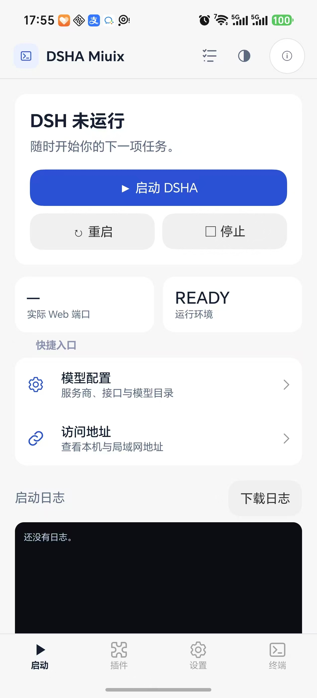
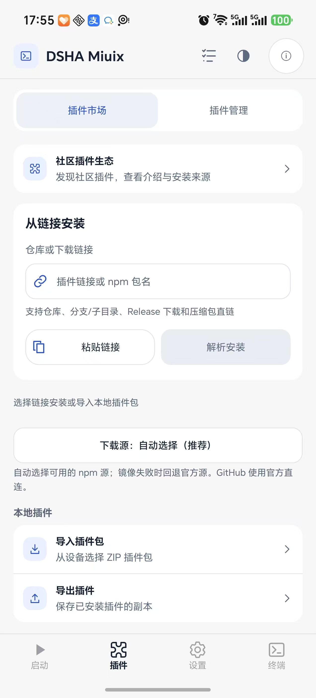
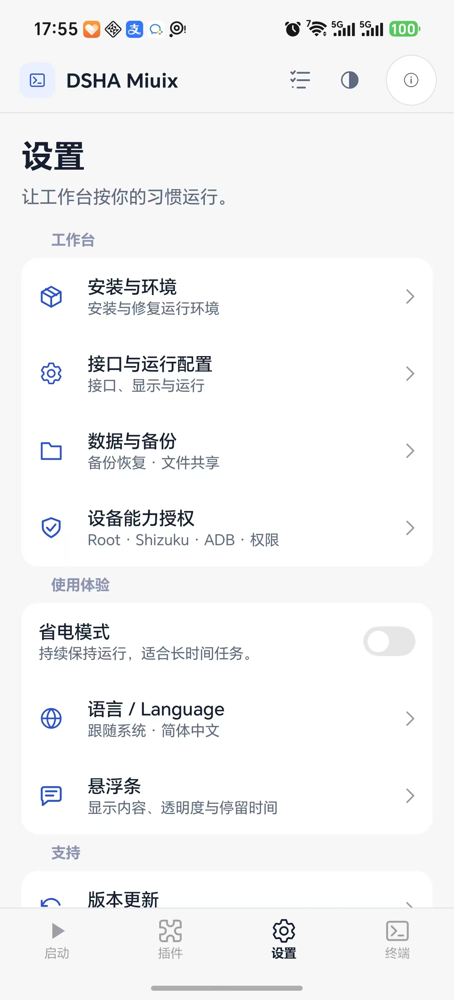

# DSHA Miuix 界面截图

以下三张图片由用户于 2026-10-19 提供，分别展示手机上的启动首页、插件页面与设置页面。点击图片可查看原尺寸。

| 启动首页 | 插件页面 | 设置页面 |
| --- | --- | --- |
|  |  |  |

这三张图替换此前的 UI 测试渲染图。截图展示用户提供时的界面，不代表所有后台功能或设备矩阵均已验收。日志越界问题的反馈图仅用于本地排查，不包含在图集中；修复与定向验证见 [UI 迁移说明](../../ui-miuix.md)。
