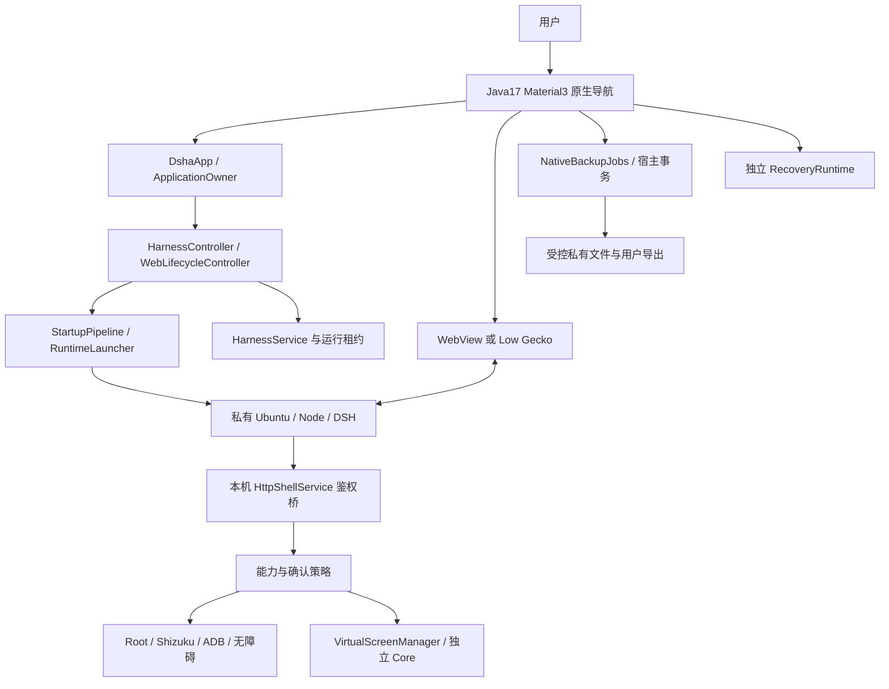
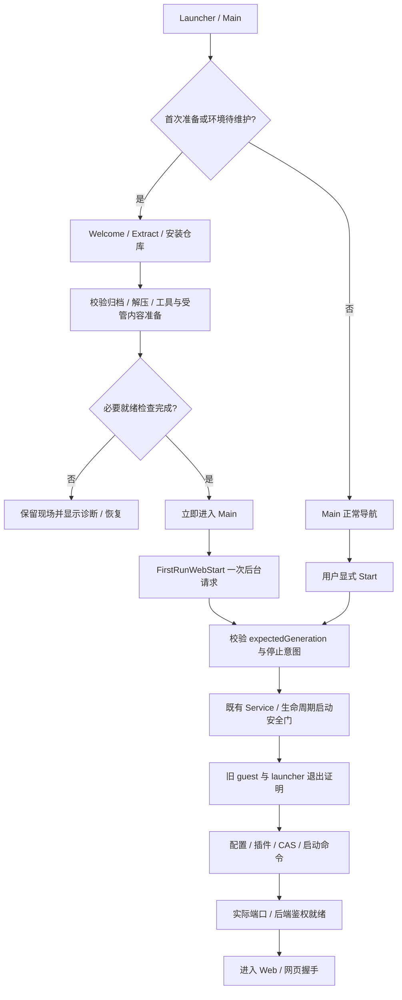
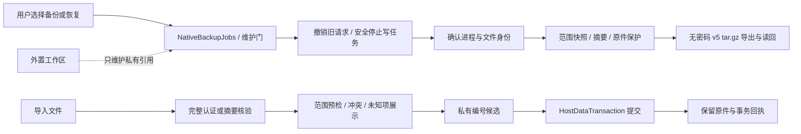

# DSHA 项目架构与功能维护总手册

核验日期：2026-10-21。本文面向需要理解、修改和验证 DSHA 的维护者，以已发布F10 `087724c`为参考，按当前 F12 / build190 工作树维护。
F11是未上传的本地检查点，不是新增已发布版本；最终诊断身份、软件、APK和附件范围见[README](../README.md)与[F12记录](releases/v0.2.1-rc.2-build190-fix12-20261021.md)，本页不预填最终版本或测试总数。
版本最终以 [app/build.gradle](../app/build.gradle) 和对应产物回执为准。
本文是功能与代码地图，不是新的验收报告，也不改变运行权限、数据格式或 APK。
设备、ADB、真实账号/模型对话和长时验收仍按交付记录的暂停边界；宿主测试通过不等于手机性能通过。

## 1. 阅读顺序、项目来源与当前边界

先读 [README](../README.md)，再按修改目标选择下列资料。

| 资料 | 解决的问题 |
|---|---|
| [本手册](project-architecture-handbook.md) | 用户功能、组件关系、修改入口和回归选择 |
| [设备权限与通道架构](device-permissions-architecture.md) | ADB、Root、Shizuku、授权与物理设备操作 |
| [运行时、数据与插件架构](runtime-data-plugin-architecture.md) | 安装、启动、受管更新、数据事务和插件安装 |
| [运行引擎](runtime-engines.md) | proot/proroot 选择、迁移、loader 与退出约束 |
| [端口与网络](ports-and-networking.md) / [DNS 配置](dns-configuration.md) | 自动端口、网络入口与解析策略 |
| [虚拟屏架构](virtual-screen-architecture.md) | Core、预览、观察、输入身份、退出证明 |
| [ADR 0003](adr/0003-virtual-screen-lifecycle-and-input.md) | 虚拟屏生命周期与输入边界的设计理由 |
| [资料与来源核验](references-and-provenance.md) | 官方资料、第三方依赖、当前锁及证据等级 |
| [BUILD](../BUILD.md) | 工具链、固定输入、软件验证与正式签名 |
| [工程规范](engineering-standard.md) | 分层、代码约束、格式与贡献流程 |
| [模块地图](module-map.md) | 状态归属与跨层协作者 |
| [安全模型](security-model.md) | 同 UID、插件、桥接和授权的实际边界 |

DSHA 是 Android 宿主与适配项目，内置上游 DSH，并增加安装、生命周期、设备桥和数据保护。
[DeepSeek 官方 deepseek-harness](https://github.com/deepseek-ai/deepseek-harness) 是上游项目；
当前维护分支、私有预发布仓库及其 Android 修改，不代表 DeepSeek 官方发布或认证。
DSHA 工程来源为 [DSH-APP/DSHA](https://github.com/DSH-APP/DSHA)，当前维护/分发在
[DSHA-prerelase](https://github.com/ym2025szz/DSHA-prerelase)；私有页面需要相应访问权限。
当前使用哪个 DSH 版本，应读 [npm manifest](../tools/dsh-runtime/package.json) 与
[完整 lock](../tools/dsh-runtime/package-lock.json)，不能根据上游默认分支推断。
移动 UI 是 [dsh-web-mobile](https://github.com/mexiaosqwq/dsh-web-mobile) 第三方插件；
当前 3.2.1 固定到实际 main 提交，并非未经修改的同名标签，详见 [上游锁](../tools/mobile-plugin-upstream.lock.json)。
本地补丁、固定归档、第三方许可与可复现范围分别记录，不能由“开源”推导所有 vendor 均可重编。

| 当前生产选择 | 维护含义 |
|---|---|
| Java 17、Material3、单 `:app` 模块 | 原生页面与平台桥使用 Java，不新增 Kotlin 旁路 |
| `dsh.android.client`、历史 E7E3、非调试正式包 | 覆盖兼容性由实际包和证书确认，不能换签名代替升级 |
| Standard：minSdk 30、系统 WebView、arm64 | 本轮交付的 APK；系统 WebView 版本仍受设备影响 |
| Low：minSdk 23、Gecko 兼容路径、arm64 | 保留源码与软件检查；本轮没有新的 Low APK/设备交付 |
| Ubuntu base10、DSH 0.2.1-rc.2 | 基础环境、DSH、APK 与数据格式是不同身份 |
| proot 默认、proroot 显式可选 | 当前不执行 bxroot；旧分支约束不能覆盖当前选择 |
| PiP 默认关闭 | 只有用户明确开启，才允许进入系统画中画 |
| 模型与 API Key 在 Web 设置 | 原生模型向导、配置页模型编辑及其生产路由已移除 |

已退休的 QuickChat、完整格式化/彻底重装擦除入口不能作为当前功能介绍。
旧凭据读取、历史备份和保留原件的兼容代码仍有用途，不能因 UI 退休而删除个人数据。

## 2. 从用户界面定位功能

Main 底部导航包含启动、终端、插件和设置；后台任务入口独立观察应用级任务。
设置进一步进入安装、接口与运行、数据与备份、设备能力授权及辅助页面。
入口以 [MainActivity](../app/src/main/java/com/deepseekharness/app/ui/MainActivity.java) 和
[SettingsFragment](../app/src/main/java/com/deepseekharness/app/ui/SettingsFragment.java) 为准。

| 用户要做什么 | 当前入口 / 主要实现 | 需要注意 |
|---|---|---|
| 首次安装、解压与校验 | Welcome、Extract、InstallFragment | 完成环境准备不等于 Web 已就绪 |
| 启动、停止、重启、进入工作台 | LaunchFragment | 服务串行编排，不能靠页面强杀进程 |
| 运行方式、端口、DNS、显示 | ConfigFragment | 模型/API Key 编辑不在这里 |
| 配置提供商、模型与密钥 | DSH Web UI 设置 | 外部服务的认证和模型能力由该服务决定 |
| 交互式 Linux 命令行 | TerminalFragment / PtyTerminalFragment | 与插件同运行域，非强沙箱 |
| 插件市场、安装、启停、更新 | PluginFragment / PluginInstallActivity | 包格式、依赖和实际加载分别核验 |
| Root、Shizuku、ADB 与权限 | DeviceGrantsFragment / AdbPairActivity | 通道开关、实际授权和连接状态不同 |
| 物理屏观察与操作 | 无障碍、设备桥与内置工具 | 当前目标、屏幕策略和系统能力都要满足 |
| 独立虚拟屏与节点操作 | VirtualScreenActivity | Standard 实验能力，不能转记为 Low 支持 |
| 一键保存备份 | 数据与备份 → 一键备份 | 安全停止后导出，完成后由用户启动 |
| 更多导出、恢复、验证 | NativeDataActivity | 先读完、核验和预检，再事务提交 |
| 文件浏览、保存和分享 | WorkspaceFilesActivity | SAF/Provider 与受控流处理，不接受任意网页路径 |
| 自动备份 | AutomaticBackupActivity | 调度受系统限制，不保证卸载存续 |
| 工作区和空间维护 | StorageActivity / StorageHelpActivity | 外置工作区内容不自动扫描清理 |
| 用户技能 | SkillsActivity | 导入文档到官方技能目录，不执行导入正文 |
| 启动失败诊断和恢复 | DiagnosticActivity / StartupRecoveryActivity | 恢复与普通插件查询使用不同状态判据 |
| 独立应急 DSH | RecoveryActivity / RecoveryWebActivity | 独立运行根，修复写入需原生确认 |
| 应用更新 | UpdateActivity / UpdateDownloadService | APK 更新与受管环境更新是两件事 |
| Agent 任务、通知和悬浮条 | AgentTasksActivity / OverlayFragment | 任务停止只作用于绑定的那次任务 |
| 局域网访问 | 配置启用 LAN，启动页显示地址 | 局域网入口仍需本轮鉴权，不是匿名开放服务 |

### 常用配置与默认值

默认值以 [ConfigStore](../app/src/main/java/com/deepseekharness/app/core/ConfigStore.java) 为准；
“保存了开关”“完成系统授权”“本轮实际生效”需要分别判断。

| 配置 | 未显式设置时 | 修改与恢复边界 |
|---|---|---|
| Shell 命令确认 | 开启 | 仍需区分本应用确认、DSH 审批和原生终端 |
| DSH 工具权限模式 | `danger-full-access` | 可选择 workspace-write / read-only；不是 Android UID 隔离 |
| Root Shell | 关闭 | 开启不创建 su，也不等于实际 UID0 验证通过 |
| 应用更新检查 | 开启 | 只控制检查意图，不保证下载或覆盖已经完成 |
| 桌面网页模式 | 关闭 | 属浏览器显示选择，不改变运行引擎 |
| PiP | 关闭 | 只认本机明确选择；归档的历史 true 不能重新开启 |
| 省电运行模式 | 关闭 | 位于设置页，改变运行行为不能代替停止证明 |
| LAN | 关闭 | 开启仍需本轮代理与鉴权准备 |
| DNS / 插件下载源 | `auto` | 下载源策略与 DNS 模式分开，详各专文 |
| 原生语言 / 主题 | 跟随系统 | 显式选择保留，不能用网页语言替代宿主选择 |

## 3. 整体框架与状态所有权

应用级状态不能跟着 Fragment 销毁，也不能由每个页面复制一套。
`ApplicationOwner`、`HarnessSessionState` 和 `RuntimeHostPorts` 组合平台能力与唯一运行状态。
`HarnessController` 保留兼容门面；`WebLifecycleController` 负责代次、队列、启停与停止意图。
`StartupPipeline` 编排动作；`StartupEnvironmentActions` 适配宿主文件、插件和配置准备。
`WebOutputSession` 解析本轮输出，`WebProcessSession` 持有实际进程与租约关系。
`MaintenanceCoordinator`、`RuntimeTasks` 和备份任务约束互斥与维护提交。
页面只观察快照、提交请求，不以按钮文字或旧缓存自行裁定进程已经退出。

[模块地图](module-map.md)描述职责划分；[ADR 0001](adr/0001-build154-boundaries.md)解释历史拆分边界。
安全主体与威胁假设见 [ADR 0002](adr/0002-current-threat-model.md)。
同包目录不等于同一生命周期，同一进程也不等于所有任务共用同一授权。

## 4. 首次安装、启动与停止

首次解压后的 Main 不等待模型目录或 Web HTTP 响应才展示。
`FirstRunWebStart` 消费一次安装启动票，持久化提交状态，旋转和重进不应重复启动。
其请求带 `expectedGeneration`；安装自身的维护停止允许本次明确启动票继续。
如果之后用户 Stop 已改变代次，旧后台票必须被拒绝，不能重新拉起 Web。
普通 Start/Restart 也在工作线程准备，界面销毁或后续 Stop 撤销排队请求。

[FirstRunWebStart](../app/src/main/java/com/deepseekharness/app/ui/FirstRunWebStart.java)、
[LaunchFragment](../app/src/main/java/com/deepseekharness/app/ui/LaunchFragment.java) 是 UI 接点。
原子代次重核与提交在 [WebLifecycleController](../app/src/main/java/com/deepseekharness/app/core/WebLifecycleController.java)，
不能只在按钮点击前检查一次 `isStarting()`。

正常启动先检查受管身份、未完成维护和停止屏障，再准备真实启动输入。
插件 CAS 旧链接在既有退出证明后、Web spawn 前实体化，不能边跑业务边修原件。
自动端口通过 `--port 0` 分配，之后只复用本机记录且仍可用的实际端口。
手动端口仍可配置；旧默认 3080 迁为自动，旧自定义值保留手动意图。
端口记忆属于本机，不随备份迁入；具体连接与 LAN 规则见 [端口与网络](ports-and-networking.md)。
绑定冲突、鉴权、网页内核握手和模型 HTTP 请求是不同阶段，不能合并成一个“启动成功”。

Stop 先撤销运行意图和旧请求，再执行精确停止并收集 guest 与 launcher 退出证明。
`WebStopCoordinator`、`WebProcessManager` 和 `TerminalSessionOwner` 不按裸 PID/端口/名称强杀。
出生身份无法核验、结果未知或仍有子进程时保留屏障，不把超时解释为已退出。
确认本代停止完成后才能退休对应 Harness 前台服务租约。
独立 `DeviceBridgeService` 的用户保活可以继续，不能把它误报为 Web 未停止。

## 5. 运行时、受管更新、维护与应急

当前运行引擎由 `ConfigStore`、`ContainerRuntime`、`ProotBootstrap` 与 `RuntimeLauncher` 连接。
默认稳定 proot；用户可显式选 proroot，Ubuntu 内的 root 身份不等于 Android root。
proroot 兼容入口与原生库有精确文件、ABI 和受管身份约束，不应由普通 UI 临时拼环境替代。
明确鉴权前退出、没有插件故障且本轮进程已确认退出时，才可能一次回退到 proot。
回退成功应记录实际 proot 与失败来源，不能报告为 proroot 成功。
慢启动、超时、未知结果或已经提交的业务操作不应借此重放。
历史默认选择、`kill-on-exit`、静态 loader 与 shim 的适用范围见 [运行引擎](runtime-engines.md)。

安装状态由 `InstallRepository` 持有，页面重建不重置后台安装或取消信号。
受管更新由 `ManagedRuntimeTransaction` 与宿主数据事务准备候选、试运行后切换。
`RuntimeTrial` 检查内容、实际端口/鉴权、数据写后重开、会话与退出，不只验证文件存在。
Ubuntu 基础环境相同的普通 DSH/UI 更新，不应重建现用 Ubuntu 或回滚个人会话。
保留前代不等于允许随意回退；还需当前数据读写兼容证据。

维护、修复、重建与应用升级应分开讨论：

| 操作 | 主要目的 | 原件保护 |
|---|---|---|
| 修补组件 | 补齐或核验受管内容 | 不把未知个人数据当缓存 |
| 受管更新 | 更新 DSH、工具或受管补丁 | 隔离候选试运行，事务切换 |
| 备份并重建环境 | 保护数据后重建受控运行根 | 保护失败不切换，失败尝试回切 |
| 空间清理 | 清理已验证可再生或已退休内容 | 未知、被修改或额外成员保留 |
| APK 覆盖更新 | 更新宿主与包内受管输入 | 保持签名与应用数据，不等于环境已升级 |

`StartupRecoveryActivity` 展示当前诊断，忙状态结束后重新读取，不能用过期“busy”遮住结果。
安全界面/profile 是本次正式环境的受限加载方式，不是独立应急运行根。
`RecoveryController`、`RecoveryRuntime` 与 `RecoveryService` 使用独立 HOME、工作区和固定输入。
应急工具受限为五项；`RecoveryRepairBroker` 的 HTTP 请求不能自行批准写入。
修复需原生确认绑定候选、摘要与代次，仍经过停止和宿主事务门禁。
更多执行与数据细节见 [运行时、数据与插件架构](runtime-data-plugin-architecture.md)。

## 6. 原生导航、双浏览器、PiP 与键盘

Main 提供原生导航；WebPreviewActivity/Low GeckoPreviewActivity 持有网页实例。
同一运行代次切换全屏、后台或 PiP 时复用同一网页，不通过重建页面“恢复”草稿。
`BrowserTasks` 与任务策略记录明确导航来源，区分系统 Home 后台与用户主动回主页。
从 Web 按 Home 后点击桌面图标，应恢复同代 Web；主动 Back/主页按钮才回 Main。
运行代次改变后不能继续认领旧 Web task，旧空宿主的退休需要匹配当前身份。
不能仅靠 `moveTaskToBack()` 成功推断 Main 已实际显示。

PiP 的应用开关默认关闭；系统允许 PiP 也不等于用户已在应用中开启。
Home、autoEnter、全屏恢复、旧 task 重入等入口必须经过同一显式意图门。
用户关闭 PiP 应回到正常主页流程，保留活跃网页，不清会话或用户数据。
原生系统栏保持可见；安全区包括稳定状态栏、挖孔、caption 和底部系统区域。
PiP 时正文使用零 Insets；全屏恢复依据当前系统状态幂等清除自有位移/缩放。

F10 键盘衔接涉及以下生产链：

- [WebFullscreenUi](../app/src/main/java/com/deepseekharness/app/ui/WebFullscreenUi.java) 获取实际 Insets 与动画帧。
- [WebPageScripts](../app/src/main/java/com/deepseekharness/app/ui/WebPageScripts.java) 组装受控页面绑定。
- [ime.js](../app/src/main/assets/web-integration/ime.js) 只合成移动聚焦的 composer seat。
- [page.js](../app/src/main/assets/web-integration/page.js) 与 Gecko content bridge 共用身份与确认协议。

动画中原生浏览器保持稳定尺寸，不逐帧 `setPadding`、平移或缩放整张 WebView。
帧携带真实安全可见宽高；DOM 按当前 CSS 视口换算绝对目标，只移动输入区，保持头部。
CSSOM 独立规则避免每帧改 style/class 属性触发移动插件 MutationObserver。
单个在途消息与最新待发帧合并，nonce/generation/instance 完整绑定，旧确认不能释放新请求。
末态提交原生尺寸；resize 与终态包无论先后到达，都按同一绝对目标收敛。
失焦、导航、detach、PiP 和取消撤销临时偏移，不清用户自己的 transform。
无桥、无 composer、不支持相应 CSS、缩放或用户自有变换时安全回退边界调整。
此机制不能推导任意手机、输入法、WebView 版本都达到相同帧率。

Android 官方说明 `onPrepare` 在重布局前，而终态 Insets 可能在 `onStart` 前到达，
因此不能把普通 onApply 当作每个动画帧，也不能让首帧直接跳终点。
参见 [Android 键盘动画文档](https://developer.android.com/develop/ui/views/layout/sw-keyboard)；
本项目消费与旧 API 兼容行为仍以当前 AndroidX 依赖和实际回归为准。
双内核平台差异另见 [Standard](android-standard.md) 与 [Low](android-low.md)。

## 7. 模型、插件、市场和技能

模型提供商、模型名称、API Key 与相关聊天选项统一在 DSH Web 设置中修改。
不能恢复已退役的原生 ModelSetup 页面、配置页编辑按钮或隐藏 Intent 路由。
旧 Native 密钥仅在明确可读且 Web 无持久凭据时作为兼容回退；Web 已有配置优先。
暂不可读、需要处理、未配置与可用状态不同，不能折叠为空字符串并覆盖旧密文。
`ConfigStore`、`KeyVault` 和凭据读取兼容仍服务迁移、备份和恢复。

插件入口分为原生管理、网页插件页、链接唤起和本地文件导入。
当前生产有市场列表/安装能力，但 DSHA 不因此为第三方插件源码或模型行为背书。
来源可包括 npm 包、GitHub 仓库/附件、HTTPS 归档和本地包，需满足实际插件格式。
普通 npm 库不因名称带 dsh 就成为插件；路径、入口、名称/版本与受管补丁都要核验。
GitHub 源码准备、npm 发布包和作者已构建 Release 是不同路径，不能互相替代测试结论。
网络、上游 prepare 脚本和 Android 容器兼容问题都可能使安装失败。

[PluginRepository](../app/src/main/java/com/deepseekharness/app/core/PluginRepository.java) 连接原生 UI 与 guest 工具。
[plugin-manager.py](../app/src/main/assets/plugin-manager.py) 解析来源、发现和安装；
[plugin-transactions.py](../app/src/main/assets/plugin-transactions.py) 管理候选、原件与提交日志。
随包 pnpm 版本由 [工具锁](../tools/runtime-tools.lock.json) 定义，不依赖手机临时全局 pnpm。
正式依赖允许未锁定重解析、生命周期脚本和 pnpmfile；实际解析锁和依赖目录必须记录。
下载阶段禁用脚本的参数不能被描述为整个安装流程永不执行第三方代码。

通过检查后自动提交/启用，用户主动禁用与安全模式意图仍优先。
安装目录存在、profile 注册/启用、当前 Web 实际加载是三层状态，列表文字不能替代加载结果。
未提交事务阻止普通启动覆盖现场；已提交旧日志不能回滚后来用户修改。
删除只作用于精确对象身份；旧依赖链接按实际版本契约处理，不跟随链接递归删除外部目标。
系统插件由签名 APK 受管证明重建，用户插件源码、实际依赖与包装脚本独立归档。
移动 UI 更新应先核上游是否已吸收或撤回差异，不把历史补丁重新整批叠回。
用户技能入口见 [SkillsActivity](../app/src/main/java/com/deepseekharness/app/ui/SkillsActivity.java)。
安装使用说明见 [插件指南](plugins.md)，其中历史版本标题不覆盖当前锁。

当前发现先筛选小manifest和真实patch bundle，单命令/请求认证一次proof表并按canonical目录去重，不用跨请求stat缓存代替完整FILE/mode/LINK、目录成员与竞态证明。Node真实Host的bundle/full-content proof异步运行，全局最多2个内容扫描并发、每次读取最多64 KiB并让出事件循环；删除先在writer/HMR锁外预检，提交内针对实际目标再次完整内容核验。只读list不占profile writer锁，不能把优化理解为跳过内容证明或放宽删除目标。

原生enable/disable严格检查`intentVerified:true`、包名和Boolean状态的实际读回，先呈现启停意图，再独立合并refresh；开关成功不是组件ready或活loader热替换，须重启Web后生效。list/refresh可取消，遇并发配置改写或writer锁明确报错并保留缓存。查询及短意图命令的30秒是含排队、准备边界与执行的协作总预算；单次系统I/O、monitor/Binder等待不可抢占，未知退出仍保留原屏障，不承诺严格墙钟终止。

已有桌面真实Host双list约0.65秒，独立Worker HTTP ping约14毫秒且扫描仍pending；这只是该夹具响应性记录，不是手机实测、最终APK性能或全插件规模保证。完整实现与失败边界见[插件运行与权限](plugin-runtime-and-permissions.md)，本页不重跑测试或增加正式总数。

## 8. 原生能力、ADB / Root / Shizuku 与授权

DSH 的 Android 工具通过内置适配器进入本机鉴权桥，原生终端是另外的执行入口。
[BridgeRoutes](../app/src/main/java/com/deepseekharness/app/util/BridgeRoutes.java) 只匹配路径，
[HttpShellService](../app/src/main/java/com/deepseekharness/app/HttpShellService.java) 负责请求与能力编排。
桥提供设备/应用信息、启动应用、剪贴板、分享/打开、振动、位置、传感器、手电等路由。
具体成功条件仍由系统能力、用户授权、参数预算与目标状态决定，路由存在不是成功证明。

三种特权通道各自要求真实可用性：

| 通道 | 前置条件 | 维护关注 |
|---|---|---|
| Root | 设备已有 su，应用开关允许且实际验证 UID0 | 不因容器内显示 root 就报告 Android Root |
| Shizuku | 服务 Binder 可用、用户授权和 UserService 绑定有效 | 与 ADB 开关独立，不能把 binder 存在当授权完成 |
| ADB | 实际配对/连接、端口与密钥身份、当前连接代次 | 配对端口与连接端口不同，不固定写死 |

`devicePlan/deviceExecute` 的普通通道选择为 Root → Shizuku → ADB；force/SMS 等有专用规则。
已发送后结果未知不能继续换通道重放；只有明确 NOT_SENT 才可按受控契约撤销未提交票。
无线配对 UI 主要面向 Android11+；旧系统路径依真实 ADB TCP、Root 或 Shizuku 条件。
App 不会凭空获得 Root，也不代替系统完成所有受保护设置授权。

全局开关、DSH 工具审批、屏幕确认与 Android 权限应分层理解。
全局授权可以减少本应用 ASK，但不能越过 DENY、系统能力、实际目标、暂停或运行代次门。
屏幕策略支持全部手动、按应用自定义、全部允许；免确认不免当前目标和观察身份核验。
坏持久记录保持 fail-closed，原生确认后保留原件并重建为 OFF，再由用户自行开启。
授权记录不从备份自动导入生效，Stop/撤销/断连使本轮许可或排队请求失效。

更完整的通道、授权与磁盘状态说明见 [设备权限与通道架构](device-permissions-architecture.md)。
Android 按应用 UID 建立系统沙箱；同 UID 内的插件/终端并没有独立的 Android 应用隔离。
参见 [AOSP 应用沙箱说明](https://source.android.com/docs/security/app-sandbox) 与本项目 [安全模型](security-model.md)。

## 9. 物理屏与独立虚拟屏

物理屏由无障碍和设备执行路径观察/操作，目标为真实物理显示，不自动转发到虚拟屏。
无障碍连接、前台应用、屏幕规则、最新截图/节点与执行身份可能分别变化。
旧截图上的坐标、旧树节点或“刚才允许过”都不是永久操作许可。

虚拟屏由独立 `app_process` Core 创建 `VirtualDisplay`，应用 Manager 持有受管 owner。
原生 Activity、悬浮预览和 DSH 观察消费同一个受管对象的不同证据，不各建一个 Core。
预览不等于输入授权，displayId 也不等于完整身份。
屏幕图片、帧号、原始坐标映射、节点/编辑器和观察锚点分别有对应契约。
长编辑器写入需完整内容证据，不能用被截断的展示文本覆盖真实字段。

DSH 的 `tree/node/editor`、`see/anchor/anchored_click` 与原生节点操作有不同输入来源。
原生明确点击不能给后台模型扩展长期 lease；离页和 owner 变化撤销当前操作资格。
关闭要求精确 Core 退出与显示释放确认，不能仅凭 socket 断开声称清理完成。
UNKNOWN 保留日志与屏障，缺身份时不按裸 PID 清理，也不自动重放创建或点击。

修改前必须阅读 [虚拟屏架构](virtual-screen-architecture.md) 和 [ADR 0003](adr/0003-virtual-screen-lifecycle-and-input.md)。
使用条件见 [虚拟屏指南](virtual-screen-guide.md)，Low 的不支持边界需要明确保持。

## 10. 终端、附件、文件、分享与麦克风

终端是真实 PTY，不是把网页命令结果放进 TextView 的模拟终端。
`PtySession`、`TerminalFragment`、`PtyTerminalFragment` 与 `TerminalSessionOwner` 管理会话和退出。
终端和插件可以执行用户代码；工具确认不构成同 UID 任意代码的强沙箱。
维护不能仅关闭终端 UI 后就假定写任务结束，仍需实际会话身份与退出判据。

附件选择走系统 SAF，`WebUploads`、`WebUploadChooser` 与 `DocumentStreams` 处理 Provider 流。
读取保留 AssetFileDescriptor 的 offset/length，不能把局部区间读成整个底层文件。
取消不能在主线程等待远程 Provider；多选、MIME 与取消结果由真实浏览器回调交付。
网页 File/Blob 分享/保存经当前同源、顶层页和运行身份校验，不接受任意本机路径。
下载同时核对实际文件名、传输完成与用户取消；chooser 打开不等于最终保存或分享成功。
FileProvider 的临时只读授权与 DocumentsProvider 的系统授权不是公共匿名目录。
详见 [网页文件分享](web-file-sharing.md)。

麦克风按网页请求申请，不在普通启动时预授权。
WebView/Gecko 只允许当前本机页面纯音频请求，校验实际主机、端口、页面与运行代次。
`RECORD_AUDIO` 与普通 `MODIFY_AUDIO_SETTINGS` 各自有作用；清单声明不能代替运行时授权。
摄像头/屏幕音频不因音频请求获准而一起开放，旧取消回调不能批准新页面。

## 11. LAN、DNS、通知与任务观察

本机 Web 实际端口与 LAN 代理入口分开；当前代理常量在 `LanProxyService`。
LAN 启用后仍绑定本轮鉴权，启动页只默认展示服务地址，用户可查看本次连接信息。
更换运行代次、端口或网络后需重新核当前性，不能复制旧 URL 当长期访问凭据。
`LanAuthBridge`、`LanAuth`、HTTP 解析与代理流边界共同防止旧会话或错误隧道接入。
WebSocket 只有真实握手成功才切隧道，正文、chunk/trailer 与 hop-by-hop 头需保持一致。
端口和访问模式详见 [端口与网络](ports-and-networking.md)。

配置页有“自动（推荐）/IPv4/原生”三种 DNS 策略，并非三个公共 DNS 地址预设。
auto 不设置 `ipv4first`；auto/ipv4 只在 Node lookup 的特定解析错误且 family 未指定或为 0 时重试一次 family4。
ipv4 另给 guest glibc 添加自有 `no-aaaa`；native 不安装该 Node 替换，并撤销自有 `no-aaaa`。
这不强制全部进程或 DoH 使用 IPv4，也不删除用户自行设置的解析选项。
修改策略前阅读 [DNS 配置](dns-configuration.md)，复核本轮进程实际环境与后续重启要求。

`HarnessService` 保护用户启动的 Web/终端运行；`DeviceBridgeService` 可独立保护设备连接。
数据维护和应急分别有自己的服务/租约，不能用一个全局“服务还在”替代所有退出判定。
Agent 通知采用普通进度通知，不申请 promoted 胶囊作为完成条件。
`AgentTaskNotifications` 记录当前任务事实，通知点击路由到绑定会话，停止绑定精确任务队列。
`BackgroundTasksActivity` 只读观察安装、插件、数据等任务；取消仍回到原业务安全边界。
悬浮条可显示进展、思考或命令并提供确认入口，依实际悬浮窗权限和用户设置工作。

## 12. 数据、备份、恢复与外置工作区

一键备份复用 `OneClickBackup`、`NativeBackupJobs` 和既有 v5 引擎，不另造轻量数据格式。
Standard 直接发布到 `Download/DSHA`；Low 旧系统首次选择目录后按持久授权复用。
备份先安全停止 DSH 和运行任务，生成并验证，再交付文件；完成后不自动重启业务。
包含实际清单记录的应用数据与当前应用内工作区，外置工作区内容需要用户另外备份。

更多选项支持范围选择、导入预检、历史读取、验证、恢复及已验证副本重导出。
用户新导出为无密码 `DSHA-data-v5-<UUID>.tar.gz`，不是把加密文件改后缀。
内部自动副本仍加密；旧加密原件读取需要原密码，失败不覆盖原件。
无密码导出有完整性校验，但没有保密性；聊天、项目和 `.env` 仍可能包含秘密。
一键备份默认排除原生 API Key；更多选项按实际请求与用户选择，不能套用旧偏好推断全部入口。
排除原生密钥也不等于所有导出内容自动脱敏。
具体格式见 [宿主 v5 归档](backup-format-v5.md)。

自动备份默认开启，支持每日、间隔和停止后计划；实际调度受 Android 约束。
后台自动任务不应为赶计划强停正在使用的 Web/终端。
自动轮换只处理已确认的正常副本，手动、未知和部分记录不自动当作过期缓存删除。
本机密钥与副本不保证卸载后存续，用户需要把可读导出保存到 App 外。
`VerifiedBackupCopy` 重导出不重新采集，不把 PARTIAL/BEST_EFFORT 提升为完整。

恢复先完整核验输入与真实范围，再写私有编号槽位，最后按事务提交。
系统插件只恢复意图并由当前 APK 重建；用户插件、实际依赖与隔离记录按图恢复。
未知/可执行配置和需处理插件不应未经确认直接成为有效运行配置。
数据格式不由 APK/DSH 版本推导；旧数据读写兼容必须有实际证据。

外置工作区维护只断开私有引用，不遍历清理、改名、覆盖或重放旧事务写删其内容。
保留树通过 `RetainedDataActivity` 只读查看、导出与预检恢复，不新增自动删除。
已退休环境清理需要稳定身份、摘要和明确退休证明；修改过或含额外成员的原件保留。
当前配置重置是受控 settings/.env 事务，保留插件构成、会话和凭据，不是完整格式化。

旧端口草稿恢复另走 `BrowserOriginRestoreActivity` 与受控本机恢复页。
它保留源和候选，核验目标语义空白后恢复，不覆盖真实新草稿、引用、命令或视图请求。
结构化空草稿与旧字符串草稿分别兼容；凭据、lease 和纯显示宽度不作为会话恢复对象。
Android 私有目录框架别名须显式绑定 canonical authority，不能放宽 NOFOLLOW 文件层。

## 13. 模块、资源与跨语言契约地图

| 路径 / 类群 | 修改入口 | 关联约束 |
|---|---|---|
| `ui/` | Main、Launch、Config、Workspace、浏览器与诊断 | 导航来源、生命周期、不可阻塞主线程 |
| `core/` | HarnessController、WebLifecycle、Startup、维护与配置 | 单一运行状态、代次围栏、维护互斥 |
| `runtime/` | 安装、启动器、受管资产、试运行、进程停止 | 实际字节、argv/env、出生身份 |
| `backup/` | 文件层、v5、事务、自动与一键备份 | NOFOLLOW、范围、原件与取消边界 |
| `recovery/` | 独立根、进程、修复 broker | 不借正式环境替代应急依赖 |
| `screen/`、`vscreen/` | 物理与虚拟观察/输入 | 显示、帧、节点、owner 与退出证明 |
| `bridge/` 与根包服务 | ADB、HTTP、Shizuku、Root、LAN、PTY | 通道身份、鉴权、撤销与结果分类 |
| `data/`、`util/` | Keystore、格式/策略/协议纯逻辑 | 兼容记录，不把失败降为空值 |
| `assets/builtin-plugins/` | DSH 系统插件与 Android 工具适配器 | 签名资产证明、真实 DSH 插件契约 |
| `assets/web-integration/` | 双浏览器受控页面脚本 | 同源、主帧、nonce/代次/实例 |
| `tools/` 与锁文件 | 生成、补丁、宿主验证与发布检查 | 源码与部署字节同时更新 |
| `res/`、`i18n/` | Material 资源、UiText 与双语索引 | 文案不泄漏内部凭据，不遗留死页面 |

生产 Java 根目录见 [app 源码](../app/src/main/java/com/deepseekharness/app/)，
Low 适配见 [low 源集](../app/src/low/)，测试见 [宿主 JUnit](../app/src/test/java/com/deepseekharness/app/)。
不要把历史目录计数当实时架构，也不要将仅用于构建/夹具的脚本包装成用户功能。

## 14. 验证、构建和修改流程

完整工具链与签名方式以 [BUILD](../BUILD.md) 为准；以下只给维护选择地图。
Git 源码与完整源码 ZIP 的固定离线输入范围不同，缺大归档不能称完整精简 APK。
原始 Ubuntu、DSH、应急、工具归档不能从 APK 内容反向猜出全部构建输入。
[ci-assets.py](../tools/ci-assets.py) 与各锁约束来源和摘要，正式构建仍核实际成员。
[prepare-runtime-descriptor.py](../tools/prepare-runtime-descriptor.py) 生成运行资产/启动器/桥/数据契约身份。
描述符、补丁 registry、Java DSH 常量与 npm lock 必须一致，不能只改显示版本。

| 修改领域 | 有意义的回归入口 |
|---|---|
| 首启与主线程响应 | `FirstRunWebStartTest`、`WebLifecycleResponsivenessTest`、`StartupPipelineTest` |
| 导航与 PiP | `BrowserTasksTest`、`PictureInPictureOptInTest`、浏览器任务/显示策略测试 |
| IME 与双桥 | 两个 `WebFullscreenUiIme*Test`、`tools/test-native-ime.mjs`、`test-native-presentation.mjs` |
| 设备授权与通道 | DeviceGrants/NativeConsent/ScreenConfirmation 测试、`test-adb-flow.py` |
| 物理屏 | ScreenOwnership 测试、`tools/test-physical-screen-flow.py` |
| 虚拟屏 | `VirtualScreen*Test`、`tools/test-adb-vscreen-bridge.py`、ADR 0003 回归索引 |
| 备份与一键发布 | `OneClickBackup*Test`、`BackupDownloadsPublicationTest`、归档/事务/文件层测试 |
| 插件与恢复 | `tools/test-native-plugin-manager.mjs`、`verify-plugin-upgrade-gate.py`、事务与恢复测试 |
| DSH 与系统插件 | `test-dsh-builtins.mjs`、`test-dsh-sessions.mjs`、真实 raw/managed 运行时夹具 |
| 移动 UI | `test-mobile-*.mjs`、锁定上游纯功能与真实浏览器模块夹具 |
| LAN 与协议 | `LanAuthTest`、LanAuthBridge/HTTP/代理边界测试 |

先做改动相关测试，再由唯一负责人运行必要两 flavor JUnit、Release Lint 和实际 APK 门禁。
JUnit 选择类、执行数、skip、平台依赖失败及补跑应分别记录，不能只展示最终绿色总数。
宿主检查入口与依赖声明集中在 [host-tests.manifest.json](../tools/host-tests.manifest.json)。
新增测试入口要登记真实环境需求；API 低版本用例缺 SDK jar 时补依赖，不悄悄 skip。
[工程规范](engineering-standard.md) 与 [源码来源](source-provenance.md) 约束格式、来源和历史隔离。

改功能时建议按以下顺序形成可审阅闭包：

1. 从本手册用户入口定位 UI，再确认真正持有状态的 Application/core/Manager。
2. 写出旧行为、目标行为与不能改变的身份、数据和授权边界。
3. 修改窄平台端口或协作者，避免在 Fragment 另造运行状态或跨语言临时协议。
4. 保留真实 before 失败，新增能触发生产路径的回归，不能只镜像实现常量。
5. 同步必要资源、i18n、格式列表、部署清单与测试 manifest，移除死路由。
6. 由单一负责人生成资产/描述符；对实际包执行签名、身份、DEX、资产与许可门禁。
7. 更新本手册或专文，写清未验边界，并把设备、软件和发布回执分别绑定实际 SHA。

## 15. 排查与维护时不要混淆的结果

- 环境 READY、后端鉴权 READY、网页可交互和模型返回是不同阶段。
- Root 开关、su 存在、实际 UID0；Shizuku Binder、授权、绑定；ADB 配对和连接各不相同。
- 任务已排队、字节已发送、动作已执行和对端确认不是同一个成功状态。
- 看见虚拟屏图片、输入已注入与目标应用实际响应不能互相替代。
- Stop UI、guest 退出、launcher 退出、Core 显示释放和服务退休需各自证据。
- 备份生成、发布到 Provider、完整读回验证和完整数据覆盖不能合并宣称。
- 不可读凭据不等于未配置；未知数据不等于垃圾；历史回执不等于当前现场。
- 同源桥校验、工具审批和 proot 不构成第三方任意代码的强沙箱。
- 两版软件通过不等于本轮交付了 Low；浏览器夹具通过不等于全 ROM/输入法手机通过。
- 新增手册和上传源码不改变已签 APK，也不产生新的设备或长时验收结论。

继续阅读：[设备权限](device-permissions-architecture.md) · [运行时与数据](runtime-data-plugin-architecture.md) ·
[运行引擎](runtime-engines.md) · [网络](ports-and-networking.md) · [DNS](dns-configuration.md) ·
[虚拟屏](virtual-screen-architecture.md) · [来源核验](references-and-provenance.md) · [BUILD](../BUILD.md)。
