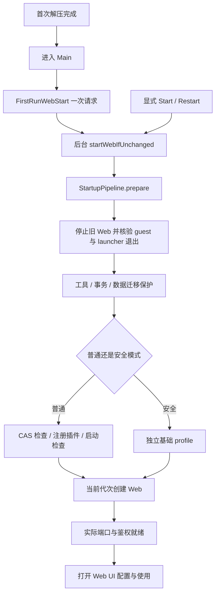
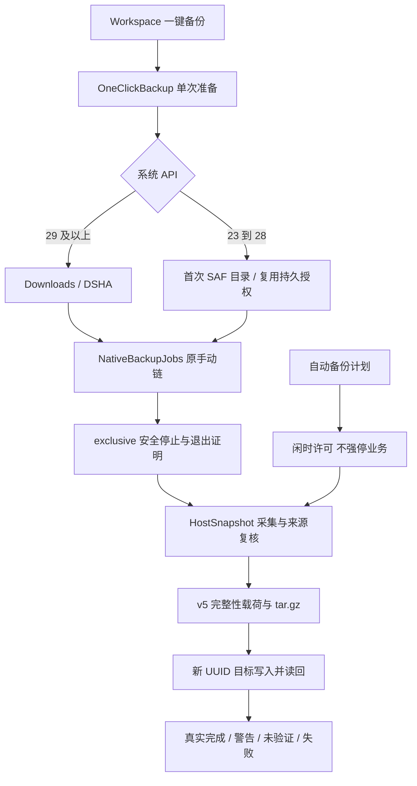

# 运行环境、数据与插件机制

本文面向准备修改 DSHA 的开发者，说明环境从哪里来、数据归谁、插件如何进入真实启动链。
核验日期：2026-10-21。当前说明以已发布F10 `087724c`为来源基线，按 build190 / F13工作树维护：Ubuntu base10、官方 DSH `0.2.1-rc.2`、Node 24、随包 pnpm `10.34.5`。F11为未上传的本地检查点，不能称新增已发布版本；最终身份与执行范围见[README](../README.md)；[F12记录](releases/v0.2.1-rc.2-build190-fix12-20261021.md)保留已发布历史归属，不从本页推导新设备或真实账号验收。 本批最终软件与产物范围由[F13记录](releases/v0.2.1-rc.2-build190-fix13-20261021.md)统一填写；本文不预填最终版本或正式总数。
默认引擎是 `proot`，用户可显式选择 `proroot`；当前生产方案不使用 bxroot。
这里的流程和约束属于 DSHA 实现，不代表 Ubuntu、Node、pnpm 或 DSH 上游对 Android 的保证。
本文是源码导航，不是一次新的构建、设备验收或所有旧数据兼容性证明。

## 阅读顺序与证据层次

- 项目入口：[README](../README.md)、[AGENTS](../AGENTS.md)、[BUILD](../BUILD.md)。
- 全局导航：[项目架构总手册](project-architecture-handbook.md)、[模块索引](module-map.md)。
- 设备能力：[权限架构](device-permissions-architecture.md)、[虚拟屏架构](virtual-screen-architecture.md)。
- 安全边界：[安全模型](security-model.md)、[ADR 0002](adr/0002-current-threat-model.md)。
- 输入与生命周期：[ADR 0003](adr/0003-virtual-screen-lifecycle-and-input.md)。
- 历史拆分理由：[ADR 0001](adr/0001-build154-boundaries.md)。
- 来源与归属：[源码来源](source-provenance.md)、[权威资料与来源](references-and-provenance.md)。
- 运行细节：[引擎选择](runtime-engines.md)、[端口与网络](ports-and-networking.md)、[DNS 配置](dns-configuration.md)。

理解一个行为时，依次核对当前入口、实际资产锁、测试边界和对应版本的验收记录。
旧文档中的 DSH 版本、引擎选择和测试数量按当时版本阅读，以当前代码与锁为准。
宿主模拟证明的是指定契约；不能将其改写为所有 Android 版本、远程插件源或设备矩阵通过。

## 一、APK、运行环境与用户数据是三层

APK 提供 Java 宿主、原生启动器、固定离线归档及受管脚本。
Ubuntu rootfs 提供 Linux 用户空间，Node/DSH 在这个执行环境内运行。
用户对话、配置、插件意图和工作文件由数据布局与迁移契约管理，不能随 APK 更新任意覆盖。
guest 中的 `/root` 不是 Android UID0；工具审批模式也不会改变应用 UID 或建立独立恶意代码沙箱。

| 层 | 主要入口 | 修改时首先检查 |
|---|---|---|
| Android 编排 | `core/HarnessController`、`WebLifecycleController` | generation、停止意图、维护与前台服务 |
| guest 执行 | `runtime/ProotBootstrap`、`RuntimeLauncher`、`ContainerRuntime` | 实际 argv、环境、出生身份及退出证明 |
| 受管内容 | `ManagedRuntimeAssets`、`RuntimeTools` | 清单、内容摘要、候选准备及原子切换 |
| 用户数据 | `backup/UserDataLayout`、`GuestDataResolver` | 实际布局、链接边界、历史原件 |
| 插件状态 | `PluginRepository`、guest 插件脚本 | 安装、选中、禁用和实际加载分别判断 |
| 备份恢复 | `NativeBackupJobs`、`HostSnapshot`、`HostDataTransaction` | 来源范围、预检、静止与目标读回 |

类名可在[主 Java 包](../app/src/main/java/com/deepseekharness/app/)内按上述目录查找。
核心编排、宿主归档和 guest 脚本属于不同执行域；不能用单一 Java 方法返回替代所有域的完成证明。

### 1.1 固定资产与描述符

关键输入如下，实际打包位置还须看 Gradle 生成配置。

| 输入 | 用途 | 权威位置 |
|---|---|---|
| `offline-rootfs.bin` | Ubuntu 基础环境 | APK 资产及其随包清单 |
| `dsh-runtime.bin` | 固定 DSH/Node 模块覆盖内容 | [运行时包锁](../tools/dsh-runtime/package-lock.json)及构包工具 |
| `pnpm-runtime.bin` | 固定 pnpm 分发 | `RootfsInstaller.pnpm`、受管描述符 |
| `python-support.bin` | 随包 Python 支持 | `RootfsInstaller.python` |
| `ubuntu-tools.bin` | Ubuntu 工具分包 | 随包布局、清单与安装脚本 |
| `managed-runtime-inputs.json` | 安装目标和受管输入契约 | [实际契约](../app/src/main/assets/managed-runtime-inputs.json) |
| `runtime-descriptor.json` | 内容、启动器、桥和数据契约身份 | [当前描述符](../app/src/main/assets/runtime-descriptor.json) |

`runtimeId` 来自受管契约和内容指纹，不等于 APK 的 versionCode。
`baseVersion=10` 表示 Ubuntu 基础环境版本；普通 DSH 或 UI 更新不应随意递增它。
`launcherInputs` 只包括描述符声明的启动相关输入，并非整个 Java 源码树的摘要。
修改不在其中的界面文件，仍需相应源码和构建验证，不能据此声称描述符覆盖所有源码。

生成入口是 [prepare-runtime-descriptor.py](../tools/prepare-runtime-descriptor.py)。
受管包准备还涉及 `prepare-dsh-runtime.py`、`build-dsh-runtime.py`、`generate-builtin-plugins.py` 和 `prepare-backup-assets.py`。
它们的输入、生成文件与检查任务见 [app/build.gradle](../app/build.gradle) 和 [BUILD](../BUILD.md)。
修改资产内容后，应由同一负责人统一生成与核验；不要让多个任务并发重写归档或描述符。

### 1.2 当前 APK 的 launcher 与旧运行树

[RuntimeLauncher](../app/src/main/java/com/deepseekharness/app/runtime/RuntimeLauncher.java)负责构造当前执行入口。
`RuntimeLauncherAssets.prepare` 将当前 APK 的桥接脚本放到独立受管目录，guest 可见挂载点为 `/run/dsha-launcher`。
这种布局避免为了使用新 launcher 而覆写留存的旧运行树。
旧运行时回退也必须核对当前 launcher 与数据的读写兼容性，不能只看“旧目录还在”。
原生进程识别、guest 进程身份与 launcher 的退出状态共同参与停止屏障。
Android 宿主、guest bash 与实际 Node 的 PID 不能混作同一个进程身份。
当前 proroot vendor 为 `v1.2.8`，受[本地 ABI 锁](../tools/proroot-compat/abi.lock.json)约束；它与历史 DSHA 应用版本号无关。
厂商二进制、兼容适配器和可从源码生成的部分需分别看来源说明，不能承诺全部 vendor 可源码重建。

## 二、首次启动与普通启动

首次解压完成后直接进入 Main，Web 在后台启动；模型与 API Key 在网页中配置。
当前不再通过原生模型表单或原生模型目录预热来阻挡 Main 显示。
“解压结束”“创建进程”“后端鉴权完成”“网页可用”是不同阶段。

### 2.1 首启一次请求与用户 Stop

[FirstRunWebStart](../app/src/main/java/com/deepseekharness/app/ui/FirstRunWebStart.java)保存首启 pending/submitted 状态。
`mainIntent`、`schedule` 与 `enqueue` 共同限定首次设置请求，不将任意外部 Intent 当作自动启动授权。
`enqueue` 在后台执行启动请求，旋转或重进不应重复提交。
`startWebIfUnchanged(expectedGeneration, true, status)` 接受同代的明确设置请求。
这里 `manual=true` 允许安装维护留下的停止状态；之后用户 Stop 导致代次改变时，旧排队请求仍被拒绝。
不要把它改成无代次检查的后台 `startWeb()`，否则排队首启可能在用户 Stop 后再次启动。
界面线程只更新状态与可见前台服务保护，不做慢磁盘预检、guest 等待或 Provider 读写。

### 2.2 编排与真正启动

[HarnessController](../app/src/main/java/com/deepseekharness/app/core/HarnessController.java)是 UI 与服务共享的入口。
[WebLifecycleController](../app/src/main/java/com/deepseekharness/app/core/WebLifecycleController.java)持有运行代次、请求接纳、停止和恢复流程。
`requestStart` 先处理已有停止/维护条件，在慢预检之后再次核对 generation。
`StartupPipeline.prepare` 负责启动前的步骤顺序，成功后才返回实际 profile。
`StartupEnvironmentActions.releasePrior` 调用 `stopOwnedLaunchers` 和 `confirmStopped`。
旧进程退出不明时，它返回失败；不能为了打开网页跳过该检查。

普通启动的准备顺序包括：

1. 读取旧原生凭据兼容状态、停止旧 LAN 和 Web。
2. 核验旧 guest 与 launcher 退出，检查随包工具及必要解压。
3. 恢复允许恢复的数据事务，核对历史清理与 rc1 迁移保护。
4. 对当前普通 profile 检查旧 pnpm CAS 文件链接，再注册内置插件。
5. 处理允许解除的历史自动审阅标记，执行本轮真实加载前检查。
6. 核对代次、启动许可与实际 profile，创建 Web 并观察鉴权输出。

`WebLaunchCommand.build` 使用动态端口 `0` 或明确选定的端口，完整官方输出才可成为鉴权依据。
端口能连接或页面有内容，不单独证明本轮 Web 已就绪。
慢启动、鉴权超时和 UNKNOWN 不能自动重放用户业务。
引擎回退只适用于代码明确允许、尚无业务且退出已证实的窄启动失败，不是通用重试策略。

### 2.3 停止与 ADB 相关响应性

`stopWeb` 先发布本轮停止围栏，再由停止工作线程执行可能阻塞的收尾。
`WebStopCoordinator` 与进程会话核对 guest、launcher 和其他任务的退出情况。
停止未证实时，保留停止状态、任务记录和维护屏障，不给裸 PID 发强杀信号。
ADB 开关、虚拟屏或 Activity 消失，不等同于 guest 已退出。
主线程不能持生命周期监视器等待慢预检、线程 join 或远端 I/O。
相关宿主响应性回归证明指定阻塞边界，不构成某台设备 ANR 唯一根因的证明。

### 2.4 已保存运行记录与后台页面恢复

正常新启动保存运行记录后也会进入周期身份复核，不能把这条链理解为仅宿主进程重建。F13用F12编译类负控复现单次失败使`restoreUnknown`永久残留的路径；当前[WebSessionRecheck](../app/src/main/java/com/deepseekharness/app/core/WebSessionRecheck.java)区分活态、未知与已退出，并丢弃不同record/代次/实例/URL/实际端口的迟到结果。

UNKNOWN保留原DOM或Gecko会话与后台保护，撤屏幕epoch、旧任务票和LAN，不把展示身份授为当前ready；Standard/Low均显示原生等待状态。同一身份恢复内核→真实HTTP鉴权→二次内核核验后，创建新registration对象通知原页面继续，不复活旧对象/排队票或重发对话、启动和stop操作。确认guest退出则显示已退出并留记录，launcher停止仍须独立证明。页面保留不构成浏览器或后端RPC强沙箱，不暂停所有JS/Node工作；定向JVM/Robolectric及固定F12旧类负控已完成，Standard实际Activity/同DOM/Blob/Service保护仅在该宿主夹具验证；Low只有编译与源码审查，无完整Gecko Activity回归。它不替代最终双版Gradle/APK，也不是故障手机、ROM后台或真实模型验收完成。完整状态和入口见[启动与诊断](startup-and-diagnostics.md)。

## 三、安全启动、应急与维护恢复

这三个入口解决不同问题，不能互相代替。

| 路径 | 入口 | 使用什么环境 | 主要边界 |
|---|---|---|---|
| 普通启动 | Main / Launch → controller | 正式 rootfs、正常 web profile | 按实际插件配置加载 |
| 安全启动 | `recoverWebIfUnchanged` 等 | 正式环境中的独立基础 profile | 不改原插件开关，普通重启可返回 |
| 启动恢复页 | `StartupRecoveryActivity/Model` | 宿主状态、快照及修复入口 | 显示失败并执行有界维护，不伪装已就绪 |
| 独立应急 DSH | `RecoveryController/Runtime` | 独立运行根、HOME、工作区 | 不借正式损坏环境当依赖 |
| 环境维护恢复 | `BackupTask.recoverMaintenance` | 已记录事务与固定目标 | 按身份和摘要恢复，不自由重放写删 |

### 3.1 启动恢复界面

`StartupRecoveryModel`读取恢复状态、快照和可处理插件，界面本身不持有后台维护所有权。
短暂 `RECOVERY_BUSY` 在任务结束后应重新读取，成功读取要清除旧 error。
普通插件只读查询的忙状态不能冒充“正在修改环境”。
Main 对显式插件/设置导航保留故障提示，但不应抢走修复界面的前台。
真实 pending 事务、Start/Stop 和环境维护仍是有效屏障；界面可用不等于绕过插件加载检查。

### 3.2 独立应急环境

[RecoveryRuntime](../app/src/main/java/com/deepseekharness/app/recovery/RecoveryRuntime.java)从独立锁准备环境。
固定输入位于 [tools/recovery-runtime/lock.json](../tools/recovery-runtime/lock.json)。
正式归档与应急锁摘要完全相同时，APK 可通过位置映射共用物理字节。
共用包内字节不表示共用解压运行根；不一致时须保留锁定的独立副本。
`prepareProfile` 创建有效 name/version 的应急代理包，并限制为应急修复工具集。
没有可用模型凭据时可以先看诊断；对话需要适当凭据，不将诊断成功说成模型请求成功。

[RecoveryRepairBroker](../app/src/main/java/com/deepseekharness/app/recovery/RecoveryRepairBroker.java)可以提议修复计划。
HTTP 不能代替原生写入确认；确认绑定候选、源摘要和数据代次。
写入仍经过宿主事务与停止屏障，停止应急聊天也不能提前释放仍在进行的修复 lease。
`READY_READ_ONLY` 只描述本次应急诊断能力，不授予正式环境停止屏障豁免。

### 3.3 受管更新与隔离试运行

`BackupTask.updateEnvironment` 委托环境维护编排，真实切换使用 `ManagedRuntimeTransaction`。
`RuntimeTools.prepareManagedOverlay` 与普通工具准备共享必要的包管理器、内置依赖和设置补丁准备。
候选必须先完整准备，再计算受管摘要；不能等首次用户 Web 启动才补齐候选。
`RuntimeTrial` 在隔离 profile 核对静态内容、原生模块、真实端口与鉴权、存储/会话写后重开。
试运行还要确认 guest 和 launcher 退出，之后才能作为提交依据。
试运行记录标明实际 runtimeMode，发生受限 fallback 时同时记录来源，不把 proot 通过算作 proroot 通过。
用户对话不会因为运行时回退而自动恢复成旧快照。

留存策略看真实健康证明与目录内容；修改过、不可读或多出成员的旧树原位保留。
至少保留所需健康前代，不能把目录数量或缓存回执当作删除依据。
`RuntimeTrialRecords` 对已关闭记录做有界轮换，未关闭或异常现场继续保留。
事务的取消、掉电和失败处理需按相应记录恢复，不能靠再次运行安装命令猜测完成状态。

## 四、Node、pnpm 与插件的命令环境

### 4.1 命令发现与准备

[WebLaunchCommand](../app/src/main/java/com/deepseekharness/app/util/WebLaunchCommand.java)显式将 `/root/dsh-bin` 等固定目录置于 PATH 前部。
它保留继承 PATH 的尾部，不依赖非 login 的 `bash -c` 自动读取 `/etc/profile.d`。
`RuntimeTools.preparePackageCommands` 统一准备 npm/npx/pnpm，并将入口、分发、版本标记和 wrapper 纳入准备检查。
`RootfsInstaller.pnpm` 从签名资产发布真实 pnpm，陈旧非空 wrapper 或丢失执行位也需要修复。
受管发布器拒绝链接目标，不把任意用户链接当成可覆写的受管普通文件。
原生插件 CLI 的环境准备与 Web 子进程入口都要验证；一个入口可用不能证明另一个入口 PATH 正确。

### 4.2 copy 默认与旧 CAS 修复

proroot 的 `--link2symlink` 会改变部分文件链接语义，Node 可能将包入口 realpath 到 pnpm store。
因此受管 pnpm wrapper 默认 `package-import-method=copy`，保留用户显式环境或命令参数的优先级。
这个默认只影响新的导入，不会自动修复已经复用的旧共享依赖。
不能用全局改变 Node realpath、扩大路径权限或盲目 `--force` 来隐藏旧树问题。

普通启动在旧 Web 确认退出后调用 `plugin-manager.py materialize-cas-links`。
该操作只处理当前 `profiles/web/node_modules` 内可证明的 pnpm CAS 文件链接。
它核对目标文件 SHA-512 与 CAS 文件名，复制原字节到普通文件，保留原链接，不修改 store、锁和 manifest。
显式算法为 `DSHA_PNPM_CAS_COPY_V1`，使用独立事务计划，超过单批上限时分批提交。
没有需要修复的链接是成功 no-op；未知算法、目标变化或 pending 不是成功。
部分提交或中断后保留现场，下一次普通启动不能自动重放；需要显式事务恢复。
此操作不执行安装脚本，也不是再次安装用户包。

## 五、插件源码、选择与运行状态

### 5.1 系统层与用户层

[builtin-plugins.json](../app/src/main/assets/builtin-plugins.json)声明随包插件及其 guest 位置。
官方核心 bundle、APK 提供的内置 wrapper 与用户第三方包分别识别，不用同名目录混为一层。
当前内置移动插件为 `3.2.1`，锁定来源及本地差异由构包输入管理。
系统插件字节从当前 APK 的受管证明重建；用户备份保存其启停意图，不复制系统实体充当用户源码。
用户插件归档包含实际源码、依赖、包装和来源关系，不能恢复时重新解析依赖后仍声称是原件。

F11进一步以APK受管包proof及完整FILE/mode/LINK内容核对来源，不按npm scope、`dsh-`前缀、目录位置或可写`installation.dependencies`排除用户包。原生备份读取APK proof，扫描无alias的实际运行时bundle，并在备份前复核变化。未证明且位于安装树的包显示用户/未验证；可查看、开关和导出，原生不自动在该位置更新/删除。普通profile用户插件按原管理流程处理，详细边界见[插件运行与权限](plugin-runtime-and-permissions.md)。

发现先筛选小manifest与真实patch bundle，单次命令/请求只认证一次proof表并按canonical目录去重；完整内容、mode、LINK、目录成员和竞态证明仍保留，不用跨请求stat缓存代替当前内容。Node真实Host用异步文件API完成bundle/full-content proof，全局内容扫描最多2并发、每块读取最多64 KiB且让出事件循环。Node删除在writer/HMR锁外预检，提交内对实际目标再做完整核验；原生Python删除保持独立NOFOLLOW对象事务，不从“列表刚看过”推导安全删除。

内置可选组件包括设备 shell 指南、任务通知、状态浮层、移动界面、Android computer-use、Auto 审阅和虚拟屏工具。
`dsh-app-integration` 等内部集成也在清单中，但不因此成为普通第三方卸载对象。
具体能力和授权见[权限架构](device-permissions-architecture.md)。

### 5.2 注册和启停意图

[register-builtin-plugins.py](../app/src/main/assets/register-builtin-plugins.py)负责发现、受管链接、profile manifest 合并与开关。
`register()` 不能把用户明确关闭的签名 wrapper 在下一次启动时补回。
Web 开关与 Native 注册共用 profile manifest 写锁；Native 入口按 data → package 锁顺序执行。
Web 侧只清除自己拥有的禁用 marker，不能解除 Native 的空标记、未知标记或安全模式意图。
Auto 的 `dsh-auto-review` 与官方实验包名合并为一个逻辑选择，避免重复卡片与重复激活。
不要将该合并推广到任意同名第三方包，也不要借启停操作修改会话 permissionMode。

必须分别观察以下状态：

1. 已安装：源码和依赖存在，并符合当前包检查。
2. 已选中：profile 的 bundles/依赖声明选择了该插件。
3. 已禁用：Native/Web marker 或安全意图阻止加载。
4. 已加载：本轮 DSH 实际加载、apply 成功，而非仅列表有卡片。
5. 需要重启：安装或开关已提交，但当前 Web 不具备可确认的热更新结果。

`PluginRepository` 驱动原生 UI；`PluginActivationHooks` 与启动观察器处理实际启动加载诊断。
加载失败应保留插件名与脱敏原因，不能把“已安装”提升成“运行正常”。

原生`enable-state`/`disable-state`只提交并读回启停意图，调用方严格核对包名、Boolean状态及`intentVerified:true`；先发布意图回执，再独立合并refresh。开关成功不是组件ready、活loader加载/卸载或热更新，须正常重启Web后生效。只读list/refresh不占profile writer锁且可取消，配置并发变化或已有writer锁明确报错，旧列表可保留但不是新核验结果。

查询和短意图命令共用30秒协作总预算，覆盖排队、准备边界与执行，实际runner使用剩余时间。`GuestScriptBudget`会在步骤和流读取前后检查；单次系统I/O、monitor或Binder等待不可被这套协作机制抢占，不能承诺所有平台调用严格30秒终止。取消/超时不把未知退出改为已退出，原任务和维护屏障继续保留，不自动重放写操作。

已有桌面真实Host夹具记录双list约0.65秒，独立Worker的HTTP ping约14毫秒且当时扫描仍pending；这只说明该Node/桌面输入下的响应性，不是手机、最终APK、所有插件规模或端到端性能保证。本次文档同步不重跑夹具、不新增正式测试总数。

### 5.3 npm、GitHub 与本地导入

原生安装入口由 `PluginRepository.install/importArchive` 等方法进入 guest 管理器。
主要脚本是 [plugin-manager.py](../app/src/main/assets/plugin-manager.py)、依赖/网络/生命周期辅助脚本和事务脚本。
Web 插件管理使用 DSH 实际 PluginManager，通过受管 pnpm 与策略补丁进入安装链。
两条路径的下载、prepare 和加载顺序可能不同，应按实际日志定位，不能互相冒充验证。

候选要核对合法包名/版本、bundle patch 声明和实际补丁文件、路径与依赖；`main/cordis.entry`只有声明时才要求对应入口文件存在。
普通 npm 库或缺少发布产物的 Git 源码包，不会因为包名包含 DSH 就成为可加载插件。
依赖策略允许未锁定重解析、生命周期脚本和 pnpmfile，记录本次实际锁与目录摘要。
下载阶段 `--ignore-scripts` 不代表后面的依赖安装和 Git prepare 都不执行脚本。
明确 HTTPS GitHub 请求的子进程可保持 HTTPS 传输，不写全局 Git 配置或擅改用户显式配置。
网络只读 fetch 的有限重试与整个有副作用安装重放是两回事，后者不能自动进行。

### 5.4 事务、删除与恢复

[plugin-transactions.py](../app/src/main/assets/plugin-transactions.py)记录固定目标、候选、前后摘要与历史原件。
Java 的 `PluginInstallJournals` 将 pending 纳入宿主维护与启动检查。
已提交旧日志不能回滚后来用户数据，未知日志不能被普通启动覆盖。普通临时准备目录在成功或明确失败后可清理；包管理退出未知时保留候选及专用marker，不能以临时收尾清理该现场。
正常安装和执行保持严格依赖检查；删除坏插件使用专用 NOFOLLOW 对象摘要。
`DSHA_DELETE_OBJECT_NOFOLLOW_V1` 只证明所选树对象及链接文本，移入保留区时不跟随旧 store 链接。
它不会删除共享 store、其他插件或外部导入源；旧 format3 日志无算法字段时仍按旧严格分支读取。
新增算法必须显式分支并拒绝未知值，不能借兼容旧日志弱化所有事务校验。

### 5.5 已知兼容性与授权边界

proroot 中 Git 源码 prepare 调用原生 Go 工具时，可能遇到内核可执行路径与 guest 路径不同的限制。
实际 TypeScript 原生工具找错 `lib.d.ts` 的失败属于 prepare/toolchain，不能归为网络失败或 pnpm copy 未生效。
构建好的 npm/Release 包成功，不证明同版本 Git 源码在同一手机引擎可构建。
切换 proot 后的独立样本须单列，不将其算作 proroot 原生成功，也不自动重放未知业务。

插件 Auto 审阅角色与 Android 设备全局授权是两套机制。
前者参与 DSH 工具审批；后者由宿主能力、目标身份、代次和许可策略控制。
“全部允许”也不放宽实际系统能力、当前目标或新鲜帧/节点校验，详见[安全模型](security-model.md)。
插件和 shell 在应用 UID 可访问的范围内运行，包格式和事务检查不构成恶意代码强沙箱。
官方模块的 dispose 也不能预设为纯内存清理；例如 Auto 的会话 preset 调整须按真实实现评估持久影响。
未逐项比对持久会话时，不应保证“所有既有会话模式绝对未变”。

### 5.6 工作区目录服务与父插件依赖

`@deepseek-ai/dsh-api-workspace-controller`同时导出`WorkspaceController`与`DirectoryPickerController`。原默认Workspace控制器的构造尾部才注册目录控制器；其`workspaceRegistry`静态依赖可等待真实存储domain、历史session headers和canonical cwd初始化。F13已用真实Host禁用registry复现：目录浏览后端与UI活动、父控制器pending，但`directoryPicker/list`返回`gateway/service-unavailable` / `active Service directoryPickerController unavailable`。健康raw/managed空profile本来可用，手机registry未就绪的具体原因未定位；不能据此推断任意历史数据损坏或所有核心服务缺失。

[独立目录服务补丁](../app/src/main/assets/directory-picker-service-patch.json)将默认导出改为组合，独立挂载真实目录控制器与原工作区控制器。前者仍inject实际`directoryPicker`；后者仍inject`remoteAccess/typert/workspaceRegistry`。原Config/name及named-class直调行为保留，私有Symbol只避免组合路径再次嵌套注册。它不伪造service、不放开Gateway认证或参数/路径检查；真实后端缺失仍拒绝。目录专项正控覆盖真实list/create/readback、路径/鉴权/缺后端拒绝、健康工作区保存及同profile两次正常退出重开与named类兼容；没有把损坏记录或HMR算作目录通过。

修复改变服务组合，不删除或重建工作区/会话/附件，不自动清空全局配置、重放未知动作或把外置目录纳入擦除。浏览/选择失败与数据存储合同分别判断；[插件操作](plugins.md)说明用户可见错误与数据保留，[启动诊断](startup-and-diagnostics.md)说明恢复和UNKNOWN屏障。相关实际Host入口为[test-directory-picker-service-host.mjs](../tools/test-directory-picker-service-host.mjs)，不是手机、模型或Android文件系统矩阵证据。

### 5.7 附件resolver的注册对象与退休

原raw/F12的`FileUploads.registerAgentResolver`把函数直接保存在Service属性；Cordis tracing读取后包装为新Proxy，使disposer的函数`===`比对失败，旧slot残留。实际Cordis及原raw/managed模块已复现registry/`SessionController`停启后重复注册错误。这是独立于目录组合的已证路径，不能由健康启动或目录专项结果覆盖，也不能推广成所有插件故障或手机截图唯一原因。

[窄生命周期补丁](../app/src/main/assets/file-upload-resolver-lifecycle-patch.json)只在锁定file-upload模块使用稳定`{ resolve }`对象持有该次注册，disposer按对象身份清理，调用时解出函数。保留live重复注册拒绝、旧disposer围栏、真实上传接收与session回执检查，不重播上传、不删旧附件或工作区内容。专项已完成原CLI（不含目录补丁）重复错误负控，以及只加载附件补丁的两轮workspace停启applied、raw/typed上传实际字节落盘读回、冷进程同Session上传/列表保留；鉴权、foreignOrigin、415/400及未知Session拒绝仍保留。真实Cordis/Commands/LocalAttachmentStore核对live重复、旧disposer、owner退休与同Session回执，入口为[test-file-upload-resolver-lifecycle.mjs](../tools/test-file-upload-resolver-lifecycle.mjs)。这不是目录+附件组合或最终共享运行时/APK通过；软件范围不扩大为所有附件端到端、账号/模型或真机矩阵，最终组合门禁由负责人另跑。

## 六、配置与凭据

[ConfigStore](../app/src/main/java/com/deepseekharness/app/core/ConfigStore.java)保存宿主设置，`CredentialRead`表达原生凭据读取结果。
四态是 `AVAILABLE`、`NOT_CONFIGURED`、`TEMPORARILY_UNAVAILABLE`、`NEEDS_ATTENTION`。
普通 Web 启动仅在 AVAILABLE 时注入旧原生 API Key 作为环境兼容 fallback。
未配置不注入；暂时不可用或需处理时保留状态警告和原密文，允许用户进入 Web 配置。
警告不得包含密钥明文；不能将不可读伪装成 missing，也不能创建替代解密密钥覆盖旧记录。
DSH 本地凭据服务先读取 Web 持久凭据，再使用继承环境，普通启动不回写原生密文。
因此 Web unset 后可能重新露出兼容环境值；不要把这个行为描述为原生覆盖了 Web 配置。
应急凭据、备份导出、显式重置仍有各自严格契约，不能将普通启动的容错广泛套用。
保存新原生值时仍需先加密并读回，保存无关设置不能清除不可读凭据。

## 七、宿主 v5 备份与一键导出

[backup-format-v5](backup-format-v5.md)定义 DSHA 自有格式，不是 DSH 上游的标准备份格式。
完整性摘要用来发现内容损坏，不证明插件作者、备份来源或执行安全。
无密码导出不提供保密性；对话、项目、配置与 `.env` 可能包含敏感内容。

### 7.1 一键范围与目标

主入口为 `WorkspaceFragment` → `OneClickBackup.start` → `NativeBackupJobs.exportToDownloads/exportToDirectory`。
范围固定为 `application`，原生 API Key 默认排除，不要求先选择密码或范围。
包含对话、配置、用户插件，以及经过定位检查的当前应用内工作区。
这不是 rootfs 全盘镜像，也不自动遍历所有私有项目或外置工作区内容。
外置工作区的实际文件应另行备份；私有引用存在不代表外部文件已经入包。

手动一键复用 `MaintenanceCoordinator.exclusive` 的正常安全停止链，会停止 DSH 和运行任务。
完成后由用户手动启动，不自动恢复聊天任务、脚本或未知操作。
重复点击和界面重建不重复提交；取消目录选择不创建备份，重开也不自动重放。

API29+ 由 `data/DownloadsExport` 通过 MediaStore 新建 `Download/DSHA` 文件，无需全文件权限。
文件名采用 `DSHA-data-v5-<UUID>.tar.gz`，不覆盖已有用户导出。
写入、关闭流和读回完整摘要后才清 `IS_PENDING`；失败 finally 只清本任务刚创建的精确行。
进程被终止后不自动扫描目录清历史 pending，也不按名称删除用户文件。

Low 的 API23–28 一键入口首次用 SAF 选目录并持久化读写授权，后续复用。
授权丢失时重新选择；Provider 工作在后台，不能在主线程等待取消或远端响应。
`BackupDirectoryTarget` 只认领实际新建、名称和空对象检查通过的叶子。
未能确认 ownership 时保留目标并报告失败，不冒险删除 Provider 返回的其他对象。
旧的其他下载工具可能还有旧系统直接文件路径，不代表一键入口会绕过 SAF 降级到私有缓存。

### 7.2 载荷、等级与流

v5 记录逻辑根、范围、路径、类型、尺寸、逐文件摘要，并验证清单与载荷双向一致。
记录明确区分缺失、不可读、排除、链接和普通文件；不能把少了内容仍称完整成功。
用户导出使用标准 tar/gzip 包装无需密码的 DSHADATA 完整性载荷和说明。
自动副本使用本机随机密码加密，旧加密归档读取仍须完成认证后才能预检。
`DocumentStreams`统一处理 SAF 查询、取消、FD 流和输入的 offset/length。
FD 所有权用自动关闭流明确转移，不能只关闭 Java 包装却泄漏 Provider 描述符。

| 结果 | 能说明什么 | 不能提升成什么 |
|---|---|---|
| `QUIESCENT` | 应用写任务停止并复核来源 | 冻结所有外部程序 |
| `EXTERNAL_CHECKED` | 外部源按契约重复核对 | 操作系统级外部写锁 |
| `BEST_EFFORT` | 尽力救援导出 | 应用一致性保证 |
| `PARTIAL` | 含明确缺失或变化记录 | 完整副本 |
| 写入未读回验证 | 目标已写但未确认全量读回 | 已验证备份、更新成功 latest |

插件依赖警告单独保留，不能因为归档摘要正确而改称插件内容完全正常。
私有验证文件只用于复核与重导出，不算卸载后仍可读取的公共备份。

### 7.3 自动备份

`AutomaticBackups` 默认开启，计划支持每日、1–168 小时间隔及停止后触发。
自动任务只在符合条件的闲时接纳，不借用手动 exclusive 链强停运行中业务。
`AutomaticBackupPruner`只轮换符合规则的正常自动副本，通常保留三份。
手动副本、未知记录、部分结果和用户公共导出不自动删除。
本机密码和私有副本不承诺卸载存续，应引导导出无需密码的公共副本。
`VerifiedBackupCopy`先核已有私有来源及其原结果等级，适用时用原密码认证读取；公共重导出生成新的无密码文件，原加密副本不改写、不提升完整性。完整当前契约见[v5归档](backup-format-v5.md)。

## 八、恢复、retained 与外置数据

恢复先完整认证/摘要核验，再写私有编号槽位并预检，归档路径不直接变成活跃目标。
本机白名单决定实际映射；归档不能导入运行 PID、桥凭据、设备授权或旧事务所有权。
`HostDataTransaction`在停止屏障内按检查后的计划提交，当前数据不是任意覆盖目标。
系统插件内容由当前 APK 重建，旧 v4 图中的系统实体字节不能重新当用户插件加载。
未知脚本、可执行配置与用户插件先按恢复契约隔离，再走明确恢复启用入口。

`RetainedCatalogue` 和 `RetainedDataActivity`提供历史只读清单、逐项检查、导出及预检恢复。
旧树解析只使用所选旧 rootfs 的映射，不能沿旧链接读到当前数据后伪称旧副本完整。
同名冲突保留当前版本，隔离原件不重新解析依赖，检查候选后才能选择恢复。
未知与损坏记录分别报告，不因为一个坏记录挡住其他可读副本。
外置工作区维护只可断开应用的私有引用，不遍历删除、覆盖或改名外部内容。
旧日志也不能自动重放外置写删；完整格式化/彻底重装的生产擦除能力已退休。

## 九、定位失败与修改路线

| 失败层 | 先看什么 | 不应采取的捷径 |
|---|---|---|
| 工具入口 | RuntimeTools、PATH、wrapper、真实版本 | 只搜索字符串存在就判成功 |
| 下载/网络 | 实际 URL、协议、单次 fetch 输出 | 运行脚本后换源重放整个安装 |
| prepare/build | 内层编译器、原生依赖和执行路径 | 将所有 exit2 都归为网络 |
| 包内容 | bundle patch、入口、发布产物 | 用缺产物源码 tar 代替发布包 |
| 加载/配置 | 实际 profile、插件、启动观察输出 | 安装成功即宣称加载成功 |
| 生命周期 | 代次、出生身份、guest/launcher 退出 | 裸 PID 强杀或忽略 UNKNOWN |
| 备份目标 | Provider、流关闭、摘要读回、结果等级 | 私有缓存冒充公共备份成功 |
| 恢复/维护 | pending 类型、目标、原件与摘要 | 清掉日志绕过维护门 |

建议按以下最小修改路线选择关联测试，测试名是入口，不表示本文重新执行了它们。

| 修改主题 | 生产入口 | 关联回归 |
|---|---|---|
| 首启/异步请求 | FirstRunWebStart、WebLifecycleController | `FirstRunWebStartTest`、`WebLifecycleResponsivenessTest` |
| 启动顺序/CAS结果 | StartupPipeline、StartupEnvironmentActions | `StartupPipelineTest`、`WebStopCoordinatorTest` |
| 原生凭据 fallback | StartupPipeline、ConfigStore | `LegacyNativeCredentialFallbackTest`、`CredentialReadTest` |
| 命令准备 | RuntimeTools、RootfsInstaller、WebLaunchCommand | `RuntimePackageCommandsAndroidTest`、`WebLaunchCommandTest` |
| 受管切换与试运行 | ManagedRuntimeTransaction、RuntimeTrial | `ManagedRuntimeTransactionTest`、`RuntimeTrialRecordsTest` |
| 插件启停/alias | register 脚本、运行时补丁 | `test-signed-builtin-web-intent.mjs`、`test-auto-review-alias.mjs` |
| 安装/删除/CAS | plugin-manager、plugin-transactions | `test-plugin-transactions.py`、`test-plugin-delete-nofollow.py`、`test-plugin-cas-materialize.py` |
| 一键入口/目标 | OneClickBackup、BackupDirectoryTarget | `OneClickBackupTest`、`OneClickBackupLifecycleTest`、`BackupDirectoryTargetTest` |
| v5/Downloads | HostSnapshot、NativeBackupJobs、DownloadsExport | `HostSnapshotTest`、`BackupArchiveTest`、`BackupDownloadsPublicationTest` |
| 恢复/旧数据 | HostDataTransaction、RetainedCatalogue | `HostDataTransactionTest`、`RetainedCatalogueTest`、`SystemPluginStateTest` |
| 维护/插件pending | MaintenanceGate、PluginInstallJournals | `MaintenanceGateTest`、`PluginInstallJournalsTest` |

Java 回归位于[宿主测试目录](../app/src/test/java/com/deepseekharness/app/)，脚本回归位于 [tools](../tools/)。
跨 flavor 的 SDK 夹具必须尊重实际合并清单：Standard 在支持的 SDK 上跑，Low 旧系统用例保留真实 API23 覆盖。
受管资产改动还需描述符来源核验、实际 APK 内容核验、两 flavor 受影响单测与 Release Lint。
源码、测试、工具、固定构建输入与交付证据应分别绑定；不能将一次旧包设备结果提升为新 APK 结果。
新增功能优先复用已有事务和停止门，不引入第二套“临时成功”状态或清日志绕过路径。

## 十、维护时保持的不变量

1. 用户 Stop 优先于旧代次排队启动；慢预检不得锁住界面生命周期。
2. guest 与 launcher 未确认退出时，不切数据树、不提交受管候选、不假定可以重放。
3. 系统插件字节归 APK，用户插件与启停意图分别保存。
4. package/data 锁按既定顺序取得，不能通过读后再删规避写入并发。
5. UNKNOWN、超时、取消和部分提交都保留真实状态，不能伪装成一次未执行的操作。
6. 原生凭据四态保留，普通 Web fallback 容错不扩散到重置、备份和应急的严格入口。
7. 手动一键可安全停止业务，自动备份不得强停；两者仍使用同一 v5 内容契约。
8. 公共导出需真实写入目标并报告读回结果；外置文件不因有引用就算已备份。
9. 恢复先验证后映射，未知权限、脚本和旧现场不能从归档直接取得当前执行权。
10. 软件测试、实际 APK 验证和设备实测分开记录，保留原失败及未覆盖范围。
