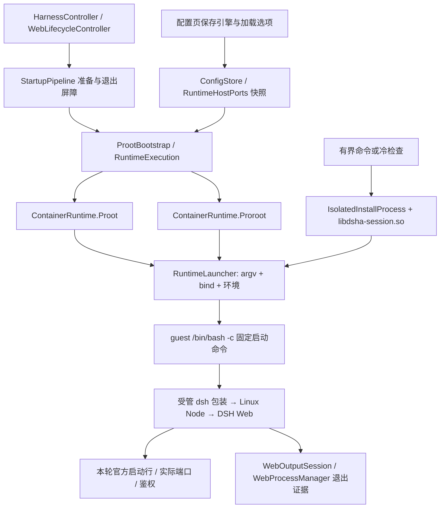

# Android 上的 Ubuntu、proot 与 proroot

本文对照 **2026-10-21 F10 / build190** 的实际源码工作树 `C:\Users\18768\.codex\worktrees\build190-from170\DSHA_RESTART`。当前应用内置 DSH **0.2.1-rc.2**，Ubuntu 基础环境身份 **10**。旧 `F:\DSHA_RESTART` 的 build173/bxroot 实现不代表当前构建。

整体入口见[项目架构手册](project-architecture-handbook.md)，数据、插件与命令环境见[运行时数据和插件架构](runtime-data-plugin-architecture.md)，外部项目、许可证与证据层次见[来源与权威参考](references-and-provenance.md)。本页讲运行机制，不新增设备验收结论；F10 的实际验证范围以[发布记录](releases/v0.2.1-rc.2-build190-prerelease-20261020.md)为准。

## 1. 现在默认什么，为什么和历史说明不同

当前是 **proot 默认、proroot 显式可选，不迁入 bxroot**。这来自 build190 的用户决定：以已发布 build170 为基座，定向迁入后续功能，保留旧数据、备份与迁移链，并恢复 proot + proroot 组合。不能把这段版本选择改写成“proroot 已被全面证明不可用”。不同手机、加载器模式、系统调用和进程信息权限有各自的兼容边界。

[ConfigStore](../app/src/main/java/com/deepseekharness/app/core/ConfigStore.java) 是配置事实来源：

| 入口 / 键 | 当前行为 |
|---|---|
| `isProroot()` / `container_runtime` | 只有精确值 `proroot` 才选择它；缺省为 `proot`。已有显式 `proroot` 值仍可读取，不是每次升级强制重置。 |
| `preferFastColdModeFrom()` | 返回 `false`，首次安装没有“未选就自动抢先用 proroot”的快捷路径。 |
| `isProrootStaticLoader()` / `proroot_static_loader` | 缺省 `true`；只有选了 proroot 才影响其加载路径。 |
| `isProotSeccompDisabled()` / `proot_disable_seccomp` | 缺省 `false`；可关闭 proot 的 seccomp 加速以适配已证实的平台问题。 |

用户在[配置页 ConfigFragment](../app/src/main/java/com/deepseekharness/app/ui/ConfigFragment.java)的高级选项选择 proroot、静态加载器及 proot seccomp 选项，`config_save` 保存。选项决定后续新进程的 argv/env，不能替换已经运行的 Web/终端引擎；先正常停止，再启动才可核对实际运行方式。`RuntimeHostPorts` 为一次调用提供配置作用域，不能让执行到一半的命令读到另一套设置。

[RuntimeExecution.runtime()](../app/src/main/java/com/deepseekharness/app/runtime/RuntimeExecution.java) 还要求 Android API >= 26、没有本次 `forceProot`，且 proroot 的五个原始文件与两个兼容文件可用并准备成功。否则记录 `RUNTIME_SELECTION_FALLBACK`，选择 proot。这是**启动前可用性选择**，和“guest 已执行后再次运行命令”是两件事。Low 最低 API 23 不意味着 API 23–25 会使用 proroot。

[CHANGELOG 历史段](../CHANGELOG.md)的“v1.1.6 起默认 proroot”说的是 **DSHA v1.1.6**，不是当前 proroot 二进制的版本号。该段还记录旧 vivo/Android14 的速度数据与旧兜底规则；“快 5–6 倍”、`+58%` 和“连续三次失败切换”等不能当成 build190 的全设备性能或当前重试契约。应分别阅读历史和上面的当前配置。

## 2. Ubuntu 在哪里，所谓 root 是什么

APK 内的离线 Ubuntu 与 DSH 归档被完整解压到应用私有环境，正式运行根由 [ProotBootstrap](../app/src/main/java/com/deepseekharness/app/runtime/ProotBootstrap.java) 管理。基础环境为 Ubuntu **24.04 arm64**，编号 10 是 DSHA 的基础环境身份，并非 Ubuntu 的发行版本号。Node 使用 Linux/glibc **24.x** 运行时；DSH 的精确 npm 版本及依赖由 [package.json](../tools/dsh-runtime/package.json) / [package-lock.json](../tools/dsh-runtime/package-lock.json) 固定。构建宿主的 Node 24 也不能作为手机实际 Node 小版本的证据。

Linux Node、Bash、glibc 与原生 npm 模块需要 Linux 路径和 ABI。Android 应用本身使用 Android/bionic 环境，不能把这套 glibc 程序当普通 Android Java 库直接调用。proot/proroot 在应用权限内提供类似 chroot 的路径和假身份视图，让 `/bin/bash`、`/usr/local/bin/node` 和 `/root` 指向所选运行根中的对象。

`-0` 使 guest 看到 root 身份，但 **Android 内核仍按应用真实 UID、SELinux 与系统权限执行**。这没有授予 Android root、真实挂载权限、其他应用私有文件访问或系统后台豁免。所有 guest 和后代仍受系统进程回收、前台服务规则及 Android 权限约束。工具确认、路径校验也不是针对任意本地代码的强沙箱；终端、第三方插件及其生命周期脚本保有项目允许的执行能力。[AOSP 的应用沙箱说明](https://source.android.com/docs/security/app-sandbox)阐明了 UID 对 Java 和原生代码共同生效的边界。

两个引擎共享 `ContainerRuntime.binds()` 的显式映射：`/dev`、`/proc`、`/sys`、`/system`、`/apex`、fd、随机设备及已可访问的共享存储。不存在或不可访问的源记录 `BIND_SKIPPED`。没有映射 `/linkerconfig`，避免将应用没有权限的目录反复当作可用依赖。`/sdcard` 映射不授予存储权限；SAF 等原生能力仍由各自受控接口提供。正式个人数据映射由 `UserDataBindings` 追加；独立应急根明确使用独立数据域，不从正式环境父目录猜测用户数据。

## 3. 一次启动经过哪些层



图中监督器表示包在相应命令外层的会话边界；**普通 Web、PTY、有界命令并不都走同一种 Process 包装**。源码分工如下：

| 文件 / 方法 | 责任 |
|---|---|
| [ContainerRuntime](../app/src/main/java/com/deepseekharness/app/runtime/ContainerRuntime.java) | 引擎可用性、原生文件、根路径、bind、专属环境。 |
| [RuntimeLauncher.builder/environment/start](../app/src/main/java/com/deepseekharness/app/runtime/RuntimeLauncher.java) | 统一非交互 argv/env，追加 `/bin/bash -c`，绑定签名预加载目录，选择普通或独立会话进程。 |
| [TerminalRuntime.launch/interactive](../app/src/main/java/com/deepseekharness/app/runtime/TerminalRuntime.java) | 复用引擎选择和环境准备；PTY 把 argv/env 交给 JNI；简易终端另持有生命周期工作锁。 |
| [StartupPipeline](../app/src/main/java/com/deepseekharness/app/core/StartupPipeline.java) / [StartupEnvironmentActions.releasePrior](../app/src/main/java/com/deepseekharness/app/core/StartupEnvironmentActions.java) | 启动准备、恢复与受管检查；关闭已持有 launcher 并确认旧 guest 退出后，才进入下一次启动。 |
| [WebLifecycleController](../app/src/main/java/com/deepseekharness/app/core/WebLifecycleController.java) | 运行代次、鉴权、停止、慢启动提示、兼容重试与用户停止意图。 |

`RuntimeLauncher.environment()` 设置 guest `HOME=/root`、命令 `PATH`、`TMPDIR=/tmp` 与非交互安装环境。`RuntimeTools.applyEnvironment()` 补 CA、DNS 预加载、npm 前缀和运行标志；固定桥接预加载还由 `RuntimeLauncherAssets` 绑定到所选根。详细环境表与插件分层见[运行时数据和插件架构](runtime-data-plugin-architecture.md)。环境准备不是业务命令的自动重放许可。

## 4. proot 实际调用与原生来源

当前 proot 使用 Termux 分支的 ptrace 路径翻译。`baseArgv()` 传入 `-L --kill-on-exit -0 --rootfs=<私有根> --cwd=/root` 及 bind。`--link2symlink` 仅在实际硬链接探测不支持时启用，另设置 `.l2s` 目录及 `PROOT_L2S_DIR`；不能为追求“兼容”无条件开启并破坏原子文件发布语义。

`applyEnv()` 设置 `PROOT_LOADER`、存在时的 `PROOT_LOADER_32`、`PROOT_TMP_DIR`、依赖搜索路径。`PROOT_NO_SECCOMP=1` 对应显式关闭加速；这不会取消应用本身的安全边界。[RuntimeNativeFiles.prepare()](../app/src/main/java/com/deepseekharness/app/runtime/RuntimeNativeFiles.java) 从随包原生库准备 `libtalloc.so.2` 与 `libandroid-shmem.so` 别名，不把缺失依赖当成环境已就绪。

| 当前文件 / 来源 | 已知边界 |
|---|---|
| Standard `libproot.so`、`libprootloader.so`、`libprootloader32.so` | Termux proot / GPL-2.0；[第三方声明](../THIRD_PARTY_NOTICES.md)明确：原始二进制的精确源码修订仍未核实。不能称 Standard 已按 Low 脚本复现。 |
| Low `libproot_legacy.so`、`libprootloader_legacy.so` | [build-low-proot.py](../tools/build-low-proot.py) 固定 Termux `v5.1.107.92` 源码归档，SHA `29385d1ddb619a9c4449ab512bfd55032034b22f724ddf98fc95ff300ea32135`；API23 本地构建标识 `5.1.107.92-dsha-android23`。 |
| Low 本地差异 | 移除一个不适用于 Android 命名 fd 的 canon 断言；旧 API 下通过 `dlsym` 查询 `getifaddrs/freeifaddrs`，不存在则明确 ENOSYS；shmem 映射到随包实现。不是通用内核仿真。 |
| NDK / 自有会话启动器 | [ci/toolchain.lock.json](../ci/toolchain.lock.json) 固定 NDK `26.3.11579264`；[native-session/build.py](../tools/native-session/build.py) 构建 API23 ARM64 会话启动器，4KiB/common 与 16KiB LOAD 对齐。对齐检查不等于全部 16KiB 手机实测。 |

本次只读核对的 Standard 三件原件 SHA-256，供查找对应字节，不补造源码来源：

```text
libproot.so         cbde86eb01b58413f9e4673e182caca5440e8fc4af8482a0e23d0faa0846f721
libprootloader.so   a2cbccfc776e23225b75e6700dd1990fcd505d2e973f5bfa19c76642d4e41c7d
libprootloader32.so 4c649eb2dce258c9111231940fdbf0474bcf1cd6dd447ad9bdf2898b35a85554
```

上游机制见 [Termux proot](https://github.com/termux/proot)。源码标签与实际分发 ELF 是不同证据层，来源缺口必须保留。

## 5. proroot、static_loader 和兼容 shim

### 5.1 原始组件与加载选择

当前随包为 **coderredlab/proroot v1.2.8**，采用上游描述的进程内路径翻译、LD_PRELOAD 与二进制补丁路径，避免 proot 的 ptrace 路径。它是专有许可二进制；DSHA 不声称有其完整源码或可重编上游加载器。机制介绍见[上游仓库](https://github.com/coderredlab/proroot)，分发身份以本地[第三方声明](../THIRD_PARTY_NOTICES.md)和[abi.lock.json](../tools/proroot-compat/abi.lock.json)为准，而不是上游当前最新版本。

`ContainerRuntime.Proroot.LIBS` 要求同目录五件原件：

```text
libproroot.so                 启动器
libproroot-runtime.so         guest 路径 hook 运行库
libproroot-linker.so          上游加载器
libproroot-stub-loader.so     上游静态 stub loader
libproroot-bridge.so          上游 bridge
```

本次只读逐字节核对：五件 vendor 原件及两个自有兼容 ELF 共七件全部符合 `abi.lock.json`。五件原始字节的完整 SHA 均在 `originalVendorSha256` 中；例如 runtime 为 `8c47a0a7db32d84c179ebb5bf3640f655a3181860ece5886ae44d92858730c34`。本地兼容工作没有修改或改名这些原件。执行入口来自 Android `nativeLibraryDir`；不能随意复制到 `filesDir` 后要求直接执行。[Android10 行为规则](https://developer.android.com/about/versions/10/behavior-changes-10#execute-permission)限制面向 API29+ 应用从可写应用目录执行文件。

`static_loader` 是**加载器模式开关**：true 时 argv 为 `--static-loader`，设置 `PROROOT_STUB_LOADER` 指向原始 stub；false 为 `--no-static-loader` 并移除该环境变量。两者都会设置 `PROROOT_LIB_PATH` 指向原始 runtime、`PROROOT_LINKER_PATH` 指向 DSHA 独立入口适配器，另有 `PROROOT_TMP_DIR`。它不表示 Node 被静态链接，也不表示关闭 glibc、跳过路径 hook、关闭所有 shim 或授予真实 root。闭源加载器内部细节不能由开关名推定。

proroot argv 还包括 `-r <根> -0 -w /root`、公共 bind、私有 cache 的 `/dev/shm` 映射及 `--link2symlink`。与 proot 按硬链接能力条件启用不同，此处当前代码固定添加后者；文件兼容层及发布器必须覆盖该实际行为。

### 5.2 目前实际存在的两个原生兼容文件

[中文说明所对照的实现 README](../tools/proroot-compat/README.md)、[stack-sysconf.c](../tools/proroot-compat/stack-sysconf.c)与[linker-entry.c](../tools/proroot-compat/linker-entry.c)说明了以下范围：

| 自有组件 | 修复和限制 |
|---|---|
| `libdsha-proroot-compat.so` | GNU AArch64 `sysconf/__sysconf` 代理，只处理 GNU 枚举 75、249、250（线程最小栈、最小信号栈、信号栈）。从内核 `/proc/self/auxv` 获取真实辅助向量；完整但没有 `AT_MINSIGSTKSZ=51` 时使用 AArch64 glibc 默认 5120。其他查询转发 `RTLD_NEXT` 并保持查找前 errno。 |
| `libdsha-proroot-linker.so` | 无依赖的入口适配器，给原始 bridge/linker 增加一个直接 `--preload <shim>`，同时保留原始 runtime 的直接预加载。只把 runtime 作为另一个库的间接依赖，曾造成路径 hook 不生效，因此不能替代此连接方式。 |

原始 Android13 故障出现 glibc 信号栈/线程栈断言；“加载器可能没有初始化相应 glibc 内部状态”是支持该修复的**推断**，不是已审计闭源源码后的定论。代理不写私有 glibc 字段、不依赖私有偏移、没有构造器。auxv 无法读、截断、重复、零值、溢出或没有终止项时以固定诊断退出 126，不伪造成功。

入口从自身当前指令对应的唯一可执行映射定位 framework 目录，核对 NOFOLLOW 打开的实际 inode、属主和不可由应用写入的权限，拒绝叶链接、可写同伴、任意路径或环境覆盖。上游合法的可选 `libgcc_s.so.1` 第二对 preload 只允许精确 `PROROOT_ROOTFS` 加固定后缀；任意第三个 preload 不放行。这里的 rootfs 变量不用于寻找自有 shim 或上游原生程序。失败只输出固定标记 `DSHA_PROROOT_PRELOAD_ENTRY_UNAVAILABLE`、stage 与 errno，不泄露业务 argv。

ABI、源码及输出摘要、五件 vendor 原件摘要均由 `abi.lock.json` 锁定；常量与公式来源是其中列出的 GNU glibc **2.39** 官方源码。`libdsha-proroot-compat.so` 无 `DT_NEEDED`、解释器或 RPATH；入口是无依赖/重定位的 static PIE。**这个适配器本身静态构建**与用户开关 `static_loader` 也不是同一概念。

### 5.3 其他运行兼容层的边界

原生 shim 只解决上述栈查询和预加载接线，不能自动修复全部 Android/Linux 差异。当前还应分别识别：

- [RuntimeTools](../app/src/main/java/com/deepseekharness/app/runtime/RuntimeTools.java) 与 [dns-compat.cjs](../app/src/main/assets/dns-compat.cjs)：受管 DNS 环境和 Node lookup 兼容，不能把 DNS 重试扩展成 HTTP/模型业务重放。
- `NARB_DISABLE_NATIVE_CACHE=1`：避免原生扩展复制缓存的 link/unlink 在 link2symlink 路径下形成悬链，不能据此删除实际原生依赖。
- [runtime-patches.json](../app/src/main/assets/runtime-patches.json)：当前 DSH 精确版本的补丁注册表，由 `RuntimeTools.applyPatchChain()` 统一准备；历史 `DT_UNKNOWN`/JSON 重开修复不能脱离当前注册表继续照搬旧模块补丁。
- [bridge-token-compat.cjs](../app/src/main/assets/bridge-token-compat.cjs)：固定受管启动预加载的一部分，与 GNU loader shim 分属不同层；其职责不授予本机桥的额外权限。
- Low proot 的 API23 兼容、PTY JNI 的出生握手、网页 ES/PDF 兼容分别有独立实现和验证；网页浏览器兼容成功不能证明 guest 原生加载成功。

## 6. 没有 --kill-on-exit 时，停止怎么成立

proot 的实际 argv 包含 `--kill-on-exit`；proroot 当前集成没有这一选项或等价保证，不能给它硬塞 proot 参数。`Process.destroy()` 只作用于持有的 launcher，不足以证明 Node 或其他 guest 后代已经停止。`ContainerRuntime` 顶部关于“按 pid 停”的注释要连同以下身份校验实现阅读，不能理解为任意裸 PID kill。

**Web 路径：** [WebProcessSession](../app/src/main/java/com/deepseekharness/app/core/WebProcessSession.java) 保存本轮 launcher/bridge lease；[WebProcessManager](../app/src/main/java/com/deepseekharness/app/runtime/WebProcessManager.java) 解析停止哨兵、PID 及出生身份，按 [WebProcSel](../app/src/main/java/com/deepseekharness/app/util/WebProcSel.java) 核对受管 Node/Bash/参数，检查当前 UID/进程身份后才发信号。`stopResult()` 区分 STOPPED、CANCELLED、UNCONFIRMED；`confirmStopped(trackedProcessAlive)` 还要求 launcher 已退出且没有本应用 Web。PID 复用、看不到 `/proc`、记录损坏或权限错误都不能直接变成“已退出”。

**有界 proroot 命令与安装会话：** `RuntimeExecution.bounded()` 要求随包 `libdsha-session.so`，先用 [BoundedGuestSessions](../app/src/main/java/com/deepseekharness/app/runtime/BoundedGuestSessions.java) 登记操作，再由 [IsolatedInstallProcess](../app/src/main/java/com/deepseekharness/app/runtime/IsolatedInstallProcess.java) 包装。[session-launcher.c](../tools/native-session/session-launcher.c) 建立 setsid 会话，设置父进程死亡信号，先发出生身份、等宿主二次核验并写 `DSHA_START`，才允许 guest 派发。壳前台状态发布后仍保留组长，关闭时核验会话、回收成员及 supervisor；不能把一个前台退出码当作整组为空。

[BoundedGuestLifetime.finish()](../app/src/main/java/com/deepseekharness/app/runtime/BoundedGuestLifetime.java) 在解释结果前关闭所属 guest 会话；失败登记不确定并保留工作锁。PTY/简易终端则由会话所有者与 [TerminalProcessCloser](../app/src/main/java/com/deepseekharness/app/runtime/TerminalProcessCloser.java) 负责本次身份/会话回收。不能用独立会话启动器的一次成功，宣称所有 Web、终端和设备后台状态都已证明。

## 7. 超时、UNKNOWN、fallback 和冷检查

| 场景 | 当前规则 / 源码依据 |
|---|---|
| Web 等鉴权超过 60 秒 | `WebLifecycleController.reportSlowStart()` 只提示“仍在等待”，保留 starting。没有因等待时间长强制杀进程的启动时限。 |
| 本轮 proroot 在鉴权前明确退出 | [WebRuntimeFallback.shouldRetry()](../app/src/main/java/com/deepseekharness/app/util/WebRuntimeFallback.java) 要求当前代次、未重试、没有鉴权、没有命名插件/启动故障且有实际退出码。`retryWithProot()` 取得环境任务 lease；新 `startWeb()` 仍经过 `StartupPipeline` 和 `releasePrior()` 的 launcher/guest 退出屏障。只重试本轮一次，不改用户保存的引擎选择。 |
| 鉴权后、插件故障、用户停止、代次过期 | 不触发上述兼容重试。不得借 fallback 重新执行用户业务提交。 |
| 有界命令超时或读取结果不完整 | 请求停止不等于确认完成；以 [GuestCommandOutcome](../app/src/main/java/com/deepseekharness/app/util/GuestCommandOutcome.java)、真实退出证明和保留现场判断。未知执行结果不能当“什么也没做”重放。 |
| 受管更新的隔离试运行 | [RuntimeTrial.verify()](../app/src/main/java/com/deepseekharness/app/runtime/RuntimeTrial.java) 只接收已闭合退出的 `TrialExit`；没有其他运行任务才尝试 proot，并记录 `fallbackFrom/fallbackExitCode`。兼容成功不能标为 proroot 成功。 |
| 冷安装能力选择 | [ColdToolsInstaller.modes()](../app/src/main/java/com/deepseekharness/app/runtime/ColdToolsInstaller.java) 与 [ColdInstallPlan](../app/src/main/java/com/deepseekharness/app/util/ColdInstallPlan.java) 先在受控私有候选上探针；当前自动偏好关闭，通常从 proot 到关闭 seccomp 的兼容 proot。显式 proroot 可在可用且支持独立会话时列入候选。 |
| 探针与真实包写入 | `ColdInstallPlan.run()` 最多三种探针，选定后真实包安装只执行一次；安装后检查失败或退出未确认不会换引擎重装一遍。成功选择持久化后才发布就绪。预配置签名包的 `runConfigured()` 做检查，不再次 dpkg。 |

代码保留 `PROROOT_DYNAMIC` 和针对特定静态信号栈断言的窄重试能力，但 `allowDynamicLoaderRetry()` 要求首次候选、automatic、非 forceProot 且静态模式；当前 `preferFastColdModeFrom()` 为 false，不能据此宣传“现在所有 proroot 失败都会自动关 static_loader”。保存设置、只读探针成功和正式环境已通过包检查，是不同状态。

## 8. 维护时应该看哪些测试

下表是**真实存在的验证入口和范围**，本次写文档没有执行它们，也没有生成 APK 或操作设备。历史通过必须继续绑定当时的源码/资产/APK 字节。

| 入口 | 能核对什么 / 不能推出什么 |
|---|---|
| [ConfigStoreRuntimeSettingsTest](../app/src/test/java/com/deepseekharness/app/core/ConfigStoreRuntimeSettingsTest.java)、[RuntimeHostPortsTest](../app/src/test/java/com/deepseekharness/app/runtime/RuntimeHostPortsTest.java) | 缺省与快照、成功冷选择保存及变更拒绝；不等于真实 guest 能启动。 |
| [ContainerRuntimeEnvironmentTest](../app/src/test/java/com/deepseekharness/app/runtime/ContainerRuntimeEnvironmentTest.java)、[RuntimeLauncherTest](../app/src/test/java/com/deepseekharness/app/runtime/RuntimeLauncherTest.java)、[TerminalRuntimeTest](../app/src/test/java/com/deepseekharness/app/runtime/TerminalRuntimeTest.java) | 实际参数、环境与终端接线；静态 argv 不能证明 Android 已执行。 |
| [WebRuntimeFallbackTest](../app/src/test/java/com/deepseekharness/app/util/WebRuntimeFallbackTest.java)、[WebProcessSessionTest](../app/src/test/java/com/deepseekharness/app/core/WebProcessSessionTest.java) | 超时/鉴权/插件/代次不触发误重试，launcher/bridge 生命周期。 |
| [IsolatedInstallProcessTest](../app/src/test/java/com/deepseekharness/app/runtime/IsolatedInstallProcessTest.java)、[BoundedGuestLifetimeTest](../app/src/test/java/com/deepseekharness/app/runtime/BoundedGuestLifetimeTest.java)、[BoundedGuestSessionsTest](../app/src/test/java/com/deepseekharness/app/runtime/BoundedGuestSessionsTest.java) | 前台状态与整组退出分离、未确认状态与工作锁。 |
| [ColdInstallPlanTest](../app/src/test/java/com/deepseekharness/app/util/ColdInstallPlanTest.java) | 探针顺序、包写一次、未知退出拒绝和窄动态 loader 条件。 |
| [test-proroot-compat.py](../tools/test-proroot-compat.py) | 锁定来源/输出 ELF 依赖与原始 vendor 字节；不执行 Android guest。 |
| [test-host.py](../tools/proroot-compat/test-host.py) | GNU/Linux 上实际 sysconf 转发、auxv 拒绝及 direct preload；不是 ARM64 专有加载器或手机执行。 |
| [test-arm64.py](../tools/proroot-compat/test-arm64.py) | QEMU/WSL 上原始 ARM64 bridge/loader 接线与自有入口拒绝条件；binfmt/二次 exec 限制按结果记录，不能替代应用域测试。 |
| [native-session/build.py --check](../tools/native-session/build.py)、[test-native-session-handshake.py](../tools/test-native-session-handshake.py)、[test-proot-runtime-libs.py](../tools/test-proot-runtime-libs.py) | 自有监督器可复现字节、宿主内核出生握手及参数/依赖契约；不覆盖全部 ROM 进程信息权限。 |

真正判断一个正式 APK 的某引擎可用，还需记录该 APK 的签名/摘要、实际选择与实际运行方式、Node/路径 hook、后端鉴权、网页就绪以及正常停止后的 guest 与 launcher 退出。Standard 与 Low、Android13 与 Android16、宿主测试与应用域测试分别记账；proot 回退成功不能替 proroot 签字。没有数据比对、长时或全设备证据时，也不把本文的架构说明写成这些验收已完成。
