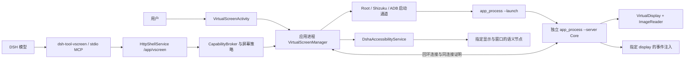
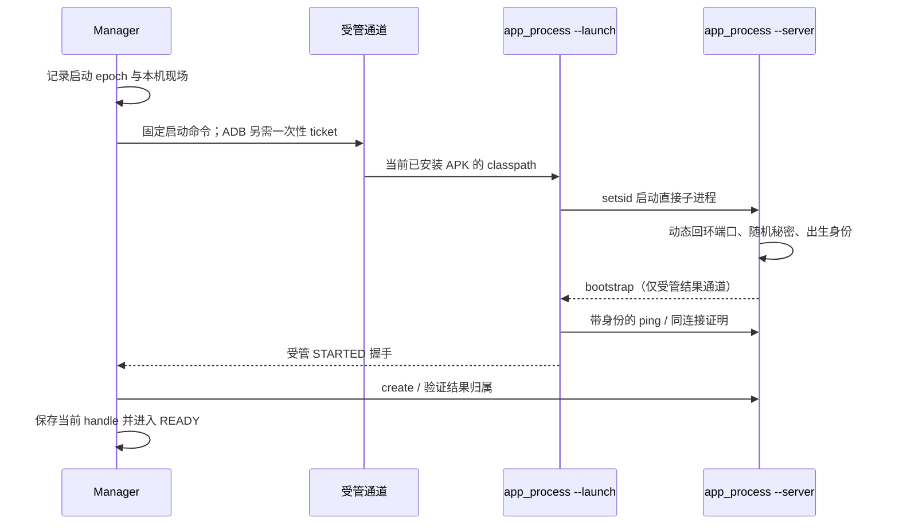
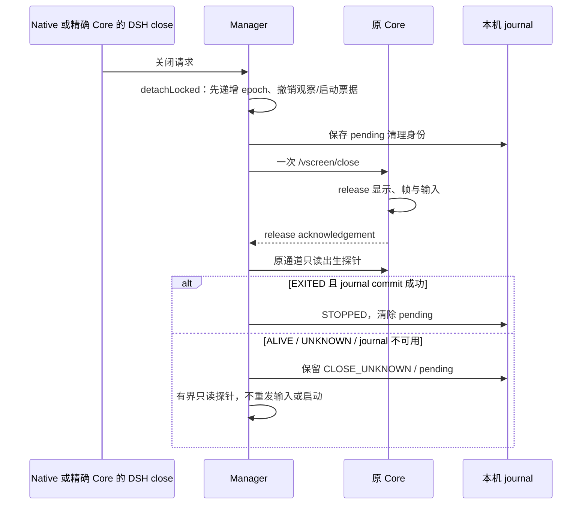

# 虚拟屏架构与维护指南

本文按 build190 / F10 当前源码说明实现，面向需要定位问题或修改虚拟屏的维护者。
它描述代码契约，不构成任何手机、ROM、应用或输入法的兼容性验收结论。
设计决定及代价见 [ADR 0003](adr/0003-virtual-screen-lifecycle-and-input.md)。
构建与项目入口见 [BUILD](../BUILD.md)、[AGENTS](../AGENTS.md) 和 [安全模型](security-model.md)。
面向使用者的入口与操作说明见 [虚拟屏使用指南](virtual-screen-guide.md)。

## 1. 先区分四个对象

| 对象 | 所有者与用途 | 不能替代的对象 |
|---|---|---|
| 物理屏 | Android 的 display 0；由物理 computer-use 路径操作 | 活跃虚拟屏 |
| 虚拟显示 | 特权 Core 创建的 `VirtualDisplay`，具有独立 displayId 和画布尺寸 | 原生预览控件 |
| 原生预览 | Activity、前台展示及悬浮预览消费的位图 | 可长期使用的输入许可 |
| DSH 观察 | 给模型的图片、节点或编辑器证据 | 当前系统状态或任意新 Core 的身份 |

虚拟屏是独立显示与受限控制协议，不是模拟器、完整桌面虚拟机或强沙箱。
运行其中的应用仍受 Android 的显示、窗口、权限、输入注入和 ROM 策略约束。
“能创建”“能看到图片”“能注入事件”“应用实际响应”是四件不同的事。
不得在物理屏工具失败时，把它自动路由到虚拟屏；反向转换也同样禁止。

## 2. 代码地图与进程边界

| 文件 | 阅读重点 |
|---|---|
| [VirtualScreenActivity][activity] | 原生创建、启动应用、预览、输入结果与显式节点面板 |
| [VirtualScreenManager][manager] | 应用级唯一编排器、身份快照、串行操作、退出收敛 |
| [VirtualScreenCore][core] | 特权进程启动、回环服务器、显示与输入路由 |
| [VirtualScreenLauncher][launcher] / [VirtualScreenChannels][channels] | 固定命令生成及可用通道选择 |
| [VirtualScreenTransport][transport] / [VirtualScreenPeerProof][peer] | 单次连接与请求证明，不透明重试 |
| [HttpShellService][http] | bridge 鉴权、当前 DSH 运行与屏幕授权检查 |
| [VirtualScreenAccessibility][accessibility] / [SemanticAdapter][semantic] | 节点树、编辑器及原生语义操作适配 |
| [dsh-tool-vscreen index][plugin-index] / [server][plugin-server] | DSH 工具发现、参数约束、图片结果与错误语义 |

`DshaApp.virtualScreenManager()` 以应用级 owner 持有 Manager。
Activity 重建或关闭预览订阅，不等于把 Core 交给某个 View 管理。
Core 不运行在 Ubuntu 的 DSH Node 进程中；Ubuntu 侧插件通过宿主 bridge 请求能力。
特权通道用于建立受管 Core 及出生探针，日常输入不重新拼任意 shell 启动命令。

## 3. 创建与受管握手

原生 `start()` 与 `/app/vscreen/create` 最终进入 Manager 的 `startOrdered()`。
先检查 flavor、API、已有生命周期和清理现场；有未决现场不能直接再建一个。
同一 Manager 负责当前 Core；调用者应先 `status`，复用已经存在的目标。
创建方向由 `VirtualScreenPolicy.phoneSize()` 规范化，不能拿原生屏幕尺寸猜虚拟尺寸。

`VirtualScreenLauncher.launchCommand()` 只指向当前安装包和固定 Core 类。
Core `main()` 检查包名、已安装 APK classpath、API 与动态端口要求。
`--launch` 父进程用 `setsid` 启动 `--server`，读 bootstrap 并确认可达后明确退出。
父进程结束不能被误认为常驻 Core 已结束；两者承担不同角色。
Core 生成秘密，不接受把秘密放进 `--token` 参数。
握手带端口、秘密和出生身份；不能只解析一个成功字样就接受启动。

[VirtualScreenChannels][channels] 通常按 Root、Shizuku、ADB 检查可用性。
API 37 且 ADB 已连接时，代码把 ADB 放到 Shizuku 前；Root 仍优先。
“可用”仍需对应本机授权，应用不会凭此自行获得 Root 或配对权限。
ADB 路径见 [AdbBridge][adb] 与 [AdbVirtualScreenStart][adb-start]。
Manager 签发与命令、epoch、期限绑定的一次性 ticket，经过 plan 授权和 commit。
ticket 经专用路径传递，不应写进日志、命令行或一般终端命令。
启动结果未知必须保留现场；换通道重新启动也可能重复创建，不能据超时推断未执行。

## 4. 身份不是一个 displayId

| 层次 | 当前代码使用的证据 | 防止的问题 |
|---|---|---|
| Core 出生 | `pid / started / uid / boot / instance` | PID、端口复用和旧 Core 冒充 |
| 连接 | handshake、动态端口、秘密、连接随机数和 HMAC | 连到错误回环服务或重用旧证明 |
| Manager | lifecycle epoch、active epoch、port、token、generation、revision | 关闭/重建后的迟到回调 |
| DSH 运行 | runtime identity、Web generation、bridge run、授权 epoch 与 revision | 旧会话运行请求跨启动生效 |
| 显示与窗口 | Core UUID、generation、displayId、windowId、package | 把可见目标换成另一个窗口 |
| 观察 | frameSeq、observationId 或一次性 node/editor/anchor ID、TTL | 旧画面和旧节点被用于新动作 |

出生身份定义在 [VirtualScreenCoreIdentity][identity]，Manager 快照使用 [RequestFence][fence]。
Core `instance` 对外表现为 `coreInstance`；`generation` 属于虚拟显示会话。
两者都不能与 DSH Web generation 混为一谈。
`status` 返回的当前 UUID 不能补贴到旧截图、旧树或旧 anchor 上。
Manager `decorate()` 不会把成功的旧观察重新标成当前 Core 的成功观察。

[VirtualScreenPeerProof][peer] 在同一 socket 上交换随机数，证明绑定应用、端口和完整出生身份。
请求证明还绑定 method、target 和正文摘要；原始秘密不作为 Core HTTP 头发送。
宿主 3090 bridge 的 `X-Token` 是另一层鉴权，不能替代 Core 的连接证明。

## 5. 采集、缩图与“用户实际看过”

Core 创建 `VirtualDisplay`，Surface 接到 RGBA `ImageReader`。
[VirtualScreenDisplaySession][display-session] 管理显示、reader、帧、输入和观察缓存的释放。
[VirtualScreenPixels][pixels] 的采集线程调用 `acquireLatestImage()`，处理行跨度和像素跨度。
只有像素确实变化才递增 `sequence`；相同像素会更新采集时刻而不伪造新帧号。
暂时无帧不会重建显示，也不会凭空制造一张可输入的帧。

这里有两条图片路径，修改时必须分别测试：

| 路径 | 图片与保留方式 | 输入含义 |
|---|---|---|
| Native preview | 宽度至多 720 的 JPEG，保留实际显示 width/height 元数据 | 展示成功后登记该帧；仍受最新帧门约束 |
| Agent `see` | [ObservedPixels][observed-pixels] 保留原始位图，返回全分辨率 JPEG | 可为显式 anchor 保留同次原观察，不续期旧证据 |

`ObservedPixels` 当前限制为 30 秒、最多两份、原始位图总预算 24 MiB。
预算统计不是 JPEG 文件长度；大分辨率原图可能直接被拒绝。
Native 缩图与 Agent 原图不能共享一个未经区分的坐标系。
`status` 只是读状态，**不签发看过图片的凭据**。

[VirtualScreenPreviews][previews] 让多个原生展示 owner 合并请求，各自持有解码位图和主线程回调。
订阅 `Lease` 只把当前 epoch 的帧送给 owner，并记录真正采用的 generation/sequence。
失败间隙会撤销输入身份；恢复时即使 sequence 相同也需重新交付，不能被去重吞掉。
[PreviewView][preview-view] 可在同代 `STALE_FRAME` / `FRAME_NOT_READY` 时保留上一张图以减小闪烁。
**保图不保输入权**：旧图可以继续可见，触摸必须禁用，直到有效帧重新采用。

## 6. 原始坐标与注入

`PreviewView.point()` 先逆变换缩放、平移和留白，再把位图坐标映射到显示 width/height。
落在图片外的点拒绝；不能直接把 Activity 截图坐标交给虚拟显示。
模型坐标以 `see` 元数据为准；若 `previewWidth/previewHeight` 与显示尺寸不同，必须换算。
当前 Agent 保留原图路径使这两组尺寸一致，协议仍明确描述差异情形。
横竖屏、缩放、Insets 和键盘出现后，都应重新核对展示几何。

原始 tap/swipe/type/key 要求：请求帧已观察、仍为最新帧、观察未超 30 秒。
判定集中在 [VirtualScreenPolicy.inputRejection()][policy]。
Core 消费观察后复位；不能把同一 `frameSeq` 当作可无限连点的许可。
流式 touch 在 DOWN 检查帧，后续阶段还受 stroke 身份与次序限制。
不能为了避免按压涟漪改变帧而删除 DOWN 前的最新帧校验。

[PreviewInputGate][preview-gate] 协调本机 preview fetch 与手势准入。
它只减少“取到下一帧但尚未画出”的本地竞争，不冻结 Android 页面或放宽远端帧门。
动态光标、动画、视频仍可能使坐标动作在派发前过期；这是实际可用性限制。
拒绝后应让用户核对画面，或由用户显式打开节点操作，不能自动刷新并重发。

[VirtualScreenInput][input] 有两类实际后端：

- 反射后端查找 `InputManager` / `InputManagerGlobal`，对事件明确调用 `setDisplayId`。
- 命令后端明确使用 `input -d <displayId>`；不能省略 display 参数去赌系统焦点。
- 反射逐阶段注入；命令后端在 UP 时汇总为命令，MOVE 不代表系统已收到每个中间事件。
- 输入结果区分接受、拒绝和未知；命令超时不等于业务未执行。
- Unicode 由无障碍输入路径处理；不能承诺 shell `input text` 支持所有文字与编辑行为。

## 7. 三种显式语义操作

### 7.1 DSH tree / node / editor

`android_vscreen_tree` 经 Manager、SemanticAdapter 到无障碍窗口树。
`VirtualScreenAccessibility` 保存有界节点与实际目标，签发一次性 nodeId。
node 操作重新核对显示、窗口、包、树期限，并刷新目标节点；取出即从 map 移除。
语义节点不要求像素 `frameSeq` 相等，因此不会因纯光标闪动而必然失效。
这并不豁免目标身份、当前授权、可用服务和节点能力校验。
editor 路径另有编辑器身份及 get/edit/submit 参数，不能拿 nodeId 冒充 editorId。
Canvas、隐藏内容、不完整 WebView 语义树可能没有可用节点；不能据此猜中心点自动点击。

### 7.2 DSH see / anchor / anchored_click

[ObservedControl][observed-control] 把原观察与授权、运行、Core、Manager、窗口和包绑定。
[AnchorProof][anchor-proof] 核对语义树、几何、遮挡和候选唯一性，并比较原区域像素证据。
`anchor` 只选定，不点击，不续期；`anchored_click` 是另一次明确的动作。
调用必须保留原 coreInstance/generation/frameSeq/observationId 和返回 anchorId。
不能取新的 status 帧号“修复”旧 anchor，也不能先试 raw tap 再静默换 anchor。
anchor 选择回复丢失会标 selectionUnknown/noReplay；重新选择也可能重复消费，不能自动做。
点击只消费一次，返回的 `validatedCurrentSeq` 不把原 `sourceFrameSeq` 改写成新观察。

### 7.3 Native“节点操作”

Activity `showNodes()` 在用户明确打开面板时调用 `Manager.openNativeControls(Activity)`。
[VirtualScreenNativeControls][native-controls] 只接受处于 RESUMED 的真实 Activity owner。
它使用独立 [NativeScreenControlLease][native-lease]，不把缺少模型 broker 当成授权。
`ON_PAUSE / ON_STOP / ON_DESTROY`、取消面板、关闭页面都会永久撤销该 owner。
重回页面需要用户重新打开面板；旧回调不得复活旧节点列表。

面板显示后端核验的 packageName 与 displayId，不能从启动包名草稿推断实际目标。
列表只提供 enabled 的可点击或可编辑节点；Native 最小动作是 click 与 set_text。
set_text 还要求 editable、非 password、声明 ACTION_SET_TEXT，长度最多 16000 字符。
树文本展示超过 1000 字符会标 `textTruncated`；此时编辑框不预填截断内容。
用户须显式输入完整替换文本并提交，防止“原样提交”悄悄丢失字段尾部。
操作后清掉旧列表，继续操作需用户手动刷新；不自动刷新后再次执行。
UNKNOWN 会撤销 owner 并要求查看实际画面；文案不能诱导直接重试同一动作。

## 8. DSH 发现、路由与结果协议

插件 [index.js][plugin-index] 通过官方 MCP client 注册 stdio server，等待子插件完成初始化。
配置禁止自动 reconnect，工具调用期限为 60 秒；初始化失败不能假装工具已就绪。
[server.cjs][plugin-server] 的 `initialize.instructions` 和工具描述共同告诉模型使用专属虚拟屏工具。
所有现有 Core 操作需显式传原 `coreInstance`；create/status 是发现入口。
close 在存在 live/pending Core 时也必须带精确身份，不能关“当前碰巧存在”的另一 Core。

`requestFor()` 把 node/type/edit/submit/anchor 等构造为受限 JSON POST，其余使用固定 route。
[VscreenBridgeRequest][bridge-request] 在宿主重新解析字段、方法、大小和参数组合，不能只信 JS schema。
`HttpShellService.handleVscreen()` 再进入屏幕授权和当前运行检查，最终调用 Manager `bridge()` / `dispatch()`。
插件把 `see` 的 JPEG 作为真实 image content，文本中保留对应元数据。
失败返回 `isError:true`；不要把含 error 的 JSON 包成普通成功工具结果。
具体未发送与未知信息必须跨 JS、HTTP、Manager、Core 四层保留。

物理工具 [dsh-computer-use-android][physical-plugin] 使用另一条物理屏协议。
维护提示词时应保持两类工具的边界，不能用“active virtual”自动改物理请求含义。
Agent preset、会话权限与宿主全局能力是不同配置层；一个设置不能证明其他层已授权。

## 9. 授权、系统能力与竞争

[CapabilityBroker][broker] 提供当前 runtime/installation、期限、授权 epoch 和一次性 dispatch claim。
它只有一个原生确认槽，不在 broker 锁内执行平台操作、回调或 I/O。
[ScreenConfirmationPolicy][screen-policy] 支持全部手动、按应用规则、全部允许。
全部允许只减少 DSHA 的确认步骤，不能增加 Android 权限、产生节点或豁免目标检查。
本机规则持久化与本轮 [ScreenSessionGrant][screen-grant] 分开，授权不能从备份导入生效。

`HttpShellService.screenPolicyChanged()` 撤销请求及观察；全局同意变化会撤销各能力域。
停止、无障碍断开、手动撤销、暂停等路径使旧请求失效，部分路径同时撤销并关闭 Core。
请求排队后仍需再次检查 Web generation、运行状态、revision、实际窗口和包。
已 claim 后发生撤销，并不能证明系统调用没有发生，必须保留执行后变化或未知标记。

创建显示还取决于特权 UID、ROM 与隐藏 API。
`requestTrustedDisplay()` 只在实际 UID 为 Root 或确有 ADD_TRUSTED_DISPLAY 时请求 TRUSTED。
探测 UNKNOWN 按不持有处理；不能按宿主包名误判 shell 进程持有签名权限。
未受信任显示的焦点、IME、系统装饰和应用支持可能不同，不能用应用确认开关补齐。

## 10. 并发、超时与 UNKNOWN

Manager 以 `ACTIONS` 串行编排动作，以 `LOCK` 保护身份和状态快照。
状态锁与生命周期 epoch 共同阻止迟到回调更新新现场；不能只把 UI 按钮设为 disabled。
Core 的 `route()` 本身同步；捕获的 listener/socket 身份与 owner 检查在同一 monitor 下核对。
socket 握手、HTTP 头正文读写在路由锁外，避免慢客户端占住状态锁。
旧 listener 关闭后迟到的 IOException 只能退休自身，不能 shutdown 后来发布的新 binding。
Host fixture 允许同 JVM 重绑，因此尤其需要测试这种实例隔离；它不是手机复现声明。

[Transport][transport] 每次使用一个 socket、一次写入，不用可能隐式重试 GET 的连接池。
Core 请求有有界头、正文和读取期限；响应最大 4 MiB，不能无限读取半包。
插件另有响应预算与取消信号；较外层取消不代表较内层动作已取消。
`executionUnknown`、`INPUT_RESULT_UNKNOWN`、执行后 target/run changed 均禁止自动重放。
允许重新观察实际状态；不得把它实现成“失败后再点一次”的业务重试。

## 11. 关闭、退出证明与覆盖后恢复

Manager `closeExpected()` 核对 Core UUID，`detachLocked()` 先令旧请求失效。
`closeDetached()` 把 display release 回复和 `coreExitProof` 分开记录。
[ExitProofPolicy][exit-policy] 根据 boot、出生 stat、UID 和明确 ESRCH 分类 EXITED/ALIVE/UNKNOWN。
端口关闭、连接失败、权限拒读、超时、裸 PID 消失的猜测都不能替代完整出生证明。
已确认 EXITED 还需 `persistCleanupExited()` 成功提交 journal，才允许清除 pending。
正常完成应同时核对 `displayReleaseAcknowledged`、`coreExitProof`、`lifecycleState` 和 `cleanupPending`。
后台清理探针是只读收敛，不重发 close 或输入；不能改成无限启动/关闭循环。

[SessionJournal][journal] 保存应用私有 `vscreen-session-v1.json`，含本机秘密和清理 handle。
它绑定 installation/application，使用 NOFOLLOW、大小限制、私有权限和原子替换。
日志不得进入用户备份、公开诊断包或 Git；记录字段也不能复制为通用屏幕授权。
`restoreJournal()` 不恢复旧 UI 输入许可；同 boot 未清现场进入 DISCONNECTED 或 START_UNKNOWN。
新 boot 可改变退出证明条件，不能要求用户重启来掩盖同 boot 未知状态。
覆盖升级前应正常停止；外部覆盖可能终止宿主，不能承诺凭端口重连就完整恢复。
虚拟 Core 退出与 DSH guest/launcher 退出是两个证明域；正常 Stop 需分别遵守各自屏障。
后者由 [WebStopCoordinator](../app/src/main/java/com/deepseekharness/app/core/WebStopCoordinator.java) 等运行编排核验，不能用 Core ACK 替代。

## 12. 状态与诊断顺序

| 状态/错误 | 首先核对 | 不应采取的捷径 |
|---|---|---|
| START_UNKNOWN / DISCONNECTED | status 的 pending、清理身份是否存在、原通道可否只读探针 | 再 create 或换通道重放启动 |
| CLOSE_UNKNOWN | release ACK、出生 proof、journal commit 和 cleanup reason | 仅因画面消失就宣布 STOPPED |
| FRAME_NOT_READY / STALE_FRAME | generation、最新帧、是否刚从无帧恢复、采用回调 | 保图同时继续开放触摸 |
| FRAME_NOT_OBSERVED / FRAME_EXPIRED | requested/current/observed frame 字段及 TTL | 用 status 的新帧号替换旧图帧号 |
| STALE_TREE / STALE_NODE | 实际窗口/包、服务状态和树期限 | 自动刷新并补发旧业务动作 |
| NATIVE_CONTROL_REVOKED | 页面是否已暂停、面板是否已取消、Core 是否变更 | 重新激活旧 owner |
| INPUT_RESULT_UNKNOWN | 实际应用画面和状态，保留原动作回执 | 换坐标/节点/通道重复同一动作 |
| inputUnavailable / 无节点 | 后端缺失成员、系统权限、目标应用语义能力 | 宣称所有按钮都应可控 |

先收集脱敏技术字段：错误码、阶段、方向/尺寸、状态、帧关系、后端类型和证明分类。
不要公开真实 token、handshake、清理 handle、用户输入、树正文或截图中的个人数据。
Native `lastStartOutcome()` / `safeStartOutcome()` 提供去除秘密和图像的启动技术摘要。
读日志前先确定它对应的源码、APK、flavor 与运行阶段；不要把另一包的 PASS 移植过来。

## 13. 修改指南与回归定位

| 修改范围 | 必须一起检查的实现 | 首选回归类或脚本 |
|---|---|---|
| 生命周期、关闭和 journal | Manager、Core、CoreIdentity、ExitProofPolicy | VirtualScreenLifecycleTest、CloseReconcileTest、PersistentCleanupTest、SessionJournalTest |
| Core listener / 协议 | Core、Transport、PeerProof、Handshake | VirtualScreenCoreControlTest、TransportTest、BridgeIdentityTest、VirtualScreenHandshakeTest |
| 启动通道与 ADB 票据 | Channels、Launcher、AdbBridge、AdbVirtualScreenStart | VirtualScreenChannelsTest、StartOutcomeTest、AdbVirtualScreenStartTest；test-adb-vscreen-bridge.py |
| 采集、预览与手势 | Pixels、Previews、PreviewView、PreviewInputGate | PixelsTest、PreviewContinuityTest、PreviewAdoptionTest、PreviewInputGateTest、NativeInputFrameBoundaryTest |
| 节点与原生面板 | Accessibility、NativeControls、Activity、NativeScreenControlLease | VirtualScreenNativeControlsTest、ActivityNodeControlsTest、ActivityLayoutTest |
| 原图锚点 | ObservedPixels、ObservedControl、AnchorProof | VirtualScreenObservedPixelsTest、VirtualScreenAnchoredChainTest；test-vscreen-anchored.mjs |
| DSH 工具/bridge | server.cjs、VscreenBridgeRequest、HttpShellService | VscreenBridgeRequestTest、VscreenAnchoredGrammarTest；test-vscreen-bundle.mjs、test-vscreen-manager-http.py |

表中省略共同前缀的测试类，位于 [vscreen 测试目录][tests] 或 [util 测试目录][util-tests]。
`AdbVirtualScreenStartTest` 在 bridge 测试目录；脚本在 [tools](../tools)。
不要只测试复制出来的 helper；布局/节点面板应覆盖真实 Activity，链测试应经过真实编排与传输边界。
资源型 fixture 构造中途失败也必须释放它自己的 Core，防止后续 CORE_ALREADY_BOUND 串案。
修改输入前先明确是 raw、semantic 还是 anchored 模式，不能通过移除身份检查修复可用性。
修改 UI 必须覆盖长错误、横竖屏、键盘安全区、面板取消、后台撤销和长字段不截断提交。
修改提示词应检查真实 assembled tool instructions，保留图片 content 与 isError，不只搜某个字符串。
修改资产后由统一构建负责人重算 descriptor、插件元数据和实际 APK 成员验证；不要并行改总资产。

## 14. 支持范围和验收边界

`VirtualScreenManager.supported()` 要求非 LOW_ANDROID 且 API 至少 30。
Standard 的 minSdk 为 30，但满足版本并不证明某个 ROM 的隐藏 API、显示和注入可用。
Low 即使运行在新系统上也不开放这条虚拟屏生产路径；其测试跳过不能计作能力通过。
物理屏单独使用无障碍协议，不因虚拟屏不可用而自动切换。
显示可能创建成功但没有目标窗口；应用可能拒绝在外部显示启动或渲染。
安全窗口、密码内容、系统输入法、Canvas、动画与无障碍树缺失均可能限制功能。
事件或 ACTION_SET_TEXT 被 Android 接受，不等于目标应用业务结果已验证；动作后需重新观察。
软件单测可证明给定 fixture 的契约，不能证明手机帧率、触控普遍可用或全设备兼容。
真机结论必须绑定实际 APK，并记录具体操作、实际回执、画面变化和未执行范围。
当前暂停设备验收的交付不能附加“本轮手机已验证”的推断，也不应为补证擅自操作设备。

[activity]: ../app/src/main/java/com/deepseekharness/app/vscreen/VirtualScreenActivity.java
[manager]: ../app/src/main/java/com/deepseekharness/app/vscreen/VirtualScreenManager.java
[core]: ../app/src/main/java/com/deepseekharness/app/vscreen/VirtualScreenCore.java
[launcher]: ../app/src/main/java/com/deepseekharness/app/vscreen/VirtualScreenLauncher.java
[channels]: ../app/src/main/java/com/deepseekharness/app/vscreen/VirtualScreenChannels.java
[transport]: ../app/src/main/java/com/deepseekharness/app/vscreen/VirtualScreenTransport.java
[peer]: ../app/src/main/java/com/deepseekharness/app/vscreen/VirtualScreenPeerProof.java
[http]: ../app/src/main/java/com/deepseekharness/app/HttpShellService.java
[accessibility]: ../app/src/main/java/com/deepseekharness/app/vscreen/VirtualScreenAccessibility.java
[semantic]: ../app/src/main/java/com/deepseekharness/app/vscreen/VirtualScreenSemanticAdapter.java
[plugin-index]: ../app/src/main/assets/builtin-plugins/dsh-tool-vscreen/lib/index.js
[plugin-server]: ../app/src/main/assets/builtin-plugins/dsh-tool-vscreen/lib/server.cjs
[physical-plugin]: ../app/src/main/assets/builtin-plugins/dsh-computer-use-android/lib/server.cjs
[adb]: ../app/src/main/java/com/deepseekharness/app/bridge/AdbBridge.java
[adb-start]: ../app/src/main/java/com/deepseekharness/app/bridge/AdbVirtualScreenStart.java
[identity]: ../app/src/main/java/com/deepseekharness/app/util/VirtualScreenCoreIdentity.java
[fence]: ../app/src/main/java/com/deepseekharness/app/util/VirtualScreenRequestFence.java
[display-session]: ../app/src/main/java/com/deepseekharness/app/vscreen/VirtualScreenDisplaySession.java
[pixels]: ../app/src/main/java/com/deepseekharness/app/vscreen/VirtualScreenPixels.java
[observed-pixels]: ../app/src/main/java/com/deepseekharness/app/vscreen/VirtualScreenObservedPixels.java
[previews]: ../app/src/main/java/com/deepseekharness/app/vscreen/VirtualScreenPreviews.java
[preview-view]: ../app/src/main/java/com/deepseekharness/app/vscreen/VirtualScreenPreviewView.java
[preview-gate]: ../app/src/main/java/com/deepseekharness/app/vscreen/VirtualScreenPreviewInputGate.java
[policy]: ../app/src/main/java/com/deepseekharness/app/util/VirtualScreenPolicy.java
[input]: ../app/src/main/java/com/deepseekharness/app/vscreen/VirtualScreenInput.java
[observed-control]: ../app/src/main/java/com/deepseekharness/app/vscreen/VirtualScreenObservedControl.java
[anchor-proof]: ../app/src/main/java/com/deepseekharness/app/vscreen/VirtualScreenAnchorProof.java
[native-controls]: ../app/src/main/java/com/deepseekharness/app/vscreen/VirtualScreenNativeControls.java
[native-lease]: ../app/src/main/java/com/deepseekharness/app/screen/NativeScreenControlLease.java
[bridge-request]: ../app/src/main/java/com/deepseekharness/app/util/VscreenBridgeRequest.java
[broker]: ../app/src/main/java/com/deepseekharness/app/capabilities/CapabilityBroker.java
[screen-policy]: ../app/src/main/java/com/deepseekharness/app/util/ScreenConfirmationPolicy.java
[screen-grant]: ../app/src/main/java/com/deepseekharness/app/util/ScreenSessionGrant.java
[exit-policy]: ../app/src/main/java/com/deepseekharness/app/util/VirtualScreenExitProofPolicy.java
[journal]: ../app/src/main/java/com/deepseekharness/app/vscreen/VirtualScreenSessionJournal.java
[tests]: ../app/src/test/java/com/deepseekharness/app/vscreen
[util-tests]: ../app/src/test/java/com/deepseekharness/app/util
